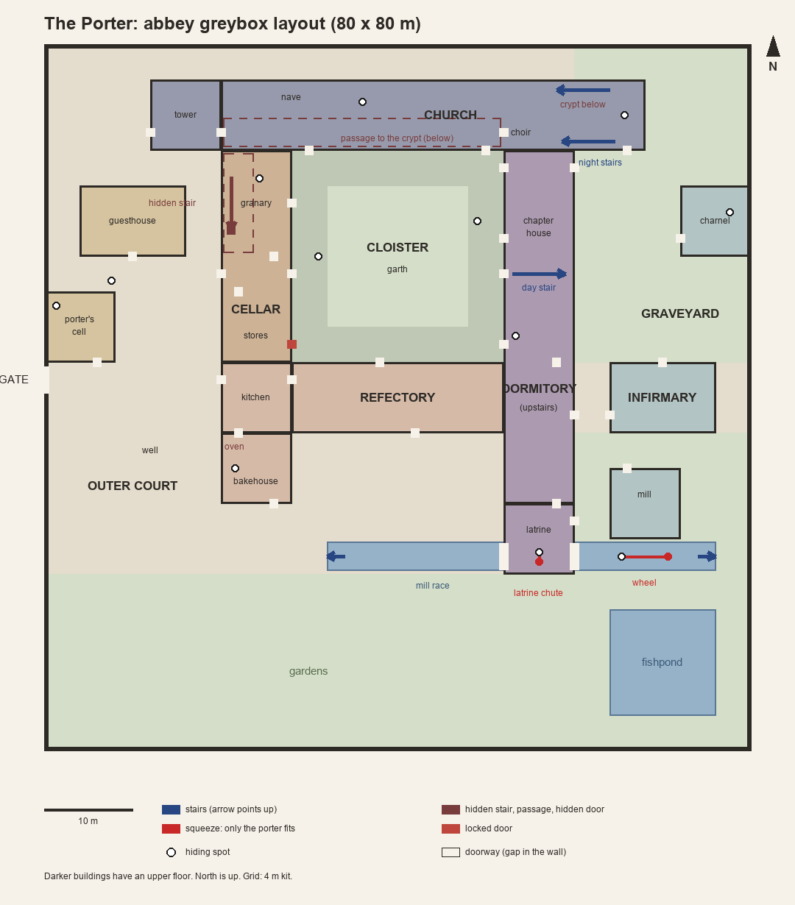

# Abbey layout (greybox)

The abbey is one walled square, 80 × 80 m, on a 4 m kit grid. Every building opens off the cloister, and every area is within a minute's walk of the garth (the farthest, the west end of the mill race, is 59 s at 1.4 m/s). This drawing stands in for the design doc's missing map.

## Areas

| Area | Where | What's in it | Hiding spots |
| --- | --- | --- | --- |
| Outer court | West strip | Gate (west wall: an iron grille under a stone porch, barred at sunset), porter's cell beside it, guesthouse, well, woodpile | Under the cot, behind the woodpile |
| Church | North | Bell tower (west end, 12 m), nave, choir, altar (east end); crypt under the choir | Under the altar cloth, the open tomb |
| Cloister | Centre | Garth (24 m square with walks) inside arcades; one open bay a side | Behind the piers |
| Dormitory (east range) | East of the cloister | Slype, chapter house, day stair, warming room, undercroft; dormitory upstairs; latrine block at the south end | Under three of the beds (north end, middle, south end) |
| South range | South of the cloister | Refectory, kitchen, bakehouse with the oven | The oven (bones inside) |
| Cellar (west range) | West of the cloister | Granary (hidden stair), outer parlour passage, stores (cloister door locked) | Grain sacks |
| Graveyard and infirmary | East and south-east | Graves, charnel house, infirmary, mill, mill race, fishpond | In the bone pile, under a sick bed in the infirmary |

## The lane outside the gate

`areas/street.tscn`, outside the west wall and outside the navmesh. A 6 m lane runs the length of the wall with a gutter down the middle. On its far side is a row of timber houses: gable ends to the lane, upper floors jutting 0.5 m per storey, lit and dark windows, a lantern outside each (`StreetLanterns`). The inn stands opposite the gate. Two alleys end out of sight. At each end the lane turns west into fog. The gate porch holds a lantern over the grille. Beyond are rooftops, spires and the city wall (`Skyline`: meshes only, no collision or shadows). Debug key G steps out into the lane and back. `tools/street_shots.sh` renders it.

## Routes

| Route | From → to | Notes |
| --- | --- | --- |
| Night stairs | Dormitory (upper floor, north end) → choir | 22.5 m from the choir to the dormitory's north end |
| Day stair | Cloister east walk → dormitory | |
| Crypt stair | Choir (north side) → crypt | |
| Hidden stair | Plank closet in the granary → passage under the nave → crypt | The closet door looks like the planks. Hunters use it: 31 m from the granary to the passage |
| Latrine chute | Latrine seat (upper floor) → mill race | Porter only, one way. A hunter goes round: 116 m |
| Under the mill wheel | Mill race west ↔ east of the wheel | Porter only (0.6 m gap). A hunter goes round: 82 m |
| Mill race | Steps at both ends | 1.2 m deep, can't be climbed out of except at the steps |

The porter's keys (design doc, "Tools") lock the guesthouse door and the charnel house door (R, from either side, when shut). A locked door keeps a hunter out. The gate is barred and has no key in the greybox.

Other markers: `WakePoint` in the infirmary (where the first capture wakes you), `BellSpawns/start` by the gate (where a restart from the start bell puts you), and `StalkPoints` in every area (where the demon may stand).

## Dimensions used

Walls 4 × 4 × 0.8 m; doorways 0.9 × 2.0 m; the gate 3.0 × 3.4 m; the church and the east range two pieces high (8 m); the tower three (12 m); upper floors at 4 m; the crypt and passage 4 m below ground. Stairs climb 4 m over 6 m.

## Editing

- Each area is a scene in `game/world/abbey/areas/`, built from the kit pieces in `game/world/kit/` (`wall`, `wall_door`, `wall_window`, `wall_arch`, `wall_arch_open`, `wall_gate`, `corner`) and `Block`s you resize in the inspector. `abbey.tscn` puts them together.
- Doors are `game/world/door/door.tscn`. Turn one 180° to swing it the other way. Set `locked`, give it a `key` the porter holds, or give it the wall's material to hide it.
- A hiding spot is an Area3D with `game/hiding/hiding_spot.gd` and Marker3D children `View` (the camera while hidden), `Exit` and `Check` (where a hunter stands). Set its box `size`, `noise` and `check_chance` in the inspector. See `docs/hunting.md`.
- Stalk points are plain Marker3Ds in the `stalk_point` group.
- After moving walls, floors, stairs or props, rebake the navmesh with `tools/bake_nav.sh` (or the Navigation node's Bake button), then run `tools/check.sh`. The walk test sends the porter through every area, so it catches a doorway or stair that no longer works.
- `tools/topdown.sh` renders the plan view with the navmesh, and `tools/abbey_shots.sh` renders in-game views.
