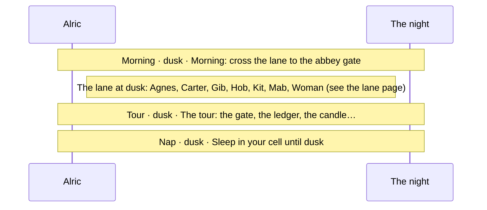

# The first day: The Tour

Generated by `tools/script_docs.py` from the game's files. Don't edit it by hand. How to read it: [README](README.md). Every flag: [links](links.md).

## The night

The chapter's beats in order (`day1.tscn`), the talks each opens, who he can go to from then on, and the flags passed between them (dashed). The note at the end lists what this chapter's talks pass on to later ones.

## Conversations
