# The evening before: The Cross Keys

Generated by `tools/script_docs.py` from the game's files. Don't edit it by hand. How to read it: [README](README.md). Every flag: [links](links.md).

## The night

The chapter's beats in order (`night0.tscn`), the talks each opens, who he can go to from then on, and the flags passed between them (dashed). The note at the end lists what this chapter's talks pass on to later ones.

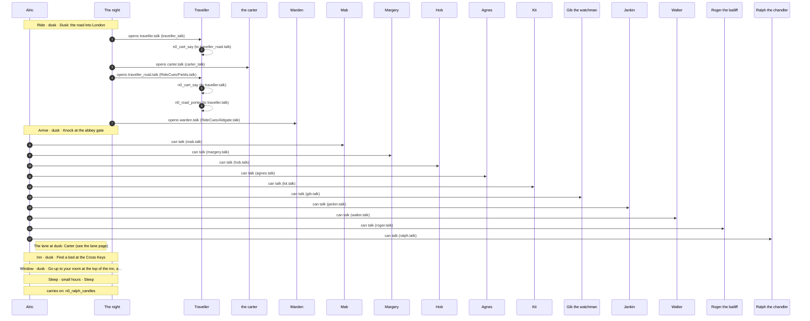

## Conversations

- [Agnes](#agnes) (`agnes.talk`)
- [the carter](#carter) (`carter.talk`)
- [Gib the watchman](#gib) (`gib.talk`)
- [Hob](#hob) (`hob.talk`)
- [Jankin](#jankin) (`jankin.talk`)
- [Kit](#kit) (`kit.talk`)
- [Mab](#mab) (`mab.talk`)
- [Margery](#margery) (`margery.talk`)
- [Ralph the chandler](#ralph) (`ralph.talk`)
- [Roger the bailiff](#roger) (`roger.talk`)
- [Traveller](#traveller) (`traveller.talk`)
- [Traveller](#traveller_road) (`traveller_road.talk`)
- [Walter](#walter) (`walter.talk`)
- [Warden](#warden) (`warden.talk`)

## Agnes

[`agnes.talk`](../../game/chapters/night0/dialogue/agnes.talk) · id `n0_agnes`

Moods through the talk: warm → amused → calm → amused → grave → cold → grave → warm → wary → warm

> Agnes, Hob's wife, by the fire in the Cross Keys, night 0. Motherly, and sharp.
> The bed answer gives him the room at the top (n0_room). An ale ends the talk; the next talk starts at again.

**Read elsewhere:** [`n0_room`](links.md#n0_room), [`talked_n0_agnes`](links.md#talked_n0_agnes)

### Every path

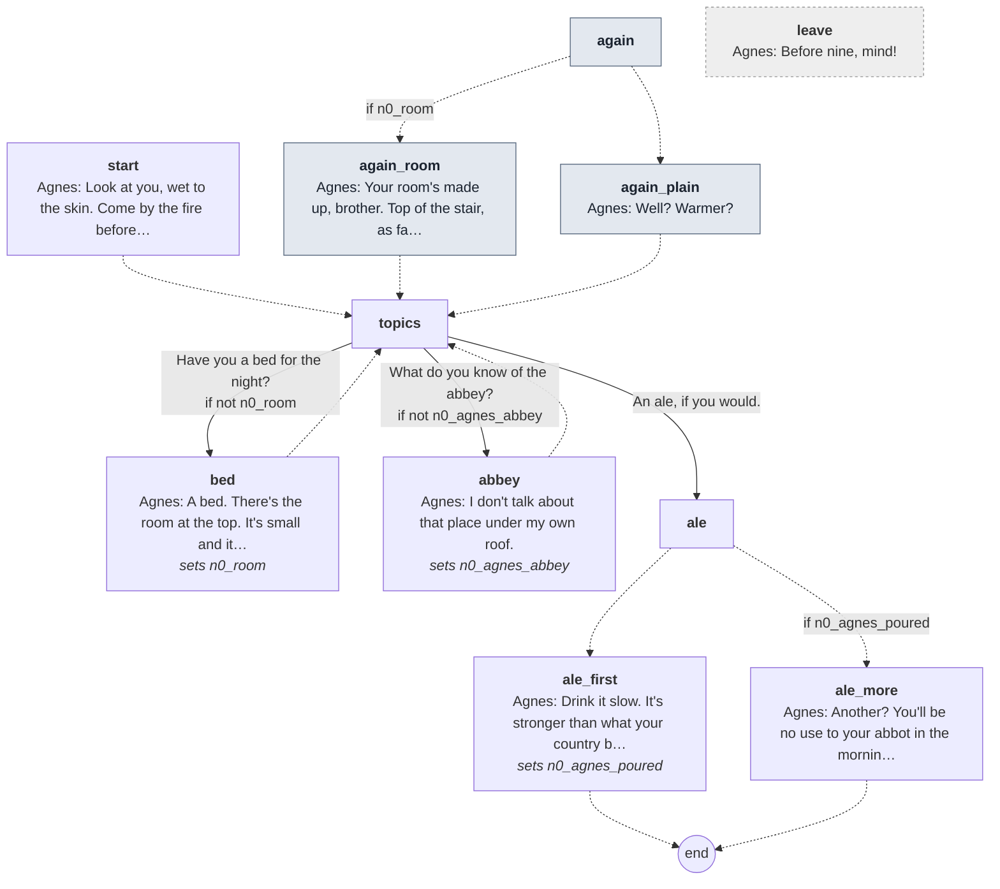

Every line

#### `start`

- *A woman by the fire with her sleeves rolled, stirring a pot. She looks you up and down.*
- **Agnes** *warm*: Look at you, wet to the skin. Come by the fire before you catch your death.

- → `topics`

#### `again` (the next time)

- → `again_room` if `n0_room`
- → `again_plain`

#### `again_room`

- **Agnes** *warm*: Your room's made up, brother. Top of the stair, as far as it goes.

- → `topics`

#### `again_plain`

- **Agnes** *amused*: Well? Warmer?

- → `topics`

#### `topics`

1. Have you a bed for the night? → `bed` · only if not `n0_room`
2. What do you know of the abbey? → `abbey` · only if not `n0_agnes_abbey`
3. An ale, if you would. → `ale` · he drinks an ale

#### `bed`
*sets `n0_room`*

- **Agnes** *calm*: A bed. There's the room at the top. It's small and it's cold, and its one window looks toward the abbey.
- **Agnes** *amused*: Nobody else will have it. You can have it for a prayer and a ha'penny.
- **Agnes** *grave*: Be in before the curfew bell at nine. After it the Keys is shut, and the street's no place to be.

- → `topics`

#### `abbey`
*sets `n0_agnes_abbey`*

- **Agnes** *cold*: I don't talk about that place under my own roof.
- *She glances at the shutters all the same, and lowers her voice.*
- **Agnes** *grave*: We've had lodgers go over there to see the relic. Paid me for two nights and slept one.
- **Agnes** *grave, swallow*: I don't ask. I strip the bed and let it again.

- → `topics`

#### `ale`

- → `ale_more` if `n0_agnes_poured`
- → `ale_first`

#### `ale_first`
*sets `n0_agnes_poured`*

- *She fills a cup from the jug and puts it into your hands.*
- **Agnes** *warm*: Drink it slow. It's stronger than what your country brothers brew.

- → `end`

#### `ale_more`

- **Agnes** *wary*: Another? You'll be no use to your abbot in the morning.
- *She fills it to the brim anyway.*

- → `end`

#### `leave` (if he walks away)

- **Agnes** *warm*: Before nine, mind!

## the carter

[`carter.talk`](../../game/chapters/night0/dialogue/carter.talk) · id `n0_carter`

Moods through the talk: weary → afraid → wary → calm → grave → angry → calm

> The carter sets the porter down in the lane by the abbey gate at dusk, night 0.

**Read elsewhere:** [`talked_n0_carter`](links.md#talked_n0_carter)

### Every path

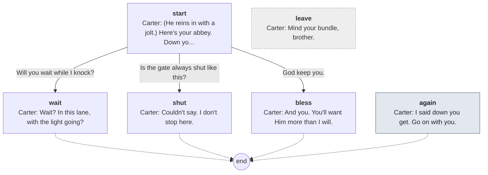

Every line

#### `start`

- **Carter** *weary*: (He reins in with a jolt.) Here's your abbey. Down you get, brother. I've a horse to stable before dark.

1. Will you wait while I knock? → `wait`
2. Is the gate always shut like this? → `shut`
3. God keep you. → `bless`

#### `wait`

- **Carter** *afraid, blink*: Wait? In this lane, with the light going?
- *He spits over the wheel.*
- **Carter** *wary*: No, brother. Knock all you like. I'll not be here to see it.

- → `end`

#### `shut`

- **Carter** *wary*: Couldn't say. I don't stop here.
- *He jerks his head across the lane, at a lit doorway under a painted sign.*
- **Carter** *calm*: There's the Keys, if they won't have you.

- → `end`

#### `bless`

- **Carter** *grave*: And you. You'll want Him more than I will.

- → `end`

#### `again` (the next time)

- **Carter** *angry*: I said down you get. Go on with you.
- *He clicks his tongue at the horse.*

- → `end`

#### `leave` (if he walks away)

- **Carter** *calm*: Mind your bundle, brother.

## Gib the watchman

[`gib.talk`](../../game/chapters/night0/dialogue/gib.talk) · id `n0_gib`

Moods through the talk: weary → grave → wary → weary → wary → calm → grave → calm → amused → grave → wary → grave → weary

> Gib, the old night watchman, night 0: lighting the lanterns along the lane (the mayor's order) before the bell,
> and walking the lane calling the hour after it (n0_curfew). He tells the porter to be indoors before the bell.

**Reads from elsewhere:** [`n0_curfew`](links.md#n0_curfew)
**Read elsewhere:** [`talked_n0_gib`](links.md#talked_n0_gib)

### Every path

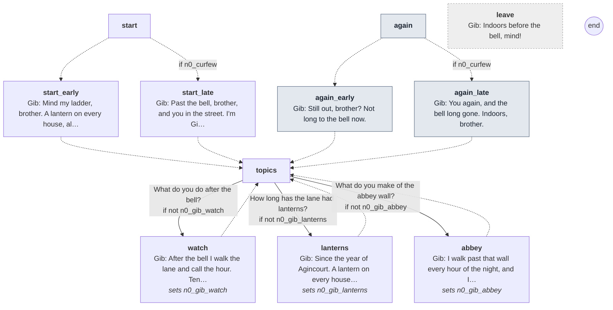

Every line

#### `start`

- → `start_late` if `n0_curfew`
- → `start_early`

#### `start_early`

- *An old man on a short ladder under the eaves, coaxing a lantern alight with a taper.*
- **Gib** *weary*: Mind my ladder, brother. A lantern on every house, all winter long. Mayor's order.
- **Gib** *grave*: And you be indoors before the bell. Nine o'clock, and not a breath after.

- → `topics`

#### `start_late`

- *An old man with a lantern on a pole, walking the middle of the empty lane.*
- **Gib** *wary*: Past the bell, brother, and you in the street. I'm Gib, the watch. Get you indoors.

- → `topics`

#### `again` (the next time)

- → `again_late` if `n0_curfew`
- → `again_early`

#### `again_early`

- **Gib** *weary*: Still out, brother? Not long to the bell now.

- → `topics`

#### `again_late`

- **Gib** *wary*: You again, and the bell long gone. Indoors, brother.

- → `topics`

#### `topics`

1. What do you do after the bell? → `watch` · only if not `n0_gib_watch`
2. How long has the lane had lanterns? → `lanterns` · only if not `n0_gib_lanterns`
3. What do you make of the abbey wall? → `abbey` · only if not `n0_gib_abbey`

#### `watch`
*sets `n0_gib_watch`*

- **Gib** *calm*: After the bell I walk the lane and call the hour. Ten o'clock and all's well, and on till the light.
- **Gib** *grave*: If you hear me call, all's well. If you don't, it isn't.

- → `topics`

#### `lanterns`
*sets `n0_gib_lanterns`*

- **Gib** *calm*: Since the year of Agincourt. A lantern on every house from Hallowtide to Candlemas.
- **Gib** *amused*: The houses find the candles, and I light them. Saves a few throats, the mayor says.

- → `topics`

#### `abbey`
*sets `n0_gib_abbey`*

- **Gib** *grave*: I walk past that wall every hour of the night, and I don't look at it.
- **Gib** *wary, swallow*: Thirty years. You hear things over a wall like that. You see lights where there shouldn't be lights.
- **Gib** *grave*: I call the hour and I keep walking. You'd do well to learn the same.

- → `topics`

#### `leave` (if he walks away)

- **Gib** *weary*: Indoors before the bell, mind!

## Hob

[`hob.talk`](../../game/chapters/night0/dialogue/hob.talk) · id `n0_hob`

Moods through the talk: wary → amused → calm → grave → calm → grave → amused → grave → calm → warm → amused → wary → calm

> Hob, who keeps the Cross Keys, behind his board, night 0. He hears everything said over the ale.
> An ale ends the talk; the next talk starts at again, so he can have another.
> Plants the night-2 rule (n0_hob_jankin): he puts Jankin out at closing every night, rain or no.

**Reads from elsewhere:** [`drank`](links.md#drank)
**Read elsewhere:** [`talked_n0_hob`](links.md#talked_n0_hob)

### Every path

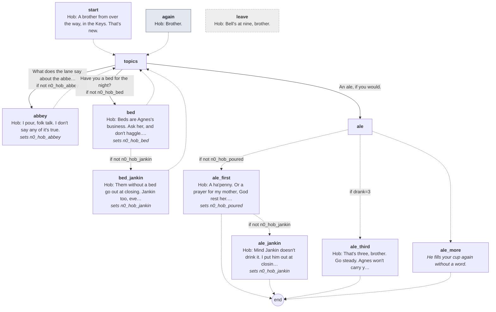

Every line

#### `start`

- *A big man behind the board, a cloth over his shoulder. He looks at your habit a long while before your face.*
- **Hob** *wary*: A brother from over the way, in the Keys. That's new.
- **Hob** *amused*: Sit where you like. Not on Jankin.

- → `topics`

#### `again` (the next time)

- **Hob** *calm*: Brother.

- → `topics`

#### `topics`

1. What does the lane say about the abbey? → `abbey` · only if not `n0_hob_abbey`
2. Have you a bed for the night? → `bed` · only if not `n0_hob_bed`
3. An ale, if you would. → `ale` · he drinks an ale

#### `abbey`
*sets `n0_hob_abbey`*

- **Hob** *calm*: I pour, folk talk. I don't say any of it's true.
- **Hob** *grave*: Pilgrims go in at that gate and don't come out. Folk say they leave by some back way. I don't know of one.
- **Hob** *calm*: Lights in the church at night, when the brothers should be abed. And a thing on the wall with horns, Jankin says.
- **Hob** *grave*: Jankin says a deal. But I keep my shutters barred on that side.

- → `topics`

#### `bed`
*sets `n0_hob_bed`*

- **Hob** *amused*: Beds are Agnes's business. Ask her, and don't haggle. She'll win.
- **Hob** *grave*: We take in anyone who comes before the bell. After it the door's barred, and it stays barred.

- → `bed_jankin` if not `n0_hob_jankin`
- → `topics`

#### `bed_jankin`
*sets `n0_hob_jankin`*

- **Hob** *calm*: Them without a bed go out at closing. Jankin too, every night, rain or no.

- → `topics`

#### `ale`

- → `ale_first` if not `n0_hob_poured`
- → `ale_third` if `drank=3`
- → `ale_more`

#### `ale_first`
*sets `n0_hob_poured`*

- *He draws a cup from the cask and sets it down in front of you, hard.*
- **Hob** *warm*: A ha'penny. Or a prayer for my mother, God rest her. From you I'll take the prayer.

- → `ale_jankin` if not `n0_hob_jankin`
- → `end`

#### `ale_jankin`
*sets `n0_hob_jankin`*

- *Down the bench, Jankin's eyes are on your cup.*
- **Hob** *amused*: Mind Jankin doesn't drink it. I put him out at closing every night, rain or no.

- → `end`

#### `ale_third`

- **Hob** *wary*: That's three, brother. Go steady. Agnes won't carry you up the stair.
- *He pours it all the same.*

- → `end`

#### `ale_more`

- *He fills your cup again without a word.*

- → `end`

#### `leave` (if he walks away)

- **Hob** *calm*: Bell's at nine, brother.

## Jankin

[`jankin.talk`](../../game/chapters/night0/dialogue/jankin.talk) · id `n0_jankin`

Moods through the talk: drunk → amused → drunk → sad → drunk → amused → drunk

> Jankin on the bench at the Cross Keys, night 0. A harmless drunk, full of stories, half of them nonsense.
> He says Hob throws him out at closing every night (the night-2 rule).

### Every path

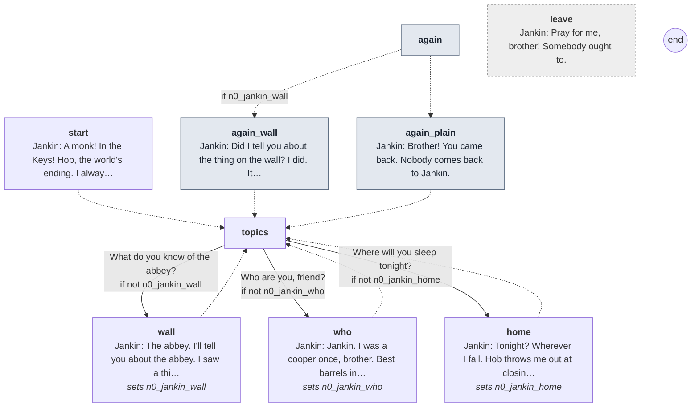

Every line

#### `start`

- *A man slumped on the bench by the wall lifts his cup to you. Most of it goes down his sleeve.*
- **Jankin** *drunk, blink*: A monk! In the Keys! Hob, the world's ending. I always said it would.

- → `topics`

#### `again` (the next time)

- → `again_wall` if `n0_jankin_wall`
- → `again_plain`

#### `again_wall`

- **Jankin** *drunk*: Did I tell you about the thing on the wall? I did. It's still true.

- → `topics`

#### `again_plain`

- **Jankin** *drunk*: Brother! You came back. Nobody comes back to Jankin.

- → `topics`

#### `topics`

1. What do you know of the abbey? → `wall` · only if not `n0_jankin_wall`
2. Who are you, friend? → `who` · only if not `n0_jankin_who`
3. Where will you sleep tonight? → `home` · only if not `n0_jankin_home`

#### `wall`
*sets `n0_jankin_wall`*

- **Jankin** *drunk*: The abbey. I'll tell you about the abbey. I saw a thing on its wall.
- **Jankin** *drunk, blink*: Up on the top, by the corner, against the moon. Horns on it like a hart's. Still as a post.
- **Jankin** *amused*: I said good evening to it. It never said good evening back. Rude, I call that.
- **Jankin** *drunk*: Hob says it was the drink. Hob says everything's the drink.

- → `topics`

#### `who`
*sets `n0_jankin_who`*

- **Jankin** *drunk*: Jankin. I was a cooper once, brother. Best barrels in Aldgate.
- **Jankin** *sad*: Then my wife died, and I found I liked what goes in a barrel better than the barrel.
- *He looks into his cup, and for a moment he doesn't look drunk at all.*

- → `topics`

#### `home`
*sets `n0_jankin_home`*

- **Jankin** *drunk*: Tonight? Wherever I fall. Hob throws me out at closing, every night, rain or no.
- **Jankin** *amused*: Good man, Hob. Big hands. I go out of that door like a sack of meal.
- **Jankin** *drunk*: There's a step by the chandler's. Dry, mostly. Nobody's murdered me on it yet.

- → `topics`

#### `leave` (if he walks away)

- **Jankin** *drunk*: Pray for me, brother! Somebody ought to.

## Kit

[`kit.talk`](../../game/chapters/night0/dialogue/kit.talk) · id `n0_kit`

Moods through the talk: glad → amused → calm → amused → wary → glad

> Kit, Ralph the chandler's daughter, selling her last candles in the lane at dusk, night 0. Young, quick, curious about the new porter.

**Read elsewhere:** [`talked_n0_kit`](links.md#talked_n0_kit)

### Every path

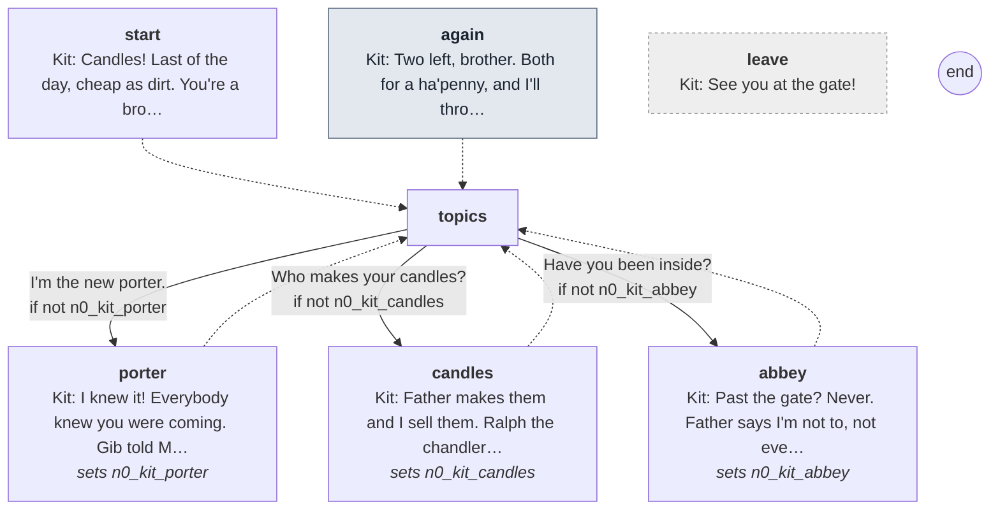

Every line

#### `start`

- *A girl with a tray of candles on a strap round her neck, her hood up against the rain.*
- **Kit** *glad*: Candles! Last of the day, cheap as dirt. You're a brother. Are you the new one?

- → `topics`

#### `again` (the next time)

- **Kit** *glad*: Two left, brother. Both for a ha'penny, and I'll throw in the tray.

- → `topics`

#### `topics`

1. I'm the new porter. → `porter` · only if not `n0_kit_porter`
2. Who makes your candles? → `candles` · only if not `n0_kit_candles`
3. Have you been inside? → `abbey` · only if not `n0_kit_abbey`

#### `porter`
*sets `n0_kit_porter`*

- **Kit** *glad*: I knew it! Everybody knew you were coming. Gib told Margery, and Margery told the lane.
- **Kit** *amused*: You're younger than Brother Anselm. Well. Everybody's younger than Brother Anselm.

- → `topics`

#### `candles`
*sets `n0_kit_candles`*

- **Kit** *calm*: Father makes them and I sell them. Ralph the chandler. He's in the Keys, most like.
- **Kit** *calm*: I'm at your gate most dusks with the tray. The brothers buy whatever I've got left.
- **Kit** *amused*: Brother Ranulf would buy the tray and the strap, if I let him.

- → `topics`

#### `abbey`
*sets `n0_kit_abbey`*

- **Kit** *wary*: Past the gate? Never. Father says I'm not to, not ever.
- **Kit** *glad*: Is it true there's a saint's finger in a glass box? And lights at night? You'll tell me, when you've seen.

- → `topics`

#### `leave` (if he walks away)

- **Kit** *glad*: See you at the gate!

## Mab

[`mab.talk`](../../game/chapters/night0/dialogue/mab.talk) · id `n0_mab` · baseline *wary* · starts at trust 0

Moods through the talk: wary → calm → wary → sad → weary → wary → sad → grave → warm → grave → wary

> Mab, a leper, begging by the barred abbey gate at dusk, night 0. Her first lines send him to the Cross Keys (n0_sent_to_inn).
> Alms once (n0_mab_alms): she gives him a heel of Fenchurch Street bread.

**Read elsewhere:** [`n0_sent_to_inn`](links.md#n0_sent_to_inn), [`talked_n0_mab`](links.md#talked_n0_mab)

### Every path

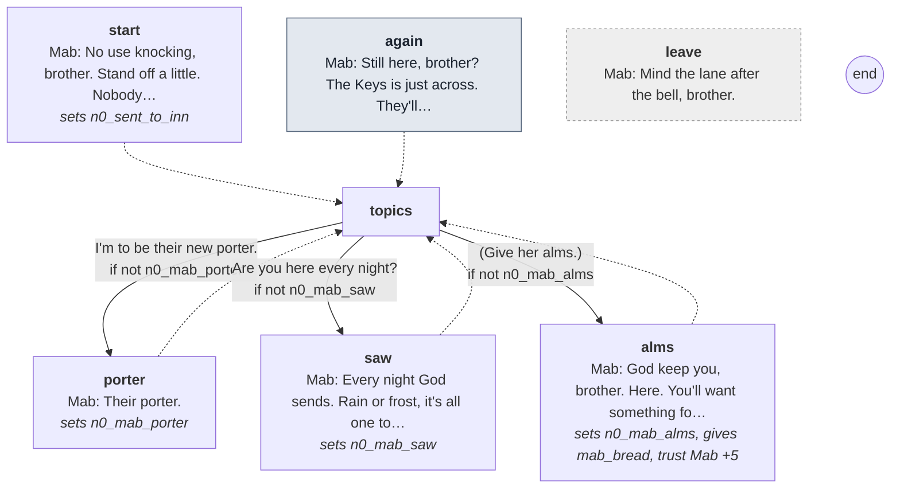

Every line

#### `start`
*sets `n0_sent_to_inn`*

- *A wooden clapper, knocking. A woman sits against the wall by the gate, her face wrapped to the eyes in grey cloth.*
- **Mab** *wary*: No use knocking, brother. Stand off a little. Nobody will come.
- **Mab** *wary*: Nobody keeps that gate at night. Not since old Brother Anselm went blind. They bar it at dusk, and that's that.
- **Mab** *calm*: Go across to the Cross Keys, there, with the lantern. Agnes will find you a bed.

- → `topics`

#### `again` (the next time)

- **Mab** *calm*: Still here, brother? The Keys is just across. They'll have the fire lit.

- → `topics`

#### `topics`

1. I'm to be their new porter. → `porter` · only if not `n0_mab_porter`
2. Are you here every night? → `saw` · only if not `n0_mab_saw`
3. (Give her alms.) → `alms` · only if not `n0_mab_alms`

#### `porter`
*sets `n0_mab_porter`*

- **Mab** *wary*: Their porter.
- *She looks at you a long while over the cloth.*
- **Mab** *sad*: You're very young. Well. You'll be in there, and I'll be out here. We'll see a deal of each other.

- → `topics`

#### `saw`
*sets `n0_mab_saw`*

- **Mab** *weary*: Every night God sends. Rain or frost, it's all one to me.
- **Mab** *wary*: I see everyone who goes in at that gate, and everyone who comes out.
- **Mab** *sad*: Nobody asks me. Who asks a leper anything?
- **Mab** *grave*: But I'll tell you for nothing, brother. More go in than come out.

- → `topics`

#### `alms`
*sets `n0_mab_alms`, gives `mab_bread`, **trust Mab +5***

- *You drop a penny of your road money in the bowl at her feet.*
- **Mab** *warm*: God keep you, brother. Here. You'll want something for your supper.
- *She sets a heel of bread on the step between you, wrapped in a cloth, and draws back.*
- **Mab** *grave*: It's from a baker on Fenchurch Street. I don't eat what comes out of that gate.

- → `topics`

#### `leave` (if he walks away)

- **Mab** *wary*: Mind the lane after the bell, brother.

## Margery

[`margery.talk`](../../game/chapters/night0/dialogue/margery.talk) · id `n0_margery`

Moods through the talk: afraid → calm → afraid → sad → afraid

> Margery, a neighbour, hurrying home with her basket before dark, night 0. Nervous; she won't stop long.

**Read elsewhere:** [`talked_n0_margery`](links.md#talked_n0_margery)

### Every path

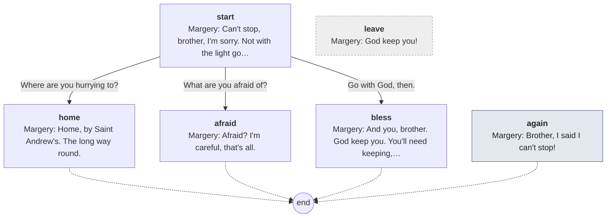

Every line

#### `start`

- *A woman with a covered basket on her arm, walking fast, her eyes on the cobbles.*
- **Margery** *afraid, blink*: Can't stop, brother, I'm sorry. Not with the light going.

1. Where are you hurrying to? → `home`
2. What are you afraid of? → `afraid`
3. Go with God, then. → `bless` · **trust Margery +5**

#### `home`

- **Margery** *afraid*: Home, by Saint Andrew's. The long way round.
- **Margery** *afraid*: Two streets more, but it doesn't go past that wall.

- → `end`

#### `afraid`

- **Margery** *calm, swallow*: Afraid? I'm careful, that's all.
- *Her eyes go to the abbey wall, and away.*
- **Margery** *afraid*: I don't walk past that wall after dark. Not for anybody. No offence to your habit.

- → `end`

#### `bless`

- **Margery** *sad*: And you, brother. God keep you. You'll need keeping, over there.

- → `end`

#### `again` (the next time)

- **Margery** *afraid*: Brother, I said I can't stop!
- *She's already past you.*

- → `end`

#### `leave` (if he walks away)

- **Margery** *afraid*: God keep you!

## Ralph the chandler

[`ralph.talk`](../../game/chapters/night0/dialogue/ralph.talk) · id `n0_ralph`

Moods through the talk: warm → calm → wary → calm → wary → amused → warm → amused

> Ralph the chandler at the Cross Keys, night 0. He makes the abbey's candles; his daughter Kit sells them.
> The sacrist has bought far more candles since about Michaelmas, and pays in coin the abbey never used to have.

**Read elsewhere:** [`n0_ralph_candles`](links.md#n0_ralph_candles)

### Every path

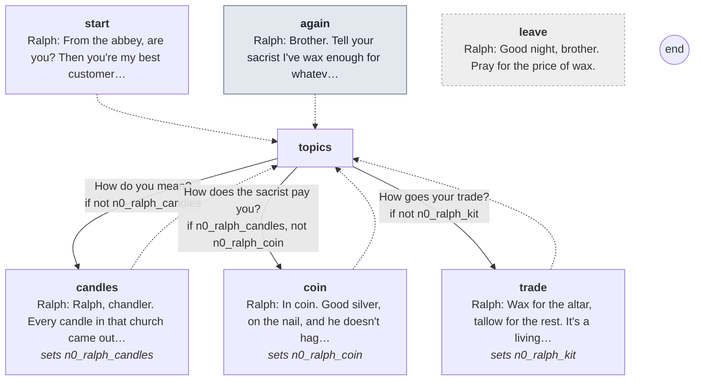

Every line

#### `start`

- *A thin man with wax under his nails and old burns on his fingers, nursing a small ale.*
- **Ralph** *warm*: From the abbey, are you? Then you're my best customer, brother, whether you know it or not.

- → `topics`

#### `again` (the next time)

- **Ralph** *warm*: Brother. Tell your sacrist I've wax enough for whatever he wants.

- → `topics`

#### `topics`

1. How do you mean? → `candles` · only if not `n0_ralph_candles`
2. How does the sacrist pay you? → `coin` · only if `n0_ralph_candles`, not `n0_ralph_coin`
3. How goes your trade? → `trade` · only if not `n0_ralph_kit`

#### `candles`
*sets `n0_ralph_candles`*

- **Ralph** *calm*: Ralph, chandler. Every candle in that church came out of my shop.
- **Ralph** *calm*: Your sacrist, Brother Ranulf, buys more than he ever did. Twice what he bought at Easter, and more again.
- **Ralph** *wary*: Since about Michaelmas. I asked him once what they burn them all for. He didn't say.

- → `topics`

#### `coin`
*sets `n0_ralph_coin`*

- **Ralph** *calm*: In coin. Good silver, on the nail, and he doesn't haggle.
- **Ralph** *wary*: That abbey hadn't two pennies to rub together. Everybody knew it. Now it's silver.
- **Ralph** *wary, swallow*: I don't ask where a man of God gets his silver. I'm a chandler. I sell candles.

- → `topics`

#### `trade`
*sets `n0_ralph_kit`*

- **Ralph** *amused*: Wax for the altar, tallow for the rest. It's a living, if you don't mind the stink.
- **Ralph** *warm*: My girl Kit sells them in the lane. She's at your gate most dusks with her tray. Be kind to her.

- → `topics`

#### `leave` (if he walks away)

- **Ralph** *amused*: Good night, brother. Pray for the price of wax.

## Roger the bailiff

[`roger.talk`](../../game/chapters/night0/dialogue/roger.talk) · id `n0_roger`

Moods through the talk: cold → calm → cold → calm → wary → grave → calm → cold → calm → warm → calm → cold → calm

> Roger, bailiff of the ward, drinking at the Cross Keys, night 0. Hard and transactional.
> He wants word of any merchant, anyone with money, who goes in at the abbey gate (n0_roger_agreed if the porter says he'll send it). The ward would like the abbey's land.
> Claims: n0_roger_count (hiding): why he wants the names. True as far as it goes; he leaves out the land. Pressed, he hints at it.

### Every path

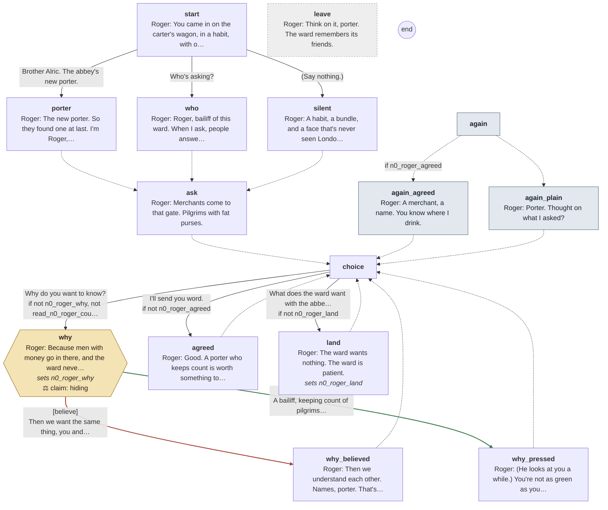

Every line

#### `start`

- *A broad man in a good brown coat, a staff of office leaning on the table. He was watching you before you sat.*
- **Roger** *cold*: You came in on the carter's wagon, in a habit, with one bundle. Who are you?

1. Brother Alric. The abbey's new porter. → `porter`
2. Who's asking? → `who` · **trust Roger the bailiff -5**
3. (Say nothing.) → `silent`

#### `porter`

- **Roger** *calm*: The new porter. So they found one at last. I'm Roger, bailiff of this ward.

- → `ask`

#### `who`

- **Roger** *cold*: Roger, bailiff of this ward. When I ask, people answer. You'll be their new porter.

- → `ask`

#### `silent`

- **Roger** *calm*: A habit, a bundle, and a face that's never seen London. You're their new porter.
- **Roger** *calm*: I'm Roger, bailiff of this ward. It's my business to know who comes into it.

- → `ask`

#### `ask`

- **Roger** *calm*: Merchants come to that gate. Pilgrims with fat purses.
- **Roger** *calm*: When one goes in, I'd like to hear of it. His name, and where he's from. That's all.

- → `choice`

#### `again` (the next time)

- → `again_agreed` if `n0_roger_agreed`
- → `again_plain`

#### `again_agreed`

- **Roger** *calm*: A merchant, a name. You know where I drink.

- → `choice`

#### `again_plain`

- **Roger** *wary*: Porter. Thought on what I asked?

- → `choice`

#### `choice`

1. Why do you want to know? → `why` · only if not `n0_roger_why`, not `read_n0_roger_count`
2. I'll send you word. → `agreed` · only if not `n0_roger_agreed` · sets `n0_roger_agreed` · **trust Roger the bailiff +5**
3. What does the ward want with the abbey? → `land` · only if not `n0_roger_land`

#### `why`
*sets `n0_roger_why`*

- **Roger** *grave*: Because men with money go in there, and the ward never hears of them again.
- **Roger** *calm, lip*: Somebody ought to keep count. Your abbey doesn't.

> **Claim `n0_roger_count`: true, but holding back.** The last line is the claim.

1. Then we want the same thing, you and I. → `why_believed` · **believe** · wrong
2. A bailiff, keeping count of pilgrims for nothing? → `why_pressed` · **press** · **right**, trust +1

#### `why_believed`

- **Roger** *calm*: Then we understand each other. Names, porter. That's all I ask.

- → `choice`

#### `why_pressed`

- **Roger** *cold*: (He looks at you a while.) You're not as green as your habit.
- **Roger** *calm*: A house that loses its guests can lose other things. The ward keeps count of those as well.

- → `choice`

#### `agreed`

- **Roger** *warm*: Good. A porter who keeps count is worth something to the ward. The ward pays its friends.

- → `choice`

#### `land`
*sets `n0_roger_land`*

- **Roger** *calm, lip*: The ward wants nothing. The ward is patient.
- **Roger** *cold*: That's good land behind your wall. Too good for an abbey that can't keep count of its own guests.
- **Roger** *cold*: If your abbey ever falls on hard times, there are men on the ward who'd put it to better use. Remember who told you.

- → `choice`

#### `leave` (if he walks away)

- **Roger** *calm*: Think on it, porter. The ward remembers its friends.

## Traveller

[`traveller.talk`](../../game/chapters/night0/dialogue/traveller.talk) · id `n0_traveller`

Moods through the talk: afraid → sad → grave → afraid → grave → afraid → grave → afraid → grave → sad → grave → weary

> The traveller (Will Fuller) beside the porter on the carter's wagon, night 0. The carter has pulled in; as the cart with the dead comes close the traveller breaks off whatever he was saying (traveller_road.tres is that talk) and turns to it.
> Four pilgrims under sacking, found in the ditch by the white chapel: seven this month on this road. They went in at the abbey's gate to see the saint; nobody saw them come out; they turn up after, outside the walls.
> The ride reveals nothing of what or who is behind it: no demon, no men, no robbery. Only the dead, the count, the abbey, and a man too frightened to say what people say.
> If the porter told him he's the abbey's porter (n0_road_porter), he says your abbey; if not, the carter has told him.
> What he doesn't get to say here (Aldgate may cut it short), the porter can ask him after (traveller_road.tres, after).

**Reads from elsewhere:** [`n0_road_porter`](links.md#n0_road_porter)
**Read elsewhere:** [`n0_cart_say`](links.md#n0_cart_say), [`talked_n0_traveller`](links.md#talked_n0_traveller)

### Every path

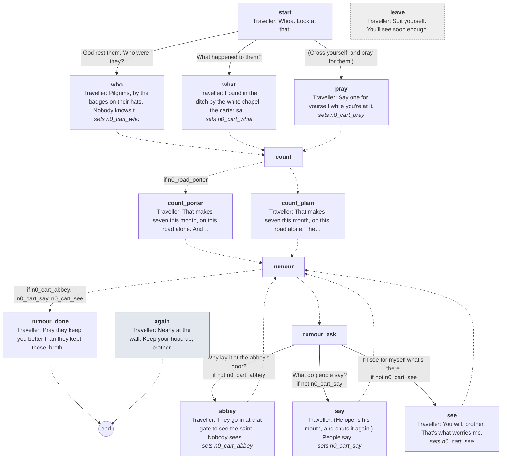

Every line

#### `start`

- **Traveller** *afraid*: Whoa. Look at that.
- *The cart creaks by close enough to touch. Shapes lie under sacking on its bed, three side by side and one across them.*
- **Traveller** *afraid, swallow*: God's wounds. That's not one man. That's four.

1. God rest them. Who were they? → `who`
2. What happened to them? → `what`
3. (Cross yourself, and pray for them.) → `pray`

#### `who`
*sets `n0_cart_who`*

- **Traveller** *sad*: Pilgrims, by the badges on their hats. Nobody knows them. Nobody ever knows them.
- **Traveller** *sad*: Men from the shires who saved a year to see a saint, and nobody here to ask after them.

- → `count`

#### `what`
*sets `n0_cart_what`*

- **Traveller** *grave*: Found in the ditch by the white chapel, the carter says. Laid out side by side, neat as you like.
- **Traveller** *afraid, blink*: Not a mark on them. Not one. As if they'd lain down there to sleep.

- → `count`

#### `pray`
*sets `n0_cart_pray`*

- *You say the words for the dead under your breath. The traveller watches you do it, and his lips move with yours.*
- **Traveller** *grave*: Say one for yourself while you're at it.

- → `count`

#### `count`

- → `count_porter` if `n0_road_porter`
- → `count_plain`

#### `count_porter`

- **Traveller** *grave*: That makes seven this month, on this road alone. And every one of them bound for your abbey, to see the saint.

- → `rumour`

#### `count_plain`

- **Traveller** *grave*: That makes seven this month, on this road alone. The carter says you're for the abbey in the lane.
- **Traveller** *afraid*: That's where they were all bound. To see the saint.

- → `rumour`

#### `rumour`

- → `rumour_done` if `n0_cart_abbey`, `n0_cart_say`, `n0_cart_see`
- → `rumour_ask`

#### `rumour_ask`

1. Why lay it at the abbey's door? → `abbey` · only if not `n0_cart_abbey`
2. What do people say? → `say` · only if not `n0_cart_say`
3. I'll see for myself what's there. → `see` · only if not `n0_cart_see`

#### `abbey`
*sets `n0_cart_abbey`*

- **Traveller** *afraid*: They go in at that gate to see the saint. Nobody sees them come out.
- **Traveller** *grave*: Then a week on, a month on, they turn up in a ditch outside the walls. Like those.
- **Traveller** *afraid, swallow*: (He crosses himself.) I don't say how. I don't know how. Nobody does.

- → `rumour`

#### `say`
*sets `n0_cart_say`*

- **Traveller** *afraid, blink*: (He opens his mouth, and shuts it again.) People say a good many things, brother. None of them in daylight.
- **Traveller** *afraid*: You'll hear it all at the Keys tonight, I don't doubt. I'd rather not be the one who told you.

- → `rumour`

#### `see`
*sets `n0_cart_see`*

- **Traveller** *grave*: You will, brother. That's what worries me.

- → `rumour`

#### `rumour_done`

- *The cart's lantern goes small down the road behind you. The traveller doesn't take his eyes off it.*
- **Traveller** *sad*: Pray they keep you better than they kept those, brother.

- → `end`

#### `again` (the next time)

- **Traveller** *grave*: Nearly at the wall. Keep your hood up, brother.

- → `end`

#### `leave` (if he walks away)

- **Traveller** *weary*: Suit yourself. You'll see soon enough.

## Traveller (traveller road)

[`traveller_road.talk`](../../game/chapters/night0/dialogue/traveller_road.talk) · id `n0_traveller_road`

Moods through the talk: warm → amused → weary → wary → grave → amused → warm → grave → amused → grave → amused → weary → amused → grave → warm → sad → grave → afraid → calm → afraid → warm → amused → warm → weary → sad → wary → afraid → weary → calm → afraid → calm → amused → afraid → weary

> The traveller beside the porter on the carter's wagon, night 0: Will Fuller, a wool merchant from Colchester, forty-one, bound for Cheapside, inside the walls. A wife and two girls at home. Wry, warm, more frightened than he lets on.
> He turns to the porter himself a little way down the road (the Fields cue), and the porter can turn to him again on the road in (E): that starts at again.
> One turn to him is one talk: after each answer the questions left come up again, until the porter turns away or has asked them all.
> Before the cart he only hints at the abbey: road talk, men who don't come home. When the cart with the dead comes close he breaks this talk off himself (traveller.tres says the rest), with no parting line; at Aldgate he breaks off again to greet the warden.
> After the cart (talked_n0_traveller) the porter can ask what he thinks goes on in the abbey, whether he's been inside, what people say, and who would know more. Nothing on the ride reveals a demon or men behind the deaths. After Aldgate (n0_past_aldgate) he opens on the warden.

**Reads from elsewhere:** [`n0_past_aldgate`](links.md#n0_past_aldgate), [`talked_n0_traveller`](links.md#talked_n0_traveller)
**Read elsewhere:** [`n0_cart_say`](links.md#n0_cart_say), [`n0_road_porter`](links.md#n0_road_porter)

### Every path

```mermaid
flowchart TD
  p_start["<b>start</b>"]
  p_hello["<b>hello</b><br/>Traveller: Evening, brother. Bound for the city, are you?"]
  p_quiet["<b>quiet</b><br/>Traveller: Not one for talk. (He blows into his hands.) Then I'l…<br/><i>sets n0_road_quiet</i>"]
  p_porter["<b>porter</b><br/>Traveller: The porter? At the abbey in the lane, by the Cross Ke…<br/><i>sets n0_road_porter</i>"]
  p_young["<b>young</b><br/>Traveller: Nineteen. (He laughs, not unkindly.) At nineteen I wa…<br/><i>sets n0_road_young</i>"]
  p_blind["<b>blind</b><br/>Traveller: Blind, was he. (He's quiet a moment.) Years on a gate…<br/><i>sets n0_road_blind</i>"]
  p_sent["<b>sent</b><br/>Traveller: Obedience. My father wanted that of me, and I gave hi…<br/><i>sets n0_road_sent</i>"]
  p_holy["<b>holy</b><br/>Traveller: A saint. Yes. Everyone on this road has heard of the…"]
  p_unknown["<b>unknown</b><br/>Traveller: Then that's two of you. Three, with me."]
  p_trade["<b>trade</b><br/>Traveller: Cheapside, with wool. I buy it cheap in Colchester an…<br/><i>sets n0_road_trade</i>"]
  p_living["<b>living</b><br/>Traveller: Good enough to complain about. (He pats the bale unde…<br/><i>sets n0_road_living</i>"]
  p_family["<b>family</b><br/>Traveller: A wife, and two girls who think London's paved with r…<br/><i>sets n0_road_family</i>"]
  p_stories["<b>stories</b><br/>Traveller: Road talk. Men who set out for London and don't come…<br/><i>sets n0_road_stories</i>"]
  p_carter["<b>carter</b><br/>Traveller: They shut the city gates at the curfew bell. Be on th…<br/><i>sets n0_road_carter</i>"]
  p_name["<b>name</b><br/>Traveller: Will Fuller. Will, to anyone who's shared a wet cart…<br/><i>sets n0_road_name</i>"]
  p_alric["<b>alric</b><br/>Traveller: Alric. (He tries it.) Well, Brother Alric. I'll pray…<br/><i>sets n0_road_alric</i>"]
  p_topics["<b>topics</b>"]
  p_topics_early["<b>topics_early</b>"]
  p_topics_late["<b>topics_late</b>"]
  p_again["<b>again</b>"]
  p_still["<b>still</b><br/>Traveller: Brother? (He shifts on the sacks.) Go on, ask. It sho…"]
  p_spent["<b>spent</b><br/>Traveller: (He pulls his hood closer.) Save your breath, brother…"]
  p_after["<b>after</b><br/>Traveller: Still thinking of that cart, brother? So am I."]
  p_after_gate["<b>after_gate</b><br/>Traveller: (He watches the gate's light go small behind you.) He…"]
  p_after_topics["<b>after_topics</b>"]
  p_after_ask["<b>after_ask</b>"]
  p_think["<b>think</b><br/>Traveller: I think men go in at that gate to pray, and nobody se…<br/><i>sets n0_road_think</i>"]
  p_defend["<b>defend</b><br/>Traveller: I'm talking about a wall I can't see over. (He shrugs…<br/><i>sets n0_road_defend</i>"]
  p_inside["<b>inside</b><br/>Traveller: Once, at Lent, to see the saint. A finger in a glass…<br/><i>sets n0_road_inside</i>"]
  p_say["<b>say</b><br/>Traveller: (He opens his mouth, and shuts it again.) People say…<br/><i>sets n0_cart_say</i>"]
  p_ask["<b>ask</b><br/>Traveller: The inn across the lane from the abbey gate. The Cros…<br/><i>sets n0_road_ask</i>"]
  p_after_spent["<b>after_spent</b><br/>Traveller: I've said more than I meant to, brother. (He tries a…"]
  p_leave["<b>leave</b><br/>Traveller: Suit yourself, brother."]
  end_((end))
  p_start -.->|"if talked_n0_traveller"| p_after
  p_start -.-> p_hello
  p_hello -->|"I'm to be porter at an abbey inside A…"| p_porter
  p_hello -->|"Where are you bound yourself?"| p_trade
  p_hello -->|"(Nod, and say nothing.)"| p_quiet
  p_quiet -.-> p_topics
  p_porter -->|"I'm nineteen. Old enough."| p_young
  p_porter -->|"The old porter went blind. They neede…"| p_blind
  p_porter -->|"I go where my abbot sends me."| p_sent
  p_young -.-> p_topics
  p_blind -.-> p_topics
  p_sent -->|"He says it's a holy house. It has a s…"| p_holy
  p_sent -->|"I don't think he knows it at all."| p_unknown
  p_holy -.-> p_topics
  p_unknown -.-> p_topics
  p_trade -->|"Is it a good living?"| p_living
  p_trade -->|"Have you family at home?"| p_family
  p_trade -->|"(Let him grumble.)"| p_topics
  p_living -.-> p_topics
  p_family -->|"What stories?"| p_stories
  p_family -->|"(Nod.)"| p_topics
  p_stories -.-> p_topics
  p_carter -.-> p_topics
  p_name -->|"Alric."| p_alric
  p_name -->|"(Smile, and leave it.)"| p_topics
  p_alric -.-> p_topics
  p_topics -.->|"if n0_road_porter, n0_road_trade, n0_road_…"| p_spent
  p_topics -.->|"if n0_road_porter, n0_road_trade"| p_topics_late
  p_topics -.-> p_topics_early
  p_topics_early -->|"I'm to be porter at an abbey inside A…<br/>if not n0_road_porter"| p_porter
  p_topics_early -->|"Where are you bound yourself?<br/>if not n0_road_trade"| p_trade
  p_topics_early -->|"Is the carter always in such a hurry?<br/>if not n0_road_carter"| p_carter
  p_topics_late -->|"I never asked your name.<br/>if not n0_road_name"| p_name
  p_topics_late -->|"Is the carter always in such a hurry?<br/>if not n0_road_carter"| p_carter
  p_topics_late -->|"What's different about this year?<br/>if not n0_road_stories"| p_stories
  p_again -.->|"if talked_n0_traveller"| p_after
  p_again -.->|"if n0_road_porter, n0_road_trade, n0_road_…"| p_spent
  p_again -.-> p_still
  p_still -.-> p_topics
  p_spent -.-> end_
  p_after -.->|"if n0_past_aldgate"| p_after_gate
  p_after -.-> p_after_topics
  p_after_gate -.-> p_after_topics
  p_after_topics -.->|"if n0_road_think, n0_cart_say, n0_road_ask"| p_after_spent
  p_after_topics -.-> p_after_ask
  p_after_ask -->|"What do you think goes on in that abb…<br/>if not n0_road_think"| p_think
  p_after_ask -->|"What do people say about it?<br/>if not n0_cart_say"| p_say
  p_after_ask -->|"Who would know more?<br/>if not n0_road_ask"| p_ask
  p_think -->|"Those are my brothers you're talking…"| p_defend
  p_think -->|"Have you been inside?"| p_inside
  p_think -->|"(Say nothing.)"| p_after_topics
  p_defend -.-> p_after_topics
  p_inside -.-> p_after_topics
  p_say -.-> p_after_topics
  p_ask -.-> p_after_topics
  p_after_spent -.-> end_
  classDef claim fill:#f3e3b5,stroke:#9a6b1a,color:#2b2116
  classDef again fill:#e3e8ef,stroke:#5b6b80,color:#1c2430
  classDef leave fill:#eee,stroke:#999,color:#333,stroke-dasharray: 3 3
  class p_again again
  class p_leave leave
```

Every line

#### `start`

- → `after` if `talked_n0_traveller`
- → `hello`

#### `hello`

- **Traveller** *warm*: Evening, brother. Bound for the city, are you?

1. I'm to be porter at an abbey inside Aldgate. → `porter`
2. Where are you bound yourself? → `trade`
3. (Nod, and say nothing.) → `quiet`

#### `quiet`
*sets `n0_road_quiet`*

- **Traveller** *amused*: Not one for talk. (He blows into his hands.) Then I'll talk for both of us. It keeps the cold out.
- **Traveller** *weary*: Wool, for Cheapside. Twelve days on the road from Colchester, and every one of them wet.

- → `topics`

#### `porter`
*sets `n0_road_porter`*

- **Traveller** *wary, blink*: The porter? At the abbey in the lane, by the Cross Keys?
- **Traveller** *grave*: (He looks at you a moment longer than he needs to.) Well. Somebody has to keep the gate.
- **Traveller** *grave*: You look young for it. They give that work to old men, mostly. Men with nothing left to want.

1. I'm nineteen. Old enough. → `young`
2. The old porter went blind. They needed someone. → `blind`
3. I go where my abbot sends me. → `sent`

#### `young`
*sets `n0_road_young`*

- **Traveller** *amused*: Nineteen. (He laughs, not unkindly.) At nineteen I was sure I'd be rich by thirty.
- **Traveller** *warm*: I'm forty-one, and sat in the back of a cart in the rain. Keep your vows, brother. They're cheaper than wool.

- → `topics`

#### `blind`
*sets `n0_road_blind`*

- **Traveller** *grave*: Blind, was he. (He's quiet a moment.) Years on a gate, watching who comes in after dark.
- **Traveller** *grave, swallow*: I'd not want to know what a man sees, all those years. Maybe the eyes just give up.

- → `topics`

#### `sent`
*sets `n0_road_sent`*

- **Traveller** *amused*: Obedience. My father wanted that of me, and I gave him a wool trade instead.
- **Traveller** *grave*: Your abbot, now. Does he know the house he's sending you to?

1. He says it's a holy house. It has a saint. → `holy`
2. I don't think he knows it at all. → `unknown`

#### `holy`

- **Traveller** *grave*: A saint. Yes. Everyone on this road has heard of the saint.
- *He says it the way a man says the name of a dog that bit him.*

- → `topics`

#### `unknown`

- **Traveller** *amused*: Then that's two of you. Three, with me.

- → `topics`

#### `trade`
*sets `n0_road_trade`*

- **Traveller** *amused*: Cheapside, with wool. I buy it cheap in Colchester and sell it dear in London.
- **Traveller** *weary*: Every toll on the road robs me in between. The bridges, the gates, the bishop's men. A sack's half sold before it's sold.

1. Is it a good living? → `living`
2. Have you family at home? → `family`
3. (Let him grumble.) → `topics`

#### `living`
*sets `n0_road_living`*

- **Traveller** *amused*: Good enough to complain about. (He pats the bale under him.) This is a winter's bread for my house.
- **Traveller** *grave*: Which is why I'll sleep inside the walls tonight, and not in some ditch.

- → `topics`

#### `family`
*sets `n0_road_family`*

- **Traveller** *warm*: A wife, and two girls who think London's paved with ribbon. I'm to bring them some.
- **Traveller** *sad*: (His face goes quiet.) My wife made me swear I'd stop nowhere but an inn I know. She's heard the stories too.

1. What stories? → `stories`
2. (Nod.) → `topics`

#### `stories`
*sets `n0_road_stories`*

- **Traveller** *grave*: Road talk. Men who set out for London and don't come home. There are always some.
- **Traveller** *afraid, glance*: (He glances at the carter's back.) More, this year. Ask him why he whips his horse when the light goes.

- → `topics`

#### `carter`
*sets `n0_road_carter`*

- **Traveller** *calm*: They shut the city gates at the curfew bell. Be on the wrong side and you sleep in the ditch.
- **Traveller** *afraid, swallow*: He doesn't care to sleep in a ditch. Not this month.

- → `topics`

#### `name`
*sets `n0_road_name`*

- **Traveller** *warm*: Will Fuller. Will, to anyone who's shared a wet cart with me.
- **Traveller** *amused*: And you're brother something, and you'll tell me if you like. I'll not press a monk.

1. Alric. → `alric`
2. (Smile, and leave it.) → `topics`

#### `alric`
*sets `n0_road_alric`*

- **Traveller** *warm*: Alric. (He tries it.) Well, Brother Alric. I'll pray for you, if you'll pray for my wool.

- → `topics`

#### `topics`

- → `spent` if `n0_road_porter`, `n0_road_trade`, `n0_road_carter`, `n0_road_stories`, `n0_road_name`
- → `topics_late` if `n0_road_porter`, `n0_road_trade`
- → `topics_early`

#### `topics_early`

1. I'm to be porter at an abbey inside Aldgate. → `porter` · only if not `n0_road_porter`
2. Where are you bound yourself? → `trade` · only if not `n0_road_trade`
3. Is the carter always in such a hurry? → `carter` · only if not `n0_road_carter`

#### `topics_late`

1. I never asked your name. → `name` · only if not `n0_road_name`
2. Is the carter always in such a hurry? → `carter` · only if not `n0_road_carter`
3. What's different about this year? → `stories` · only if not `n0_road_stories`

#### `again` (the next time)

- → `after` if `talked_n0_traveller`
- → `spent` if `n0_road_porter`, `n0_road_trade`, `n0_road_carter`, `n0_road_stories`, `n0_road_name`
- → `still`

#### `still`

- **Traveller** *warm*: Brother? (He shifts on the sacks.) Go on, ask. It shortens the road.

- → `topics`

#### `spent`

- **Traveller** *weary*: (He pulls his hood closer.) Save your breath, brother. It's a cold way to Aldgate yet.

- → `end`

#### `after`

- **Traveller** *sad*: Still thinking of that cart, brother? So am I.

- → `after_gate` if `n0_past_aldgate`
- → `after_topics`

#### `after_gate`

- **Traveller** *wary*: (He watches the gate's light go small behind you.) He took his time over you, that warden. Most nights they wave a monk through.

- → `after_topics`

#### `after_topics`

- → `after_spent` if `n0_road_think`, `n0_cart_say`, `n0_road_ask`
- → `after_ask`

#### `after_ask`

1. What do you think goes on in that abbey? → `think` · only if not `n0_road_think`
2. What do people say about it? → `say` · only if not `n0_cart_say`
3. Who would know more? → `ask` · only if not `n0_road_ask`

#### `think`
*sets `n0_road_think`*

- **Traveller** *afraid*: I think men go in at that gate to pray, and nobody sees them come out.
- **Traveller** *afraid, swallow*: That's all I know, and it's more than I want to. I'd call it a reason to keep walking.

1. Those are my brothers you're talking about. → `defend`
2. Have you been inside? → `inside`
3. (Say nothing.) → `after_topics`

#### `defend`
*sets `n0_road_defend`*

- **Traveller** *weary*: I'm talking about a wall I can't see over. (He shrugs.) You'll be over it tomorrow. Then you tell me.

- → `after_topics`

#### `inside`
*sets `n0_road_inside`*

- **Traveller** *calm*: Once, at Lent, to see the saint. A finger in a glass box, and more candles than I've seen in my life.
- **Traveller** *afraid*: And cold. Cold in there like the bottom of a well. I said my prayer and I didn't stay.

- → `after_topics`

#### `say`
*sets `n0_cart_say`*

- **Traveller** *afraid, blink*: (He opens his mouth, and shuts it again.) People say a good many things, brother. None of them in daylight.
- **Traveller** *afraid*: You'll hear it all at the Keys tonight, I don't doubt. I'd rather not be the one who told you.

- → `after_topics`

#### `ask`
*sets `n0_road_ask`*

- **Traveller** *calm*: The inn across the lane from the abbey gate. The Cross Keys.
- **Traveller** *amused*: Buy the landlord an ale and he'll talk till the candle's out. His wife hears more, and says less.

- → `after_topics`

#### `after_spent`

- **Traveller** *afraid*: I've said more than I meant to, brother. (He tries a smile.) It's the cold. It loosens a man.

- → `end`

#### `leave` (if he walks away)

- **Traveller** *weary*: Suit yourself, brother.

## Walter

[`walter.talk`](../../game/chapters/night0/dialogue/walter.talk) · id `n0_walter` · baseline *amused*, habit *brow*

Moods through the talk: amused → warm → amused → glad → calm → amused → glad

> Walter the pardoner at the Cross Keys, night 0, selling relics to the drinkers out of a rattling box.
> He knows the abbey's gate well and won't say why. (He supplies the henbane. Nothing here says so.)
> Claims: n0_walter_gate (hiding): what his business at the abbey gate is. Pressed, he says herbs for the brothers, no more.

### Every path

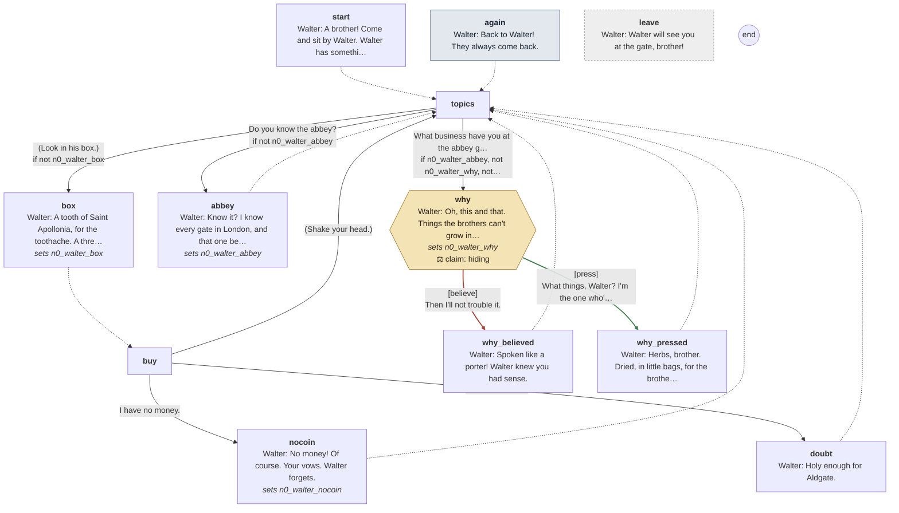

Every line

#### `start`

- *A plump man in a wine-red cloak, the only colour in the room. The box on his knees rattles when he moves.*
- **Walter** *amused, brow*: A brother! Come and sit by Walter. Walter has something for every soul in the Keys, and you've a soul, I'll be bound.

- → `topics`

#### `again` (the next time)

- **Walter** *amused*: Back to Walter! They always come back.

- → `topics`

#### `topics`

1. (Look in his box.) → `box` · only if not `n0_walter_box`
2. Do you know the abbey? → `abbey` · only if not `n0_walter_abbey`
3. What business have you at the abbey gate? → `why` · only if `n0_walter_abbey`, not `n0_walter_why`, not `read_n0_walter_gate`

#### `box`
*sets `n0_walter_box`*

- *He lifts the lid. Little bones, scraps of cloth and a cloudy phial, each on its own bed of wool.*
- **Walter** *amused*: A tooth of Saint Apollonia, for the toothache. A thread of Our Lady's veil.
- **Walter** *amused, brow*: And this, a drop of her milk, from Walsingham. A groat to you, since you're in the trade.

- → `buy`

#### `buy`

1. I have no money. → `nocoin`
2. Those aren't holy. → `doubt` · **trust Walter -5**
3. (Shake your head.) → `topics`

#### `nocoin`
*sets `n0_walter_nocoin`*

- **Walter** *amused*: No money! Of course. Your vows. Walter forgets.
- *He shuts the lid gently, as if on something sleeping.*
- **Walter** *amused*: Keep Walter in your prayers, then, and keep a kind eye on him at your gate. We'll call it square.

- → `topics`

#### `doubt`

- **Walter** *amused*: Holy enough for Aldgate.
- *He is still smiling.*
- **Walter** *amused*: Faith does the rest, brother. Faith always does.

- → `topics`

#### `abbey`
*sets `n0_walter_abbey`*

- **Walter** *amused*: Know it? I know every gate in London, and that one best of all.
- **Walter** *amused, brow*: You'll be the new porter. Don't look so struck, brother. Word gets about, in the trade.
- **Walter** *warm*: You and I will be friends. I'm at that gate more nights than not.

- → `topics`

#### `why`
*sets `n0_walter_why`*

- **Walter** *amused*: Oh, this and that. Things the brothers can't grow in their own garden.
- *He pats the box. Something inside it rattles.*
- **Walter** *amused, still*: Holy business, brother. Nothing a porter need trouble his head over.

> **Claim `n0_walter_gate`: true, but holding back.** The last line is the claim.

1. Then I'll not trouble it. → `why_believed` · **believe** · wrong
2. What things, Walter? I'm the one who'll open the gate to them. → `why_pressed` · **press** · **right**, trust +1

#### `why_believed`

- **Walter** *glad, brow*: Spoken like a porter! Walter knew you had sense.
- *He turns back to the drinkers and his box.*

- → `topics`

#### `why_pressed`

- *For a moment he stops selling. The smile goes, and comes back.*
- **Walter** *calm*: Herbs, brother. Dried, in little bags, for the brothers who ask for them. A pardoner carries what he's asked to carry.
- **Walter** *amused, smile*: There. Now you know all Walter knows, and Walter knows nothing.

- → `topics`

#### `leave` (if he walks away)

- **Walter** *glad*: Walter will see you at the gate, brother!

## Warden

[`warden.talk`](../../game/chapters/night0/dialogue/warden.talk) · id `n0_warden`

Moods through the talk: weary → cold → weary → grave → wary → cold → amused → grave → cold

> The warden at Aldgate, night 0. The wagon has stopped, he has walked up beside the porter and holds his lantern up to his face (RideBeat, the Aldgate cue's inspector). When the talk ends he lowers it and walks back to his place saying they can go (the cue's parting_lines).
> A gatekeeper talking to a gatekeeper: blunt, tired, and he has seen the dead come out past his gate this month.

### Every path

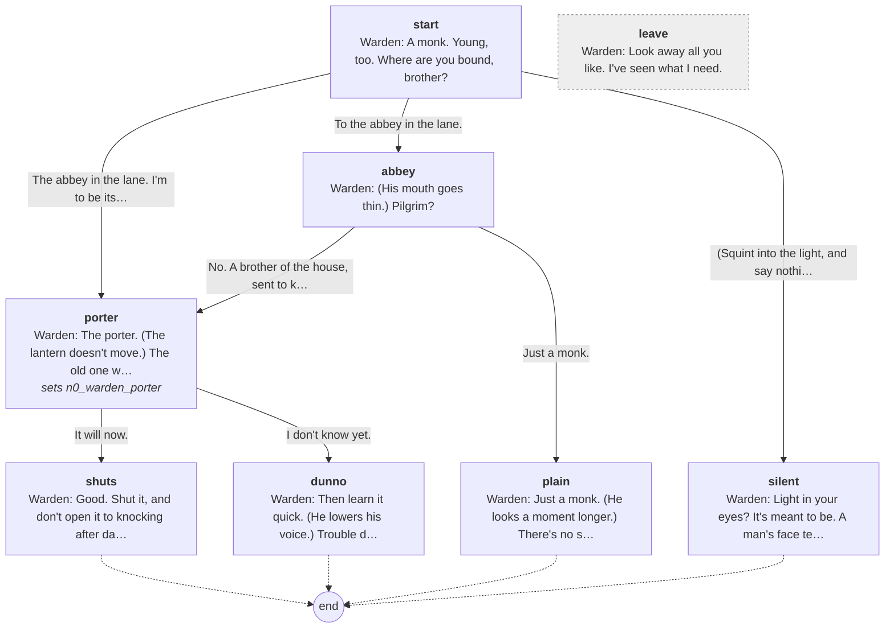

Every line

#### `start`

- *He holds his lantern up to your face, and looks at you a long moment.*
- **Warden** *weary*: A monk. Young, too. Where are you bound, brother?

1. The abbey in the lane. I'm to be its porter. → `porter`
2. To the abbey in the lane. → `abbey`
3. (Squint into the light, and say nothing.) → `silent`

#### `porter`
*sets `n0_warden_porter`*

- **Warden** *cold*: The porter. (The lantern doesn't move.) The old one went blind, I heard.
- **Warden** *weary*: You'll keep your gate and I'll keep mine. Mine shuts at the curfew bell. Does yours?

1. It will now. → `shuts`
2. I don't know yet. → `dunno`

#### `shuts`

- **Warden** *grave*: Good. Shut it, and don't open it to knocking after dark. Not for a pilgrim, not for a friend. Not for anyone.

- → `end`

#### `dunno`

- **Warden** *grave*: Then learn it quick. (He lowers his voice.) Trouble doesn't climb walls, brother. It knocks.

- → `end`

#### `abbey`

- **Warden** *wary, lip*: (His mouth goes thin.) Pilgrim?

1. No. A brother of the house, sent to keep its gate. → `porter`
2. Just a monk. → `plain`

#### `plain`

- **Warden** *cold*: Just a monk. (He looks a moment longer.) There's no such thing in this city, brother.

- → `end`

#### `silent`

- **Warden** *amused*: Light in your eyes? It's meant to be. A man's face tells me more than his mouth.
- **Warden** *grave*: Yours says you've never slept inside a city wall. Mind you wake up inside one.

- → `end`

#### `leave` (if he walks away)

- **Warden** *cold*: Look away all you like. I've seen what I need.

## Scripted lines

Said by the night's beats and cues (`night0.tscn`), outside any talk.

- `RideCues/WhiteChapel`: **Carter** *wary*: Vespers already. Hup! We'll be in before they shut the gate.
- `RideCues/Whoa`: **Carter** *wary*: Easy, easy. Let him by.
- `RideCues/Aldgate`: **Traveller** *warm*: Evening, warden. God keep the gate.
- `RideCues/Aldgate`: **Warden** *weary*: In or out, carter? We shut at the curfew bell, and we open for no one after it.
- `RideCues/Aldgate`: **Carter** *calm*: In, warden. Two for the city.
- `RideCues/Aldgate`: **Warden** *wary*: Let's have a look at you, then.
- `RideCues/Aldgate`: **Warden** *calm*: You're good. Go on, and God go with you.
- `RideCues/Dog`: **Traveller** *grave*: They bar their doors early, this side of the wall. Since the pilgrims started going missing.
- `RideCues/Bridge`: **Carter** *calm*: Over the brook, and your lane's the next turning. Nearly there.
- `RideCues/Lane`: **Traveller** *grave*: That wall's your abbey. God keep you, brother. Bar your door at night.
