# The evening before: The Cross Keys

Generated by `tools/script_docs.py` from the game's files. Don't edit it by hand. How to read it: [README](README.md). Every flag: [links](links.md).

## The night

The chapter's beats in order (`night0.tscn`), the talks each opens, who he can go to from then on, and the flags passed between them (dashed). The note at the end lists what this chapter's talks pass on to later ones.

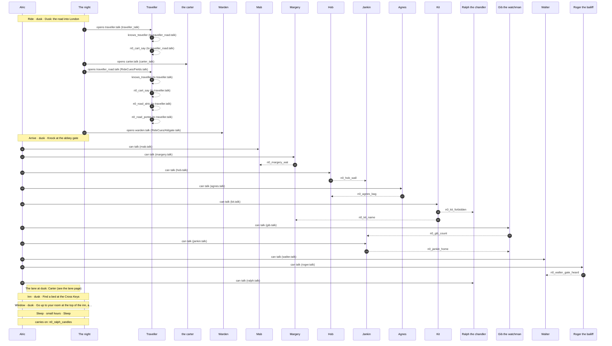

## Conversations

- [Agnes](#agnes) (`agnes.talk`)
- [the carter](#carter) (`carter.talk`)
- [Hob](#chatter_hob_agnes) (`chatter_hob_agnes.talk`)
- [Walter](#chatter_jankin_walter) (`chatter_jankin_walter.talk`)
- [Margery](#chatter_kit_margery) (`chatter_kit_margery.talk`)
- [Roger the bailiff](#chatter_roger_ralph) (`chatter_roger_ralph.talk`)
- [Gib the watchman](#gib) (`gib.talk`)
- [Hob](#hob) (`hob.talk`)
- [Jankin](#jankin) (`jankin.talk`)
- [Kit](#kit) (`kit.talk`)
- [Mab](#mab) (`mab.talk`)
- [Margery](#margery) (`margery.talk`)
- [Ralph the chandler](#ralph) (`ralph.talk`)
- [Roger the bailiff](#roger) (`roger.talk`)
- [Traveller](#traveller) (`traveller.talk`)
- [Traveller](#traveller_road) (`traveller_road.talk`)
- [Walter](#walter) (`walter.talk`)
- [Warden](#warden) (`warden.talk`)

## Agnes

[`agnes.talk`](../../game/chapters/night0/dialogue/agnes.talk) · id `n0_agnes`

Moods through the talk: warm → grave → warm → calm → warm → amused → warm → amused → cold → grave → weary → wary → grave → wary → warm → sad → weary → sad → warm → wary → warm

> Agnes, Hob's wife, by the fire in the Cross Keys, night 0. Motherly, and sharp.
> The bed answer gives him the room at the top (n0_room); so does telling her the gate is shut: she says she has the one bed, and goes straight on to it. An ale ends the talk with her own line; the next talk starts at again, so he can have another.
> Answer paths the tests take: answer 0 at her first question is the bed; the next question (has he eaten?) has the ale as answer 1. 0,0,0 reaches n0_room.
> She asks whether he's eaten today, and remembers it (n0_agnes_fed: she fed him; the lane's first dusk opens on whether they're feeding him over there).
> Thread: the room at the top, whose one window looks toward the abbey. Nobody else will have it. The last lodger up there came down at midnight in his shirt and sat by her fire till light: a lantern going about in their court, by the well. She doesn't look out of that window, and tells him not to (n0_agnes_window). It is the window he sees the killing from. For later nights: the lane's night 6 ("You looked out of it, your first night").
> Cross-link: she tells him Hob keeps a lodger's bag behind his board (n0_agnes_bag): Hob's talk then has it.
> Overheard: Hob and Agnes about the top room and the bag (chatter_hob_agnes.talk).

**Reads from elsewhere:** [`overheard_n0_chatter_hob_agnes`](links.md#overheard_n0_chatter_hob_agnes)
**Read elsewhere:** [`n0_agnes_bag`](links.md#n0_agnes_bag), [`n0_room`](links.md#n0_room), [`talked_n0_agnes`](links.md#talked_n0_agnes)

### Every path

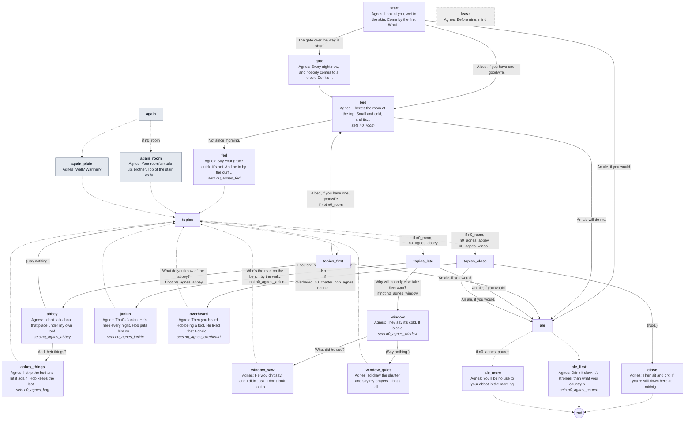

Every line

#### `start`

- *A woman by the fire with her sleeves rolled, stirring a pot. She looks you up and down.*
- **Agnes** *warm*: Look at you, wet to the skin. Come by the fire. What brings a brother into the Keys?

1. A bed, if you have one, goodwife. → `bed`
2. The gate over the way is shut. → `gate`
3. An ale, if you would. → `ale` · he drinks an ale

#### `gate`

- **Agnes** *grave, glance*: Every night now, and nobody comes to a knock. Don't stand out there knocking, brother.
- **Agnes** *warm*: So it's a bed you want, and I've the one.

- → `bed`

#### `bed`
*sets `n0_room`*

- **Agnes** *calm*: There's the room at the top. Small and cold, and its one window looks toward the abbey. Nobody else will have it.
- **Agnes** *warm*: A ha'penny, and I'll not haggle with a monk. Have you eaten today?

1. Not since morning. → `fed`
2. An ale will do me. → `ale` · he drinks an ale

#### `fed`
*sets `n0_agnes_fed`*

- *She ladles pottage into a bowl and puts it into your hands without asking.*
- **Agnes** *amused*: Say your grace quick, it's hot. And be in by the curfew bell. At nine Hob bars the door, and he'll not open it for a bishop.

- → `topics`

#### `again` (the next time)

- → `again_room` if `n0_room`
- → `again_plain`

#### `again_room`

- **Agnes** *warm*: Your room's made up, brother. Top of the stair, as far as it goes.

- → `topics`

#### `again_plain`

- **Agnes** *amused*: Well? Warmer?

- → `topics`

#### `topics`

- → `topics_close` if `n0_room`, `n0_agnes_abbey`, `n0_agnes_window`, `n0_agnes_jankin`
- → `topics_late` if `n0_room`, `n0_agnes_abbey`
- → `topics_first`

#### `topics_first`

1. A bed, if you have one, goodwife. → `bed` · only if not `n0_room`
2. What do you know of the abbey? → `abbey` · only if not `n0_agnes_abbey`
3. An ale, if you would. → `ale` · he drinks an ale

#### `topics_late`

1. Why will nobody else take the room? → `window` · only if not `n0_agnes_window`
2. Who's the man on the bench by the wall? → `jankin` · only if not `n0_agnes_jankin`
3. An ale, if you would. → `ale` · he drinks an ale

#### `topics_close`

1. I couldn't help hearing, about the Norwich man. → `overheard` · only if `overheard_n0_chatter_hob_agnes`, not `n0_agnes_overheard`
2. (Nod.) → `close`
3. An ale, if you would. → `ale` · he drinks an ale

#### `abbey`
*sets `n0_agnes_abbey`*

- **Agnes** *cold*: I don't talk about that place under my own roof.
- *She glances at the shutters all the same, and lowers her voice.*
- **Agnes** *grave, lip*: We've had lodgers go over there of an evening, to see the relic. Not all of them came back for their supper.

1. And their things? → `abbey_things`
2. (Say nothing.) → `topics`

#### `abbey_things`
*sets `n0_agnes_bag`*

- **Agnes** *grave, swallow*: I strip the bed and let it again. Hob keeps the last one's bag behind his board.
- **Agnes** *weary*: Says the man will come back for it. Ask him, if you want to hear a grown man be a fool.

- → `topics`

#### `window`
*sets `n0_agnes_window`*

- **Agnes** *wary*: They say it's cold. It is cold.
- **Agnes** *grave, glance*: The last one up there came down at midnight in his shirt, and sat by my fire till light. Said there was a lantern going about in their court, by the well.

1. What did he see? → `window_saw`
2. (Say nothing.) → `window_quiet`

#### `window_saw`

- **Agnes** *grave*: He wouldn't say, and I didn't ask. I don't look out of that window, brother.
- **Agnes** *wary*: Nor should you. Draw the shutter, and say your prayers.

- → `topics`

#### `window_quiet`

- **Agnes** *wary, look down*: I'd draw the shutter, and say my prayers. That's all I'd do.

- → `topics`

#### `jankin`
*sets `n0_agnes_jankin`*

- *She looks down the bench at him, and her face softens.*
- **Agnes** *warm*: That's Jankin. He's here every night. Hob puts him out at closing, and I put a crust in his pocket first.
- **Agnes** *sad*: One of these nights it'll be too cold for him out there. You see if it isn't.

- → `topics`

#### `overheard`
*sets `n0_agnes_overheard`*

- **Agnes** *weary*: Then you heard Hob being a fool. He liked that Norwich man. They talked about their mothers.
- **Agnes** *sad*: Nobody comes back from over the way for a bag. I'd burn it, if he'd let me.

- → `topics`

#### `close`

- **Agnes** *warm*: Then sit and dry. If you're still down here at midnight, I'll send you up myself.

- → `end`

#### `ale`

- → `ale_more` if `n0_agnes_poured`
- → `ale_first`

#### `ale_first`
*sets `n0_agnes_poured`*

- *She fills a cup from the jug and puts it into your hands.*
- **Agnes** *warm*: Drink it slow. It's stronger than what your country brothers brew.

- → `end`

#### `ale_more`

- *She fills it to the brim, shaking her head.*
- **Agnes** *wary*: You'll be no use to your abbot in the morning.

- → `end`

#### `leave` (if he walks away)

- **Agnes** *warm*: Before nine, mind!

## the carter

[`carter.talk`](../../game/chapters/night0/dialogue/carter.talk) · id `n0_carter`

Moods through the talk: weary → wary → afraid → calm → wary → calm → grave → angry → calm

> The carter, Hamo *(the name is mine, 2026-11-15)*, has set the porter down in the lane by the abbey gate at dusk, night 0 (RideBeat). The porter has jumped down and come round to him on his board; he tells him to knock at the gate (your ask, 2026-11-16), then drives off down the lane with the traveller (the scene does that once the talk ends). He stays facing his horse, turning his head to the porter.
> Gruff and in a hurry: one answer, one reply, and he's gone. Each reply is his parting line.
> His name: every answer reaches it (knows_carter): Will asks Hamo to wait, Hamo tells him to say Hamo set him down at the Keys, or asks to be put in his prayer. The traveller may have named him already on the road (traveller_road.talk, carter_hamo). Only walking away at his first line misses it.
> Answer paths the tests take: test_prologue and test_flow answer 0 (wait, wait_will).

**Read elsewhere:** [`talked_n0_carter`](links.md#talked_n0_carter)

### Every path

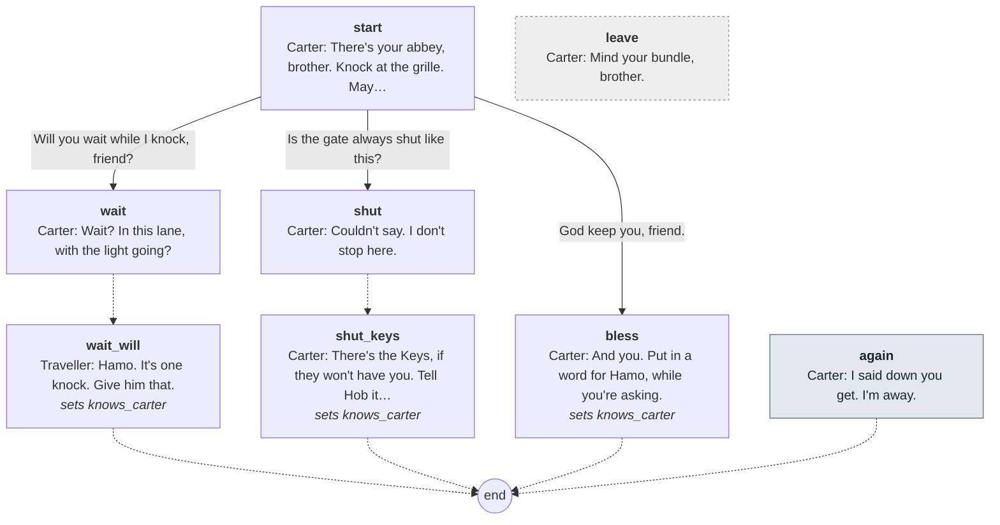

Every line

#### `start`

- *The carter looks down at you from his board, the reins in his fists. The horse stamps in the wet.*
- **Carter** *weary*: There's your abbey, brother. Knock at the grille. Maybe somebody'll let you in.
- **Carter** *wary, glance*: I've a horse to stable before dark.

1. Will you wait while I knock, friend? → `wait`
2. Is the gate always shut like this? → `shut`
3. God keep you, friend. → `bless`

#### `wait`

- **Carter** *afraid, glance*: Wait? In this lane, with the light going?

- → `wait_will`

#### `wait_will`
*sets `knows_carter`*

- **Traveller** *calm*: Hamo. It's one knock. Give him that.
- *Hamo spits over the wheel.*
- **Carter** *wary*: No. Knock all you like, brother. I'll not be here to see it.

- → `end`

#### `shut`

- **Carter** *wary*: Couldn't say. I don't stop here.

- → `shut_keys`

#### `shut_keys`
*sets `knows_carter`*

- *He jerks his head across the lane, at a lit doorway under a painted sign.*
- **Carter** *calm*: There's the Keys, if they won't have you. Tell Hob it was Hamo set you down.

- → `end`

#### `bless`
*sets `knows_carter`*

- **Carter** *grave*: And you. Put in a word for Hamo, while you're asking.
- **Carter** *grave, look away*: You'll want Him more than I will.

- → `end`

#### `again` (the next time)

- **Carter** *angry*: I said down you get. I'm away.

- → `end`

#### `leave` (if he walks away)

- **Carter** *calm*: Mind your bundle, brother.

## Hob (chatter hob agnes)

[`chatter_hob_agnes.talk`](../../game/chapters/night0/dialogue/chatter_hob_agnes.talk) · id `n0_chatter_hob_agnes`

Moods through the talk: grave → calm → wary → grave → sad → angry

> Overheard at the Cross Keys, night 0 (Chatter): Hob and Agnes about tonight's lodgers: the top room nobody will take, and the Norwich man's bag Hob keeps behind his board. Only the start point is said.
> Where: the taproom, at Hob's board, Agnes come over from the fire.
> Picked up by hob.talk (the porter can ask about the bag) and agnes.talk (the porter can ask about the Norwich man).

### Every path

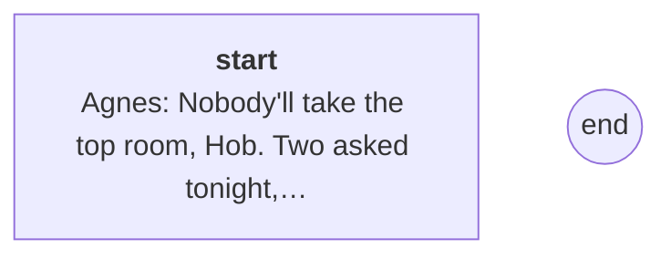

Every line

#### `start`

- **Agnes** *grave*: Nobody'll take the top room, Hob. Two asked tonight, and both went back out in the rain.
- **Hob** *calm*: Then give it the monk. Monks don't look out of windows.
- **Agnes** *wary*: And that bag behind your board. Three weeks, Hob.
- **Hob** *grave*: He paid for two nights. A man comes back for a bag like that.
- **Agnes** *sad*: He went over the way. They don't come back from over the way.
- **Hob** *angry, jaw*: Not under my roof, Agnes. Not that talk.

## Walter (chatter jankin walter)

[`chatter_jankin_walter.talk`](../../game/chapters/night0/dialogue/chatter_jankin_walter.talk) · id `n0_chatter_jankin_walter` · baseline *amused*, habit *brow*

Moods through the talk: drunk → amused → drunk → amused → afraid → amused

> Overheard at the Cross Keys, night 0 (Chatter): Jankin on his bench telling Walter about the horned thing on the abbey wall, and Walter scoffing. Only the start point is said.
> Where: the taproom, Jankin's bench by the wall, Walter sitting by him with his box on his knees.
> Picked up by jankin.talk (he opens on it, and the porter can ask what was on the wall) and walter.talk (the porter can ask whether he believes Jankin; he stops selling for a line).

### Every path

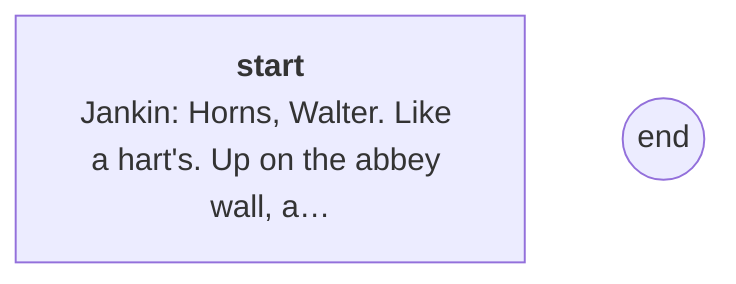

Every line

#### `start`

- **Jankin** *drunk*: Horns, Walter. Like a hart's. Up on the abbey wall, against the moon.
- **Walter** *amused, brow*: A hart, on a wall. Had it wings as well, Jankin?
- **Jankin** *drunk, blink*: It looked at me. Still as a post. I said good evening.
- **Walter** *amused*: And it said nothing back, being a chimney.
- **Jankin** *afraid, still*: Chimneys stay where they're put, Walter. It was gone in the morning.
- **Walter** *amused, brow*: Then Walter will sell you a scraping of its horn. A groat, for the toothache.

## Margery (chatter kit margery)

[`chatter_kit_margery.talk`](../../game/chapters/night0/dialogue/chatter_kit_margery.talk) · id `n0_chatter_kit_margery`

Moods through the talk: glad → wary → afraid

> Overheard in the lane at dusk, night 0 (Chatter): Kit with her tray and Margery with her basket, about Margery's son-in-law Wat, who carts the abbey's rye and won't go in past the gate any more. Only the start point is said. It ends as they notice the porter.
> Where: the lane, before the curfew bell, near the Keys' door or the chandler's: Margery stopped on her way home, Kit beside her.
> Picked up by margery.talk (she opens on it) and kit.talk (the porter can step in about Wat).

### Every path

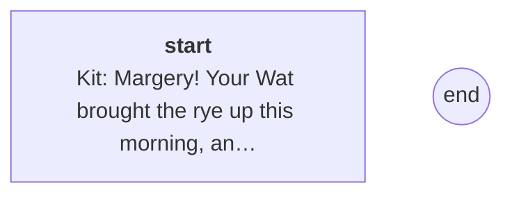

Every line

#### `start`

- **Kit** *glad*: Margery! Your Wat brought the rye up this morning, and he never whistled at me. He always whistles.
- **Margery** *wary*: He doesn't whistle now. Not since they kept him in there overnight.
- **Kit** *wary, brow*: Inside? Past the gate? What's it like?
- **Margery** *afraid*: He won't say. He wants a rushlight by the bed all night now, a grown man, and he won't say why.
- **Kit** *afraid, swallow*: Did he see the finger?
- **Margery** *afraid, glance*: Hush, Kit. There's a brother.

## Roger the bailiff (chatter roger ralph)

[`chatter_roger_ralph.talk`](../../game/chapters/night0/dialogue/chatter_roger_ralph.talk) · id `n0_chatter_roger_ralph`

Moods through the talk: calm → wary → cold → calm → wary → cold

> Overheard at the Cross Keys, night 0 (Chatter): Roger the bailiff and Ralph the chandler on the price of the abbey's candles, and the silver it's paid in. Only the start point is said.
> Where: the taproom, a table with Roger's staff leaning on it, Ralph across from him with his small ale.
> Picked up by roger.talk and ralph.talk: each opens on it.

### Every path

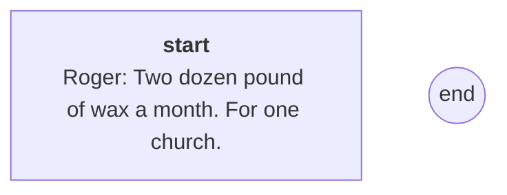

Every line

#### `start`

- **Roger** *calm*: Two dozen pound of wax a month. For one church.
- **Ralph** *wary*: Since Michaelmas. At Easter it was a dozen. I don't ask what for.
- **Roger** *cold*: You should. Who pays?
- **Ralph** *calm*: The sacrist. In silver, on the nail.
- **Roger** *calm, lip*: Silver. From a house that couldn't mend its own roof at Lady Day.
- **Ralph** *wary, swallow*: I make candles, Roger. I don't count other men's silver.
- **Roger** *cold*: I do.

## Gib the watchman

[`gib.talk`](../../game/chapters/night0/dialogue/gib.talk) · id `n0_gib`

Moods through the talk: weary → wary → grave → wary → grave → warm → grave → calm → grave → weary → wary → calm → wary → grave → afraid → grave → wary → grave → weary → sad → warm → afraid → weary

> Gib, the old night watchman, night 0: lighting the lanterns along the lane (the mayor's order) before the bell, and walking the lane calling the hour after it (n0_curfew). Old, slow, a watchman: he tells the porter to be indoors before the bell.
> Hail: before the bell, from up his ladder, as the porter walks under it.
> His call is a clock the porter will hear from inside the walls: if it stops, something is wrong.
> He asks whether the porter sleeps sound, and remembers it (n0_gib_sleep = sound, light or asked).
> Thread: Gib counts the lanterns he lights, fourteen, and counts them out again. Last night one went out before the bell, with no wind: the one over the chandler's step, where Jankin sleeps (n0_gib_count). For later nights: the count, night by night; Jankin is killed by the chandler's on night 2 unless kept in.
> Cross-links: if Jankin said he sleeps on the chandler's step (n0_jankin_home), the porter can say so here (n0_gib_jankin); Gib's count opens a question for Jankin (jankin.talk, [if n0_gib_count]).
> If the porter says he'll be on the other side of the wall, Gib will call a little louder along his stretch (n0_gib_louder): for later nights.

**Reads from elsewhere:** [`hailed_n0_gib`](links.md#hailed_n0_gib), [`n0_curfew`](links.md#n0_curfew), [`n0_jankin_home`](links.md#n0_jankin_home)
**Read elsewhere:** [`n0_gib_count`](links.md#n0_gib_count), [`talked_n0_gib`](links.md#talked_n0_gib)

### Every path

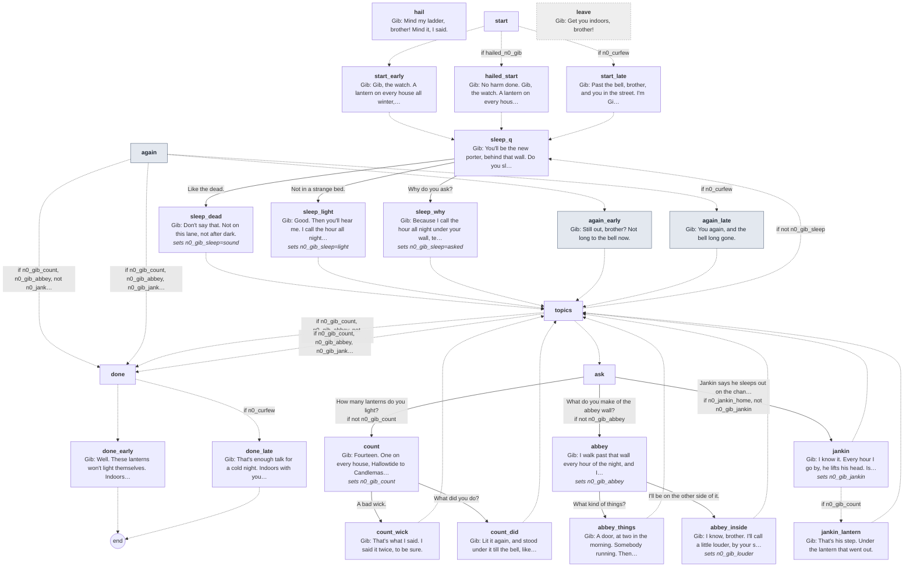

Every line

#### `hail`

- *A voice from up a short ladder, under the eaves.*
- **Gib** *weary*: Mind my ladder, brother! Mind it, I said.

#### `start`

- → `start_late` if `n0_curfew`
- → `hailed_start` if `hailed_n0_gib`
- → `start_early`

#### `start_early`

- *An old man on a short ladder under the eaves, coaxing a lantern alight with a taper.*
- **Gib** *weary*: Gib, the watch. A lantern on every house all winter, by the mayor's order.

- → `sleep_q`

#### `hailed_start`

- *The old man comes down his ladder a rung at a time, the taper cupped in his hand.*
- **Gib** *weary*: No harm done. Gib, the watch. A lantern on every house all winter, by the mayor's order.

- → `sleep_q`

#### `start_late`

- *An old man with a lantern on a pole, walking slow down the middle of the empty lane.*
- **Gib** *wary*: Past the bell, brother, and you in the street. I'm Gib, the watch.

- → `sleep_q`

#### `sleep_q`

- **Gib** *grave*: You'll be the new porter, behind that wall. Do you sleep sound, brother?

1. Like the dead. → `sleep_dead`
2. Not in a strange bed. → `sleep_light`
3. Why do you ask? → `sleep_why`

#### `sleep_dead`
*sets `n0_gib_sleep=sound`*

- **Gib** *wary, shake*: Don't say that. Not on this lane, not after dark.
- **Gib** *grave*: Sleep light. I call the hour all night under your wall. If you hear me, all's well.

- → `topics`

#### `sleep_light`
*sets `n0_gib_sleep=light`*

- **Gib** *warm*: Good. Then you'll hear me. I call the hour all night under your wall.
- **Gib** *grave*: If you hear me, all's well. If you don't, it isn't.

- → `topics`

#### `sleep_why`
*sets `n0_gib_sleep=asked`*

- **Gib** *calm*: Because I call the hour all night under your wall, ten of the clock till first light.
- **Gib** *grave*: If you hear me, all's well. If you don't, it isn't.

- → `topics`

#### `again` (the next time)

- → `done` if `n0_gib_count`, `n0_gib_abbey`, not `n0_jankin_home`
- → `done` if `n0_gib_count`, `n0_gib_abbey`, `n0_gib_jankin`
- → `again_late` if `n0_curfew`
- → `again_early`

#### `again_early`

- **Gib** *weary*: Still out, brother? Not long to the bell now.

- → `topics`

#### `again_late`

- **Gib** *wary*: You again, and the bell long gone.

- → `topics`

#### `topics`

- → `sleep_q` if not `n0_gib_sleep`
- → `done` if `n0_gib_count`, `n0_gib_abbey`, not `n0_jankin_home`
- → `done` if `n0_gib_count`, `n0_gib_abbey`, `n0_gib_jankin`
- → `ask`

#### `ask`

1. How many lanterns do you light? → `count` · only if not `n0_gib_count`
2. What do you make of the abbey wall? → `abbey` · only if not `n0_gib_abbey`
3. Jankin says he sleeps out on the chandler's step. → `jankin` · only if `n0_jankin_home`, not `n0_gib_jankin`

#### `count`
*sets `n0_gib_count`*

- **Gib** *calm*: Fourteen. One on every house, Hallowtide to Candlemas. I count them lit, and I count them out.
- **Gib** *wary*: Last night one went out before the bell. The one over the chandler's step. There was no wind.

1. A bad wick. → `count_wick`
2. What did you do? → `count_did`

#### `count_wick`

- **Gib** *grave*: That's what I said. I said it twice, to be sure.

- → `topics`

#### `count_did`

- **Gib** *grave*: Lit it again, and stood under it till the bell, like an old fool.
- **Gib** *afraid*: Nobody came by. I'd have sworn somebody was stood there with me.

- → `topics`

#### `abbey`
*sets `n0_gib_abbey`*

- *He's slow to answer.*
- **Gib** *grave*: I walk past that wall every hour of the night, and I don't look at it.
- **Gib** *wary, swallow*: Thirty years. You hear things over a wall like that. You see lights where there shouldn't be lights.

1. What kind of things? → `abbey_things`
2. I'll be on the other side of it. → `abbey_inside`

#### `abbey_things`

- **Gib** *grave*: A door, at two in the morning. Somebody running. Then quiet, like a held breath.
- **Gib** *weary*: I call the hour, and I keep walking. You'd do well to learn the same.

- → `topics`

#### `abbey_inside`
*sets `n0_gib_louder`*

- *He looks at you a while.*
- **Gib** *sad*: I know, brother. I'll call a little louder, by your stretch.

- → `topics`

#### `jankin`
*sets `n0_gib_jankin`*

- **Gib** *warm*: I know it. Every hour I go by, he lifts his head. Is it, Gib, he says. Is it all well?

- → `jankin_lantern` if `n0_gib_count`
- → `topics`

#### `jankin_lantern`

- **Gib** *afraid, swallow*: That's his step. Under the lantern that went out.

- → `topics`

#### `done`

- → `done_late` if `n0_curfew`
- → `done_early`

#### `done_early`

- **Gib** *weary*: Well. These lanterns won't light themselves. Indoors before the bell, brother.

- → `end`

#### `done_late`

- **Gib** *weary*: That's enough talk for a cold night. Indoors with you, brother.

- → `end`

#### `leave` (if he walks away)

- **Gib** *weary*: Get you indoors, brother!

## Hob

[`hob.talk`](../../game/chapters/night0/dialogue/hob.talk) · id `n0_hob`

Moods through the talk: calm → wary → amused → calm → grave → calm → grave → cold → grave → calm → weary → amused → calm → amused → grave → calm → warm → angry → amused → warm → amused → wary → calm

> Hob, who keeps the Cross Keys, behind his board, night 0. Blunt and kind. He hears everything said over the ale, and doesn't say any of it is true.
> Hail: as the porter comes in at the door, he tells him to shut it.
> He asks whether it's the porter's first time in London, and remembers the answer (n0_hob_london).
> His questions: what the lane says about the abbey; when the Keys shuts; who's drinking tonight; the lodger's bag, once he knows of it. He never runs out: the ale is always there.
> The ale is always the last answer, and the third while he has two questions left (always, until he's asked: the tests take answer 2 for an ale, four times running). An ale ends the talk with his own line; the next talk starts at again, so he can have another.
> Plants the night-2 rule (n0_hob_jankin): he puts Jankin out at closing every night, rain or no.
> Thread: a Norwich man, Adam, a glover with a cough, lodged three weeks back, paid for two nights, went over the way to see the saint, and slept one. Hob keeps his scrip behind the board and says a man comes back for a bag like that (n0_hob_bag). If the porter promises to tell Adam, should he see him (n0_hob_bag_promise), that's for later nights: Hob asks after him.
> Cross-links: Hob's talk of the wall (n0_hob_wall) lets the porter ask Jankin about it; Agnes tells him about the bag (n0_agnes_bag), which opens it here.
> Overheard: Hob and Agnes about the top room and the bag (chatter_hob_agnes.talk).

**Reads from elsewhere:** [`drank`](links.md#drank), [`hailed_n0_hob`](links.md#hailed_n0_hob), [`n0_agnes_bag`](links.md#n0_agnes_bag), [`overheard_n0_chatter_hob_agnes`](links.md#overheard_n0_chatter_hob_agnes)
**Read elsewhere:** [`n0_hob_wall`](links.md#n0_hob_wall), [`talked_n0_hob`](links.md#talked_n0_hob)

### Every path

```mermaid
flowchart TD
  p_hail["<b>hail</b><br/>Hob: Shut the door, brother. You're letting the rain in."]
  p_start["<b>start</b>"]
  p_first_start["<b>first_start</b><br/>Hob: A brother from over the way, in the Keys. That's new.…"]
  p_hailed_start["<b>hailed_start</b><br/>Hob: Better. A brother, in the Keys. That's new. First tim…"]
  p_london_q["<b>london_q</b>"]
  p_london_first["<b>london_first</b><br/>Hob: Any town! Then sit where you like. Not on Jankin. Eve…<br/><i>sets n0_hob_london</i>"]
  p_london_show["<b>london_show</b><br/>Hob: You're wet through and staring at my rafters. Aye, it…<br/><i>sets n0_hob_london</i>"]
  p_again["<b>again</b>"]
  p_again_london["<b>again_london</b><br/>Hob: Brother. Still looking at my rafters? What'll it be?"]
  p_again_plain["<b>again_plain</b><br/>Hob: Brother. What'll it be?"]
  p_topics["<b>topics</b>"]
  p_topics_first["<b>topics_first</b>"]
  p_topics_shut["<b>topics_shut</b>"]
  p_topics_abbey["<b>topics_abbey</b>"]
  p_topics_last["<b>topics_last</b>"]
  p_topics_bag["<b>topics_bag</b>"]
  p_abbey["<b>abbey</b><br/>Hob: I pour, folk talk. I don't say any of it's true.<br/><i>sets n0_hob_abbey</i>"]
  p_abbey_more["<b>abbey_more</b><br/>Hob: Lights moving in there at night, at hours no bell's r…<br/><i>sets n0_hob_wall</i>"]
  p_abbey_believe["<b>abbey_believe</b><br/>Hob: I believe in what I pour and what I'm paid."]
  p_shut["<b>shut</b><br/>Hob: At the bell. After it the door's barred, and it stays…<br/><i>sets n0_hob_shut, sets n0_hob_jankin</i>"]
  p_shut_jankin["<b>shut_jankin</b><br/>Hob: Even Jankin. A man who doesn't pay doesn't sleep in t…"]
  p_room["<b>room</b><br/>Hob: Walter, in the red, selling bones. Roger, the ward's…<br/><i>sets n0_hob_room</i>"]
  p_bag["<b>bag</b><br/>Hob: A Norwich man's. Adam, a glover, with a cough on him.…<br/><i>sets n0_hob_bag</i>"]
  p_bag_promise["<b>bag_promise</b><br/>Hob: You do that. Adam of Norwich, a cough you can hear ac…"]
  p_bag_gone["<b>bag_gone</b><br/>Hob: You and Agnes. It stays where it is."]
  p_close["<b>close</b><br/>Hob: Go and sit, then. You're making the place look holy."]
  p_ale["<b>ale</b>"]
  p_ale_first["<b>ale_first</b><br/>Hob: A ha'penny. Or a prayer for my mother, God rest her.…<br/><i>sets n0_hob_poured</i>"]
  p_ale_jankin["<b>ale_jankin</b><br/>Hob: Mind Jankin doesn't drink it. I put him out at closin…<br/><i>sets n0_hob_jankin</i>"]
  p_ale_third["<b>ale_third</b><br/>Hob: That's three, brother. Go steady. Agnes won't carry y…"]
  p_ale_more["<b>ale_more</b><br/>Hob: There. Drink it sitting down."]
  p_leave["<b>leave</b><br/>Hob: Bell's at nine, brother."]
  end_((end))
  p_start -.->|"if hailed_n0_hob"| p_hailed_start
  p_start -.-> p_first_start
  p_first_start -.-> p_london_q
  p_hailed_start -.-> p_london_q
  p_london_q -->|"First time in any town."| p_london_first
  p_london_q -->|"Does it show?"| p_london_show
  p_london_q -->|"An ale, if you would."| p_ale
  p_london_first -.-> p_topics
  p_london_show -.-> p_topics
  p_again -.->|"if n0_hob_london"| p_again_london
  p_again -.-> p_again_plain
  p_again_london -.-> p_topics
  p_again_plain -.-> p_topics
  p_topics -.->|"if n0_hob_abbey, n0_hob_shut, n0_agnes_bag…"| p_topics_bag
  p_topics -.->|"if n0_hob_abbey, n0_hob_shut, overheard_n0…"| p_topics_bag
  p_topics -.->|"if n0_hob_abbey, n0_hob_shut"| p_topics_last
  p_topics -.->|"if n0_hob_abbey"| p_topics_shut
  p_topics -.->|"if n0_hob_shut"| p_topics_abbey
  p_topics -.-> p_topics_first
  p_topics_first -->|"What does the lane say about the abbe…"| p_abbey
  p_topics_first -->|"When do you shut, friend?"| p_shut
  p_topics_first -->|"An ale, if you would."| p_ale
  p_topics_shut -->|"When do you shut, friend?"| p_shut
  p_topics_shut -->|"Who's drinking here tonight?<br/>if not n0_hob_room"| p_room
  p_topics_shut -->|"An ale, if you would."| p_ale
  p_topics_abbey -->|"What does the lane say about the abbe…"| p_abbey
  p_topics_abbey -->|"Who's drinking here tonight?<br/>if not n0_hob_room"| p_room
  p_topics_abbey -->|"An ale, if you would."| p_ale
  p_topics_last -->|"Who's drinking here tonight?<br/>if not n0_hob_room"| p_room
  p_topics_last -->|"(Nod.)"| p_close
  p_topics_last -->|"An ale, if you would."| p_ale
  p_topics_bag -->|"What's the bag behind your board?"| p_bag
  p_topics_bag -->|"(Nod.)"| p_close
  p_topics_bag -->|"An ale, if you would."| p_ale
  p_abbey -->|"What else do they say?"| p_abbey_more
  p_abbey -->|"You don't believe in the back way?"| p_abbey_believe
  p_abbey_more -.-> p_topics
  p_abbey_believe -.-> p_topics
  p_shut -->|"Even Jankin?"| p_shut_jankin
  p_shut -->|"(Nod.)"| p_topics
  p_shut_jankin -.-> p_topics
  p_room -.-> p_topics
  p_bag -->|"If I see him over there, I'll tell hi…"| p_bag_promise
  p_bag -->|"He's not coming back, Hob."| p_bag_gone
  p_bag_promise -.-> p_topics
  p_bag_gone -.-> p_topics
  p_close -.-> end_
  p_ale -.->|"if not n0_hob_poured"| p_ale_first
  p_ale -.->|"if drank=3"| p_ale_third
  p_ale -.-> p_ale_more
  p_ale_first -.->|"if not n0_hob_jankin"| p_ale_jankin
  p_ale_first -.-> end_
  p_ale_jankin -.-> end_
  p_ale_third -.-> end_
  p_ale_more -.-> end_
  classDef claim fill:#f3e3b5,stroke:#9a6b1a,color:#2b2116
  classDef again fill:#e3e8ef,stroke:#5b6b80,color:#1c2430
  classDef leave fill:#eee,stroke:#999,color:#333,stroke-dasharray: 3 3
  class p_again again
  class p_again_london again
  class p_again_plain again
  class p_leave leave
```

Every line

#### `hail`

- *A big voice from behind the board.*
- **Hob** *calm*: Shut the door, brother. You're letting the rain in.

#### `start`

- → `hailed_start` if `hailed_n0_hob`
- → `first_start`

#### `first_start`

- *A big man behind the board, a cloth over his shoulder. He looks at your habit a long while before your face.*
- **Hob** *wary*: A brother from over the way, in the Keys. That's new. First time in London?

- → `london_q`

#### `hailed_start`

- *The big man behind the board watches you shut the door, and nods.*
- **Hob** *wary*: Better. A brother, in the Keys. That's new. First time in London?

- → `london_q`

#### `london_q`

1. First time in any town. → `london_first`
2. Does it show? → `london_show`
3. An ale, if you would. → `ale` · he drinks an ale

#### `london_first`
*sets `n0_hob_london`*

- **Hob** *amused*: Any town! Then sit where you like. Not on Jankin. Every soul in here has a story, and I pour while they tell it.

- → `topics`

#### `london_show`
*sets `n0_hob_london`*

- **Hob** *amused*: You're wet through and staring at my rafters. Aye, it shows. Sit where you like. Not on Jankin.

- → `topics`

#### `again` (the next time)

- → `again_london` if `n0_hob_london`
- → `again_plain`

#### `again_london`

- **Hob** *calm*: Brother. Still looking at my rafters? What'll it be?

- → `topics`

#### `again_plain`

- **Hob** *calm*: Brother. What'll it be?

- → `topics`

#### `topics`

- → `topics_bag` if `n0_hob_abbey`, `n0_hob_shut`, `n0_agnes_bag`, not `n0_hob_bag`
- → `topics_bag` if `n0_hob_abbey`, `n0_hob_shut`, `overheard_n0_chatter_hob_agnes`, not `n0_hob_bag`
- → `topics_last` if `n0_hob_abbey`, `n0_hob_shut`
- → `topics_shut` if `n0_hob_abbey`
- → `topics_abbey` if `n0_hob_shut`
- → `topics_first`

#### `topics_first`

1. What does the lane say about the abbey? → `abbey`
2. When do you shut, friend? → `shut`
3. An ale, if you would. → `ale` · he drinks an ale

#### `topics_shut`

1. When do you shut, friend? → `shut`
2. Who's drinking here tonight? → `room` · only if not `n0_hob_room`
3. An ale, if you would. → `ale` · he drinks an ale

#### `topics_abbey`

1. What does the lane say about the abbey? → `abbey`
2. Who's drinking here tonight? → `room` · only if not `n0_hob_room`
3. An ale, if you would. → `ale` · he drinks an ale

#### `topics_last`

1. Who's drinking here tonight? → `room` · only if not `n0_hob_room`
2. (Nod.) → `close`
3. An ale, if you would. → `ale` · he drinks an ale

#### `topics_bag`

1. What's the bag behind your board? → `bag`
2. (Nod.) → `close`
3. An ale, if you would. → `ale` · he drinks an ale

#### `abbey`
*sets `n0_hob_abbey`*

- **Hob** *calm*: I pour, folk talk. I don't say any of it's true.
- **Hob** *grave*: They say there's a back way out of that abbey, for pilgrims who'd sooner not be seen leaving. Twenty years on this lane, and I don't know of one.

1. What else do they say? → `abbey_more`
2. You don't believe in the back way? → `abbey_believe`

#### `abbey_more`
*sets `n0_hob_wall`*

- **Hob** *calm*: Lights moving in there at night, at hours no bell's rung for. And a thing up on the wall with horns, Jankin says.
- **Hob** *grave*: Jankin says a deal. But I keep my shutters barred on that side.

- → `topics`

#### `abbey_believe`

- **Hob** *cold*: I believe in what I pour and what I'm paid.
- **Hob** *grave, glance*: And I keep my shutters barred on that side.

- → `topics`

#### `shut`
*sets `n0_hob_shut`, sets `n0_hob_jankin`*

- **Hob** *grave*: At the bell. After it the door's barred, and it stays barred.
- **Hob** *calm*: Them with a bed go up the stair. Them without go out. Jankin too, every night, rain or no.

1. Even Jankin? → `shut_jankin`
2. (Nod.) → `topics`

#### `shut_jankin`

- **Hob** *weary, look away*: Even Jankin. A man who doesn't pay doesn't sleep in the Keys. If I kept him, I'd keep the lane.
- **Hob** *amused*: If it's a bed you're after, that's Agnes's business. Don't haggle. She'll win.

- → `topics`

#### `room`
*sets `n0_hob_room`*

- *He nods round the room, one face at a time.*
- **Hob** *calm*: Walter, in the red, selling bones. Roger, the ward's bailiff, with the staff. Ralph the chandler, who makes your candles.
- **Hob** *amused*: And Jankin, who's always here. Mind what you say near Roger. He counts everything.

- → `topics`

#### `bag`
*sets `n0_hob_bag`*

- *He reaches under the board and sets a pilgrim's scrip on it: good leather, a scallop shell sewn to the flap.*
- **Hob** *grave*: A Norwich man's. Adam, a glover, with a cough on him. Paid for two nights, went over the way to ask your saint about the cough, and slept one.
- **Hob** *calm*: Three weeks. Agnes wants it gone. I say a man comes back for a bag like that.

1. If I see him over there, I'll tell him. → `bag_promise` · sets `n0_hob_bag_promise`
2. He's not coming back, Hob. → `bag_gone`

#### `bag_promise`

- **Hob** *warm*: You do that. Adam of Norwich, a cough you can hear across a yard. Tell him Hob's got his bag.

- → `topics`

#### `bag_gone`

- *He puts the scrip back under the board, carefully.*
- **Hob** *angry, jaw*: You and Agnes. It stays where it is.

- → `topics`

#### `close`

- **Hob** *amused*: Go and sit, then. You're making the place look holy.

- → `end`

#### `ale`

- → `ale_first` if not `n0_hob_poured`
- → `ale_third` if `drank=3`
- → `ale_more`

#### `ale_first`
*sets `n0_hob_poured`*

- *He draws a cup from the cask and sets it down in front of you, hard.*
- **Hob** *warm*: A ha'penny. Or a prayer for my mother, God rest her. From you I'll take the prayer.

- → `ale_jankin` if not `n0_hob_jankin`
- → `end`

#### `ale_jankin`
*sets `n0_hob_jankin`*

- *Down the bench, Jankin's eyes are on your cup.*
- **Hob** *amused*: Mind Jankin doesn't drink it. I put him out at closing every night, rain or no.

- → `end`

#### `ale_third`

- *He pours it, slower than before.*
- **Hob** *wary*: That's three, brother. Go steady. Agnes won't carry you up the stair.

- → `end`

#### `ale_more`

- *He fills your cup again.*
- **Hob** *calm*: There. Drink it sitting down.

- → `end`

#### `leave` (if he walks away)

- **Hob** *calm*: Bell's at nine, brother.

## Jankin

[`jankin.talk`](../../game/chapters/night0/dialogue/jankin.talk) · id `n0_jankin`

Moods through the talk: drunk → glad → amused → drunk → glad → drunk → amused → drunk → afraid → amused → drunk → sad → drunk → amused → drunk → afraid → drunk

> Jankin on the bench at the Cross Keys, night 0. A harmless drunk, rambling, full of stories, half of them nonsense. Twice, for a moment, he isn't drunk at all.
> He asks the porter whether he believes in devils, and remembers the answer (n0_jankin_believe = yes, no or quiet).
> He saw a thing with horns on the abbey wall (the horned costume; nothing here says so). He says Hob throws him out at closing every night and he sleeps on the chandler's step (the night-2 rule).
> Thread: the thing on the wall comes nearer. He has seen it three times this autumn: at Michaelmas on the church end, at Hallowtide over the gate, last week on the wall across from his own step (n0_jankin_count). If the porter tells him to sleep somewhere else (n0_jankin_warned), he can't: Hob puts him out. For later nights: he is the man killed by the chandler's on night 2 unless Hob keeps him in.
> Second thread (mine): he was a cooper, the best in Aldgate, and lost his trade. The lane says it was the drink, after his wife died; he won't say why (n0_jankin_trade).
> Cross-links: Hob's talk of the wall (n0_hob_wall) lets the porter ask him about it; Gib's lantern (n0_gib_count) opens a question here (n0_jankin_lantern); his step (n0_jankin_home) opens one with Gib.
> Overheard: Jankin telling Walter about the wall (chatter_jankin_walter.talk).

**Reads from elsewhere:** [`n0_gib_count`](links.md#n0_gib_count), [`n0_hob_wall`](links.md#n0_hob_wall), [`overheard_n0_chatter_jankin_walter`](links.md#overheard_n0_chatter_jankin_walter)
**Read elsewhere:** [`n0_jankin_home`](links.md#n0_jankin_home)

### Every path

```mermaid
flowchart TD
  p_start["<b>start</b><br/><i>A man slumped on the bench by the wall lifts his cup…</i>"]
  p_greet["<b>greet</b><br/>Jankin: A monk! In the Keys! Hob, the world's ending. I alway…"]
  p_greet_heard["<b>greet_heard</b><br/>Jankin: A monk! You heard me. Walter doesn't believe me. Walt…"]
  p_devils["<b>devils</b><br/>Jankin: Tell me, brother. Do you believe in devils?"]
  p_devils_yes["<b>devils_yes</b><br/>Jankin: He does! Hob, he does! The first man in this house wi…<br/><i>sets n0_jankin_believe=yes</i>"]
  p_devils_no["<b>devils_no</b><br/>Jankin: Then you've never drunk in Aldgate. Sit down. I'll le…<br/><i>sets n0_jankin_believe=no</i>"]
  p_devils_quiet["<b>devils_quiet</b><br/>Jankin: A careful man. Careful men live longest. I'm not care…<br/><i>sets n0_jankin_believe=quiet</i>"]
  p_again["<b>again</b>"]
  p_again_wall["<b>again_wall</b><br/>Jankin: Did I tell you about the thing on the wall? I did. It…"]
  p_again_plain["<b>again_plain</b><br/>Jankin: Brother! You came back. Nobody comes back to Jankin."]
  p_topics["<b>topics</b>"]
  p_ask["<b>ask</b>"]
  p_ask_heard["<b>ask_heard</b>"]
  p_ask_hob["<b>ask_hob</b>"]
  p_ask_late["<b>ask_late</b>"]
  p_wall["<b>wall</b><br/>Jankin: The wall. Up on the top, against the moon. Horns on i…<br/><i>sets n0_jankin_wall</i>"]
  p_wall_drink["<b>wall_drink</b><br/>Jankin: Hob says that. Hob says everything's the drink."]
  p_wall_when["<b>wall_when</b><br/>Jankin: Michaelmas, it was on the church end. Hallowtide, ove…<br/><i>sets n0_jankin_count</i>"]
  p_warned["<b>warned</b><br/>Jankin: Where? Hob puts me out at the bell, and every door in…<br/><i>sets n0_jankin_warned</i>"]
  p_wall_down["<b>wall_down</b><br/>Jankin: No. No, it won't. It's a wall thing. It stops on wall…<br/><i>sets n0_jankin_comforted</i>"]
  p_who["<b>who</b><br/>Jankin: Jankin. I was a cooper once, brother. Best barrels in…<br/><i>sets n0_jankin_who</i>"]
  p_who_why["<b>who_why</b><br/>Jankin: Ask me another, brother. Ask me about devils. I'm goo…<br/><i>sets n0_jankin_trade</i>"]
  p_home["<b>home</b><br/>Jankin: Tonight? Wherever I fall. Hob throws me out at closin…<br/><i>sets n0_jankin_home</i>"]
  p_lantern["<b>lantern</b><br/>Jankin: Did it? I'm never awake to see.<br/><i>sets n0_jankin_lantern</i>"]
  p_done["<b>done</b><br/><i>He peers into his cup.</i>"]
  p_done_yes["<b>done_yes</b><br/>Jankin: That's all my stories, brother. You believe in devils…"]
  p_done_plain["<b>done_plain</b><br/>Jankin: That's all my stories, brother. Well. Most of them. C…"]
  p_leave["<b>leave</b><br/>Jankin: Pray for me, brother! Somebody ought to."]
  end_((end))
  p_start -.->|"if overheard_n0_chatter_jankin_walter"| p_greet_heard
  p_start -.-> p_greet
  p_greet -.-> p_devils
  p_greet_heard -.-> p_devils
  p_devils -->|"I do."| p_devils_yes
  p_devils -->|"Not in taverns."| p_devils_no
  p_devils -->|"(Say nothing.)"| p_devils_quiet
  p_devils_yes -.-> p_topics
  p_devils_no -.-> p_topics
  p_devils_quiet -.-> p_topics
  p_again -.->|"if n0_jankin_wall, n0_jankin_who, n0_janki…"| p_done
  p_again -.->|"if n0_jankin_wall, n0_jankin_who, n0_janki…"| p_done
  p_again -.->|"if n0_jankin_wall"| p_again_wall
  p_again -.-> p_again_plain
  p_again_wall -.-> p_topics
  p_again_plain -.-> p_topics
  p_topics -.->|"if not n0_jankin_believe"| p_devils
  p_topics -.->|"if n0_jankin_wall, n0_jankin_who, n0_janki…"| p_done
  p_topics -.->|"if n0_jankin_wall, n0_jankin_who, n0_janki…"| p_done
  p_topics -.->|"if n0_jankin_wall"| p_ask_late
  p_topics -.->|"if overheard_n0_chatter_jankin_walter"| p_ask_heard
  p_topics -.->|"if n0_hob_wall"| p_ask_hob
  p_topics -.-> p_ask
  p_ask -->|"You've seen one, then? A devil?"| p_wall
  p_ask -->|"Who are you, friend?<br/>if not n0_jankin_who"| p_who
  p_ask -->|"Where will you sleep tonight?<br/>if not n0_jankin_home"| p_home
  p_ask_heard -->|"I couldn't help hearing. What was on…"| p_wall
  p_ask_heard -->|"Who are you, friend?<br/>if not n0_jankin_who"| p_who
  p_ask_heard -->|"Where will you sleep tonight?<br/>if not n0_jankin_home"| p_home
  p_ask_hob -->|"Hob says you saw something on the abb…"| p_wall
  p_ask_hob -->|"Who are you, friend?<br/>if not n0_jankin_who"| p_who
  p_ask_hob -->|"Where will you sleep tonight?<br/>if not n0_jankin_home"| p_home
  p_ask_late -->|"Who are you, friend?<br/>if not n0_jankin_who"| p_who
  p_ask_late -->|"Where will you sleep tonight?<br/>if not n0_jankin_home"| p_home
  p_ask_late -->|"Gib says the lantern over your step w…<br/>if n0_gib_count, not n0_jankin_lantern"| p_lantern
  p_wall -->|"When was this?"| p_wall_when
  p_wall -->|"It was the drink, friend."| p_wall_drink
  p_wall_drink -->|"Three times?"| p_wall_when
  p_wall_drink -->|"(Say nothing.)"| p_topics
  p_wall_when -->|"Sleep somewhere else tonight."| p_warned
  p_wall_when -->|"It won't come down off the wall."| p_wall_down
  p_warned -.-> p_topics
  p_wall_down -.-> p_topics
  p_who -->|"What happened?"| p_who_why
  p_who -->|"(Nod.)"| p_topics
  p_who_why -.-> p_topics
  p_home -.-> p_topics
  p_lantern -.-> p_topics
  p_done -.->|"if n0_jankin_believe=yes"| p_done_yes
  p_done -.-> p_done_plain
  p_done_yes -.-> end_
  p_done_plain -.-> end_
  classDef claim fill:#f3e3b5,stroke:#9a6b1a,color:#2b2116
  classDef again fill:#e3e8ef,stroke:#5b6b80,color:#1c2430
  classDef leave fill:#eee,stroke:#999,color:#333,stroke-dasharray: 3 3
  class p_again again
  class p_again_wall again
  class p_again_plain again
  class p_leave leave
```

Every line

#### `start`

- *A man slumped on the bench by the wall lifts his cup to you. Most of it goes down his sleeve.*

- → `greet_heard` if `overheard_n0_chatter_jankin_walter`
- → `greet`

#### `greet`

- **Jankin** *drunk*: A monk! In the Keys! Hob, the world's ending. I always said it would.

- → `devils`

#### `greet_heard`

- **Jankin** *drunk*: A monk! You heard me. Walter doesn't believe me. Walter believes in groats.

- → `devils`

#### `devils`

- **Jankin** *drunk, blink*: Tell me, brother. Do you believe in devils?

1. I do. → `devils_yes`
2. Not in taverns. → `devils_no`
3. (Say nothing.) → `devils_quiet`

#### `devils_yes`
*sets `n0_jankin_believe=yes`*

- **Jankin** *glad*: He does! Hob, he does! The first man in this house with any sense.

- → `topics`

#### `devils_no`
*sets `n0_jankin_believe=no`*

- **Jankin** *amused*: Then you've never drunk in Aldgate. Sit down. I'll learn you.

- → `topics`

#### `devils_quiet`
*sets `n0_jankin_believe=quiet`*

- **Jankin** *drunk*: A careful man. Careful men live longest. I'm not careful. Look at me.

- → `topics`

#### `again` (the next time)

- → `done` if `n0_jankin_wall`, `n0_jankin_who`, `n0_jankin_home`, not `n0_gib_count`
- → `done` if `n0_jankin_wall`, `n0_jankin_who`, `n0_jankin_home`, `n0_jankin_lantern`
- → `again_wall` if `n0_jankin_wall`
- → `again_plain`

#### `again_wall`

- **Jankin** *drunk*: Did I tell you about the thing on the wall? I did. It's still true.

- → `topics`

#### `again_plain`

- **Jankin** *glad*: Brother! You came back. Nobody comes back to Jankin.

- → `topics`

#### `topics`

- → `devils` if not `n0_jankin_believe`
- → `done` if `n0_jankin_wall`, `n0_jankin_who`, `n0_jankin_home`, not `n0_gib_count`
- → `done` if `n0_jankin_wall`, `n0_jankin_who`, `n0_jankin_home`, `n0_jankin_lantern`
- → `ask_late` if `n0_jankin_wall`
- → `ask_heard` if `overheard_n0_chatter_jankin_walter`
- → `ask_hob` if `n0_hob_wall`
- → `ask`

#### `ask`

1. You've seen one, then? A devil? → `wall`
2. Who are you, friend? → `who` · only if not `n0_jankin_who`
3. Where will you sleep tonight? → `home` · only if not `n0_jankin_home`

#### `ask_heard`

1. I couldn't help hearing. What was on the wall? → `wall`
2. Who are you, friend? → `who` · only if not `n0_jankin_who`
3. Where will you sleep tonight? → `home` · only if not `n0_jankin_home`

#### `ask_hob`

1. Hob says you saw something on the abbey wall. → `wall`
2. Who are you, friend? → `who` · only if not `n0_jankin_who`
3. Where will you sleep tonight? → `home` · only if not `n0_jankin_home`

#### `ask_late`

1. Who are you, friend? → `who` · only if not `n0_jankin_who`
2. Where will you sleep tonight? → `home` · only if not `n0_jankin_home`
3. Gib says the lantern over your step went out last night. → `lantern` · only if `n0_gib_count`, not `n0_jankin_lantern`

#### `wall`
*sets `n0_jankin_wall`*

- **Jankin** *drunk*: The wall. Up on the top, against the moon. Horns on it like a hart's. Still as a post.
- **Jankin** *amused*: I said good evening to it. It never said good evening back. Rude, I call that.

1. When was this? → `wall_when`
2. It was the drink, friend. → `wall_drink`

#### `wall_drink`

- **Jankin** *drunk*: Hob says that. Hob says everything's the drink.
- **Jankin** *drunk, blink*: Three times, though, brother. Can the drink count to three?

1. Three times? → `wall_when`
2. (Say nothing.) → `topics`

#### `wall_when`
*sets `n0_jankin_count`*

- **Jankin** *drunk*: Michaelmas, it was on the church end. Hallowtide, over the gate.
- *He puts his cup down, and for a moment he doesn't look drunk at all.*
- **Jankin** *afraid, still*: Last week it was on the wall right across from my step. Looking down at me.

1. Sleep somewhere else tonight. → `warned`
2. It won't come down off the wall. → `wall_down`

#### `warned`
*sets `n0_jankin_warned`*

- **Jankin** *amused, smile*: Where? Hob puts me out at the bell, and every door in Aldgate's barred by then.
- **Jankin** *drunk*: Pray for me instead. Monks' prayers are stronger. They're sober.

- → `topics`

#### `wall_down`
*sets `n0_jankin_comforted`*

- **Jankin** *drunk*: No. No, it won't. It's a wall thing. It stops on walls.
- **Jankin** *drunk, glance*: You said that like a man who knows. I'll hold you to it, brother.

- → `topics`

#### `who`
*sets `n0_jankin_who`*

- **Jankin** *drunk*: Jankin. I was a cooper once, brother. Best barrels in Aldgate.
- **Jankin** *sad*: Then I wasn't.

1. What happened? → `who_why`
2. (Nod.) → `topics`

#### `who_why`
*sets `n0_jankin_trade`*

- *He looks into his cup a long while.*
- **Jankin** *sad, still*: Ask me another, brother. Ask me about devils. I'm good on devils.

- → `topics`

#### `home`
*sets `n0_jankin_home`*

- **Jankin** *drunk*: Tonight? Wherever I fall. Hob throws me out at closing.
- **Jankin** *amused*: There's a step by the chandler's. Dry, mostly. Nobody's murdered me on it yet.

- → `topics`

#### `lantern`
*sets `n0_jankin_lantern`*

- **Jankin** *drunk*: Did it? I'm never awake to see.
- **Jankin** *afraid, still*: I woke in the dark last night. I thought, Jankin, you're dead. Then I thought, no. Somebody's breathing, and it isn't me.

- → `topics`

#### `done`

- *He peers into his cup.*

- → `done_yes` if `n0_jankin_believe=yes`
- → `done_plain`

#### `done_yes`

- **Jankin** *drunk*: That's all my stories, brother. You believe in devils. Remember I told you first.

- → `end`

#### `done_plain`

- **Jankin** *drunk*: That's all my stories, brother. Well. Most of them. Come back when I've thought of the rest.

- → `end`

#### `leave` (if he walks away)

- **Jankin** *drunk*: Pray for me, brother! Somebody ought to.

## Kit

[`kit.talk`](../../game/chapters/night0/dialogue/kit.talk) · id `n0_kit`

Moods through the talk: glad → amused → glad → amused → glad → pleading → glad → wary → pleading → glad → wary → amused → calm → wary → amused → ashamed → wary → glad

> Kit, Ralph the chandler's daughter, selling her last candles in the lane at dusk, night 0. Young, quick, curious about the new porter: she asks more than she answers.
> Hail: she calls her candles at him as he passes.
> She asks him whether he's the porter, and whether he's seen the saint's finger. She remembers his name if he gives it (n0_kit_name: Margery greets him by it), and whether he had a saint's tooth at home (n0_kit_tooth).
> Thread: Kit wants to see the saint's finger, and her father won't let her past the abbey gate, not ever, and won't say why. If Alric promises to look for her (n0_kit_promise), she holds him to it: the lane's night 1 opens on it ("Did you see the finger? Is it real?"). The relic is a pig's bone (design doc, "The Hungry Saint").
> Cross-link: she tells him to ask her father why (n0_kit_forbidden): Ralph's talk then has the question, and his answer (n0_ralph_singing).
> Overheard: Kit and Margery in the lane, about Margery's son-in-law Wat (chatter_kit_margery.talk). He can step in about it here.
> For later nights: n0_kit_promise, n0_kit_tooth, n0_kit_name.

**Reads from elsewhere:** [`hailed_n0_kit`](links.md#hailed_n0_kit), [`overheard_n0_chatter_kit_margery`](links.md#overheard_n0_chatter_kit_margery)
**Read elsewhere:** [`n0_kit_forbidden`](links.md#n0_kit_forbidden), [`n0_kit_name`](links.md#n0_kit_name), [`talked_n0_kit`](links.md#talked_n0_kit)

### Every path

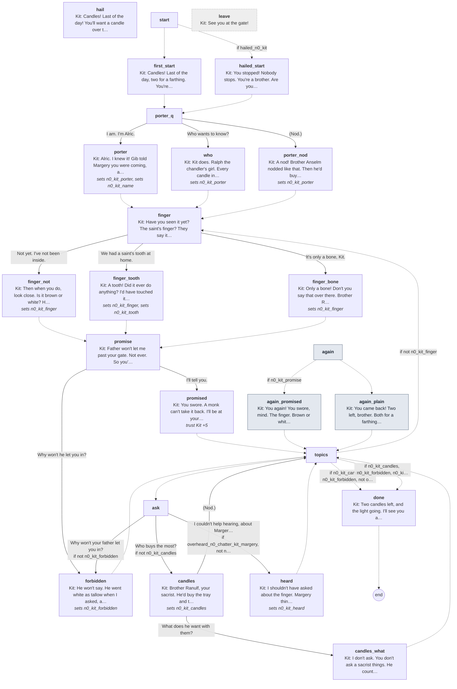

Every line

#### `hail`

- *A girl's voice, over the rain.*
- **Kit** *glad*: Candles! Last of the day! You'll want a candle over there, brother!

#### `start`

- → `hailed_start` if `hailed_n0_kit`
- → `first_start`

#### `first_start`

- *A girl with a tray of candles on a strap round her neck, her hood up against the rain.*
- **Kit** *glad*: Candles! Last of the day, two for a farthing. You're a brother. Are you the new porter?

- → `porter_q`

#### `hailed_start`

- *The candle girl comes up close, her tray held out of the rain under her cloak.*
- **Kit** *glad, brow*: You stopped! Nobody stops. You're a brother. Are you the new porter?

- → `porter_q`

#### `porter_q`

1. I am. I'm Alric. → `porter`
2. Who wants to know? → `who`
3. (Nod.) → `porter_nod`

#### `porter`
*sets `n0_kit_porter`, sets `n0_kit_name`*

- **Kit** *glad*: Alric. I knew it! Gib told Margery you were coming, and Margery told the whole lane.
- **Kit** *amused*: You're younger than Brother Anselm. Everybody's younger than Brother Anselm.

- → `finger`

#### `who`
*sets `n0_kit_porter`*

- **Kit** *amused*: Kit does. Ralph the chandler's girl. Every candle in your church, Father made and I carried.
- **Kit** *glad*: And you are the porter. Gib told Margery you were coming, and Margery told the whole lane.

- → `finger`

#### `porter_nod`
*sets `n0_kit_porter`*

- **Kit** *amused*: A nod! Brother Anselm nodded like that. Then he'd buy nothing.

- → `finger`

#### `finger`

- **Kit** *glad, brow*: Have you seen it yet? The saint's finger? They say it's in a glass box, and it moves if you pray hard enough.

1. Not yet. I've not been inside. → `finger_not`
2. We had a saint's tooth at home. → `finger_tooth`
3. It's only a bone, Kit. → `finger_bone`

#### `finger_not`
*sets `n0_kit_finger`*

- **Kit** *pleading*: Then when you do, look close. Is it brown or white? Has it got its nail?

- → `promise`

#### `finger_tooth`
*sets `n0_kit_finger`, sets `n0_kit_tooth`*

- **Kit** *glad*: A tooth! Did it ever do anything? I'd have touched it every day, if I'd been you.

- → `promise`

#### `finger_bone`
*sets `n0_kit_finger`*

- **Kit** *wary*: Only a bone! Don't you say that over there. Brother Ranulf would have your ears.

- → `promise`

#### `promise`

- **Kit** *pleading*: Father won't let me past your gate. Not ever. So you'll have to look for me, and tell me.

1. I'll tell you. → `promised` · sets `n0_kit_promise`
2. Why won't he let you in? → `forbidden`

#### `promised`
***trust Kit +5***

- **Kit** *glad*: You swore. A monk can't take it back. I'll be at your gate tomorrow, and you'll tell me.

- → `topics`

#### `forbidden`
*sets `n0_kit_forbidden`*

- **Kit** *wary*: He won't say. He went white as tallow when I asked, and said not ever, and that was all.
- **Kit** *amused*: You ask him. He's in the Keys. He won't tell you either.

- → `topics`

#### `again` (the next time)

- → `again_promised` if `n0_kit_promise`
- → `again_plain`

#### `again_promised`

- **Kit** *amused*: You again! You swore, mind. The finger. Brown or white.

- → `topics`

#### `again_plain`

- **Kit** *amused*: You came back! Two left, brother. Both for a farthing, and I'll throw in the tray.

- → `topics`

#### `topics`

- → `finger` if not `n0_kit_finger`
- → `done` if `n0_kit_candles`, `n0_kit_forbidden`, not `overheard_n0_chatter_kit_margery`
- → `done` if `n0_kit_candles`, `n0_kit_forbidden`, `n0_kit_heard`
- → `ask`

#### `ask`

1. Who buys the most? → `candles` · only if not `n0_kit_candles`
2. Why won't your father let you in? → `forbidden` · only if not `n0_kit_forbidden`
3. I couldn't help hearing, about Margery's Wat. → `heard` · only if `overheard_n0_chatter_kit_margery`, not `n0_kit_heard`

#### `candles`
*sets `n0_kit_candles`*

- **Kit** *amused*: Brother Ranulf, your sacrist. He'd buy the tray and the strap, if I let him.
- **Kit** *calm*: At Easter it was two a week. Father says nobody needs that much light to pray by.

1. What does he want with them? → `candles_what`
2. (Nod.) → `topics`

#### `candles_what`

- **Kit** *wary*: I don't ask. You don't ask a sacrist things. He counts them into his sleeve, one by one, and goes in.
- **Kit** *amused*: You can ask him, though. You live there.

- → `topics`

#### `heard`
*sets `n0_kit_heard`*

- **Kit** *ashamed*: I shouldn't have asked about the finger. Margery thinks it's wicked, wanting to see it.
- **Kit** *wary*: But Father saw Wat come out of your gate that morning, and he wouldn't say good day. Wat says good day to cats.

- → `topics`

#### `done`

- **Kit** *glad*: Two candles left, and the light going. I'll see you at your gate, porter!

- → `end`

#### `leave` (if he walks away)

- **Kit** *glad*: See you at the gate!

## Mab

[`mab.talk`](../../game/chapters/night0/dialogue/mab.talk) · id `n0_mab` · baseline *wary* · starts at trust 0

Moods through the talk: wary → calm → wary → grave → calm → grave → wary → grave → calm → grave → weary → wary → grave → cold → warm → grave → wary → calm → grave → calm → wary

> Mab, a leper, begging by the barred abbey gate at dusk, night 0. Plain and unflinching: she sees everyone who goes in and out, and nobody asks her. Her first lines send him to the Cross Keys (n0_sent_to_inn, set at start whichever way it opens).
> Hail: as he comes near the gate she knocks her clapper and asks alms. Then he knocks, nobody comes, and she speaks up herself: this talk starts on its own (arrive_beat.gd; your ask, 2026-11-16).
> She asks him why they'd send a boy to keep that gate, and remembers what he said (n0_mab_why = must, sent or quiet): her closing line uses it.
> Alms once (n0_mab_alms): a heel of bread from a Fenchurch Street baker. She doesn't eat what comes out of the abbey's gate.
> Thread: Brother Anselm, the old porter, was the only one inside who passed her a word through the bars, most nights for eleven years. The winter before his eyes went he stopped, and stood at the grille after the bell looking out past her. The last thing he said to her: never come in, not if they ask kindly (n0_mab_anselm). For later nights: Anselm (day 1, night 1) can know Mab's name from it; on night 4 she comes inside the gate for the first time.
> Cross-link: if Margery told him her son-in-law Wat carts the abbey's rye (n0_margery_wat), Mab has seen Wat come out (n0_mab_wat).
> Answer paths the tests take: 0,0,0 and 2,0,0 (alms first) both end the talk with n0_sent_to_inn set; 2,0,0 gives the bread.

**Reads from elsewhere:** [`hailed_n0_mab`](links.md#hailed_n0_mab), [`n0_margery_wat`](links.md#n0_margery_wat)
**Read elsewhere:** [`n0_sent_to_inn`](links.md#n0_sent_to_inn), [`talked_n0_mab`](links.md#talked_n0_mab)

### Every path

```mermaid
flowchart TD
  p_hail["<b>hail</b><br/>Mab: Alms, brother. Alms, for the love of God."]
  p_start["<b>start</b><br/><i>sets n0_sent_to_inn</i>"]
  p_first_start["<b>first_start</b><br/>Mab: No use knocking, brother. Nobody keeps that gate at n…"]
  p_hailed_start["<b>hailed_start</b><br/>Mab: I could have told you. Nobody keeps that gate at nigh…"]
  p_send["<b>send</b><br/>Mab: They'll open it for nobody now. You'll have to stay t…"]
  p_again["<b>again</b>"]
  p_again_ask["<b>again_ask</b><br/>Mab: You again, brother. The Keys hasn't moved."]
  p_topics["<b>topics</b>"]
  p_ask["<b>ask</b>"]
  p_ask_wat["<b>ask_wat</b>"]
  p_porter["<b>porter</b><br/>Mab: Their porter. Why would they send a boy to keep that…<br/><i>sets n0_mab_porter</i>"]
  p_why_must["<b>why_must</b><br/>Mab: Anselm said that, his first year. Eleven years, and h…<br/><i>sets n0_mab_why=must</i>"]
  p_why_sent["<b>why_sent</b><br/>Mab: So was the last one. Old Anselm. He passed me a word…<br/><i>sets n0_mab_why=sent</i>"]
  p_why_quiet["<b>why_quiet</b><br/>Mab: Close-mouthed. Anselm was the same, his first year. T…<br/><i>sets n0_mab_why=quiet</i>"]
  p_anselm["<b>anselm</b><br/>Mab: The winter before his eyes went, he stopped. He'd sta…"]
  p_anselm_what["<b>anselm_what</b><br/>Mab: I asked him. He wouldn't say. But the last thing he e…<br/><i>sets n0_mab_anselm</i>"]
  p_anselm_where["<b>anselm_where</b><br/>Mab: In their infirmary, they say. I've not heard his voic…<br/><i>sets n0_mab_anselm</i>"]
  p_saw["<b>saw</b><br/>Mab: Every night God sends. Rain or frost, it's all one to…<br/><i>sets n0_mab_saw</i>"]
  p_saw_asked["<b>saw_asked</b><br/>Mab: Then I'll tell you for nothing, brother. More go in t…<br/><i>trust Mab +5</i>"]
  p_saw_nod["<b>saw_nod</b><br/>Mab: No. Nobody does."]
  p_alms["<b>alms</b><br/>Mab: God keep you, brother. Here. You'll want something fo…<br/><i>sets n0_mab_alms, gives mab_bread, trust Mab +5</i>"]
  p_bread_why["<b>bread_why</b><br/>Mab: Because I'm a leper, brother, not a fool. Ask me agai…"]
  p_bread_thanks["<b>bread_thanks</b><br/>Mab: Eat it tonight. Not tomorrow. Tomorrow they'll feed y…"]
  p_wat["<b>wat</b><br/>Mab: Wat. Big man, Thursdays, with the rye. He used to whi…<br/><i>sets n0_mab_wat</i>"]
  p_done["<b>done</b>"]
  p_done_must["<b>done_must</b><br/>Mab: Go on across to the fire, brother. Keep it, then. And…"]
  p_done_sent["<b>done_sent</b><br/>Mab: Go where you're sent, then, brother. Across to the fi…"]
  p_done_plain["<b>done_plain</b><br/>Mab: Go on across to the fire, brother. I'll be here. I'm…"]
  p_leave["<b>leave</b><br/>Mab: Mind the lane after the bell, brother."]
  end_((end))
  p_start -.->|"if hailed_n0_mab"| p_hailed_start
  p_start -.-> p_first_start
  p_first_start -.-> p_send
  p_hailed_start -.-> p_send
  p_send -.-> p_topics
  p_again -.->|"if n0_mab_porter, n0_mab_saw, n0_mab_alms,…"| p_done
  p_again -.->|"if n0_mab_porter, n0_mab_saw, n0_mab_alms,…"| p_done
  p_again -.-> p_again_ask
  p_again_ask -.-> p_topics
  p_topics -.->|"if n0_mab_porter, n0_mab_saw, n0_mab_alms,…"| p_done
  p_topics -.->|"if n0_mab_porter, n0_mab_saw, n0_mab_alms,…"| p_done
  p_topics -.->|"if n0_margery_wat, not n0_mab_wat"| p_ask_wat
  p_topics -.-> p_ask
  p_ask -->|"I'm to be its porter.<br/>if not n0_mab_porter"| p_porter
  p_ask -->|"Are you here every night?<br/>if not n0_mab_saw"| p_saw
  p_ask -->|"(Give her a coin.)<br/>if not n0_mab_alms"| p_alms
  p_ask_wat -->|"I'm to be its porter.<br/>if not n0_mab_porter"| p_porter
  p_ask_wat -->|"Margery's son-in-law carts rye to thi…"| p_wat
  p_ask_wat -->|"(Give her a coin.)<br/>if not n0_mab_alms"| p_alms
  p_porter -->|"Someone has to keep it."| p_why_must
  p_porter -->|"I go where I'm sent."| p_why_sent
  p_porter -->|"(Say nothing.)"| p_why_quiet
  p_why_must -.-> p_anselm
  p_why_sent -.-> p_anselm
  p_why_quiet -.-> p_anselm
  p_anselm -->|"What was he looking for?"| p_anselm_what
  p_anselm -->|"Is he still in there?"| p_anselm_where
  p_anselm_what -.-> p_topics
  p_anselm_where -.-> p_topics
  p_saw -->|"I'm asking."| p_saw_asked
  p_saw -->|"(Nod.)"| p_saw_nod
  p_saw_asked -.-> p_topics
  p_saw_nod -.-> p_topics
  p_alms -->|"Why not?"| p_bread_why
  p_alms -->|"(Take it, and thank her.)"| p_bread_thanks
  p_bread_why -.-> p_topics
  p_bread_thanks -.-> p_topics
  p_wat -.-> p_topics
  p_done -.->|"if n0_mab_why=must"| p_done_must
  p_done -.->|"if n0_mab_why=sent"| p_done_sent
  p_done -.-> p_done_plain
  p_done_must -.-> end_
  p_done_sent -.-> end_
  p_done_plain -.-> end_
  classDef claim fill:#f3e3b5,stroke:#9a6b1a,color:#2b2116
  classDef again fill:#e3e8ef,stroke:#5b6b80,color:#1c2430
  classDef leave fill:#eee,stroke:#999,color:#333,stroke-dasharray: 3 3
  class p_again again
  class p_again_ask again
  class p_leave leave
```

Every line

#### `hail`

- *A wooden clapper knocks by the wall, twice.*
- **Mab** *wary*: Alms, brother. Alms, for the love of God.

#### `start`
*sets `n0_sent_to_inn`*

- → `hailed_start` if `hailed_n0_mab`
- → `first_start`

#### `first_start`

- *A wooden clapper, knocking. A woman sits against the wall by the gate, her face wrapped to the eyes in grey cloth.*
- **Mab** *wary*: No use knocking, brother. Nobody keeps that gate at night, not since old Brother Anselm went blind.

- → `send`

#### `hailed_start`

- *The woman by the wall lowers her clapper. Her face is wrapped to the eyes in grey cloth.*
- **Mab** *wary*: I could have told you. Nobody keeps that gate at night, not since old Brother Anselm went blind.

- → `send`

#### `send`

- **Mab** *calm*: They'll open it for nobody now. You'll have to stay the night at the Cross Keys, there, with the lantern. Agnes will find you a bed.

- → `topics`

#### `again` (the next time)

- → `done` if `n0_mab_porter`, `n0_mab_saw`, `n0_mab_alms`, not `n0_margery_wat`
- → `done` if `n0_mab_porter`, `n0_mab_saw`, `n0_mab_alms`, `n0_mab_wat`
- → `again_ask`

#### `again_ask`

- **Mab** *wary*: You again, brother. The Keys hasn't moved.

- → `topics`

#### `topics`

- → `done` if `n0_mab_porter`, `n0_mab_saw`, `n0_mab_alms`, not `n0_margery_wat`
- → `done` if `n0_mab_porter`, `n0_mab_saw`, `n0_mab_alms`, `n0_mab_wat`
- → `ask_wat` if `n0_margery_wat`, not `n0_mab_wat`
- → `ask`

#### `ask`

1. I'm to be its porter. → `porter` · only if not `n0_mab_porter`
2. Are you here every night? → `saw` · only if not `n0_mab_saw`
3. (Give her a coin.) → `alms` · only if not `n0_mab_alms`

#### `ask_wat`

1. I'm to be its porter. → `porter` · only if not `n0_mab_porter`
2. Margery's son-in-law carts rye to this gate. Wat. → `wat`
3. (Give her a coin.) → `alms` · only if not `n0_mab_alms`

#### `porter`
*sets `n0_mab_porter`*

- *She looks at you a long while over the cloth.*
- **Mab** *wary*: Their porter. Why would they send a boy to keep that gate?

1. Someone has to keep it. → `why_must`
2. I go where I'm sent. → `why_sent`
3. (Say nothing.) → `why_quiet`

#### `why_must`
*sets `n0_mab_why=must`*

- **Mab** *grave*: Anselm said that, his first year. Eleven years, and he's the only one in there ever passed me a word through the bars.

- → `anselm`

#### `why_sent`
*sets `n0_mab_why=sent`*

- **Mab** *calm*: So was the last one. Old Anselm. He passed me a word through the bars most nights, eleven years.

- → `anselm`

#### `why_quiet`
*sets `n0_mab_why=quiet`*

- **Mab** *calm*: Close-mouthed. Anselm was the same, his first year. Then he talked to me through the bars most nights, eleven years.

- → `anselm`

#### `anselm`

- **Mab** *grave, look away*: The winter before his eyes went, he stopped. He'd stand at the grille after the bell and look out past me, at nothing.

1. What was he looking for? → `anselm_what`
2. Is he still in there? → `anselm_where`

#### `anselm_what`
*sets `n0_mab_anselm`*

- **Mab** *wary*: I asked him. He wouldn't say. But the last thing he ever said to me was, don't you ever come in, Mab.
- **Mab** *grave*: Not if they ask you kindly. Not if it snows.

- → `topics`

#### `anselm_where`
*sets `n0_mab_anselm`*

- **Mab** *calm*: In their infirmary, they say. I've not heard his voice since Lammas.
- **Mab** *grave*: The last thing he said to me was, don't you ever come in, Mab. Not if they ask you kindly.

- → `topics`

#### `saw`
*sets `n0_mab_saw`*

- **Mab** *weary*: Every night God sends. Rain or frost, it's all one to me.
- **Mab** *wary*: I see everyone who goes in at that gate, and everyone who comes out. Nobody asks me.

1. I'm asking. → `saw_asked`
2. (Nod.) → `saw_nod`

#### `saw_asked`
***trust Mab +5***

- *She's quiet a moment behind the cloth.*
- **Mab** *grave, still*: Then I'll tell you for nothing, brother. More go in than come out.

- → `topics`

#### `saw_nod`

- **Mab** *cold*: No. Nobody does.

- → `topics`

#### `alms`
*sets `n0_mab_alms`, gives `mab_bread`, **trust Mab +5***

- *You drop a penny in the bowl at her feet.*
- **Mab** *warm*: God keep you, brother. Here. You'll want something for your supper.
- *She sets a heel of bread on the step between you, wrapped in a cloth, and draws back.*
- **Mab** *grave*: It's from a baker on Fenchurch Street. I don't eat what comes out of that gate.

1. Why not? → `bread_why`
2. (Take it, and thank her.) → `bread_thanks`

#### `bread_why`

- **Mab** *wary*: Because I'm a leper, brother, not a fool. Ask me again when you've eaten in there a week.

- → `topics`

#### `bread_thanks`

- **Mab** *calm*: Eat it tonight. Not tomorrow. Tomorrow they'll feed you.

- → `topics`

#### `wat`
*sets `n0_mab_wat`*

- **Mab** *calm*: Wat. Big man, Thursdays, with the rye. He used to whistle at me going in.
- **Mab** *grave, glance*: The night they shut him in, he came out at first light leading his horse, and never once looked at the wall. He doesn't whistle now.

- → `topics`

#### `done`

- → `done_must` if `n0_mab_why=must`
- → `done_sent` if `n0_mab_why=sent`
- → `done_plain`

#### `done_must`

- **Mab** *calm*: Go on across to the fire, brother. Keep it, then. And keep your eyes. The last one didn't.

- → `end`

#### `done_sent`

- **Mab** *calm*: Go where you're sent, then, brother. Across to the fire. I'll be here. I'm always here.

- → `end`

#### `done_plain`

- **Mab** *calm*: Go on across to the fire, brother. I'll be here. I'm always here.

- → `end`

#### `leave` (if he walks away)

- **Mab** *wary*: Mind the lane after the bell, brother.

## Margery

[`margery.talk`](../../game/chapters/night0/dialogue/margery.talk) · id `n0_margery`

Moods through the talk: afraid → wary → calm → afraid → sad → afraid → wary → warm → afraid → sad → afraid

> Margery, a neighbour from by Saint Andrew's, hurrying home with her basket before dark, night 0. Hurried, careful, frightened: she won't stop long, and she won't pass the abbey wall after dark. She doesn't call out to anyone.
> If Kit has his name (n0_kit_name) she greets him by it: the lane passes everything on.
> She asks where he'll sleep tonight, and remembers it (n0_margery_unsure: she tells him again, going, to make it the Keys).
> Thread: her daughter's husband, Wat, carts the abbey's rye in from Essex on Thursdays. Once they kept him late unloading, shut the gate on him, and he slept in his cart in their court. He came home at first light and hasn't slept in the dark since; he won't go in past the gate now, and won't say why (n0_margery_wat, n0_margery_wat_saw). For later nights: what Wat saw, a piece at a time.
> Cross-link: Mab has seen Wat come out (mab.talk, [if n0_margery_wat]).
> Overheard: Kit and Margery in the lane (chatter_kit_margery.talk). If he heard it, she opens on it.

**Reads from elsewhere:** [`n0_kit_name`](links.md#n0_kit_name), [`overheard_n0_chatter_kit_margery`](links.md#overheard_n0_chatter_kit_margery)
**Read elsewhere:** [`n0_margery_wat`](links.md#n0_margery_wat), [`talked_n0_margery`](links.md#talked_n0_margery)

### Every path

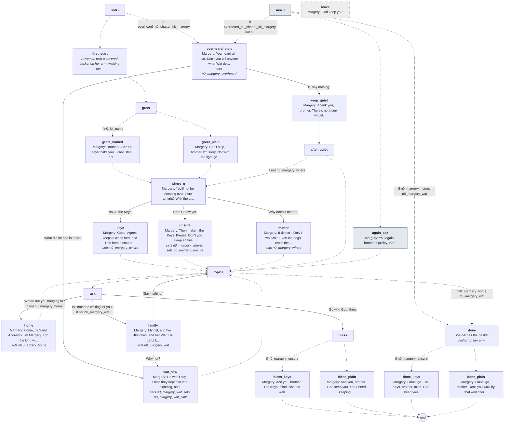

Every line

#### `start`

- → `overheard_start` if `overheard_n0_chatter_kit_margery`
- → `first_start`

#### `first_start`

- *A woman with a covered basket on her arm, walking fast, her eyes on the cobbles.*

- → `greet`

#### `greet`

- → `greet_named` if `n0_kit_name`
- → `greet_plain`

#### `greet_named`

- **Margery** *afraid*: Brother Alric? Kit says that's you. I can't stop, not with the light going.

- → `where_q`

#### `greet_plain`

- **Margery** *afraid*: Can't stop, brother, I'm sorry. Not with the light going.

- → `where_q`

#### `where_q`

- **Margery** *wary*: You'll not be sleeping over there tonight? With the gate shut?

1. No. At the Keys. → `keys`
2. I don't know yet. → `unsure`
3. Why does it matter? → `matter`

#### `keys`
*sets `n0_margery_where`*

- **Margery** *calm*: Good. Agnes keeps a clean bed, and Hob bars a stout door.

- → `topics`

#### `unsure`
*sets `n0_margery_where`, sets `n0_margery_unsure`*

- **Margery** *afraid*: Then make it the Keys. Please. Don't you sleep against that wall.

- → `topics`

#### `matter`
*sets `n0_margery_where`*

- **Margery** *afraid, glance*: It doesn't. Only I wouldn't. Even the dogs cross the lane rather than go by it.

- → `topics`

#### `overheard_start`
*sets `n0_margery_overheard`*

- *The woman with the basket stops short when she sees how near you are.*
- **Margery** *afraid*: You heard all that. Don't you tell anyone what Wat does. He's a good man. He's only tired.

1. I'll say nothing. → `keep_quiet` · **trust Margery +5**
2. What did he see in there? → `wat_saw`

#### `keep_quiet`

- **Margery** *sad*: Thank you, brother. There's not many would.

- → `after_quiet`

#### `after_quiet`

- → `where_q` if not `n0_margery_where`
- → `topics`

#### `again` (the next time)

- → `overheard_start` if `overheard_n0_chatter_kit_margery`, not `n0_margery_overheard`
- → `done` if `n0_margery_home`, `n0_margery_wat`
- → `again_ask`

#### `again_ask`

- **Margery** *afraid*: You again, brother. Quickly, then.

- → `topics`

#### `topics`

- → `done` if `n0_margery_home`, `n0_margery_wat`
- → `ask`

#### `ask`

1. Where are you hurrying to? → `home` · only if not `n0_margery_home`
2. Is someone waiting for you? → `family` · only if not `n0_margery_wat`
3. Go with God, then. → `bless` · **trust Margery +5**

#### `home`
*sets `n0_margery_home`*

- **Margery** *afraid*: Home, by Saint Andrew's. I'm Margery. I go the long way round.
- **Margery** *wary, glance*: Two streets more, but it doesn't pass that wall.

- → `topics`

#### `family`
*sets `n0_margery_wat`*

- **Margery** *warm*: My girl, and her little ones, and her Wat. He carts for your abbey. Rye, from Essex, every Thursday.
- *Her face changes.*
- **Margery** *afraid*: He won't go in past the gate any more. He leaves the sacks for your lay brothers to carry.

1. Why not? → `wat_saw`
2. (Say nothing.) → `topics`

#### `wat_saw`
*sets `n0_margery_wat`, sets `n0_margery_wat_saw`*

- **Margery** *afraid, look away*: He won't say. Once they kept him late unloading, and shut the gate on him, and he slept in his cart in their court.
- **Margery** *afraid, swallow*: He came home at first light. He's not slept in the dark since. Not one night.

- → `topics`

#### `bless`

- → `bless_keys` if `n0_margery_unsure`
- → `bless_plain`

#### `bless_keys`

- **Margery** *sad*: And you, brother. The Keys, mind. Not that wall.

- → `end`

#### `bless_plain`

- **Margery** *sad*: And you, brother. God keep you. You'll need keeping, over there.

- → `end`

#### `done`

- *She hitches the basket higher on her arm.*

- → `done_keys` if `n0_margery_unsure`
- → `done_plain`

#### `done_keys`

- **Margery** *afraid*: I must go. The Keys, brother, mind. God keep you.

- → `end`

#### `done_plain`

- **Margery** *afraid*: I must go, brother. Don't you walk by that wall after dark. Nobody does.

- → `end`

#### `leave` (if he walks away)

- **Margery** *afraid*: God keep you!

## Ralph the chandler

[`ralph.talk`](../../game/chapters/night0/dialogue/ralph.talk) · id `n0_ralph`

Moods through the talk: warm → wary → calm → amused → calm → wary → warm → calm → wary → warm → grave → calm → grave → afraid → wary → grave → calm → amused

> Ralph the chandler at the Cross Keys, night 0. He makes the abbey's candles; his daughter Kit sells them. A careful tradesman who notices numbers.
> He asks the porter how much light they burned at the house he came from, and remembers it (n0_ralph_light = little, read or never).
> The sacrist has bought twice the wax since about Michaelmas, and pays in silver the abbey never used to have (n0_ralph_candles: night 2's Ranulf answers to it).
> Thread: he won't let Kit past the abbey gate, not ever. A month back the sacrist had him carry a late order to the church door himself, after Compline with no bell rung, and there was singing under the floor of the church (n0_ralph_singing). For later nights: the count of candles, which Kit carries on at each dusk; what he heard.
> Cross-link: Kit tells the porter to ask her father why (n0_kit_forbidden).
> Overheard: Roger and Ralph on the price of the abbey's candles (chatter_roger_ralph.talk). If he heard it, Ralph opens on it.

**Reads from elsewhere:** [`n0_kit_forbidden`](links.md#n0_kit_forbidden), [`overheard_n0_chatter_roger_ralph`](links.md#overheard_n0_chatter_roger_ralph)
**Read elsewhere:** [`n0_ralph_candles`](links.md#n0_ralph_candles)

### Every path

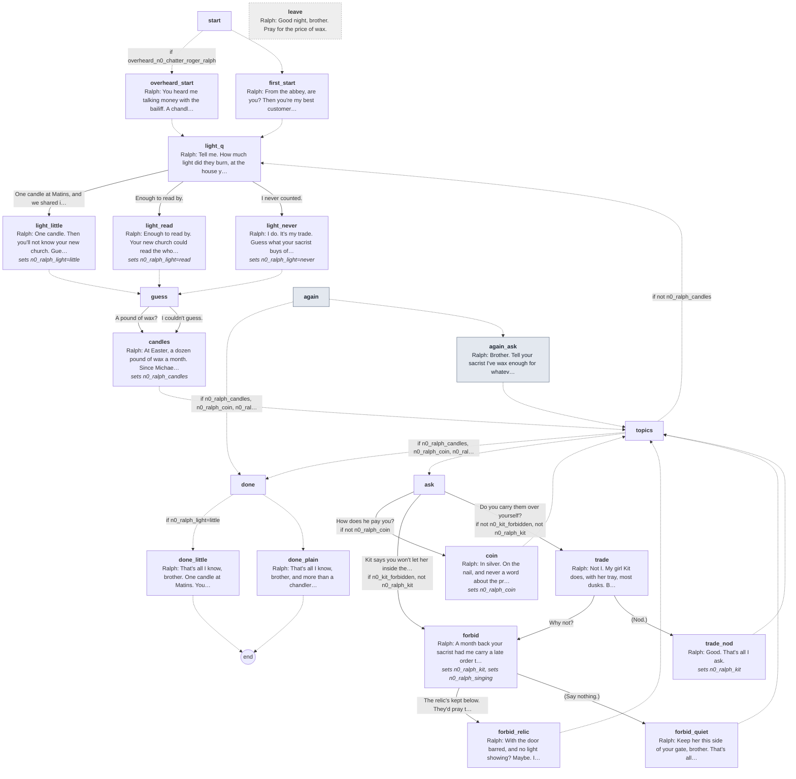

Every line

#### `start`

- → `overheard_start` if `overheard_n0_chatter_roger_ralph`
- → `first_start`

#### `first_start`

- *A thin man with wax under his nails and old burns on his fingers, nursing a small ale.*
- **Ralph** *warm*: From the abbey, are you? Then you're my best customer, brother, whether you know it or not.

- → `light_q`

#### `overheard_start`

- *The thin man with burned fingers looks up from his ale, and colours.*
- **Ralph** *wary*: You heard me talking money with the bailiff. A chandler talks money, brother. It's all he's got.

- → `light_q`

#### `light_q`

- **Ralph** *calm*: Tell me. How much light did they burn, at the house you came from?

1. One candle at Matins, and we shared it. → `light_little`
2. Enough to read by. → `light_read`
3. I never counted. → `light_never`

#### `light_little`
*sets `n0_ralph_light=little`*

- **Ralph** *amused*: One candle. Then you'll not know your new church. Guess what your sacrist buys of me in a month.

- → `guess`

#### `light_read`
*sets `n0_ralph_light=read`*

- **Ralph** *amused*: Enough to read by. Your new church could read the whole Bible by night, twice over. Guess what your sacrist buys of me in a month.

- → `guess`

#### `light_never`
*sets `n0_ralph_light=never`*

- **Ralph** *calm*: I do. It's my trade. Guess what your sacrist buys of me in a month.

- → `guess`

#### `guess`

1. A pound of wax? → `candles`
2. I couldn't guess. → `candles`

#### `candles`
*sets `n0_ralph_candles`*

- **Ralph** *calm*: At Easter, a dozen pound of wax a month. Since Michaelmas, two dozen, and more.
- **Ralph** *wary*: I asked Brother Ranulf once what they burn it all for. He didn't say.

- → `topics`

#### `again` (the next time)

- → `done` if `n0_ralph_candles`, `n0_ralph_coin`, `n0_ralph_kit`
- → `again_ask`

#### `again_ask`

- **Ralph** *warm*: Brother. Tell your sacrist I've wax enough for whatever he wants.

- → `topics`

#### `topics`

- → `light_q` if not `n0_ralph_candles`
- → `done` if `n0_ralph_candles`, `n0_ralph_coin`, `n0_ralph_kit`
- → `ask`

#### `ask`

1. How does he pay you? → `coin` · only if not `n0_ralph_coin`
2. Kit says you won't let her inside the abbey. → `forbid` · only if `n0_kit_forbidden`, not `n0_ralph_kit`
3. Do you carry them over yourself? → `trade` · only if not `n0_kit_forbidden`, not `n0_ralph_kit`

#### `coin`
*sets `n0_ralph_coin`*

- **Ralph** *calm*: In silver. On the nail, and never a word about the price.
- **Ralph** *wary, swallow*: That abbey hadn't two pennies to rub together. Everybody knew it. I don't ask where a man of God gets his silver.

- → `topics`

#### `trade`

- **Ralph** *warm*: Not I. My girl Kit does, with her tray, most dusks. Be kind to her.
- *He turns his cup round on the board.*
- **Ralph** *grave*: And don't you ever let her in past it.

1. Why not? → `forbid`
2. (Nod.) → `trade_nod`

#### `trade_nod`
*sets `n0_ralph_kit`*

- **Ralph** *calm*: Good. That's all I ask.

- → `topics`

#### `forbid`
*sets `n0_ralph_kit`, sets `n0_ralph_singing`*

- *He's quiet so long you think he won't answer.*
- **Ralph** *grave*: A month back your sacrist had me carry a late order to the church door myself. After Compline, and no bell rung.
- **Ralph** *afraid, swallow*: There was singing, brother. Under the floor of the church. Under it.

1. The relic's kept below. They'd pray to it. → `forbid_relic`
2. (Say nothing.) → `forbid_quiet`

#### `forbid_relic`

- **Ralph** *wary*: With the door barred, and no light showing? Maybe. I make candles. I don't know what monks do.
- **Ralph** *grave*: I know where my girl stays. This side of your gate.

- → `topics`

#### `forbid_quiet`

- **Ralph** *grave*: Keep her this side of your gate, brother. That's all I ask.

- → `topics`

#### `done`

- → `done_little` if `n0_ralph_light=little`
- → `done_plain`

#### `done_little`

- **Ralph** *calm*: That's all I know, brother. One candle at Matins. You'll miss it. Good night to you.

- → `end`

#### `done_plain`

- **Ralph** *calm*: That's all I know, brother, and more than a chandler ought to say. Good night to you.

- → `end`

#### `leave` (if he walks away)

- **Ralph** *amused*: Good night, brother. Pray for the price of wax.

## Roger the bailiff

[`roger.talk`](../../game/chapters/night0/dialogue/roger.talk) · id `n0_roger`

Moods through the talk: cold → calm → cold → calm → cold → calm → cold → wary → grave → calm → cold → calm → warm → cold → calm → cold → calm

> Roger, bailiff of the ward, drinking at the Cross Keys, night 0. Officious, counting, cold: he has counted the porter before he sits down.
> He asks the porter whether he can write (the porter keeps a ledger) and remembers it (n0_roger_letters).
> He wants word of any merchant, anyone with money, who goes in at the abbey gate. The porter can agree (n0_roger_agreed) or refuse (n0_roger_refused); either way the ward remembers. The ward would like the abbey's land.
> Claims: n0_roger_count (hiding): why he wants the names. True as far as it goes; he leaves out the land. Pressed, he hints at it.
> Thread: Roger keeps a tally: nine men with money since Lammas who went in at that gate and were never heard of again in the ward (n0_roger_tally). For later nights: the count goes up; on night 2 he comes to the gate asking after a merchant.
> Cross-link: whatever the porter answers, Roger tells him to ask the pardoner what he carries in (n0_walter_gate_heard): Walter's talk then has the question.
> Overheard: Roger and Ralph on the price of the abbey's candles (chatter_roger_ralph.talk). If he heard it, Roger opens on it.

**Reads from elsewhere:** [`overheard_n0_chatter_roger_ralph`](links.md#overheard_n0_chatter_roger_ralph)
**Read elsewhere:** [`n0_walter_gate_heard`](links.md#n0_walter_gate_heard)

### Every path

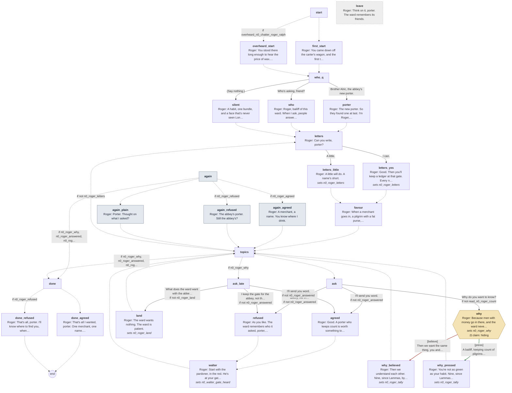

Every line

#### `start`

- → `overheard_start` if `overheard_n0_chatter_roger_ralph`
- → `first_start`

#### `first_start`

- *A broad man in a good brown coat, a staff of office leaning on the table. He was watching you before you came in.*
- **Roger** *cold*: You came down off the carter's wagon, and the first thing you looked at was the abbey wall. Who are you?

- → `who_q`

#### `overheard_start`

- *The broad man with the staff of office turns on the bench. He knew you were there.*
- **Roger** *cold*: You stood there long enough to hear the price of wax. Who are you?

- → `who_q`

#### `who_q`

1. Brother Alric, the abbey's new porter. → `porter`
2. Who's asking, friend? → `who` · **trust Roger the bailiff -5**
3. (Say nothing.) → `silent`

#### `porter`

- **Roger** *calm*: The new porter. So they found one at last. I'm Roger, bailiff of this ward.

- → `letters`

#### `who`

- **Roger** *cold*: Roger, bailiff of this ward. When I ask, people answer. You'll be their new porter.

- → `letters`

#### `silent`

- **Roger** *calm*: A habit, one bundle, and a face that's never seen London. You're their new porter. I'm Roger, bailiff of this ward.

- → `letters`

#### `letters`

- **Roger** *calm*: Can you write, porter?

1. I can. → `letters_yes`
2. A little. → `letters_little`

#### `letters_yes`
*sets `n0_roger_letters`*

- **Roger** *calm*: Good. Then you'll keep a ledger at that gate. Every name that goes in.

- → `favour`

#### `letters_little`
*sets `n0_roger_letters`*

- **Roger** *cold*: A little will do. A name's short.

- → `favour`

#### `favour`

- **Roger** *calm*: When a merchant goes in, a pilgrim with a fat purse, I'd like his name, and where he's from. That's all.

- → `topics`

#### `again` (the next time)

- → `done` if `n0_roger_why`, `n0_roger_answered`, `n0_roger_land`
- → `again_agreed` if `n0_roger_agreed`
- → `again_refused` if `n0_roger_refused`
- → `again_plain`

#### `again_agreed`

- **Roger** *calm*: A merchant, a name. You know where I drink.

- → `topics`

#### `again_refused`

- **Roger** *cold*: The abbey's porter. Still the abbey's?

- → `topics`

#### `again_plain`

- **Roger** *wary*: Porter. Thought on what I asked?

- → `topics`

#### `topics`

- → `letters` if not `n0_roger_letters`
- → `done` if `n0_roger_why`, `n0_roger_answered`, `n0_roger_land`
- → `ask_late` if `n0_roger_why`
- → `ask`

#### `ask`

1. Why do you want to know? → `why` · only if not `read_n0_roger_count`
2. I'll send you word. → `agreed` · only if not `n0_roger_answered` · sets `n0_roger_agreed` · sets `n0_roger_answered` · **trust Roger the bailiff +5**
3. I keep the gate for the abbey, not the ward. → `refused` · only if not `n0_roger_answered` · sets `n0_roger_refused` · sets `n0_roger_answered` · **trust Roger the bailiff -5**

#### `ask_late`

1. What does the ward want with the abbey? → `land` · only if not `n0_roger_land`
2. I'll send you word. → `agreed` · only if not `n0_roger_answered` · sets `n0_roger_agreed` · sets `n0_roger_answered` · **trust Roger the bailiff +5**
3. I keep the gate for the abbey, not the ward. → `refused` · only if not `n0_roger_answered` · sets `n0_roger_refused` · sets `n0_roger_answered` · **trust Roger the bailiff -5**

#### `why`
*sets `n0_roger_why`*

- **Roger** *grave*: Because men with money go in there, and the ward never hears of them again.
- **Roger** *calm, lip*: Somebody ought to keep count. Your abbey doesn't.

> **Claim `n0_roger_count`: true, but holding back.** The last line is the claim.

1. Then we want the same thing, you and I. → `why_believed` · **believe** · wrong
2. A bailiff, keeping count of pilgrims for nothing? → `why_pressed` · **press** · **right**, trust +1

#### `why_believed`
*sets `n0_roger_tally`*

- **Roger** *calm*: Then we understand each other. Nine, since Lammas, by my count. A goldsmith's man, two drapers, a knight's widow.
- **Roger** *cold*: Not one of them was heard of again in this ward.

- → `topics`

#### `why_pressed`
*sets `n0_roger_tally`*

- *He looks at you a while.*
- **Roger** *cold*: You're not as green as your habit. Nine, since Lammas. A house that loses its guests can lose other things.
- **Roger** *calm*: The ward keeps count of those as well.

- → `topics`

#### `agreed`

- **Roger** *warm*: Good. A porter who keeps count is worth something to the ward. The ward pays its friends.

- → `walter`

#### `refused`

- **Roger** *cold*: As you like. The ward remembers who it asked, porter, and what he said.

- → `walter`

#### `walter`
*sets `n0_walter_gate_heard`*

- **Roger** *calm*: Start with the pardoner, in the red. He's at your gate more nights than not. Ask him what he carries in.

- → `topics`

#### `land`
*sets `n0_roger_land`*

- **Roger** *calm, lip*: The ward wants nothing. The ward is patient.
- **Roger** *cold*: That's good land behind your wall. If your abbey ever falls on hard times, there are men who'd put it to better use. Remember who told you.

- → `topics`

#### `done`

- → `done_refused` if `n0_roger_refused`
- → `done_agreed`

#### `done_agreed`

- **Roger** *cold*: That's all I wanted, porter. One merchant, one name. I'll know where to find you.

- → `end`

#### `done_refused`

- **Roger** *cold*: That's all, porter. I'll know where to find you, when you change your mind.

- → `end`

#### `leave` (if he walks away)

- **Roger** *calm*: Think on it, porter. The ward remembers its friends.

## Traveller

[`traveller.talk`](../../game/chapters/night0/dialogue/traveller.talk) · id `n0_traveller`

Moods through the talk: afraid → sad → afraid → grave → afraid → grave → afraid → grave → sad → grave → sad → grave → sad

> The traveller (Will Fuller) beside the porter on the carter's wagon, night 0. The carter has pulled in; as the cart with the dead comes close the traveller breaks off whatever he was saying (traveller_road.talk is that talk) and turns to it. It opens on him, not on a greeting: they have been talking all the way from the fields.
> Four pilgrims under sacking, found in the ditch: seven this month on this road. They went in at the abbey's gate to see the saint; nobody saw them come out; they turn up after, outside the walls.
> The ride reveals nothing of what or who is behind it: no demon, no men, no robbery. Only the dead, the count, the abbey, and a man too frightened to say what people say.
> If the porter told him he's the abbey's porter (n0_road_porter), he says your abbey; if not, the carter has told him. If he gave his name (n0_road_alric), Will uses it.
> If the cart broke in before Will gave his own name, he gives it as the cart goes (done_name: knows_traveller).
> He asks the porter one thing back: whether he'll still go in at that gate (n0_cart_go).
> One talk: the questions left come up again until all are asked; then he watches the cart go and closes it (done). What he doesn't get to say here (Aldgate may cut it short), the porter can ask him after (traveller_road.talk, after).
> Answer paths the tests take: test_prologue and test_flow answer 0 throughout (who, abbey, abbey_how, say, see, see_go, done). The two lines that open it ("Whoa. Look at that." and the cart going by) are checked word for word.

**Reads from elsewhere:** [`n0_road_alric`](links.md#n0_road_alric), [`n0_road_porter`](links.md#n0_road_porter)
**Read elsewhere:** [`knows_traveller`](links.md#knows_traveller), [`n0_cart_say`](links.md#n0_cart_say), [`talked_n0_traveller`](links.md#talked_n0_traveller)

### Every path

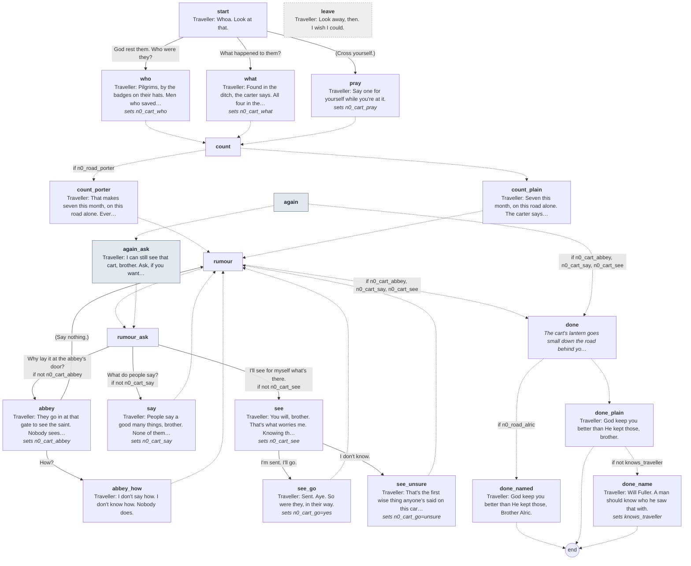

Every line

#### `start`

- **Traveller** *afraid*: Whoa. Look at that.
- *The cart creaks by close enough to touch. Shapes lie under sacking on its bed, three side by side and one across them.*
- **Traveller** *afraid, swallow*: God's wounds. That's not one man. That's four.

1. God rest them. Who were they? → `who`
2. What happened to them? → `what`
3. (Cross yourself.) → `pray`

#### `who`
*sets `n0_cart_who`*

- **Traveller** *sad*: Pilgrims, by the badges on their hats. Men who saved a year to see a saint, and nobody here to ask after them.

- → `count`

#### `what`
*sets `n0_cart_what`*

- **Traveller** *afraid, blink*: Found in the ditch, the carter says. All four in the one ditch, and not a mark on them.

- → `count`

#### `pray`
*sets `n0_cart_pray`*

- *You say the words for the dead under your breath. His lips move with yours.*
- **Traveller** *grave*: Say one for yourself while you're at it.

- → `count`

#### `count`

- → `count_porter` if `n0_road_porter`
- → `count_plain`

#### `count_porter`

- **Traveller** *grave*: That makes seven this month, on this road alone. Every one of them bound for your abbey, to see the saint.

- → `rumour`

#### `count_plain`

- **Traveller** *grave*: Seven this month, on this road alone. The carter says you're for the abbey in the lane. That's where they were all bound.

- → `rumour`

#### `rumour`

- → `done` if `n0_cart_abbey`, `n0_cart_say`, `n0_cart_see`
- → `rumour_ask`

#### `rumour_ask`

1. Why lay it at the abbey's door? → `abbey` · only if not `n0_cart_abbey`
2. What do people say? → `say` · only if not `n0_cart_say`
3. I'll see for myself what's there. → `see` · only if not `n0_cart_see`

#### `abbey`
*sets `n0_cart_abbey`*

- **Traveller** *afraid*: They go in at that gate to see the saint. Nobody sees them come out.
- **Traveller** *grave*: Then a week on, a month on, they turn up in a ditch outside the walls. Like those.

1. How? → `abbey_how`
2. (Say nothing.) → `rumour`

#### `abbey_how`

- *He crosses himself.*
- **Traveller** *afraid, swallow*: I don't say how. I don't know how. Nobody does.

- → `rumour`

#### `say`
*sets `n0_cart_say`*

- *He opens his mouth, and shuts it again.*
- **Traveller** *afraid, blink*: People say a good many things, brother. None of them in daylight.
- **Traveller** *afraid*: You'll hear it all at the Keys tonight. I'd rather not be the one who told you.

- → `rumour`

#### `see`
*sets `n0_cart_see`*

- **Traveller** *grave*: You will, brother. That's what worries me. Knowing that, you'll still go in at that gate?

1. I'm sent. I'll go. → `see_go`
2. I don't know. → `see_unsure`

#### `see_go`
*sets `n0_cart_go=yes`*

- **Traveller** *sad*: Sent. Aye. So were they, in their way.

- → `rumour`

#### `see_unsure`
*sets `n0_cart_go=unsure`*

- **Traveller** *grave*: That's the first wise thing anyone's said on this cart.

- → `rumour`

#### `done`

- *The cart's lantern goes small down the road behind you. He doesn't take his eyes off it.*

- → `done_named` if `n0_road_alric`
- → `done_plain`

#### `done_named`

- **Traveller** *sad*: God keep you better than He kept those, Brother Alric.

- → `end`

#### `done_plain`

- **Traveller** *sad*: God keep you better than He kept those, brother.

- → `done_name` if not `knows_traveller`
- → `end`

#### `done_name`
*sets `knows_traveller`*

- **Traveller** *sad, look down*: Will Fuller. A man should know who he saw that with.

- → `end`

#### `again` (the next time)

- → `done` if `n0_cart_abbey`, `n0_cart_say`, `n0_cart_see`
- → `again_ask`

#### `again_ask`

- **Traveller** *grave*: I can still see that cart, brother. Ask, if you want to.

- → `rumour_ask`

#### `leave` (if he walks away)

- **Traveller** *sad*: Look away, then. I wish I could.

## Traveller (traveller road)

[`traveller_road.talk`](../../game/chapters/night0/dialogue/traveller_road.talk) · id `n0_traveller_road`

Moods through the talk: warm → amused → warm → amused → wary → grave → amused → warm → grave → amused → grave → amused → warm → amused → warm → sad → warm → amused → sad → grave → afraid → calm → afraid → warm → weary → sad → wary → sad → afraid → grave → sad → weary → calm → afraid → calm → amused → afraid → weary

> The traveller beside the porter on the carter's wagon, night 0: Will Fuller, a wool merchant from Colchester, forty-one, bound for Cheapside, inside the walls. A wife and two girls at home. Wry and warm, and more frightened than he lets on.
> He turns to the porter himself a little way down the road (the Fields cue), and the porter can turn to him again on the road in (E): that starts at again.
> His name: he gives it in his first reply, whichever way the porter answers him (trade_name, porter_hand: knows_traveller). If the cart cuts the talk off before that, he gives it after (after_intro here, done_name in traveller.talk).
> The carter's name: Will calls him Hamo when asked why he hurries (carter_hamo: knows_carter). carter.talk names him on every path too.
> He asks as much as he answers: where the porter is bound, what takes a monk to London, whether he has anyone at home, whether he's afraid. He remembers the porter's name if he gives it (n0_road_alric) and uses it after the cart, and remembers whether he said he was afraid (n0_road_afraid).
> Thread: two girls in Colchester who think London's paved with ribbon; he's to bring them some, and his wife made him swear to stop nowhere but an inn he knows. If the porter will pray for them (n0_road_girls), he names them, and asks whose prayers to tell them of.
> One turn to him is one talk: after each answer the questions left come up again, until the porter turns away or has asked them all; then he closes it himself (spent, after_spent). Once porter and trade are both said, he asks about home himself (family_ask).
> Before the cart he only hints: road talk, men who set out for London and don't come home. When the cart with the dead comes close he breaks this talk off himself (traveller.talk says the rest), with no parting line; at Aldgate he breaks off again to greet the warden.
> After the cart (talked_n0_traveller) the porter can ask what he makes of the abbey, what people say, and who would know more. Nothing on the ride reveals a demon or men behind the deaths. After Aldgate (n0_past_aldgate) he opens on the warden.
> Answer paths the tests take: test_prologue leaves the first question ("Evening, brother. Bound for the city, are you?") unanswered until the cart breaks in, turns to him again before Aldgate and in the lane (after) and turns away; test_flow answers 0 throughout.

**Reads from elsewhere:** [`n0_past_aldgate`](links.md#n0_past_aldgate), [`talked_n0_traveller`](links.md#talked_n0_traveller)
**Read elsewhere:** [`knows_traveller`](links.md#knows_traveller), [`n0_cart_say`](links.md#n0_cart_say), [`n0_road_alric`](links.md#n0_road_alric), [`n0_road_porter`](links.md#n0_road_porter)

### Every path

```mermaid
flowchart TD
  p_start["<b>start</b>"]
  p_meet["<b>meet</b><br/><i>The man on the seat beside you, a merchant by his goo…</i>"]
  p_hello["<b>hello</b><br/>Traveller: Evening, brother. Bound for the city, are you?"]
  p_quiet["<b>quiet</b><br/>Traveller: Not one for talk. Then I'll talk for both of us.<br/><i>sets n0_road_quiet</i>"]
  p_trade["<b>trade</b><br/><i>sets n0_road_trade</i>"]
  p_trade_name["<b>trade_name</b><br/>Traveller: Will Fuller, wool, for Cheapside. Will, to anyone who…<br/><i>sets knows_traveller</i>"]
  p_trade_known["<b>trade_known</b><br/>Traveller: Cheapside, with wool. Three days from Colchester, and…"]
  p_trade_turn["<b>trade_turn</b>"]
  p_trade_ask["<b>trade_ask</b><br/>Traveller: Three days from Colchester, and every one of them wet…"]
  p_trade_shrug["<b>trade_shrug</b><br/>Traveller: A shrug. The Church's whole answer, in one shoulder.…"]
  p_porter["<b>porter</b><br/>Traveller: The porter? At the abbey in the lane, across from the…<br/><i>sets n0_road_porter</i>"]
  p_porter_hand["<b>porter_hand</b><br/>Traveller: Will Fuller. Somebody has to keep that gate, I suppos…<br/><i>sets knows_traveller</i>"]
  p_porter_known["<b>porter_known</b><br/>Traveller: Well. Somebody has to keep that gate, I suppose. You…"]
  p_young["<b>young</b><br/>Traveller: Nineteen. At nineteen I was sure I'd be rich by thirt…"]
  p_blind["<b>blind</b><br/>Traveller: Years on a gate, watching who comes in after dark. Ma…"]
  p_sent["<b>sent</b><br/>Traveller: Obedience. My father wanted that of me, and got a woo…"]
  p_holy["<b>holy</b><br/>Traveller: A saint. Yes. Everyone on this road has heard of the…"]
  p_unknown["<b>unknown</b><br/>Traveller: Then that's two of you who don't. Three, with me."]
  p_family_ask["<b>family_ask</b><br/>Traveller: Have you anyone at home, brother? Or is it all brothe…"]
  p_family_brothers["<b>family_brothers</b><br/>Traveller: A house full of men, and not a ribbon among you. I've…"]
  p_family_none["<b>family_none</b><br/>Traveller: No. Well, I've a wife, and two girls who think London…"]
  p_family["<b>family</b><br/>Traveller: My wife made me swear I'd stop nowhere but an inn I k…<br/><i>sets n0_road_family</i>"]
  p_girls["<b>girls</b><br/>Traveller: Alys and Kate. Seven and five. Kate's the loud one. W…<br/><i>sets n0_road_girls</i>"]
  p_alric["<b>alric</b><br/>Traveller: Brother Alric. Kate will want to know if you've a bea…<br/><i>sets n0_road_alric</i>"]
  p_girls_smile["<b>girls_smile</b><br/>Traveller: A monk with no name. Kate will like that. Pray they'v…"]
  p_stories["<b>stories</b><br/>Traveller: Road talk. Men set out for London and don't come home…<br/><i>sets n0_road_stories</i>"]
  p_stories_carter["<b>stories_carter</b><br/>Traveller: More, this year. Ask him why he whips his horse when…"]
  p_stories_more["<b>stories_more</b><br/>Traveller: More, this year. A good many more."]
  p_carter["<b>carter</b><br/>Traveller: They shut the city gates at the curfew bell. Be on th…<br/><i>sets n0_road_carter</i>"]
  p_carter_hamo["<b>carter_hamo</b><br/>Traveller: Hamo there doesn't care to sleep in a ditch. Not this…<br/><i>sets knows_carter</i>"]
  p_carter_ask["<b>carter_ask</b>"]
  p_topics["<b>topics</b>"]
  p_topics_ask["<b>topics_ask</b>"]
  p_again["<b>again</b>"]
  p_still["<b>still</b><br/>Traveller: Go on, brother, ask. It shortens the road."]
  p_spent["<b>spent</b><br/>Traveller: Save your breath, brother. It's a cold way to Aldgate…"]
  p_after["<b>after</b>"]
  p_after_cart["<b>after_cart</b><br/>Traveller: Still thinking of that cart, brother? So am I."]
  p_after_cart_named["<b>after_cart_named</b><br/>Traveller: Still thinking of that cart, Brother Alric? So am I."]
  p_after_gate["<b>after_gate</b><br/>Traveller: He took his time over you, that warden. Most nights t…"]
  p_after_name["<b>after_name</b>"]
  p_after_intro["<b>after_intro</b><br/>Traveller: Will Fuller, by the way. A man should know who he saw…<br/><i>sets knows_traveller</i>"]
  p_after_topics["<b>after_topics</b>"]
  p_after_ask["<b>after_ask</b>"]
  p_after_ask_first["<b>after_ask_first</b>"]
  p_after_ask_inside["<b>after_ask_inside</b>"]
  p_think["<b>think</b><br/>Traveller: I've been inside it once. Once was enough.<br/><i>sets n0_road_think</i>"]
  p_afraid_yes["<b>afraid_yes</b><br/>Traveller: Good. A man who's afraid keeps his eyes open. Keep yo…<br/><i>sets n0_road_afraid=yes</i>"]
  p_afraid_no["<b>afraid_no</b><br/>Traveller: God's house. I'm speaking of a wall I can't see over.…<br/><i>sets n0_road_afraid=no</i>"]
  p_inside["<b>inside</b><br/>Traveller: At Lent, to see the saint. A finger in a glass box, a…<br/><i>sets n0_road_inside</i>"]
  p_say["<b>say</b><br/>Traveller: People say a good many things, brother. None of them…<br/><i>sets n0_cart_say</i>"]
  p_ask["<b>ask</b><br/>Traveller: The Cross Keys, across the lane from your gate. Buy t…<br/><i>sets n0_road_ask</i>"]
  p_after_spent["<b>after_spent</b><br/><i>He tries a smile.</i>"]
  p_after_spent_no["<b>after_spent_no</b><br/>Traveller: I've said more than I meant to. You're not afraid, yo…"]
  p_after_spent_plain["<b>after_spent_plain</b><br/>Traveller: I've said more than I meant to, brother. It's the col…"]
  p_leave["<b>leave</b><br/>Traveller: Suit yourself, brother."]
  end_((end))
  p_start -.->|"if talked_n0_traveller"| p_after
  p_start -.-> p_meet
  p_meet -.-> p_hello
  p_hello -->|"I'm to be porter at an abbey inside A…"| p_porter
  p_hello -->|"I am. And you, friend?"| p_trade
  p_hello -->|"(Nod.)"| p_quiet
  p_quiet -.-> p_trade
  p_trade -.->|"if knows_traveller"| p_trade_known
  p_trade -.-> p_trade_name
  p_trade_name -.-> p_trade_turn
  p_trade_known -.-> p_trade_turn
  p_trade_turn -.->|"if n0_road_porter"| p_family_ask
  p_trade_turn -.-> p_trade_ask
  p_trade_ask -->|"I'm to be porter at an abbey inside A…"| p_porter
  p_trade_ask -->|"I go where my abbot sends me."| p_sent
  p_trade_ask -->|"(Shrug.)"| p_trade_shrug
  p_trade_shrug -.-> p_topics
  p_porter -.->|"if not knows_traveller"| p_porter_hand
  p_porter -.-> p_porter_known
  p_porter_hand -->|"I'm nineteen. Old enough."| p_young
  p_porter_hand -->|"The old porter went blind."| p_blind
  p_porter_hand -->|"I go where my abbot sends me."| p_sent
  p_porter_known -->|"I'm nineteen. Old enough."| p_young
  p_porter_known -->|"The old porter went blind."| p_blind
  p_porter_known -->|"I go where my abbot sends me."| p_sent
  p_young -.-> p_topics
  p_blind -.-> p_topics
  p_sent -->|"He says it's a holy house, with a sai…"| p_holy
  p_sent -->|"I don't think he knows it at all."| p_unknown
  p_holy -.-> p_topics
  p_unknown -.-> p_topics
  p_family_ask -->|"My brothers are my family."| p_family_brothers
  p_family_ask -->|"(Shake your head.)"| p_family_none
  p_family_brothers -.-> p_family
  p_family_none -.-> p_family
  p_family -->|"What stories?<br/>if not n0_road_stories"| p_stories
  p_family -->|"I'll pray for your girls."| p_girls
  p_girls -->|"Brother Alric's."| p_alric
  p_girls -->|"(Smile.)"| p_girls_smile
  p_alric -.-> p_topics
  p_girls_smile -.-> p_topics
  p_stories -.->|"if not n0_road_carter"| p_stories_carter
  p_stories -.-> p_stories_more
  p_stories_carter -.-> p_topics
  p_stories_more -.-> p_topics
  p_carter -.-> p_carter_hamo
  p_carter_hamo -.->|"if not n0_road_stories"| p_carter_ask
  p_carter_hamo -.-> p_topics
  p_carter_ask -->|"Why not this month?"| p_stories
  p_carter_ask -->|"(Nod.)"| p_topics
  p_topics -.->|"if n0_road_porter, n0_road_trade, n0_road_…"| p_spent
  p_topics -.->|"if n0_road_porter, n0_road_trade, not n0_r…"| p_family_ask
  p_topics -.-> p_topics_ask
  p_topics_ask -->|"I'm to be porter at an abbey inside A…<br/>if not n0_road_porter"| p_porter
  p_topics_ask -->|"Where are you bound yourself, friend?<br/>if not n0_road_trade"| p_trade
  p_topics_ask -->|"Why is the carter in such a hurry?<br/>if not n0_road_carter"| p_carter
  p_again -.->|"if talked_n0_traveller"| p_after
  p_again -.->|"if n0_road_porter, n0_road_trade, n0_road_…"| p_spent
  p_again -.-> p_still
  p_still -.-> p_topics
  p_spent -.-> end_
  p_after -.->|"if n0_past_aldgate"| p_after_gate
  p_after -.->|"if n0_road_alric"| p_after_cart_named
  p_after -.-> p_after_cart
  p_after_cart -.-> p_after_name
  p_after_cart_named -.-> p_after_name
  p_after_gate -.-> p_after_name
  p_after_name -.->|"if knows_traveller"| p_after_topics
  p_after_name -.-> p_after_intro
  p_after_intro -.-> p_after_topics
  p_after_topics -.->|"if n0_road_think, n0_road_inside, n0_cart_…"| p_after_spent
  p_after_topics -.-> p_after_ask
  p_after_ask -.->|"if n0_road_think"| p_after_ask_inside
  p_after_ask -.-> p_after_ask_first
  p_after_ask_first -->|"What do you make of that abbey?"| p_think
  p_after_ask_first -->|"What do people say about it?<br/>if not n0_cart_say"| p_say
  p_after_ask_first -->|"Who would know more?<br/>if not n0_road_ask"| p_ask
  p_after_ask_inside -->|"What did you see, inside?<br/>if not n0_road_inside"| p_inside
  p_after_ask_inside -->|"What do people say about it?<br/>if not n0_cart_say"| p_say
  p_after_ask_inside -->|"Who would know more?<br/>if not n0_road_ask"| p_ask
  p_think -->|"Yes."| p_afraid_yes
  p_think -->|"No. It's God's house."| p_afraid_no
  p_afraid_yes -.-> p_after_topics
  p_afraid_no -.-> p_after_topics
  p_inside -.-> p_after_topics
  p_say -.-> p_after_topics
  p_ask -.-> p_after_topics
  p_after_spent -.->|"if n0_road_afraid=no"| p_after_spent_no
  p_after_spent -.-> p_after_spent_plain
  p_after_spent_no -.-> end_
  p_after_spent_plain -.-> end_
  classDef claim fill:#f3e3b5,stroke:#9a6b1a,color:#2b2116
  classDef again fill:#e3e8ef,stroke:#5b6b80,color:#1c2430
  classDef leave fill:#eee,stroke:#999,color:#333,stroke-dasharray: 3 3
  class p_again again
  class p_leave leave
```

Every line

#### `start`

- → `after` if `talked_n0_traveller`
- → `meet`

#### `meet`

- *The man on the seat beside you, a merchant by his good wet cloak, has watched the road go by in silence. Now he turns to you.*

- → `hello`

#### `hello`

- **Traveller** *warm*: Evening, brother. Bound for the city, are you?

1. I'm to be porter at an abbey inside Aldgate. → `porter`
2. I am. And you, friend? → `trade`
3. (Nod.) → `quiet`

#### `quiet`
*sets `n0_road_quiet`*

- **Traveller** *amused*: Not one for talk. Then I'll talk for both of us.

- → `trade`

#### `trade`
*sets `n0_road_trade`*

- → `trade_known` if `knows_traveller`
- → `trade_name`

#### `trade_name`
*sets `knows_traveller`*

- **Traveller** *amused*: Will Fuller, wool, for Cheapside. Will, to anyone who's shared a wet cart with me.

- → `trade_turn`

#### `trade_known`

- **Traveller** *amused*: Cheapside, with wool. Three days from Colchester, and every one of them wet.

- → `trade_turn`

#### `trade_turn`

- → `family_ask` if `n0_road_porter`
- → `trade_ask`

#### `trade_ask`

- **Traveller** *warm*: Three days from Colchester, and every one of them wet. What takes a monk to London in the rain?

1. I'm to be porter at an abbey inside Aldgate. → `porter`
2. I go where my abbot sends me. → `sent`
3. (Shrug.) → `trade_shrug`

#### `trade_shrug`

- **Traveller** *amused*: A shrug. The Church's whole answer, in one shoulder. My wife would envy it.

- → `topics`

#### `porter`
*sets `n0_road_porter`*

- **Traveller** *wary, blink*: The porter? At the abbey in the lane, across from the Cross Keys?

- → `porter_hand` if not `knows_traveller`
- → `porter_known`

#### `porter_hand`
*sets `knows_traveller`*

- *He looks at you a moment longer than he needs to. Then he wipes his hand on his cloak and holds it out.*
- **Traveller** *grave*: Will Fuller. Somebody has to keep that gate, I suppose. You look young for it.

1. I'm nineteen. Old enough. → `young`
2. The old porter went blind. → `blind`
3. I go where my abbot sends me. → `sent`

#### `porter_known`

- *He looks at you a moment longer than he needs to.*
- **Traveller** *grave*: Well. Somebody has to keep that gate, I suppose. You look young for it.

1. I'm nineteen. Old enough. → `young`
2. The old porter went blind. → `blind`
3. I go where my abbot sends me. → `sent`

#### `young`

- **Traveller** *amused*: Nineteen. At nineteen I was sure I'd be rich by thirty.
- **Traveller** *warm*: I'm forty-one, and sat in the back of a cart in the rain. Keep your vows, brother. They're cheaper than wool.

- → `topics`

#### `blind`

- *He's quiet a moment.*
- **Traveller** *grave, swallow*: Years on a gate, watching who comes in after dark. Maybe the eyes just give up.

- → `topics`

#### `sent`

- **Traveller** *amused*: Obedience. My father wanted that of me, and got a wool trade instead.
- **Traveller** *grave*: Does your abbot know the house he's sending you to?

1. He says it's a holy house, with a saint. → `holy`
2. I don't think he knows it at all. → `unknown`

#### `holy`

- **Traveller** *grave*: A saint. Yes. Everyone on this road has heard of the saint.
- *He says it the way a man names a dog that once bit him.*

- → `topics`

#### `unknown`

- **Traveller** *amused*: Then that's two of you who don't. Three, with me.

- → `topics`

#### `family_ask`

- **Traveller** *warm*: Have you anyone at home, brother? Or is it all brothers, with you?

1. My brothers are my family. → `family_brothers`
2. (Shake your head.) → `family_none`

#### `family_brothers`

- **Traveller** *amused*: A house full of men, and not a ribbon among you. I've two girls who think London's paved with ribbon.

- → `family`

#### `family_none`

- **Traveller** *warm*: No. Well, I've a wife, and two girls who think London's paved with ribbon. I'm to bring them some.

- → `family`

#### `family`
*sets `n0_road_family`*

- *His face goes quiet.*
- **Traveller** *sad*: My wife made me swear I'd stop nowhere but an inn I know. She's heard the stories.

1. What stories? → `stories` · only if not `n0_road_stories`
2. I'll pray for your girls. → `girls`

#### `girls`
*sets `n0_road_girls`*

- **Traveller** *warm*: Alys and Kate. Seven and five. Kate's the loud one. Whose prayers shall I tell them they've got?

1. Brother Alric's. → `alric`
2. (Smile.) → `girls_smile`

#### `alric`
*sets `n0_road_alric`*

- **Traveller** *amused*: Brother Alric. Kate will want to know if you've a beard.
- **Traveller** *sad*: Pray they've their father home by Saint Edmund's. That'll do.

- → `topics`

#### `girls_smile`

- **Traveller** *sad*: A monk with no name. Kate will like that. Pray they've their father home by Saint Edmund's.

- → `topics`

#### `stories`
*sets `n0_road_stories`*

- **Traveller** *grave*: Road talk. Men set out for London and don't come home. There are always a few.

- → `stories_carter` if not `n0_road_carter`
- → `stories_more`

#### `stories_carter`

- *He glances at the carter's back.*
- **Traveller** *afraid, glance*: More, this year. Ask him why he whips his horse when the light goes.

- → `topics`

#### `stories_more`

- **Traveller** *afraid, look away*: More, this year. A good many more.

- → `topics`

#### `carter`
*sets `n0_road_carter`*

- **Traveller** *calm*: They shut the city gates at the curfew bell. Be on the wrong side and you sleep in the ditch.

- → `carter_hamo`

#### `carter_hamo`
*sets `knows_carter`*

- **Traveller** *afraid, glance*: Hamo there doesn't care to sleep in a ditch. Not this month.

- → `carter_ask` if not `n0_road_stories`
- → `topics`

#### `carter_ask`

1. Why not this month? → `stories`
2. (Nod.) → `topics`

#### `topics`

- → `spent` if `n0_road_porter`, `n0_road_trade`, `n0_road_family`, `n0_road_carter`
- → `family_ask` if `n0_road_porter`, `n0_road_trade`, not `n0_road_family`
- → `topics_ask`

#### `topics_ask`

1. I'm to be porter at an abbey inside Aldgate. → `porter` · only if not `n0_road_porter`
2. Where are you bound yourself, friend? → `trade` · only if not `n0_road_trade`
3. Why is the carter in such a hurry? → `carter` · only if not `n0_road_carter`

#### `again` (the next time)

- → `after` if `talked_n0_traveller`
- → `spent` if `n0_road_porter`, `n0_road_trade`, `n0_road_family`, `n0_road_carter`
- → `still`

#### `still`

- *He shifts on his seat.*
- **Traveller** *warm*: Go on, brother, ask. It shortens the road.

- → `topics`

#### `spent`

- *He pulls his hood closer.*
- **Traveller** *weary*: Save your breath, brother. It's a cold way to Aldgate yet.

- → `end`

#### `after`

- → `after_gate` if `n0_past_aldgate`
- → `after_cart_named` if `n0_road_alric`
- → `after_cart`

#### `after_cart`

- **Traveller** *sad*: Still thinking of that cart, brother? So am I.

- → `after_name`

#### `after_cart_named`

- **Traveller** *sad*: Still thinking of that cart, Brother Alric? So am I.

- → `after_name`

#### `after_gate`

- **Traveller** *wary*: He took his time over you, that warden. Most nights they wave a monk through.

- → `after_name`

#### `after_name`

- → `after_topics` if `knows_traveller`
- → `after_intro`

#### `after_intro`
*sets `knows_traveller`*

- **Traveller** *sad*: Will Fuller, by the way. A man should know who he saw a thing like that with.

- → `after_topics`

#### `after_topics`

- → `after_spent` if `n0_road_think`, `n0_road_inside`, `n0_cart_say`, `n0_road_ask`
- → `after_ask`

#### `after_ask`

- → `after_ask_inside` if `n0_road_think`
- → `after_ask_first`

#### `after_ask_first`

1. What do you make of that abbey? → `think`
2. What do people say about it? → `say` · only if not `n0_cart_say`
3. Who would know more? → `ask` · only if not `n0_road_ask`

#### `after_ask_inside`

1. What did you see, inside? → `inside` · only if not `n0_road_inside`
2. What do people say about it? → `say` · only if not `n0_cart_say`
3. Who would know more? → `ask` · only if not `n0_road_ask`

#### `think`
*sets `n0_road_think`*

- **Traveller** *afraid*: I've been inside it once. Once was enough.
- **Traveller** *grave*: You're the one going in, brother. Are you afraid of it?

1. Yes. → `afraid_yes`
2. No. It's God's house. → `afraid_no`

#### `afraid_yes`
*sets `n0_road_afraid=yes`*

- **Traveller** *sad*: Good. A man who's afraid keeps his eyes open. Keep yours open.

- → `after_topics`

#### `afraid_no`
*sets `n0_road_afraid=no`*

- **Traveller** *weary*: God's house. I'm speaking of a wall I can't see over. You'll be over it tomorrow. Then you tell me.

- → `after_topics`

#### `inside`
*sets `n0_road_inside`*

- **Traveller** *calm*: At Lent, to see the saint. A finger in a glass box, and more candles than I'd seen in my life.
- **Traveller** *afraid, swallow*: And cold in there, like the bottom of a well. I said my prayer and I didn't stay.

- → `after_topics`

#### `say`
*sets `n0_cart_say`*

- *He opens his mouth, and shuts it again.*
- **Traveller** *afraid, blink*: People say a good many things, brother. None of them in daylight.
- **Traveller** *afraid*: You'll hear it all at the Keys tonight. I'd rather not be the one who told you.

- → `after_topics`

#### `ask`
*sets `n0_road_ask`*

- **Traveller** *calm*: The Cross Keys, across the lane from your gate. Buy the landlord an ale and he'll talk till the candle's out.
- **Traveller** *amused*: His wife hears more, and says less.

- → `after_topics`

#### `after_spent`

- *He tries a smile.*

- → `after_spent_no` if `n0_road_afraid=no`
- → `after_spent_plain`

#### `after_spent_no`

- **Traveller** *afraid*: I've said more than I meant to. You're not afraid, you said. Hold on to that, brother.

- → `end`

#### `after_spent_plain`

- **Traveller** *afraid*: I've said more than I meant to, brother. It's the cold. It loosens a man.

- → `end`

#### `leave` (if he walks away)

- **Traveller** *weary*: Suit yourself, brother.

## Walter

[`walter.talk`](../../game/chapters/night0/dialogue/walter.talk) · id `n0_walter` · baseline *amused*, habit *brow*

Moods through the talk: amused → glad → amused → warm → amused → warm → amused → glad → calm → amused → calm → glad

> Walter the pardoner at the Cross Keys, night 0, selling relics to the drinkers out of a rattling box. A salesman: flattering, never still, and he calls himself Walter. His baseline is amused, with a flick of the brow; his tell is that he stops selling.
> Hail: from the fire as the porter comes in.
> He asks which saint keeps the porter, and remembers it (n0_walter_saint = road, home or none). He already knows the porter is the porter, and why he knows is the first thing that should worry him.
> He knows the abbey's gate well and won't say why. (He supplies the henbane. Nothing here says so.)
> Claims: n0_walter_gate (hiding): what his business at the abbey gate is. Pressed, he stops selling for a moment and says herbs for the brothers, no more. Believed, he never says.
> Thread: Walter wants a friend on the gate ("a kind eye at your gate", n0_walter_nocoin), and is at it more nights than not. For later nights: he comes to the grille on nights 1 and 3 and can call the porter's promise in.
> Cross-link: Roger tells the porter to ask the pardoner what he carries in (n0_walter_gate_heard, set by roger.talk too), which opens the gate question here.
> Overheard: Jankin telling Walter about the wall, and Walter scoffing (chatter_jankin_walter.talk). Asked about it, he stops selling for a line.

**Reads from elsewhere:** [`hailed_n0_walter`](links.md#hailed_n0_walter), [`overheard_n0_chatter_jankin_walter`](links.md#overheard_n0_chatter_jankin_walter)

### Every path

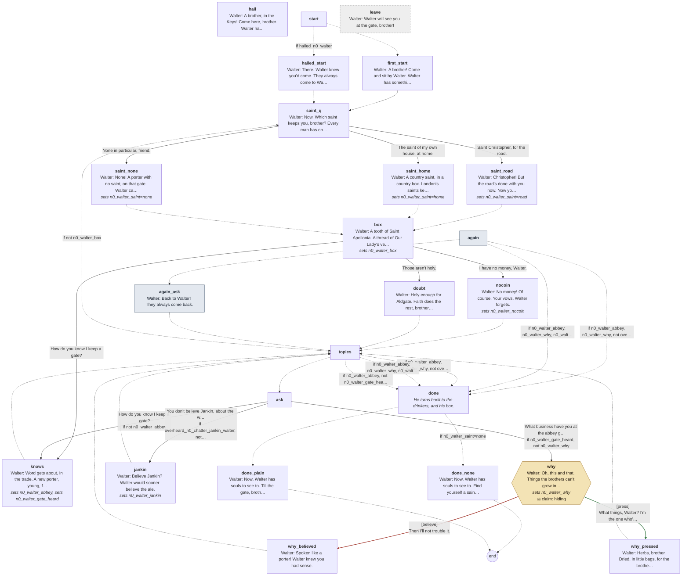

Every line

#### `hail`

- *A box rattles on a man's knees, by the fire.*
- **Walter** *amused, brow*: A brother, in the Keys! Come here, brother. Walter has something for every soul in the house.

#### `start`

- → `hailed_start` if `hailed_n0_walter`
- → `first_start`

#### `first_start`

- *A plump man in a wine-red cloak, the only colour in the room. The box on his knees rattles when he moves.*
- **Walter** *amused, brow*: A brother! Come and sit by Walter. Walter has something for every soul in the Keys, and you've a soul, I'll be bound.

- → `saint_q`

#### `hailed_start`

- *The man in the wine-red cloak shifts along the bench to make room, and pats it.*
- **Walter** *amused*: There. Walter knew you'd come. They always come to Walter.

- → `saint_q`

#### `saint_q`

- **Walter** *amused, brow*: Now. Which saint keeps you, brother? Every man has one, and Walter has a piece of most of them.

1. Saint Christopher, for the road. → `saint_road`
2. The saint of my own house, at home. → `saint_home`
3. None in particular, friend. → `saint_none`

#### `saint_road`
*sets `n0_walter_saint=road`*

- **Walter** *glad*: Christopher! But the road's done with you now. Now you want a saint for a gate.

- → `box`

#### `saint_home`
*sets `n0_walter_saint=home`*

- **Walter** *amused*: A country saint, in a country box. London's saints keep later hours, brother. You'll want one of ours.

- → `box`

#### `saint_none`
*sets `n0_walter_saint=none`*

- **Walter** *amused, brow*: None! A porter with no saint, on that gate. Walter can't allow it.

- → `box`

#### `box`
*sets `n0_walter_box`*

- *He lifts the lid. Little bones, scraps of cloth and a cloudy phial, each on its own bed of wool.*
- **Walter** *amused*: A tooth of Saint Apollonia. A thread of Our Lady's veil. And a link of Saint Peter's chain, for a man who keeps a gate.

1. I have no money, Walter. → `nocoin`
2. Those aren't holy. → `doubt` · **trust Walter -5**
3. How do you know I keep a gate? → `knows`

#### `nocoin`
*sets `n0_walter_nocoin`*

- **Walter** *amused*: No money! Of course. Your vows. Walter forgets.
- *He shuts the lid gently, as if on something sleeping.*
- **Walter** *warm*: Keep Walter in your prayers, then, and a kind eye on him at your gate. We'll call it square.

- → `topics`

#### `doubt`

- *He is still smiling.*
- **Walter** *amused*: Holy enough for Aldgate. Faith does the rest, brother. Faith always does.

- → `topics`

#### `knows`
*sets `n0_walter_abbey`, sets `n0_walter_gate_heard`*

- **Walter** *amused, brow*: Word gets about, in the trade. A new porter, young, from the country, due by Martinmas. Don't look so struck.
- **Walter** *warm*: You and Walter will be friends. Walter's at that gate more nights than not.

- → `topics`

#### `again` (the next time)

- → `done` if `n0_walter_abbey`, `n0_walter_why`, not `overheard_n0_chatter_jankin_walter`
- → `done` if `n0_walter_abbey`, `n0_walter_why`, `n0_walter_jankin`
- → `again_ask`

#### `again_ask`

- **Walter** *amused*: Back to Walter! They always come back.

- → `topics`

#### `topics`

- → `saint_q` if not `n0_walter_box`
- → `done` if `n0_walter_abbey`, `n0_walter_why`, not `overheard_n0_chatter_jankin_walter`
- → `done` if `n0_walter_abbey`, `n0_walter_why`, `n0_walter_jankin`
- → `done` if `n0_walter_abbey`, not `n0_walter_gate_heard`
- → `ask`

#### `ask`

1. How do you know I keep a gate? → `knows` · only if not `n0_walter_abbey`
2. What business have you at the abbey gate? → `why` · only if `n0_walter_gate_heard`, not `n0_walter_why`
3. You don't believe Jankin, about the wall? → `jankin` · only if `overheard_n0_chatter_jankin_walter`, not `n0_walter_jankin`

#### `why`
*sets `n0_walter_why`*

- **Walter** *amused*: Oh, this and that. Things the brothers can't grow in their own garden.
- *He pats the box. Something inside it rattles.*
- **Walter** *amused, still*: Holy business, brother. Nothing a porter need trouble his head over.

> **Claim `n0_walter_gate`: true, but holding back.** The last line is the claim.

1. Then I'll not trouble it. → `why_believed` · **believe** · wrong
2. What things, Walter? I'm the one who'll open the gate to them. → `why_pressed` · **press** · **right**, trust +1

#### `why_believed`

- **Walter** *glad, brow*: Spoken like a porter! Walter knew you had sense.

- → `topics`

#### `why_pressed`

- *For a moment he stops selling. The smile goes, and comes back.*
- **Walter** *calm*: Herbs, brother. Dried, in little bags, for the brothers who ask for them. A pardoner carries what he's asked to carry.
- **Walter** *amused, smile*: There. Now you know all Walter knows, and Walter knows nothing.

- → `topics`

#### `jankin`
*sets `n0_walter_jankin`*

- **Walter** *amused*: Believe Jankin? Walter would sooner believe the ale.
- *For a moment he stops selling.*
- **Walter** *calm*: Tell him to drink less, and sleep indoors. That's free.

- → `topics`

#### `done`

- *He turns back to the drinkers, and his box.*

- → `done_none` if `n0_walter_saint=none`
- → `done_plain`

#### `done_none`

- **Walter** *glad*: Now, Walter has souls to see to. Find yourself a saint, brother, before the gate!

- → `end`

#### `done_plain`

- **Walter** *glad*: Now, Walter has souls to see to. Till the gate, brother!

- → `end`

#### `leave` (if he walks away)

- **Walter** *glad*: Walter will see you at the gate, brother!

## Warden

[`warden.talk`](../../game/chapters/night0/dialogue/warden.talk) · id `n0_warden`

Moods through the talk: weary → cold → weary → grave → wary → cold → amused → grave → calm → weary → grave → weary → cold

> The warden at Aldgate, night 0: Lambert *(the name is mine, 2026-11-15)*. The wagon has stopped, he has walked up beside the porter and holds his lantern up to his face (RideBeat, the Aldgate cue's inspector). When the talk ends he lowers it and walks back to his place saying they can go (the cue's parting_lines): that is the talk's closing line, so his own last answer can end it.
> A gatekeeper talking to a gatekeeper: blunt and tired. He has just told the carter he opens for no one after the curfew bell; told the porter's going to keep a gate, he asks him what he'll do when someone knocks after it. He lifts the sacking on every cart that passes his gate, and has counted the dead this month. Nothing he says names a demon or men behind the deaths.
> His name: every path comes to `name` (knows_warden), where he gives it as he finishes looking the porter over. Only walking away before it misses it.
> Answer paths the tests take: test_prologue and test_flow answer 0 throughout (porter, open, name, cart): n0_warden_porter. The narration that opens it is checked word for word.

### Every path

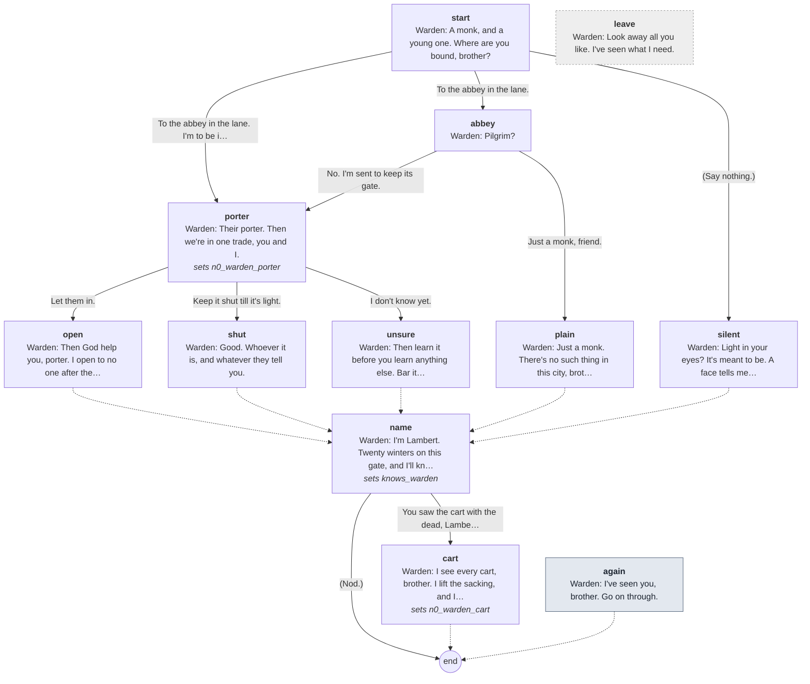

Every line

#### `start`

- *He holds his lantern up to your face, and looks at you a long moment.*
- **Warden** *weary*: A monk, and a young one. Where are you bound, brother?

1. To the abbey in the lane. I'm to be its porter. → `porter`
2. To the abbey in the lane. → `abbey`
3. (Say nothing.) → `silent`

#### `porter`
*sets `n0_warden_porter`*

- *The lantern doesn't move.*
- **Warden** *cold, jaw*: Their porter. Then we're in one trade, you and I.
- **Warden** *weary*: Somebody knocks at your gate after the bell, wet through, a child with him. What do you do?

1. Let them in. → `open`
2. Keep it shut till it's light. → `shut`
3. I don't know yet. → `unsure`

#### `open`

- **Warden** *grave, shake*: Then God help you, porter. I open to no one after the bell. Not to a child. Not to my own mother.

- → `name`

#### `shut`

- **Warden** *grave, nod*: Good. Whoever it is, and whatever they tell you.

- → `name`

#### `unsure`

- **Warden** *grave*: Then learn it before you learn anything else. Bar it at the bell, and keep it barred till it's light.

- → `name`

#### `abbey`

- *His mouth goes thin.*
- **Warden** *wary, lip*: Pilgrim?

1. No. I'm sent to keep its gate. → `porter`
2. Just a monk, friend. → `plain`

#### `plain`

- **Warden** *cold*: Just a monk. There's no such thing in this city, brother.

- → `name`

#### `silent`

- **Warden** *amused*: Light in your eyes? It's meant to be. A face tells me more than a mouth does.
- **Warden** *grave*: Yours says you've never slept inside a city wall.

- → `name`

#### `name`
*sets `knows_warden`*

- **Warden** *calm*: I'm Lambert. Twenty winters on this gate, and I'll know your face again.

1. You saw the cart with the dead, Lambert? → `cart`
2. (Nod.) → `end`

#### `cart`
*sets `n0_warden_cart`*

- **Warden** *weary*: I see every cart, brother. I lift the sacking, and I count.
- **Warden** *grave*: Seven this month. Most of them came in at this gate on their own feet, to see your saint.

- → `end`

#### `again` (the next time)

- **Warden** *weary*: I've seen you, brother. Go on through.

- → `end`

#### `leave` (if he walks away)

- **Warden** *cold*: Look away all you like. I've seen what I need.

## Scripted lines

Said by the night's beats and cues (`night0.tscn`), outside any talk.

- `RideCues/WhiteChapel`: **Carter** *wary*: Vespers already. Hup! We'll be in before they shut the gate.
- `RideCues/Whoa`: **Carter** *wary*: Easy, easy. Let him by.
- `RideCues/Aldgate`: **Traveller** *warm*: Evening, warden. God keep the gate.
- `RideCues/Aldgate`: **Warden** *weary*: In or out, carter? We shut at the curfew bell, and we open for no one after it.
- `RideCues/Aldgate`: **Carter** *calm*: In, warden. Two for the city.
- `RideCues/Aldgate`: **Warden** *wary*: Let's have a look at you, then.
- `RideCues/Aldgate`: **Warden** *calm*: You're good. Go on, and God go with you.
- `RideCues/Dog`: **Traveller** *grave*: They bar their doors early, this side of the wall. Since the pilgrims stopped coming home.
- `RideCues/Bridge`: **Carter** *calm*: Over the brook, and your lane's the next turning. Nearly there.
- `RideCues/Lane`: **Traveller** *grave*: That wall's your abbey. God keep you, brother. Bar your door at night.
