# The first night: The New Porter

Generated by `tools/script_docs.py` from the game's files. Don't edit it by hand. How to read it: [README](README.md). Every flag: [links](links.md).

## The night

The chapter's beats in order (`night1.tscn`), the talks each opens, who he can go to from then on, and the flags passed between them (dashed). The note at the end lists what this chapter's talks pass on to later ones.

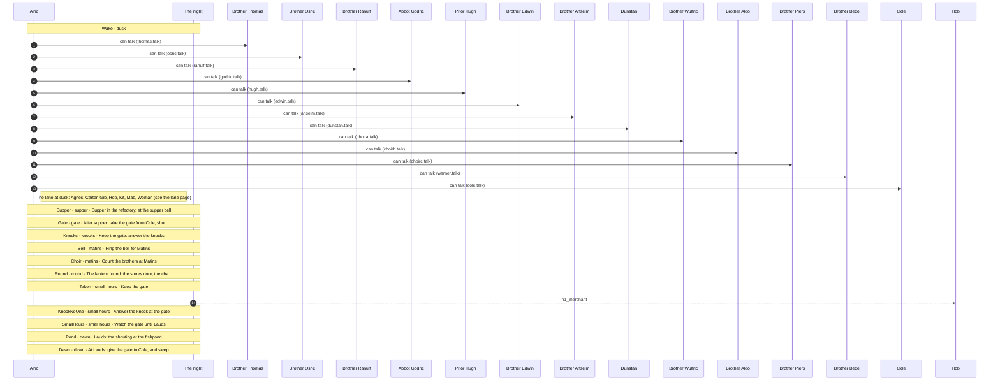

## Conversations

- [Brother Anselm](#anselm) (`anselm.talk`)
- [Brother Wulfric](#choira) (`choira.talk`)
- [Brother Aldo](#choirb) (`choirb.talk`)
- [Brother Piers](#choirc) (`choirc.talk`)
- [Cole](#cole) (`cole.talk`)
- [Dunstan](#dunstan) (`dunstan.talk`)
- [Brother Edwin](#edwin) (`edwin.talk`)
- [Abbot Godric](#godric) (`godric.talk`)
- [Prior Hugh](#hugh) (`hugh.talk`)
- [Brother Osric](#osric) (`osric.talk`)
- [Brother Ranulf](#ranulf) (`ranulf.talk`)
- [Brother Thomas](#thomas) (`thomas.talk`)
- [Brother Bede](#warner) (`warner.talk`)

## Brother Anselm

[`anselm.talk`](../../game/chapters/night1/dialogue/anselm.talk) · id `n1_anselm` · baseline *weary*, habit *lip* · starts at trust 20

Moods through the talk: weary → afraid → warm → ashamed → afraid → weary → afraid

> Anselm, the old porter, by the infirmary brazier at dusk (night 1). Blind, guilty and terrified: he hints, never tells.
> He wants to know the porter remembers his warning from the tour (d1_anselm_warned). If the tour was skipped, he gives it now.
> Hint: by the old porter who locked the guests in, he meant himself, and he didn't, every night.

**Reads from elsewhere:** [`d1_anselm_warned`](links.md#d1_anselm_warned)

### Every path

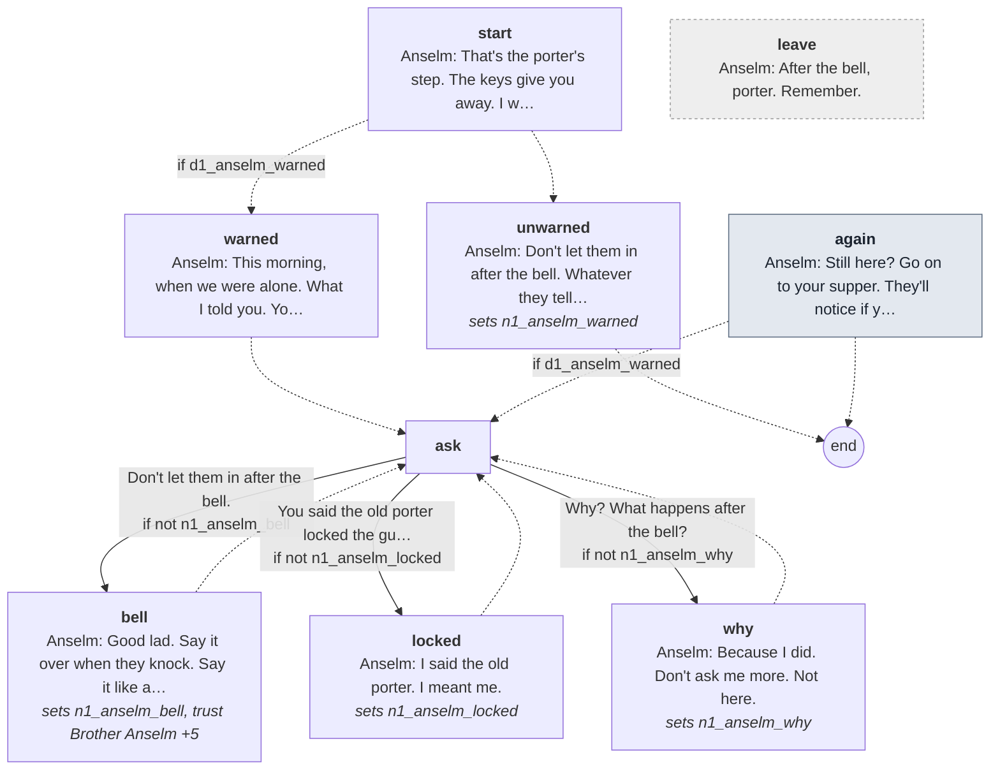

Every line

#### `start`

- *The old porter sits by the brazier with a blanket round him. His white eyes are on the door before you're through it.*
- **Anselm** *weary*: That's the porter's step. The keys give you away. I wore them thirty years.

- → `warned` if `d1_anselm_warned`
- → `unwarned`

#### `warned`

- *He listens to the room a moment, then leans toward you.*
- **Anselm** *afraid*: This morning, when we were alone. What I told you. You remember it?

- → `ask`

#### `ask`

1. Don't let them in after the bell. → `bell` · only if not `n1_anselm_bell`
2. You said the old porter locked the guests in. → `locked` · only if not `n1_anselm_locked`
3. Why? What happens after the bell? → `why` · only if not `n1_anselm_why`

#### `bell`
*sets `n1_anselm_bell`, **trust Brother Anselm +5***

- *He lets out his breath.*
- **Anselm** *warm*: Good lad. Say it over when they knock. Say it like a psalm.

- → `ask`

#### `locked`
*sets `n1_anselm_locked`*

- **Anselm** *ashamed, lip*: I said the old porter. I meant me.
- **Anselm** *ashamed, swallow*: I locked them in. Most nights. (He turns his face away.) Lock them in, porter. Every night.

- → `ask`

#### `why`
*sets `n1_anselm_why`*

- *His hand finds your sleeve and holds it.*
- **Anselm** *afraid*: Because I did. Don't ask me more. Not here.

- → `ask`

#### `unwarned`
*sets `n1_anselm_warned`*

- *He listens to the room a moment, then his hand finds your sleeve.*
- **Anselm** *afraid*: Don't let them in after the bell. Whatever they tell you.
- **Anselm** *weary, swallow*: And lock the guesthouse at night. The old porter always did.

- → `end`

#### `again` (the next time)

- *He turns his face toward you.*
- **Anselm** *weary*: Still here? Go on to your supper. They'll notice if you're late.

- → `ask` if `d1_anselm_warned`
- → `end`

#### `leave` (if he walks away)

- **Anselm** *afraid*: After the bell, porter. Remember.

## Brother Wulfric

[`choira.talk`](../../game/chapters/night1/dialogue/choira.talk) · id `n1_choira` · starts at trust 10

Moods through the talk: weary → amused → weary

> Brother Wulfric, the oldest of the choir, on the south walk at dusk (night 1). Background; short and crabbed.

### Every path

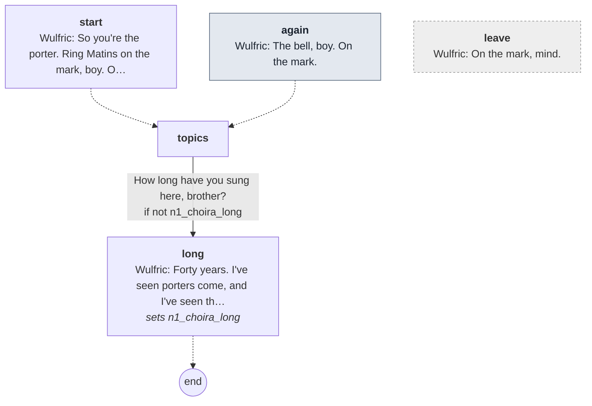

Every line

#### `start`

- *An old brother of the choir on the south walk, rubbing his knees against the cold.*
- **Wulfric** *weary*: So you're the porter. Ring Matins on the mark, boy. Old knees need warning.

- → `topics`

#### `again` (the next time)

- **Wulfric** *weary*: The bell, boy. On the mark.

- → `topics`

#### `topics`

1. How long have you sung here, brother? → `long` · only if not `n1_choira_long`

#### `long`
*sets `n1_choira_long`*

- **Wulfric** *amused*: Forty years. I've seen porters come, and I've seen them go. Most of them go.

- → `end`

#### `leave` (if he walks away)

- **Wulfric** *weary*: On the mark, mind.

## Brother Aldo

[`choirb.talk`](../../game/chapters/night1/dialogue/choirb.talk) · id `n1_choirb` · starts at trust 10

Moods through the talk: amused → glad → calm → amused

> Brother Aldo, a young brother of the choir, in the nave at dusk (night 1). Background; friendly.

### Every path

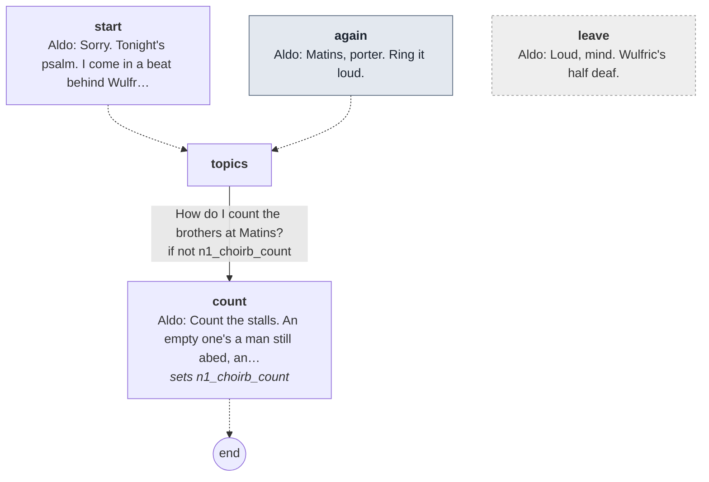

Every line

#### `start`

- *A young brother in the nave, humming a chant under his breath. He stops when he sees you.*
- **Aldo** *amused*: Sorry. Tonight's psalm. I come in a beat behind Wulfric every night, and he never forgives me.

- → `topics`

#### `again` (the next time)

- **Aldo** *glad*: Matins, porter. Ring it loud.

- → `topics`

#### `topics`

1. How do I count the brothers at Matins? → `count` · only if not `n1_choirb_count`

#### `count`
*sets `n1_choirb_count`*

- **Aldo** *calm*: Count the stalls. An empty one's a man still abed, and it's the porter who goes to fetch him.

- → `end`

#### `leave` (if he walks away)

- **Aldo** *amused*: Loud, mind. Wulfric's half deaf.

## Brother Piers

[`choirc.talk`](../../game/chapters/night1/dialogue/choirc.talk) · id `n1_choirc` · starts at trust 10

Moods through the talk: amused → weary → sad → calm

> Brother Piers, of the choir, on the east walk at dusk (night 1), watching the rain fill the garden. Background.

### Every path

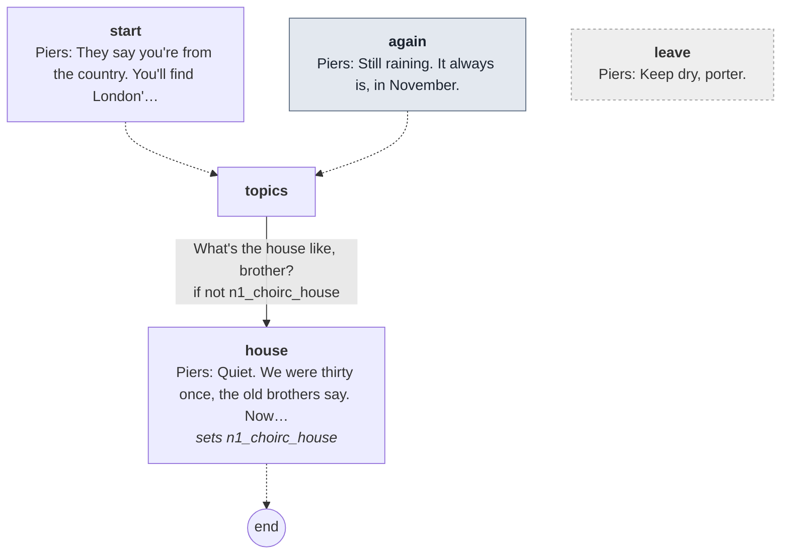

Every line

#### `start`

- *A brother of the choir on the east walk, watching the rain drown the garden beds.*
- **Piers** *amused*: They say you're from the country. You'll find London's rain is the same, only dirtier.

- → `topics`

#### `again` (the next time)

- **Piers** *weary*: Still raining. It always is, in November.

- → `topics`

#### `topics`

1. What's the house like, brother? → `house` · only if not `n1_choirc_house`

#### `house`
*sets `n1_choirc_house`*

- **Piers** *sad*: Quiet. We were thirty once, the old brothers say. Now look at us.

- → `end`

#### `leave` (if he walks away)

- **Piers** *calm*: Keep dry, porter.

## Cole

[`cole.talk`](../../game/chapters/night1/dialogue/cole.talk) · id `n1_cole` · baseline *blank* · **in the cult**

Moods through the talk: blank

> Cole, the lay brother, keeping the gate at dusk (night 1). Big and silent: a word or two at most, and a look.

### Every path

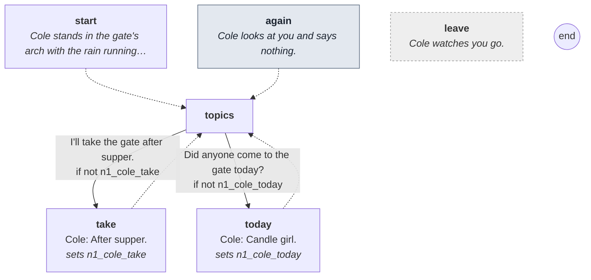

Every line

#### `start`

- *Cole stands in the gate's arch with the rain running off his hood. He looks at you, then at the keys on your belt.*

- → `topics`

#### `again` (the next time)

- *Cole looks at you and says nothing.*

- → `topics`

#### `topics`

1. I'll take the gate after supper. → `take` · only if not `n1_cole_take`
2. Did anyone come to the gate today? → `today` · only if not `n1_cole_today`

#### `take`
*sets `n1_cole_take`*

- **Cole** *blank*: After supper.
- *He nods once, and goes back to watching the lane.*

- → `topics`

#### `today`
*sets `n1_cole_today`*

- *He thinks about it.*
- **Cole** *blank*: Candle girl.

- → `topics`

#### `leave` (if he walks away)

- *Cole watches you go.*

## Dunstan

[`dunstan.talk`](../../game/chapters/night1/dialogue/dunstan.talk) · id `n1_dunstan` · baseline *blank* · **in the cult**

Moods through the talk: blank

> Dunstan, the lay brother, splitting wood at the woodpile at dusk (night 1). Big and silent: a word at most, and a look.

### Every path

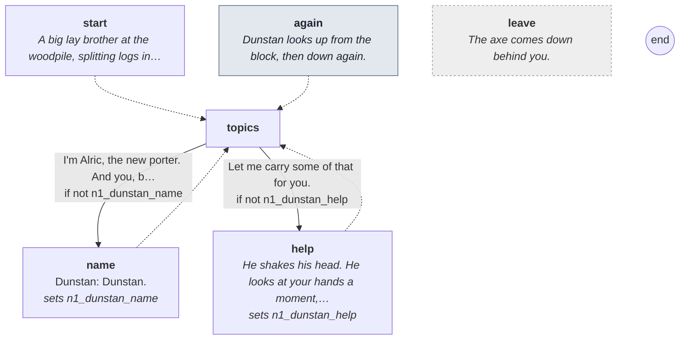

Every line

#### `start`

- *A big lay brother at the woodpile, splitting logs in the rain. He stops with the axe on the block and looks at you.*

- → `topics`

#### `again` (the next time)

- *Dunstan looks up from the block, then down again.*

- → `topics`

#### `topics`

1. I'm Alric, the new porter. And you, brother? → `name` · only if not `n1_dunstan_name`
2. Let me carry some of that for you. → `help` · only if not `n1_dunstan_help`

#### `name`
*sets `n1_dunstan_name`*

- **Dunstan** *blank*: Dunstan.
- *He sets the next log on the block.*

- → `topics`

#### `help`
*sets `n1_dunstan_help`*

- *He shakes his head. He looks at your hands a moment, then splits the log in one stroke.*

- → `topics`

#### `leave` (if he walks away)

- *The axe comes down behind you.*

## Brother Edwin

[`edwin.talk`](../../game/chapters/night1/dialogue/edwin.talk) · id `n1_edwin` · baseline *warm*, habit *brow* · starts at trust 50

Moods through the talk: glad → amused → warm → grave → amused → warm → afraid → glad

> Edwin, the novice, on the west walk at dusk (night 1), an armful of rushlights. The porter's friend; talks too fast.
> The relic and the pilgrims (he never sees one leave); his novice's week; and, if the porter saw the shape
> at the squint on night 0 (n0_squint_scare), the lane's horned demon, which had no horns.

**Reads from elsewhere:** [`n0_squint_scare`](links.md#n0_squint_scare)

### Every path

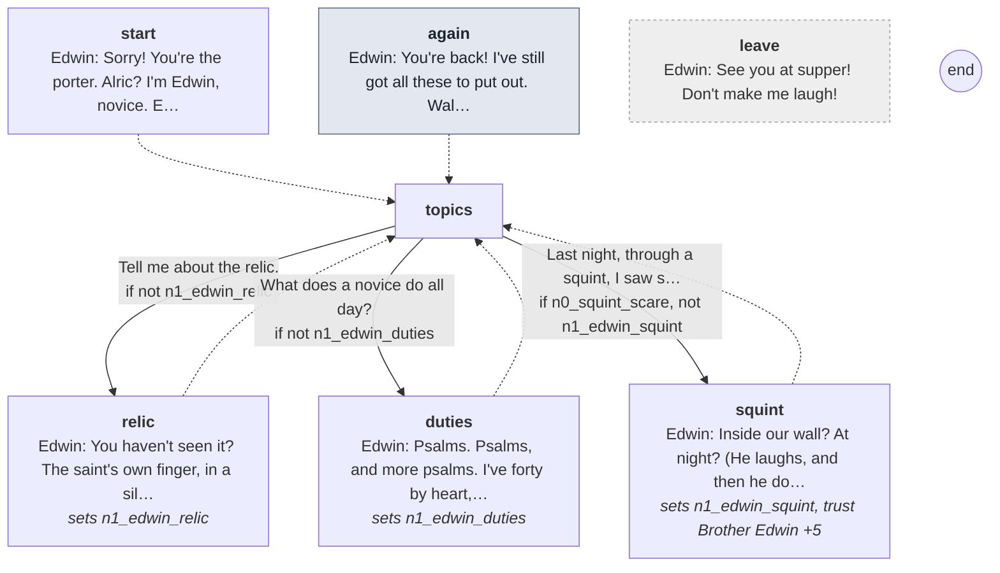

Every line

#### `start`

- *A young brother hurries down the west walk with an armful of rushlights and nearly walks into you.*
- **Edwin** *glad*: Sorry! You're the porter. Alric? I'm Edwin, novice. Everyone's been talking about you. Well, Brother Osric has.
- **Edwin** *glad, brow*: Is it true you came in through Aldgate on a cart? I've never been past Aldgate. I've never been past Cheapside.

- → `topics`

#### `again` (the next time)

- **Edwin** *glad*: You're back! I've still got all these to put out. Walk with me?

- → `topics`

#### `topics`

1. Tell me about the relic. → `relic` · only if not `n1_edwin_relic`
2. What does a novice do all day? → `duties` · only if not `n1_edwin_duties`
3. Last night, through a squint, I saw something tall inside the wall. → `squint` · only if `n0_squint_scare`, not `n1_edwin_squint`

#### `relic`
*sets `n1_edwin_relic`*

- **Edwin** *glad*: You haven't seen it? The saint's own finger, in a silver hand on the high altar. With the candles behind it, it glows.
- **Edwin** *amused*: Brother Ranulf won't let me near it. He says I breathe too hard.
- **Edwin** *warm*: Pilgrims come to it from Kent, from Essex. They pray, they sleep in the guesthouse, and they're gone before I'm up.
- **Edwin** *grave*: I've never once seen one leave. They're just not there.

- → `topics`

#### `duties`
*sets `n1_edwin_duties`*

- **Edwin** *amused*: Psalms. Psalms, and more psalms. I've forty by heart, and they tell me forty isn't a hundred and fifty.
- **Edwin** *amused, brow*: And I'm reader at supper this week, up in the pulpit. So don't make me laugh. I mean it, Alric.

- → `topics`

#### `squint`
*sets `n1_edwin_squint`, **trust Brother Edwin +5***

- **Edwin** *amused*: Inside our wall? At night? (He laughs, and then he doesn't.)
- **Edwin** *warm*: Tall? That's the lane's demon, with the horns. Jankin's been seeing it for years.
- *You tell him it had no horns.*
- **Edwin** *afraid, swallow*: No horns? (He's quiet a moment, which isn't like him.) Then I don't know what you saw.

- → `topics`

#### `leave` (if he walks away)

- **Edwin** *glad*: See you at supper! Don't make me laugh!

## Abbot Godric

[`godric.talk`](../../game/chapters/night1/dialogue/godric.talk) · id `n1_godric` · baseline *weary*

Moods through the talk: warm → calm → afraid → grave → warm

> Abbot Godric in the chapter house at dusk (night 1), a blanket over his knees. Frail, kind, fatherly.
> He welcomes the porter, blesses him, and speaks of the saint who keeps the house. He dreams badly (the drug; he doesn't know it).

### Every path

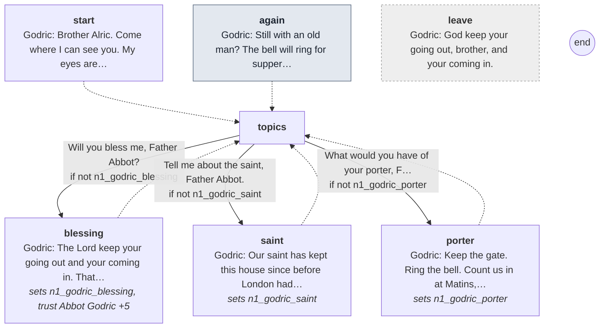

Every line

#### `start`

- *The abbot sits on the stone bench of the chapter house with a blanket over his knees. He holds out a thin hand.*
- **Godric** *warm*: Brother Alric. Come where I can see you. My eyes are better than Anselm's, but not by much in this light.
- **Godric** *warm*: Welcome to our house. You're young. Good. The young sleep less and see more.

- → `topics`

#### `again` (the next time)

- **Godric** *warm*: Still with an old man? The bell will ring for supper soon.

- → `topics`

#### `topics`

1. Will you bless me, Father Abbot? → `blessing` · only if not `n1_godric_blessing`
2. Tell me about the saint, Father Abbot. → `saint` · only if not `n1_godric_saint`
3. What would you have of your porter, Father Abbot? → `porter` · only if not `n1_godric_porter`

#### `blessing`
*sets `n1_godric_blessing`, **trust Abbot Godric +5***

- *He lays his hand on your head. It's light and cold, and it shakes.*
- **Godric** *warm*: The Lord keep your going out and your coming in. That's the porter's psalm. I chose it for you.

- → `topics`

#### `saint`
*sets `n1_godric_saint`*

- **Godric** *calm*: Our saint has kept this house since before London had a mayor. While the relic is on the altar, nothing evil comes in.
- **Godric** *calm*: The pilgrims come to the bone, and the bone keeps us. That's how it has always been.
- **Godric** *afraid, look away*: Lately I dream of the saint. (He looks toward the church, and doesn't finish.) Old men dream.

- → `topics`

#### `porter`
*sets `n1_godric_porter`*

- **Godric** *grave*: Keep the gate. Ring the bell. Count us in at Matins, every one.
- **Godric** *warm, nod*: And be kind at the grille. Half of London comes to a gate in the dark, and most of it is only cold.

- → `topics`

#### `leave` (if he walks away)

- **Godric** *warm*: God keep your going out, brother, and your coming in.

## Prior Hugh

[`hugh.talk`](../../game/chapters/night1/dialogue/hugh.talk) · id `n1_hugh` · baseline *cold*, habit *jaw* · starts at trust -20

Moods through the talk: cold → angry → cold

> Prior Hugh at dusk on the north walk (night 1). Cold; he suspects the new porter from the first.
> He asks why a country house sent a boy to keep a London gate (n1_hugh_why), then gives his rule:
> nobody comes in after the curfew bell without the prior (n1_hugh_rule).
> Claims: n1_hugh_gate (true: he is investigating the deaths, and suspects the porter; his glare and jaw are how he tells the truth).
> If the porter drank hard at the Keys he says so. hangover is cleared by the day-1 nap, so n0_saw_killing=drunk is the real test.

**Reads from elsewhere:** [`hangover`](links.md#hangover), [`n0_saw_killing`](links.md#n0_saw_killing)

### Every path

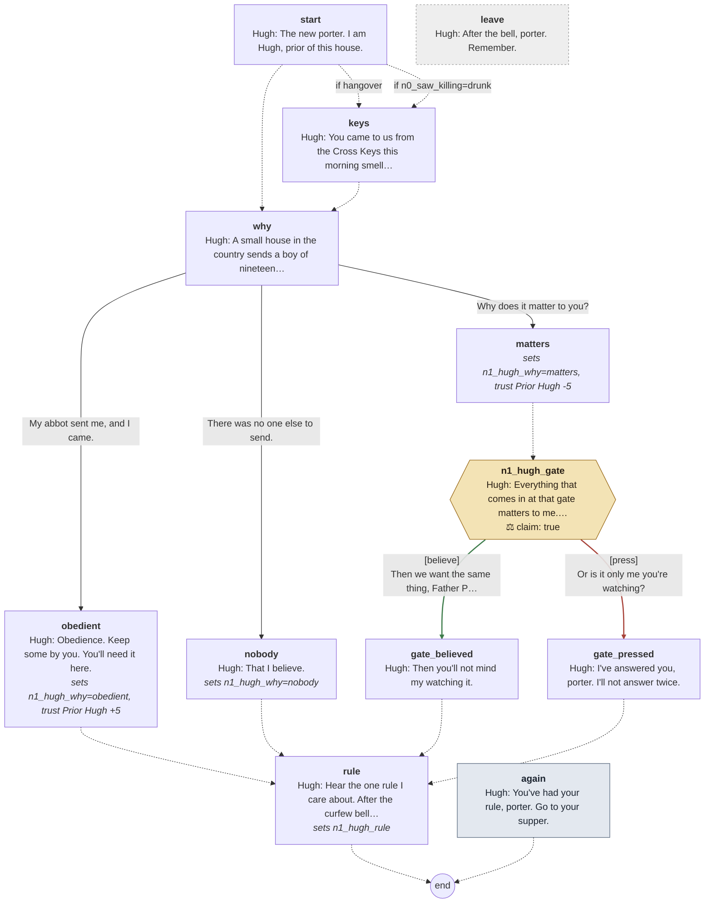

Every line

#### `start`

- *A tall brother stands in the middle of the north walk, hands in his sleeves, watching you come.*
- **Hugh** *cold*: The new porter. I am Hugh, prior of this house.

- → `keys` if `hangover`
- → `keys` if `n0_saw_killing=drunk`
- → `why`

#### `keys`

- **Hugh** *cold, jaw*: You came to us from the Cross Keys this morning smelling of it. I noticed. So did others.

- → `why`

#### `why`

- **Hugh** *cold*: A small house in the country sends a boy of nineteen to keep a gate in London. Why you?

1. My abbot sent me, and I came. → `obedient`
2. There was no one else to send. → `nobody`
3. Why does it matter to you? → `matters`

#### `obedient`
*sets `n1_hugh_why=obedient`, **trust Prior Hugh +5***

- **Hugh** *cold*: Obedience. Keep some by you. You'll need it here.

- → `rule`

#### `nobody`
*sets `n1_hugh_why=nobody`*

- **Hugh** *cold*: That I believe.

- → `rule`

#### `matters`
*sets `n1_hugh_why=matters`, **trust Prior Hugh -5***

- → `n1_hugh_gate`

#### `n1_hugh_gate`

- **Hugh** *cold, jaw*: Everything that comes in at that gate matters to me. You came in at it.

> **Claim `n1_hugh_gate`: true.** The last line is the claim.

1. Then we want the same thing, Father Prior. → `gate_believed` · **believe** · **right**, trust +2
2. Or is it only me you're watching? → `gate_pressed` · **press** · wrong, trust -2

#### `gate_believed`

- *He looks at you a long moment, as if he hadn't expected that.*
- **Hugh** *cold, jaw*: Then you'll not mind my watching it.

- → `rule`

#### `gate_pressed`

- **Hugh** *angry*: I've answered you, porter. I'll not answer twice.

- → `rule`

#### `rule`
*sets `n1_hugh_rule`*

- **Hugh** *cold*: Hear the one rule I care about. After the curfew bell, nobody comes in at that gate unless I say so.
- **Hugh** *cold, jaw*: Pilgrim, priest or the King's own uncle. You send for me, and you wait.

- → `end`

#### `again` (the next time)

- **Hugh** *cold*: You've had your rule, porter. Go to your supper.

- → `end`

#### `leave` (if he walks away)

- **Hugh** *cold*: After the bell, porter. Remember.

## Brother Osric

[`osric.talk`](../../game/chapters/night1/dialogue/osric.talk) · id `n1_osric` · baseline *glad*, habit *nod* · starts at trust 20 · **in the cult**

Moods through the talk: glad → amused → glad → amused → wary → glad

> Osric, the cellarer, at the kitchen fire at dusk (night 1). Jolly; he feeds you. He promises extra bread at supper (n1_osric_bread).
> If Thomas told the porter about the beast bled by the well (d1_asked_sand), he can ask Osric about it:
> Osric backs the lie, and the cult notes the porter's curiosity (Suspicion +5, the wrong question to the wrong brother).
> Claims: n1_osric_pig (lie: a man was killed by the well on night 0, and Osric started the killings; confront with window_killing).

**Reads from elsewhere:** [`d1_asked_sand`](links.md#d1_asked_sand), [`window_killing`](links.md#window_killing)

### Every path

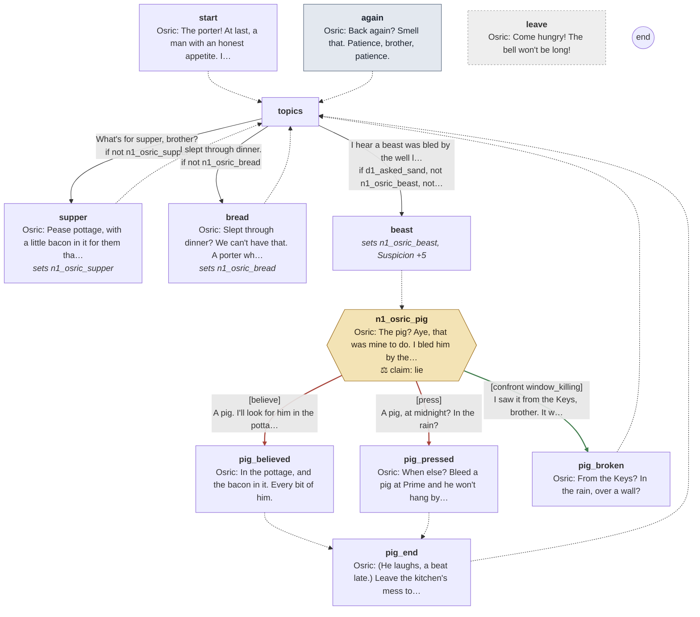

Every line

#### `start`

- *A round brother at the kitchen fire, sleeves rolled, flour to the elbow. He beams at you.*
- **Osric** *glad*: The porter! At last, a man with an honest appetite. I'm Osric, cellarer.
- **Osric** *glad*: Everything you eat in this house goes through my hands.

- → `topics`

#### `again` (the next time)

- **Osric** *amused*: Back again? Smell that. Patience, brother, patience.

- → `topics`

#### `topics`

1. What's for supper, brother? → `supper` · only if not `n1_osric_supper`
2. I slept through dinner. → `bread` · only if not `n1_osric_bread`
3. I hear a beast was bled by the well last night. → `beast` · only if `d1_asked_sand`, not `n1_osric_beast`, not `read_n1_osric_pig`

#### `supper`
*sets `n1_osric_supper`*

- **Osric** *glad*: Pease pottage, with a little bacon in it for them that work nights. That's you.
- **Osric** *glad*: And bread, our own, baked this morning. Rye from our own granary. Nothing bought in.

- → `topics`

#### `bread`
*sets `n1_osric_bread`*

- **Osric** *glad*: Slept through dinner? We can't have that. A porter who's hungry nods at his post.
- **Osric** *glad, smile*: I'll see you have the heel of the loaf at supper, and a second piece after. Eat it all, mind.

- → `topics`

#### `beast`
*sets `n1_osric_beast`, **Suspicion +5***

- → `n1_osric_pig`

#### `n1_osric_pig`

- **Osric** *glad, smile*: The pig? Aye, that was mine to do. I bled him by the well, where there's water to sluice the stones.

> **Claim `n1_osric_pig`: a lie.** The last line is the claim.

1. A pig. I'll look for him in the pottage. → `pig_believed` · **believe** · wrong
2. A pig, at midnight? In the rain? → `pig_pressed` · **press** · wrong
3. I saw it from the Keys, brother. It was no pig. → `pig_broken` · **confront** with *window_killing* · **right**, **Suspicion +10**: the cult knows he knows

#### `pig_believed`

- **Osric** *glad*: In the pottage, and the bacon in it. Every bit of him.

- → `pig_end`

#### `pig_pressed`

- **Osric** *glad*: When else? Bleed a pig at Prime and he won't hang by Prime.

- → `pig_end`

#### `pig_end`

- *He goes on kneading, and doesn't look up.*
- **Osric** *amused*: (He laughs, a beat late.) Leave the kitchen's mess to the kitchen, brother, and I'll leave your gate to you.

- → `topics`

#### `pig_broken`

- *The smile comes too fast, and goes.*
- **Osric** *wary*: From the Keys? In the rain, over a wall?
- **Osric** *glad, smile*: (He laughs, too loud.) A pig screams like a Christian when the knife goes in, brother. Ask any butcher in Eastcheap.

- → `topics`

#### `leave` (if he walks away)

- **Osric** *glad*: Come hungry! The bell won't be long!

## Brother Ranulf

[`ranulf.talk`](../../game/chapters/night1/dialogue/ranulf.talk) · id `n1_ranulf` · baseline *grave* · starts at trust 0 · **in the cult**

Moods through the talk: grave → calm → grave

> Ranulf, the sacrist, at the candle stand in the nave at dusk (night 1). Dry, exact, never stops working.
> He keeps the bells, the candles, the relic and the incense. He offers nothing yet (the remedy is night 3).
> Hidden: he wears the horned costume; the relic is a pig's bone; the incense doses the choir.

### Every path

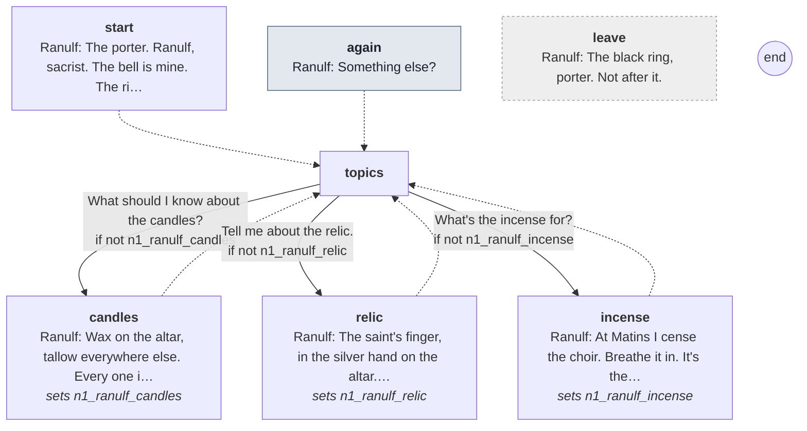

Every line

#### `start`

- *The sacrist at the candle stand in the nave, trimming wicks with small shears. He doesn't stop.*
- **Ranulf** *grave*: The porter. Ranulf, sacrist. The bell is mine. The ringing of it is yours. Don't be late with it.

- → `topics`

#### `again` (the next time)

- **Ranulf** *grave*: Something else?

- → `topics`

#### `topics`

1. What should I know about the candles? → `candles` · only if not `n1_ranulf_candles`
2. Tell me about the relic. → `relic` · only if not `n1_ranulf_relic`
3. What's the incense for? → `incense` · only if not `n1_ranulf_incense`

#### `candles`
*sets `n1_ranulf_candles`*

- **Ranulf** *grave*: Wax on the altar, tallow everywhere else. Every one is counted.
- **Ranulf** *grave*: If you find a lamp out on your round, light it from the sanctuary lamp and tell me. Not the prior. Me.

- → `topics`

#### `relic`
*sets `n1_ranulf_relic`*

- **Ranulf** *grave*: The saint's finger, in the silver hand on the altar. Pilgrims may kiss the glass.
- **Ranulf** *grave, glance*: I keep the key to it. Nobody opens it. Nobody needs to.

- → `topics`

#### `incense`
*sets `n1_ranulf_incense`*

- **Ranulf** *calm, glance*: At Matins I cense the choir. Breathe it in. It's the prayers going up.
- **Ranulf** *grave*: And it's good for the chest, in this damp.

- → `topics`

#### `leave` (if he walks away)

- **Ranulf** *grave*: The black ring, porter. Not after it.

## Brother Thomas

[`thomas.talk`](../../game/chapters/night1/dialogue/thomas.talk) · id `n1_thomas` · baseline *warm*, habit *nod* · starts at trust 40 · **in the cult**

Moods through the talk: warm → grave → warm → sad → warm → sad → warm

> Thomas at dusk, at his herbs in the infirmary (night 1). Kind; he goes over the night's routine.
> The killing seen from the Keys (n0_saw_killing): a dream, or the kitchen's beast being bled. Never the truth.
> The guesthouse key: truthful, but he leaves locking to the porter and makes it sound unkind.
> Anselm: an old man who frightens easily. If Anselm warned him on the tour, Thomas asks what he said.
> Claims: n1_thomas_beast (lie: a man was killed by the well on night 0, not a beast; confront with window_killing).

**Reads from elsewhere:** [`d1_anselm_warned`](links.md#d1_anselm_warned), [`n0_saw_killing`](links.md#n0_saw_killing), [`window_killing`](links.md#window_killing)

### Every path

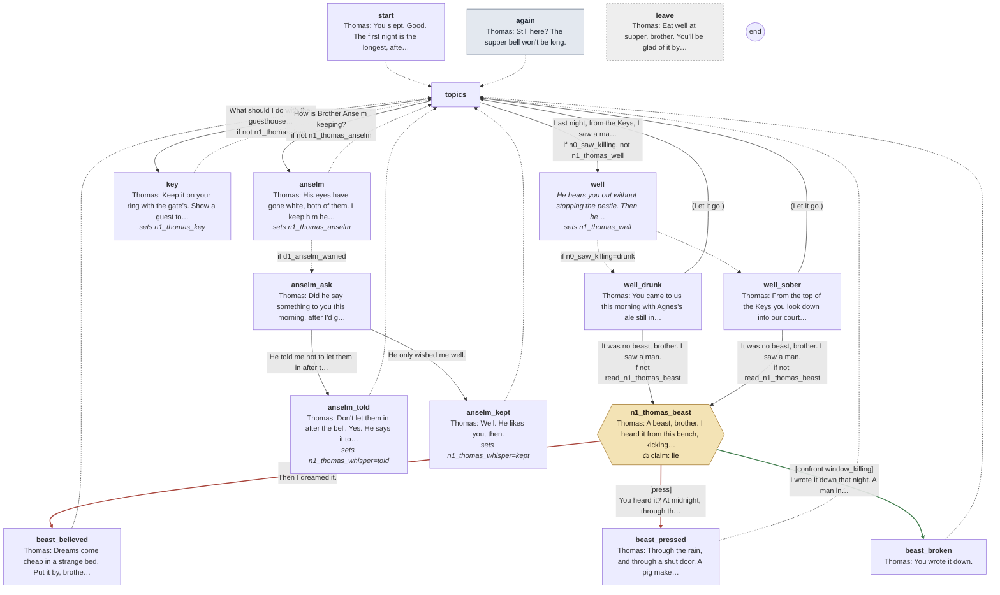

Every line

#### `start`

- *Thomas at his bench, a mortar in his lap, grinding something that smells green. He smiles when he sees you.*
- **Thomas** *warm*: You slept. Good. The first night is the longest; after that your body learns it.
- **Thomas** *warm, nod*: Supper at the bell, then the gate from Cole. Bar it. Matins at the black ring, then your round, then wait for Lauds.

- → `topics`

#### `again` (the next time)

- **Thomas** *warm*: Still here? The supper bell won't be long.

- → `topics`

#### `topics`

1. Last night, from the Keys, I saw a man killed by the well. → `well` · only if `n0_saw_killing`, not `n1_thomas_well`
2. What should I do with the guesthouse key? → `key` · only if not `n1_thomas_key`
3. How is Brother Anselm keeping? → `anselm` · only if not `n1_thomas_anselm`

#### `well`
*sets `n1_thomas_well`*

- *He hears you out without stopping the pestle. Then he stops.*

- → `well_drunk` if `n0_saw_killing=drunk`
- → `well_sober`

#### `well_drunk`

- **Thomas** *warm*: You came to us this morning with Agnes's ale still in your eyes. At midnight, in rain, from the top of the Keys?
- **Thomas** *warm, still*: They bled a beast for the kitchen by the well last night. A lantern, a knife, a thing that kicks.
- **Thomas** *warm*: I'd have dreamed the same. But I'd not carry it to the abbot. He sleeps badly enough as it is.

1. It was no beast, brother. I saw a man. → `n1_thomas_beast` · only if not `read_n1_thomas_beast`
2. (Let it go.) → `topics`

#### `well_sober`

- **Thomas** *warm*: From the top of the Keys you look down into our court, it's true. At midnight, in the rain, after a day on a cart.
- **Thomas** *warm, still*: The kitchen bled a beast by the well in the night, so it would hang by morning. A knife over a thing that kicks.
- **Thomas** *warm*: I can see how it looked. I'd not carry it to the abbot, though. He sleeps badly enough as it is.

1. It was no beast, brother. I saw a man. → `n1_thomas_beast` · only if not `read_n1_thomas_beast`
2. (Let it go.) → `topics`

#### `n1_thomas_beast`

- *He sets the pestle down, and smiles at you.*
- **Thomas** *warm, still*: A beast, brother. I heard it from this bench, kicking and bawling. Nobody died in our court.

> **Claim `n1_thomas_beast`: a lie.** The last line is the claim.

1. Then I dreamed it. → `beast_believed` · **believe** · wrong
2. You heard it? At midnight, through the rain? → `beast_pressed` · **press** · wrong
3. I wrote it down that night. A man in a habit, dragging a man toward the cellar. → `beast_broken` · **confront** with *window_killing* · **right**, **Suspicion +10**: the cult knows he knows

#### `beast_believed`

- **Thomas** *warm, nod*: Dreams come cheap in a strange bed. Put it by, brother.

- → `topics`

#### `beast_pressed`

- **Thomas** *warm*: Through the rain, and through a shut door. A pig makes himself heard.
- *He takes up the pestle again, and says no more about it.*

- → `topics`

#### `beast_broken`

- *For a moment his face does nothing at all. Then the smile comes back, slower.*
- **Thomas** *grave, swallow*: You wrote it down.
- **Thomas** *warm*: Then write beside it that it was dark, and raining, and every brother here wears a black habit. So does the man who drags a pig to the cellar to hang.

- → `topics`

#### `key`
*sets `n1_thomas_key`*

- **Thomas** *warm*: Keep it on your ring with the gate's. Show a guest to his bed, and the rest is your judgement.
- **Thomas** *warm*: Anselm locked them in at night. Some guests took that ill, to be shut up like sheep.
- **Thomas** *warm, nod*: Do as you think best. It's your gate now.

- → `topics`

#### `anselm`
*sets `n1_thomas_anselm`*

- **Thomas** *sad*: His eyes have gone white, both of them. I keep him here, where it's warm.
- **Thomas** *warm, still*: He frightens easily now, and he talks. Old porters' tales. Don't let him put them in your head.

- → `anselm_ask` if `d1_anselm_warned`
- → `topics`

#### `anselm_ask`

- **Thomas** *warm*: Did he say something to you this morning, after I'd gone?

1. He told me not to let them in after the bell. → `anselm_told` · **trust Brother Thomas +5**
2. He only wished me well. → `anselm_kept`

#### `anselm_told`
*sets `n1_thomas_whisper=told`*

- *He nods slowly, and goes back to his mortar.*
- **Thomas** *sad*: Don't let them in after the bell. Yes. He says it to the walls, most nights. Poor soul.

- → `topics`

#### `anselm_kept`
*sets `n1_thomas_whisper=kept`*

- *He looks at you a moment longer than he needs to.*
- **Thomas** *warm*: Well. He likes you, then.

- → `topics`

#### `leave` (if he walks away)

- **Thomas** *warm*: Eat well at supper, brother. You'll be glad of it by Matins.

## Brother Bede

[`warner.talk`](../../game/chapters/night1/dialogue/warner.talk) · id `n1_warner` · starts at trust 10

Moods through the talk: wary → afraid → calm → sad → warm → wary

> Brother Bede, of the choir, under the eaves by the refectory door at dusk (night 1). Nervous; he keeps looking at the door.
> He does NOT warn about the bread here: that is supper's scripted moment. He is only strange about supper.
> He hangs in the bell tower on night 2: his stall, his climbs to be alone, the rooks that know him.

### Every path

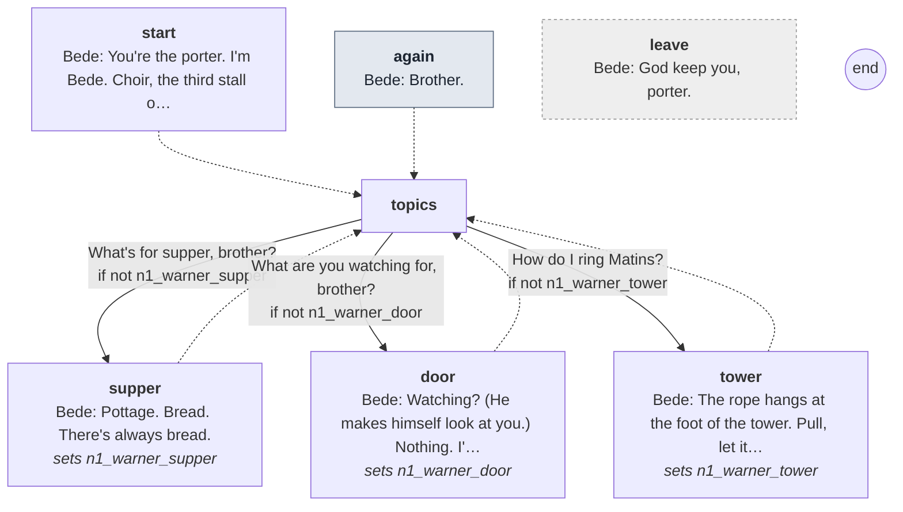

Every line

#### `start`

- *A thin brother under the eaves by the refectory door, his hood up. His eyes keep going past you to the door.*
- **Bede** *wary, glance*: You're the porter. I'm Bede. Choir, the third stall on the left. You'll count me at Matins.

- → `topics`

#### `again` (the next time)

- *He's still watching the refectory door.*
- **Bede** *wary*: Brother.

- → `topics`

#### `topics`

1. What's for supper, brother? → `supper` · only if not `n1_warner_supper`
2. What are you watching for, brother? → `door` · only if not `n1_warner_door`
3. How do I ring Matins? → `tower` · only if not `n1_warner_tower`

#### `supper`
*sets `n1_warner_supper`*

- **Bede** *wary*: Pottage. Bread. There's always bread.
- *He lowers his voice.*
- **Bede** *afraid*: Eat slowly, brother. Watch what the rest of us leave.

- → `topics`

#### `door`
*sets `n1_warner_door`*

- **Bede** *afraid, swallow*: Watching? (He makes himself look at you.) Nothing. I'm hungry, that's all. We're all hungry here.

- → `topics`

#### `tower`
*sets `n1_warner_tower`*

- **Bede** *calm*: The rope hangs at the foot of the tower. Pull, let it rise, pull again. Don't hold on when it rises.
- **Bede** *sad*: I go up the tower stair sometimes, when I can't sleep. It's the one place in this house a man can think.
- **Bede** *warm*: The rooks know me now. They don't even get up. Anyone else, they go up all at once.

- → `topics`

#### `leave` (if he walks away)

- **Bede** *wary*: God keep you, porter.

## Scripted lines

Said by the night's beats and cues (`night1.tscn`), outside any talk.

- `Director/Supper`: **Godric** *warm*: Brothers, this is Brother Alric, who keeps our gate from tonight, as Anselm kept it before him.
- `Director/Supper`: **Godric** *warm*: You're welcome among us, my son. Eat, and God keep you through the night.
- `Director/Supper`: **Osric** *glad, smile*: A new porter wants feeding. The nights are long at that gate.
- `Director/Supper`: **Bede** *afraid, swallow*: Don't eat the bread, porter. Not tomorrow, not any night. Something is wrong with it.
- `Director/Supper`: **Bede** *afraid, look down*: Don't look at me. Don't ask me here. Eat your pottage.
- `Director/Supper`: **Osric** *glad*: (From the hatch, smiling.) Not hungry, porter? I'll keep an eye on you. Can't have you wasting away.
- `Director/Gate`: **Cole** *blank*: Yours.
- `Director/Knocks`: **Hugh** *cold*: Stand aside, porter. I'll see him to a bed myself.
- `Director/Knocks`: **Hugh** *cold, jaw*: (To the visitor.) This way. Keep close, and touch nothing.
- `Director/Pond`: **Thomas** *sad, still*: The merchant. He drowned drunk, poor soul, wandering about in the dark. It happens.
- `Director/Pond`: **Merchant** *angry*: Locked in! Like a sheep in a fold, porter, and me a guest of this house!
- `Director/Pond`: **Merchant** *angry, jaw*: I'll tell every inn from here to Coventry how your abbey treats its pilgrims.
- `Director/Pond`: **Merchant** *cold*: Cold as a tomb, your guesthouse. I've slept warmer in a ditch. Good day to you, porter.
