# The second night: The Bell

Generated by `tools/script_docs.py` from the game's files. Don't edit it by hand. How to read it: [README](README.md). Every flag: [links](links.md).

## The night

The chapter's beats in order (`night2.tscn`), the talks each opens, who he can go to from then on, and the flags passed between them (dashed). The note at the end lists what this chapter's talks pass on to later ones.

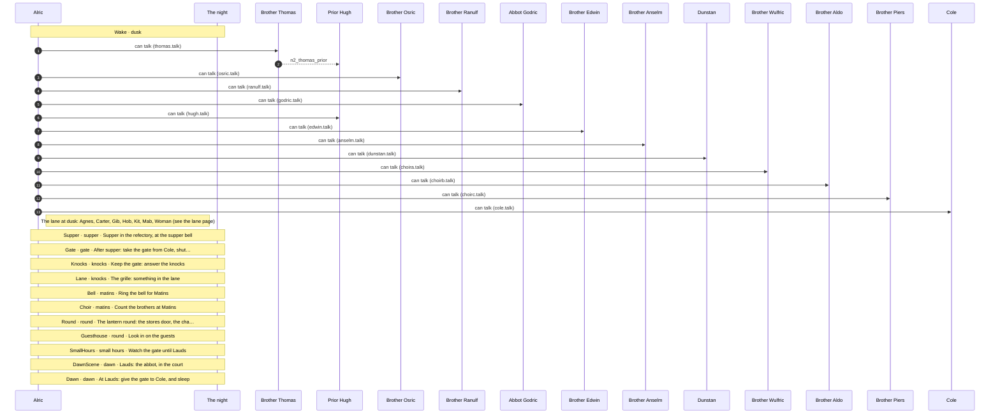

## Conversations

- [Brother Anselm](#anselm) (`anselm.talk`)
- [Brother Wulfric](#choira) (`choira.talk`)
- [Brother Aldo](#choirb) (`choirb.talk`)
- [Brother Piers](#choirc) (`choirc.talk`)
- [Cole](#cole) (`cole.talk`)
- [Dunstan](#dunstan) (`dunstan.talk`)
- [Brother Edwin](#edwin) (`edwin.talk`)
- [Abbot Godric](#godric) (`godric.talk`)
- [Prior Hugh](#hugh) (`hugh.talk`)
- [Brother Osric](#osric) (`osric.talk`)
- [Brother Ranulf](#ranulf) (`ranulf.talk`)
- [Brother Thomas](#thomas) (`thomas.talk`)

## Brother Anselm

[`anselm.talk`](../../game/chapters/night2/dialogue/anselm.talk) · id `n2_anselm` · baseline *weary*, habit *lip* · starts at trust 20

Moods through the talk: afraid → pleading → weary → amused → warm → weary → afraid → weary → afraid → weary → ashamed → pained → pleading

> Anselm by the infirmary brazier at dusk (night 2). He heard the merchant carried past his door, or heard him leave cursing.
> The knock with no one there frightens him more than anything; it's new to him. He hints at his guilt and won't tell.
> Claims: n2_anselm_guests (hiding: he is blind now, but for years he let the victims in; pressed, he hints, and names no one).

**Reads from elsewhere:** [`died_merchant`](links.md#died_merchant), [`n1_knock_no_one`](links.md#n1_knock_no_one), [`n1_merchant`](links.md#n1_merchant)

### Every path

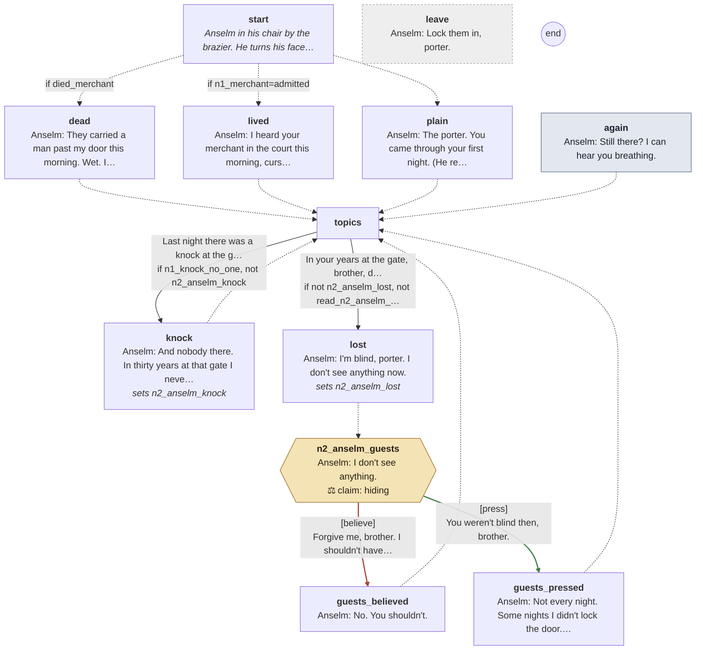

Every line

#### `start`

- *Anselm in his chair by the brazier. He turns his face toward your step before you speak.*

- → `dead` if `died_merchant`
- → `lived` if `n1_merchant=admitted`
- → `plain`

#### `dead`

- **Anselm** *afraid*: They carried a man past my door this morning. Wet. I heard it run off him onto the flags.
- *His voice drops.*
- **Anselm** *pleading*: Did you lock the door, porter? I told you. I told you to.

- → `topics`

#### `lived`

- **Anselm** *weary*: I heard your merchant in the court this morning, cursing you for locking him in.
- *He's nearly smiling.*
- **Anselm** *amused*: Let him curse. Let them all curse you, and go home.

- → `topics`

#### `plain`

- **Anselm** *warm*: The porter. You came through your first night. (He reaches for your hand, and holds it a moment.)

- → `topics`

#### `again` (the next time)

- **Anselm** *weary*: Still there? I can hear you breathing.

- → `topics`

#### `topics`

1. Last night there was a knock at the gate, and no one there. → `knock` · only if `n1_knock_no_one`, not `n2_anselm_knock`
2. In your years at the gate, brother, did you ever lose a guest? → `lost` · only if not `n2_anselm_lost`, not `read_n2_anselm_guests`

#### `knock`
*sets `n2_anselm_knock`*

- *His hands find the arms of his chair and hold on.*
- **Anselm** *afraid, swallow*: And nobody there. In thirty years at that gate I never had that.
- **Anselm** *afraid*: Pray, porter. It's all I know to tell you.

- → `topics`

#### `lost`
*sets `n2_anselm_lost`*

- *A long silence. His hands tighten on the arms of the chair.*
- **Anselm** *weary, lip*: I'm blind, porter. I don't see anything now.

- → `n2_anselm_guests`

#### `n2_anselm_guests`

- **Anselm** *afraid, swallow*: I don't see anything.

> **Claim `n2_anselm_guests`: true, but holding back.** The last line is the claim.

1. Forgive me, brother. I shouldn't have asked. → `guests_believed` · **believe** · wrong
2. You weren't blind then, brother. → `guests_pressed` · **press** · **right**, trust +1

#### `guests_believed`

- *He turns his face back to the brazier.*
- **Anselm** *weary*: No. You shouldn't.

- → `topics`

#### `guests_pressed`

- *His mouth works a long while before anything comes out of it.*
- **Anselm** *ashamed, lip*: Not every night. Some nights I didn't lock the door. Those mornings there was a bed empty by Lauds.
- **Anselm** *pained, swallow*: And I never asked whose. Never once. Don't make me say more.

- → `topics`

#### `leave` (if he walks away)

- **Anselm** *pleading*: Lock them in, porter.

## Brother Wulfric

[`choira.talk`](../../game/chapters/night2/dialogue/choira.talk) · id `n2_choira` · starts at trust 10

Moods through the talk: amused → weary → amused → grave → weary

> Brother Wulfric on the south walk at dusk (night 2), rubbing his knees. Background; crabbed.
> The drowned merchant, or the abbot's extra hour of prayer; the abbot has dreamed badly since Michaelmas.

**Reads from elsewhere:** [`died_merchant`](links.md#died_merchant)

### Every path

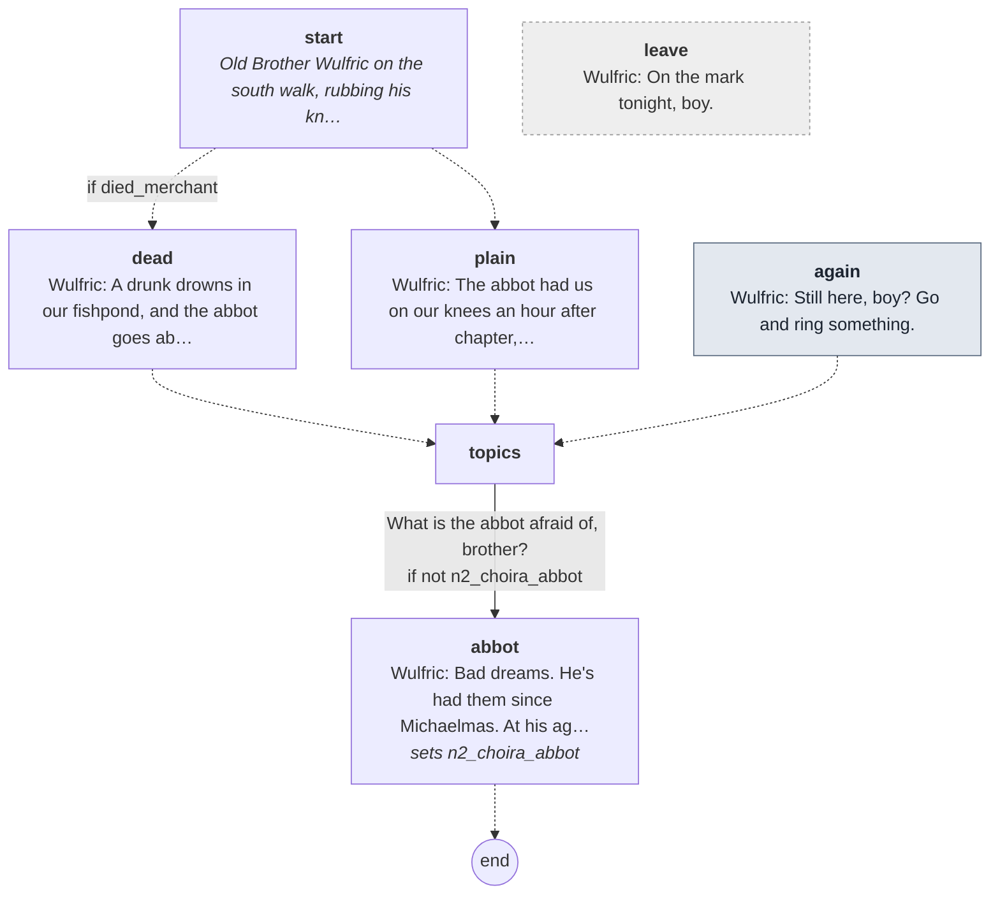

Every line

#### `start`

- *Old Brother Wulfric on the south walk, rubbing his knees.*

- → `dead` if `died_merchant`
- → `plain`

#### `dead`

- **Wulfric** *amused*: A drunk drowns in our fishpond, and the abbot goes about with a face like he's seen the Devil.
- **Wulfric** *weary*: In my day a drunk who drowned was a drunk who drowned.

- → `topics`

#### `plain`

- **Wulfric** *weary*: The abbot had us on our knees an hour after chapter, praying for the house. My knees are older than his.

- → `topics`

#### `again` (the next time)

- **Wulfric** *amused*: Still here, boy? Go and ring something.

- → `topics`

#### `topics`

1. What is the abbot afraid of, brother? → `abbot` · only if not `n2_choira_abbot`

#### `abbot`
*sets `n2_choira_abbot`*

- **Wulfric** *grave*: Bad dreams. He's had them since Michaelmas. At his age you dream of the grave, and he's earned it.

- → `end`

#### `leave` (if he walks away)

- **Wulfric** *weary*: On the mark tonight, boy.

## Brother Aldo

[`choirb.talk`](../../game/chapters/night2/dialogue/choirb.talk) · id `n2_choirb` · starts at trust 10

Moods through the talk: wary → amused → wary → warm → calm

> Brother Aldo in the nave at dusk (night 2), setting out the psalters in the stalls. Background.
> Bede wasn't at Sext or None; nobody knows yet that he is dead (he's found when the porter rings Matins).
> Aldo thinks he's up the tower sulking. Promising to count him in sets n2_choirb_bede.

### Every path

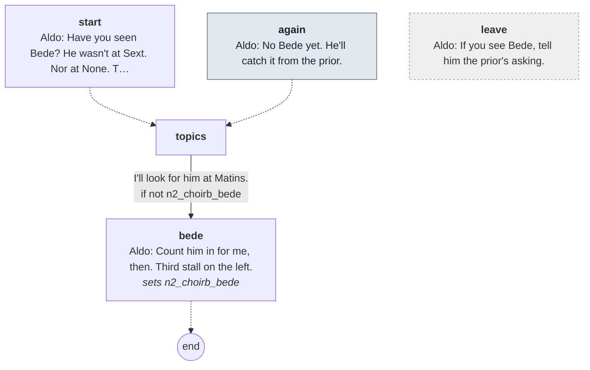

Every line

#### `start`

- *Brother Aldo in the nave, setting out the psalters. At one stall he sets the book down, picks it up, sets it down.*
- **Aldo** *wary*: Have you seen Bede? He wasn't at Sext. Nor at None. The prior marked him.
- **Aldo** *amused*: He'll be up the tower with the rooks, sulking. He goes up there to think.

- → `topics`

#### `again` (the next time)

- **Aldo** *wary*: No Bede yet. He'll catch it from the prior.

- → `topics`

#### `topics`

1. I'll look for him at Matins. → `bede` · only if not `n2_choirb_bede`

#### `bede`
*sets `n2_choirb_bede`*

- **Aldo** *warm*: Count him in for me, then. Third stall on the left.

- → `end`

#### `leave` (if he walks away)

- **Aldo** *calm*: If you see Bede, tell him the prior's asking.

## Brother Piers

[`choirc.talk`](../../game/chapters/night2/dialogue/choirc.talk) · id `n2_choirc` · starts at trust 10

Moods through the talk: grave → weary → cold → weary → calm

> Brother Piers on the east walk at dusk (night 2), watching the rain. Background.
> The drowned merchant (Thomas says drunk, so drunk it is), or the abbot's dreams and Bede off sulking.

**Reads from elsewhere:** [`died_merchant`](links.md#died_merchant)

### Every path

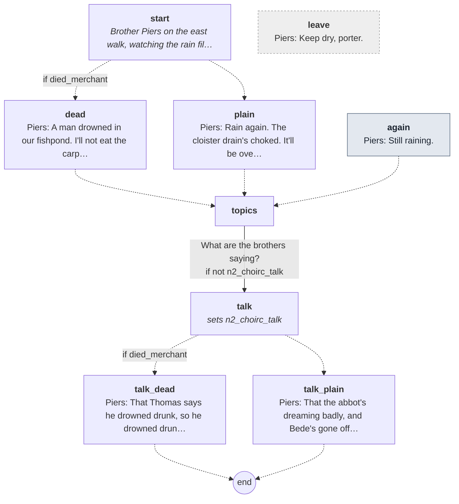

Every line

#### `start`

- *Brother Piers on the east walk, watching the rain fill the garden beds.*

- → `dead` if `died_merchant`
- → `plain`

#### `dead`

- **Piers** *grave*: A man drowned in our fishpond. I'll not eat the carp this side of Easter.

- → `topics`

#### `plain`

- **Piers** *weary*: Rain again. The cloister drain's choked. It'll be over our shoes by Matins.

- → `topics`

#### `again` (the next time)

- **Piers** *weary*: Still raining.

- → `topics`

#### `topics`

1. What are the brothers saying? → `talk` · only if not `n2_choirc_talk`

#### `talk`
*sets `n2_choirc_talk`*

- → `talk_dead` if `died_merchant`
- → `talk_plain`

#### `talk_dead`

- **Piers** *cold*: That Thomas says he drowned drunk, so he drowned drunk. (He doesn't smile.) Thomas is never wrong about the dead.

- → `end`

#### `talk_plain`

- **Piers** *weary*: That the abbot's dreaming badly, and Bede's gone off sulking again. Nothing new.

- → `end`

#### `leave` (if he walks away)

- **Piers** *calm*: Keep dry, porter.

## Cole

[`cole.talk`](../../game/chapters/night2/dialogue/cole.talk) · id `n2_cole` · baseline *blank* · **in the cult**

Moods through the talk: blank

> Cole keeping the gate at dusk (night 2). Silent: a word or two at most, and a look.
> If the merchant drowned, there's pond weed drying on his boots: he helped pull him out, or so it would seem.

**Reads from elsewhere:** [`died_merchant`](links.md#died_merchant)

### Every path

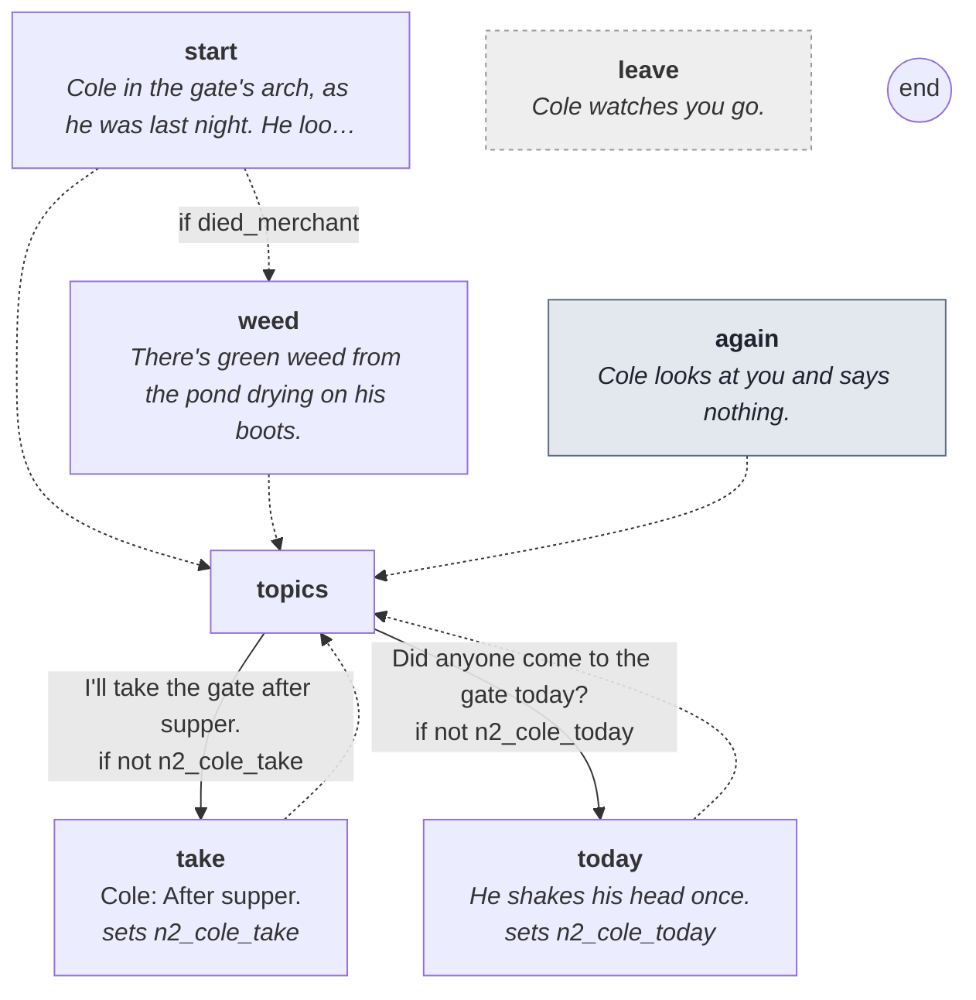

Every line

#### `start`

- *Cole in the gate's arch, as he was last night. He looks at you a long moment.*

- → `weed` if `died_merchant`
- → `topics`

#### `weed`

- *There's green weed from the pond drying on his boots.*

- → `topics`

#### `again` (the next time)

- *Cole looks at you and says nothing.*

- → `topics`

#### `topics`

1. I'll take the gate after supper. → `take` · only if not `n2_cole_take`
2. Did anyone come to the gate today? → `today` · only if not `n2_cole_today`

#### `take`
*sets `n2_cole_take`*

- **Cole** *blank*: After supper.

- → `topics`

#### `today`
*sets `n2_cole_today`*

- *He shakes his head once.*

- → `topics`

#### `leave` (if he walks away)

- *Cole watches you go.*

## Dunstan

[`dunstan.talk`](../../game/chapters/night2/dialogue/dunstan.talk) · id `n2_dunstan` · baseline *blank* · **in the cult**

> Dunstan at the woodpile at dusk (night 2), stacking logs out of the rain. Silent: a look, and no word at all tonight.

**Reads from elsewhere:** [`died_merchant`](links.md#died_merchant)

### Every path

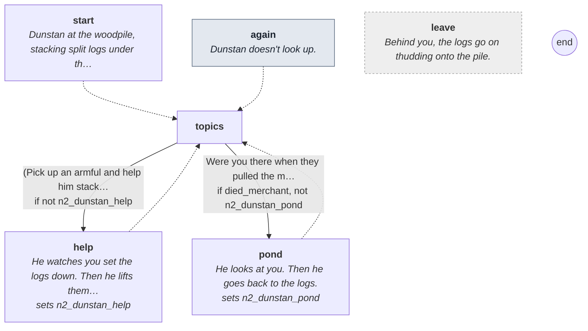

Every line

#### `start`

- *Dunstan at the woodpile, stacking split logs under the eaves out of the rain. He doesn't stop.*

- → `topics`

#### `again` (the next time)

- *Dunstan doesn't look up.*

- → `topics`

#### `topics`

1. (Pick up an armful and help him stack.) → `help` · only if not `n2_dunstan_help`
2. Were you there when they pulled the merchant out, brother? → `pond` · only if `died_merchant`, not `n2_dunstan_pond`

#### `help`
*sets `n2_dunstan_help`*

- *He watches you set the logs down. Then he lifts them off the pile and stacks them again, his own way.*

- → `topics`

#### `pond`
*sets `n2_dunstan_pond`*

- *He looks at you. Then he goes back to the logs.*

- → `topics`

#### `leave` (if he walks away)

- *Behind you, the logs go on thudding onto the pile.*

## Brother Edwin

[`edwin.talk`](../../game/chapters/night2/dialogue/edwin.talk) · id `n2_edwin` · baseline *warm*, habit *brow* · starts at trust 50

Moods through the talk: afraid → sad → glad → amused → glad → amused → afraid → glad → amused → grave → amused → glad

> Edwin on the west walk at dusk (night 2). He opens on the night before: the drowned merchant (Osric carried him off),
> the merchant who left cursing the lock, or just the porter's first night. Then the knock, the pardoner, and what
> the brothers are saying: the abbot's bad dreams, and Ranulf on the incense. (The bread is night 3's talk.)

**Reads from elsewhere:** [`died_merchant`](links.md#died_merchant), [`n1_knock_no_one`](links.md#n1_knock_no_one), [`n1_merchant`](links.md#n1_merchant), [`n1_walter`](links.md#n1_walter)

### Every path

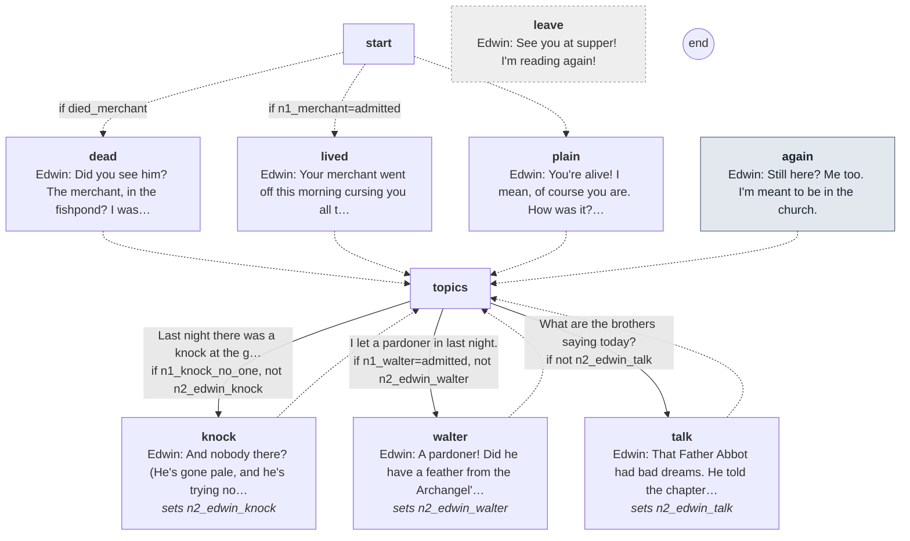

Every line

#### `start`

- → `dead` if `died_merchant`
- → `lived` if `n1_merchant=admitted`
- → `plain`

#### `dead`

- *Edwin catches your sleeve the moment he sees you.*
- **Edwin** *afraid*: Did you see him? The merchant, in the fishpond? I wasn't let look.
- **Edwin** *sad*: Brother Osric carried him off before Prime. He said a drowned man's no sight for a novice.

- → `topics`

#### `lived`

- **Edwin** *glad*: Your merchant went off this morning cursing you all the way to the gate! For locking him in!
- **Edwin** *amused*: I've never heard a man swear like it, and I've been to Billingsgate.

- → `topics`

#### `plain`

- **Edwin** *glad*: You're alive! I mean, of course you are. How was it? Was it long?
- **Edwin** *amused, brow*: Brother Wulfric says the first night's the longest, and then they get longer.

- → `topics`

#### `again` (the next time)

- **Edwin** *amused*: Still here? Me too. I'm meant to be in the church.

- → `topics`

#### `topics`

1. Last night there was a knock at the gate, and no one there. → `knock` · only if `n1_knock_no_one`, not `n2_edwin_knock`
2. I let a pardoner in last night. → `walter` · only if `n1_walter=admitted`, not `n2_edwin_walter`
3. What are the brothers saying today? → `talk` · only if not `n2_edwin_talk`

#### `knock`
*sets `n2_edwin_knock`*

- **Edwin** *afraid, swallow*: And nobody there? (He's gone pale, and he's trying not to be.)
- **Edwin** *afraid*: Boys from the lane. It'll have been boys. Won't it?

- → `topics`

#### `walter`
*sets `n2_edwin_walter`*

- **Edwin** *glad, brow*: A pardoner! Did he have a feather from the Archangel's wing? They always have a feather.
- **Edwin** *amused*: Brother Hugh says pardoners are thieves with Latin. I'd still like to see the feather.

- → `topics`

#### `talk`
*sets `n2_edwin_talk`*

- **Edwin** *grave*: That Father Abbot had bad dreams. He told the chapter this morning, and asked us all to pray for the house.
- **Edwin** *amused*: Brother Hugh says it's the rain. Brother Ranulf says the incense isn't thick enough at Matins.

- → `topics`

#### `leave` (if he walks away)

- **Edwin** *glad*: See you at supper! I'm reading again!

## Abbot Godric

[`godric.talk`](../../game/chapters/night2/dialogue/godric.talk) · id `n2_godric` · baseline *weary*

Moods through the talk: warm → sad → warm → afraid → grave → afraid → grave → warm → grave

> Abbot Godric in the chapter house at dusk (night 2). Uneasy: he believes a demon troubles the house, but hasn't said so
> to the chapter yet (he will at dawn, and order more incense). He dreams badly: the drug, though he doesn't know it.
> He tells the porter to count every brother at Matins tonight, and to breathe the incense.

**Reads from elsewhere:** [`died_merchant`](links.md#died_merchant), [`n1_knock_no_one`](links.md#n1_knock_no_one)

### Every path

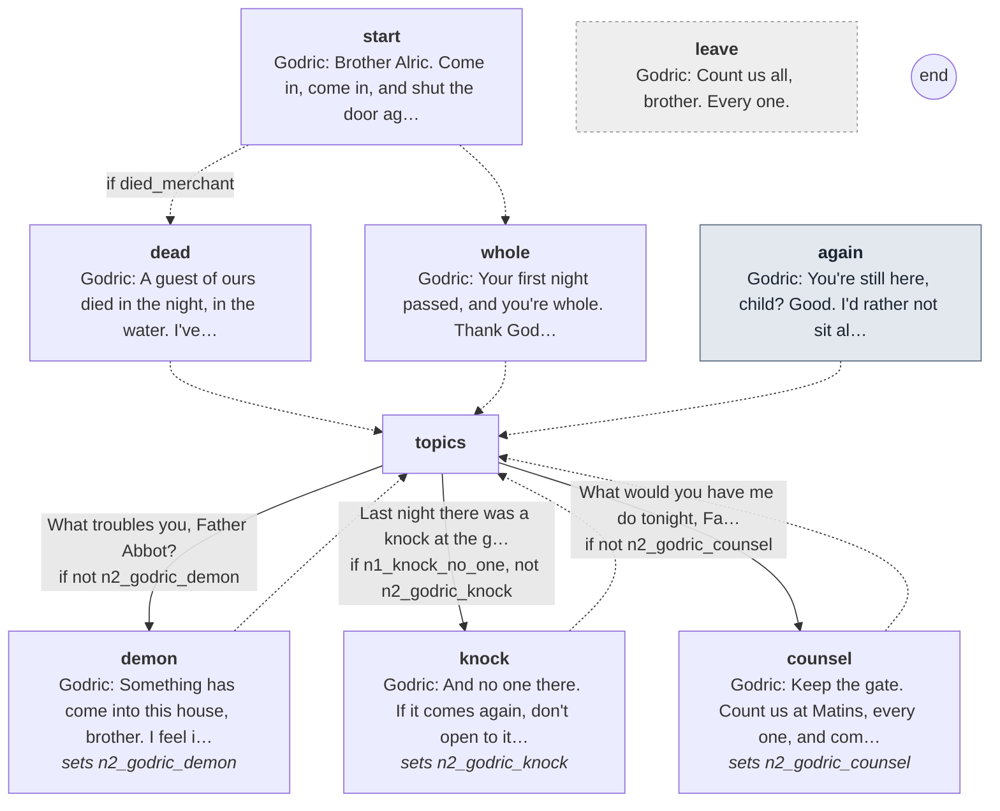

Every line

#### `start`

- *The abbot sits with his blanket in the chapter house, but he isn't reading. He's watching the door.*
- **Godric** *warm*: Brother Alric. Come in, come in, and shut the door against the draught.

- → `dead` if `died_merchant`
- → `whole`

#### `dead`

- **Godric** *sad*: A guest of ours died in the night, in the water. I've said a mass for him, and I'll say another.

- → `topics`

#### `whole`

- **Godric** *warm*: Your first night passed, and you're whole. Thank God for that.

- → `topics`

#### `again` (the next time)

- **Godric** *afraid*: You're still here, child? Good. I'd rather not sit alone tonight.

- → `topics`

#### `topics`

1. What troubles you, Father Abbot? → `demon` · only if not `n2_godric_demon`
2. Last night there was a knock at the gate, and no one there. → `knock` · only if `n1_knock_no_one`, not `n2_godric_knock`
3. What would you have me do tonight, Father Abbot? → `counsel` · only if not `n2_godric_counsel`

#### `demon`
*sets `n2_godric_demon`*

- **Godric** *afraid*: Something has come into this house, brother. I feel it when I pray, like a draught from a door nobody opened.
- **Godric** *grave*: I think it's a demon. I've not said so to the chapter. I'll not say it till I'm sure.
- **Godric** *afraid, swallow*: Last night I dreamed something knelt at the foot of my bed and counted on its fingers.

- → `topics`

#### `knock`
*sets `n2_godric_knock`*

- *He crosses himself.*
- **Godric** *afraid*: And no one there. If it comes again, don't open to it. Ring the bell and wake me.

- → `topics`

#### `counsel`
*sets `n2_godric_counsel`*

- **Godric** *grave*: Keep the gate. Count us at Matins, every one, and come to me if one is missing.
- **Godric** *warm*: And breathe the incense, child. That's what it's for. I mean to have Ranulf burn more.

- → `topics`

#### `leave` (if he walks away)

- **Godric** *grave*: Count us all, brother. Every one.

## Prior Hugh

[`hugh.talk`](../../game/chapters/night2/dialogue/hugh.talk) · id `n2_hugh` · baseline *cold*, habit *jaw* · starts at trust -20

Moods through the talk: cold → angry → grave → cold → calm → cold → angry → cold

> Prior Hugh on the north walk at dusk (night 2). If the merchant died, he wants to know why the guesthouse was left
> unlocked (n2_hugh_lock), and tells the porter the purse is gone (the merchant_purse note). He suspects the porter, and Walter.
> Otherwise he is merely cold, and has a word on the pardoner. If Thomas told the porter the prior walks at night,
> the porter can ask him why (n2_hugh_night): he turns it back on the porter.

**Reads from elsewhere:** [`died_merchant`](links.md#died_merchant), [`n1_merchant`](links.md#n1_merchant), [`n1_walter`](links.md#n1_walter), [`n2_thomas_prior`](links.md#n2_thomas_prior), [`reported_merchant`](links.md#reported_merchant)

### Every path

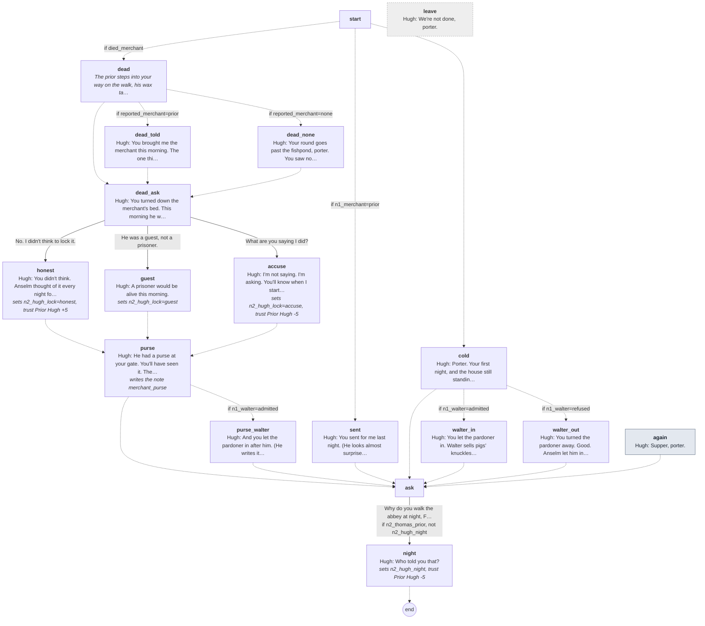

Every line

#### `start`

- → `dead` if `died_merchant`
- → `sent` if `n1_merchant=prior`
- → `cold`

#### `dead`

- *The prior steps into your way on the walk, his wax tablet already open.*

- → `dead_told` if `reported_merchant=prior`
- → `dead_none` if `reported_merchant=none`
- → `dead_ask`

#### `dead_told`

- **Hugh** *cold*: You brought me the merchant this morning. The one thing you've done right.

- → `dead_ask`

#### `dead_none`

- **Hugh** *cold, jaw*: Your round goes past the fishpond, porter. You saw nothing? Nothing at all?

- → `dead_ask`

#### `dead_ask`

- **Hugh** *cold, jaw*: You turned down the merchant's bed. This morning he was in the fishpond. Was the guesthouse locked, porter?

1. No. I didn't think to lock it. → `honest`
2. He was a guest, not a prisoner. → `guest`
3. What are you saying I did? → `accuse`

#### `honest`
*sets `n2_hugh_lock=honest`, **trust Prior Hugh +5***

- **Hugh** *cold*: You didn't think. Anselm thought of it every night for thirty years.

- → `purse`

#### `guest`
*sets `n2_hugh_lock=guest`*

- **Hugh** *cold*: A prisoner would be alive this morning.

- → `purse`

#### `accuse`
*sets `n2_hugh_lock=accuse`, **trust Prior Hugh -5***

- **Hugh** *angry*: I'm not saying. I'm asking. You'll know when I start saying.

- → `purse`

#### `purse`
*writes the note *merchant_purse**

- **Hugh** *grave*: He had a purse at your gate. You'll have seen it. There was none on him this morning.
- **Hugh** *cold, jaw*: Thomas says he drowned drunk. Drunk men drown with their purses on.

- → `purse_walter` if `n1_walter=admitted`
- → `ask`

#### `purse_walter`

- **Hugh** *cold*: And you let the pardoner in after him. (He writes it on his tablet.) I'll be asking Walter about purses.

- → `ask`

#### `sent`

- *The prior watches you come down the walk.*
- **Hugh** *calm*: You sent for me last night. (He looks almost surprised.) Good. That's the rule. Keep to it.

- → `ask`

#### `cold`

- *The prior watches you come down the walk, and doesn't move out of your way.*
- **Hugh** *cold*: Porter. Your first night, and the house still standing. Don't let it go to your head.

- → `walter_in` if `n1_walter=admitted`
- → `walter_out` if `n1_walter=refused`
- → `ask`

#### `walter_in`

- **Hugh** *cold*: You let the pardoner in. Walter sells pigs' knuckles to widows and calls them saints. Next time, send for me.

- → `ask`

#### `walter_out`

- **Hugh** *cold*: You turned the pardoner away. Good. Anselm let him in whenever he knocked.

- → `ask`

#### `ask`

1. Why do you walk the abbey at night, Father Prior? → `night` · only if `n2_thomas_prior`, not `n2_hugh_night`

#### `night`
*sets `n2_hugh_night`, **trust Prior Hugh -5***

- *His face doesn't change, but he closes his tablet.*
- **Hugh** *angry*: Who told you that?
- **Hugh** *cold, jaw*: I walk where I please in this house. I'm its prior. Where do you walk, porter, between Matins and Lauds?

- → `end`

#### `again` (the next time)

- *He's writing on his tablet, and doesn't look up.*
- **Hugh** *cold*: Supper, porter.

- → `ask`

#### `leave` (if he walks away)

- **Hugh** *cold*: We're not done, porter.

## Brother Osric

[`osric.talk`](../../game/chapters/night2/dialogue/osric.talk) · id `n2_osric` · baseline *glad*, habit *nod* · starts at trust 20 · **in the cult**

Moods through the talk: sad → glad → amused → glad → wary → glad

> Osric at the kitchen fire at dusk (night 2). Jolly; he carried the drowned merchant (he handles the bodies).
> He noticed whether the porter ate his bread last night (n1_ate_bread). Asking what's in the bread, once warned,
> is the wrong question to the wrong brother (Suspicion +5), and ends the talk on his question.
> Claims: n2_osric_rye (hiding: the rye is the abbey's own, and it carries the ergot the cult doses the house with).

**Reads from elsewhere:** [`bread_warned`](links.md#bread_warned), [`died_merchant`](links.md#died_merchant), [`n1_ate_bread`](links.md#n1_ate_bread)

### Every path

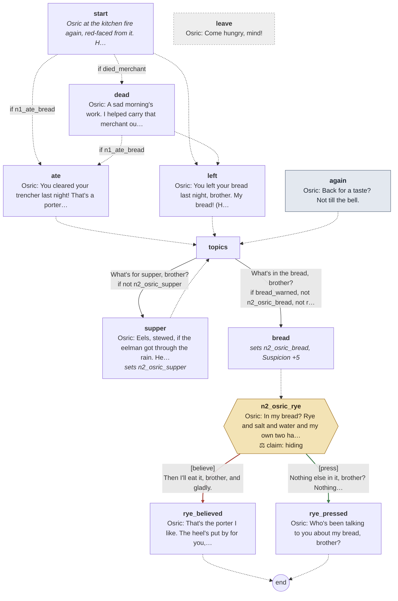

Every line

#### `start`

- *Osric at the kitchen fire again, red-faced from it. He waves a ladle at you.*

- → `dead` if `died_merchant`
- → `ate` if `n1_ate_bread`
- → `left`

#### `dead`

- **Osric** *sad, smile*: A sad morning's work. I helped carry that merchant out of the pond, heavy as wet barley. Not kitchen talk.

- → `ate` if `n1_ate_bread`
- → `left`

#### `ate`

- **Osric** *glad*: You cleared your trencher last night! That's a porter I like.

- → `topics`

#### `left`

- **Osric** *glad*: You left your bread last night, brother. My bread! (He laughs, but his eyes stay on you.)
- **Osric** *amused*: Tonight you'll eat it, or I'll know why.

- → `topics`

#### `again` (the next time)

- **Osric** *glad*: Back for a taste? Not till the bell.

- → `topics`

#### `topics`

1. What's for supper, brother? → `supper` · only if not `n2_osric_supper`
2. What's in the bread, brother? → `bread` · only if `bread_warned`, not `n2_osric_bread`, not `read_n2_osric_rye`

#### `supper`
*sets `n2_osric_supper`*

- **Osric** *glad*: Eels, stewed, if the eelman got through the rain. He did. And the bread, with a heel put by for you.

- → `topics`

#### `bread`
*sets `n2_osric_bread`, **Suspicion +5***

- → `n2_osric_rye`

#### `n2_osric_rye`

- **Osric** *glad, smile*: In my bread? Rye and salt and water and my own two hands. Rye from our own granary.

> **Claim `n2_osric_rye`: true, but holding back.** The last line is the claim.

1. Then I'll eat it, brother, and gladly. → `rye_believed` · **believe** · wrong
2. Nothing else in it, brother? Nothing at all? → `rye_pressed` · **press** · **right**, trust +1

#### `rye_believed`

- **Osric** *glad*: That's the porter I like. The heel's put by for you, mind.
- *He goes back to his kneading.*

- → `end`

#### `rye_pressed`

- *He keeps smiling. He has stopped kneading.*
- **Osric** *wary*: Who's been talking to you about my bread, brother?

- → `end`

#### `leave` (if he walks away)

- **Osric** *glad*: Come hungry, mind!

## Brother Ranulf

[`ranulf.talk`](../../game/chapters/night2/dialogue/ranulf.talk) · id `n2_ranulf` · baseline *grave* · starts at trust 0 · **in the cult**

Moods through the talk: grave → cold → grave → cold → grave

> Ranulf on a ladder at the candle beam in the church at dusk (night 2). He keeps the bells.
> Ringing Matins: the rope has been stiff with the wet and will feel heavy. (Tonight Bede hangs from it; Ranulf knows.)
> If Ralph told the porter on night 0 how many candles the sacrist buys (n0_ralph_candles), the porter can say so:
> the wrong question to the wrong brother (Suspicion +5).

**Reads from elsewhere:** [`n0_ralph_candles`](links.md#n0_ralph_candles)

### Every path

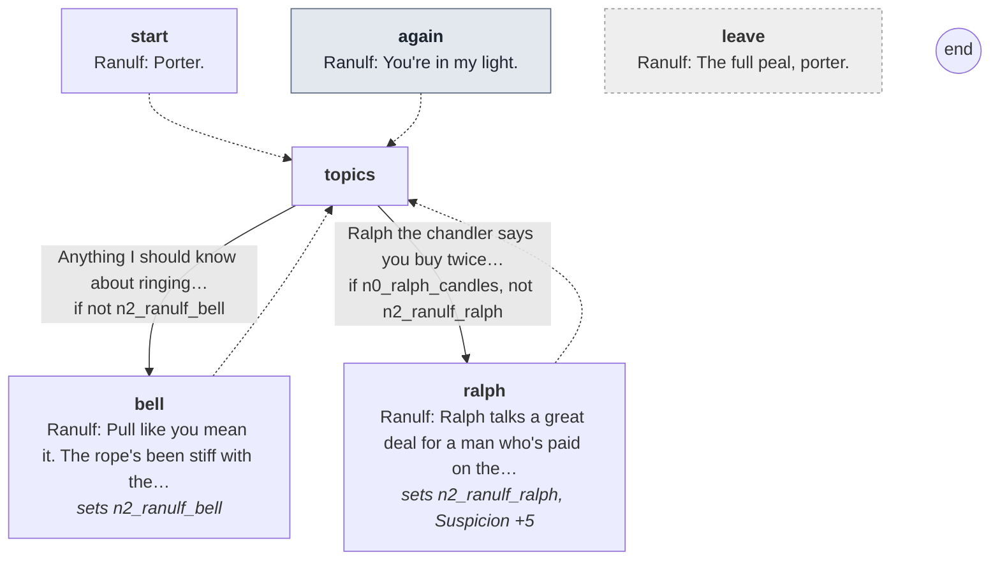

Every line

#### `start`

- *Ranulf is up a ladder at the candle beam, fitting new candles. He looks down at you and doesn't come down.*
- **Ranulf** *grave*: Porter.

- → `topics`

#### `again` (the next time)

- **Ranulf** *cold*: You're in my light.

- → `topics`

#### `topics`

1. Anything I should know about ringing Matins tonight? → `bell` · only if not `n2_ranulf_bell`
2. Ralph the chandler says you buy twice the candles you used to. → `ralph` · only if `n0_ralph_candles`, not `n2_ranulf_ralph`

#### `bell`
*sets `n2_ranulf_bell`*

- **Ranulf** *grave, glance*: Pull like you mean it. The rope's been stiff with the wet these two nights. It'll feel heavy.
- **Ranulf** *grave*: Ring the full peal. The abbot takes a short one for an omen, and he's had omens enough this week.

- → `topics`

#### `ralph`
*sets `n2_ranulf_ralph`, **Suspicion +5***

- *He stops, a candle in each hand, and looks down at you a long moment.*
- **Ranulf** *cold*: Ralph talks a great deal for a man who's paid on the nail.
- **Ranulf** *grave, glance*: A church in winter eats candles, porter. So does a house that prays more than it used to.

- → `topics`

#### `leave` (if he walks away)

- **Ranulf** *grave*: The full peal, porter.

## Brother Thomas

[`thomas.talk`](../../game/chapters/night2/dialogue/thomas.talk) · id `n2_thomas` · baseline *warm*, habit *nod* · starts at trust 40 · **in the cult**

Moods through the talk: grave → warm → cold → warm → amused → grave → warm → grave → warm → grave

> Thomas at dusk, at his herbs in the infirmary (night 2). He opens, quietly, with the prior about the abbey at night
> (n2_thomas_prior): true, and the prior is innocent. Then the merchant: drowned drunk (his lie), or alive, or turned away.
> The knock with no one there: boys from the lane. Bede's warning about the bread: Bede fasts and sees things.
> Telling him about the bread is the wrong brother (Suspicion +5). Bede is already dead; Thomas knows it.
> Claims: n2_thomas_drowned (lie: no water in the lungs, rope marks on the wrists; confront with merchant_rope).

**Reads from elsewhere:** [`bread_warned`](links.md#bread_warned), [`died_merchant`](links.md#died_merchant), [`merchant_rope`](links.md#merchant_rope), [`n1_knock_no_one`](links.md#n1_knock_no_one), [`n1_merchant`](links.md#n1_merchant), [`reported_merchant`](links.md#reported_merchant)
**Read elsewhere:** [`n2_thomas_prior`](links.md#n2_thomas_prior)

### Every path

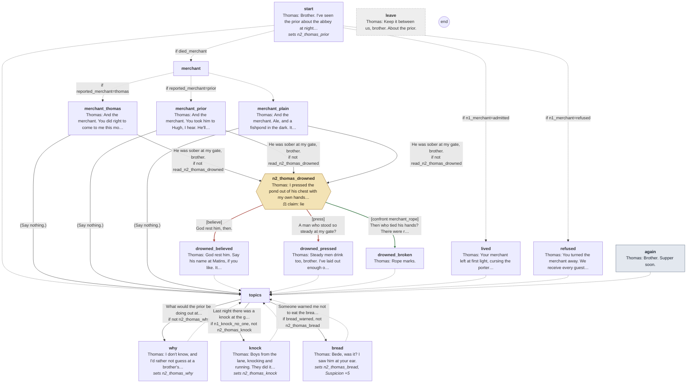

Every line

#### `start`
*sets `n2_thomas_prior`*

- *Thomas looks past you at the door before he speaks, and keeps his voice low.*
- **Thomas** *grave*: Brother. I've seen the prior about the abbey at night. In the court, by the guesthouse, long after Compline.
- **Thomas** *grave, nod*: He has no business there at that hour. I don't say what it means. Only, if you see a man in the dark, it may be Hugh.

- → `merchant` if `died_merchant`
- → `lived` if `n1_merchant=admitted`
- → `refused` if `n1_merchant=refused`
- → `topics`

#### `merchant`

- → `merchant_thomas` if `reported_merchant=thomas`
- → `merchant_prior` if `reported_merchant=prior`
- → `merchant_plain`

#### `merchant_thomas`

- **Thomas** *warm, still*: And the merchant. You did right to come to me this morning, and quietly. Ale and a fishpond: no fault of yours.

1. He was sober at my gate, brother. → `n2_thomas_drowned` · only if not `read_n2_thomas_drowned`
2. (Say nothing.) → `topics`

#### `merchant_prior`

- **Thomas** *warm, still*: And the merchant. You took him to Hugh, I hear. He'll have made it your doing. It wasn't. The man was drunk.

1. He was sober at my gate, brother. → `n2_thomas_drowned` · only if not `read_n2_thomas_drowned`
2. (Say nothing.) → `topics`

#### `merchant_plain`

- **Thomas** *warm, still*: And the merchant. Ale, and a fishpond in the dark. It's no fault of yours, brother. Don't carry him.

1. He was sober at my gate, brother. → `n2_thomas_drowned` · only if not `read_n2_thomas_drowned`
2. (Say nothing.) → `topics`

#### `n2_thomas_drowned`

- *He sets the pestle down.*
- **Thomas** *warm, still*: I pressed the pond out of his chest with my own hands, brother. He drowned. Drink and the dark, nothing more.

> **Claim `n2_thomas_drowned`: a lie.** The last line is the claim.

1. God rest him, then. → `drowned_believed` · **believe** · wrong
2. A man who stood so steady at my gate? → `drowned_pressed` · **press** · wrong
3. Then who tied his hands? There were rope marks on his wrists. → `drowned_broken` · **confront** with *merchant_rope* · **right**, **Suspicion +10**: the cult knows he knows

#### `drowned_believed`

- **Thomas** *warm, nod*: God rest him. Say his name at Matins, if you like. It does the living good.

- → `topics`

#### `drowned_pressed`

- **Thomas** *warm, still*: Steady men drink too, brother. I've laid out enough of them to know.
- *He takes up the pestle again.*

- → `topics`

#### `drowned_broken`

- *The pestle stops. For a moment his face is a stranger's.*
- **Thomas** *cold, still*: Rope marks.
- **Thomas** *warm*: They drew him out with a rope, brother, and Dunstan with his boathook. A drowned man's skin marks like wet clay.
- **Thomas** *warm, nod*: You've a sharp eye. Keep it on your gate.

- → `topics`

#### `lived`

- **Thomas** *amused*: Your merchant left at first light, cursing the porter who locked him in like a sheep. Well. He's alive to curse.

- → `topics`

#### `refused`

- **Thomas** *grave*: You turned the merchant away. We receive every guest as Christ, the Rule says. Still, it was your first night.

- → `topics`

#### `again` (the next time)

- *Thomas is back at his mortar.*
- **Thomas** *warm*: Brother. Supper soon.

- → `topics`

#### `topics`

1. What would the prior be doing out at night? → `why` · only if not `n2_thomas_why`
2. Last night there was a knock at the gate, and no one there. → `knock` · only if `n1_knock_no_one`, not `n2_thomas_knock`
3. Someone warned me not to eat the bread. → `bread` · only if `bread_warned`, not `n2_thomas_bread`

#### `why`
*sets `n2_thomas_why`*

- **Thomas** *grave*: I don't know, and I'd rather not guess at a brother's sins.
- **Thomas** *warm, nod*: You're up all night. You'll see more than I do. Watch, that's all I ask.

- → `topics`

#### `knock`
*sets `n2_thomas_knock`*

- *For a moment he doesn't answer. Then he smiles.*
- **Thomas** *warm*: Boys from the lane, knocking and running. They did it to Anselm for years.
- **Thomas** *warm*: And Mab sleeps more than she lets on. Don't lose sleep over a knock.

- → `topics`

#### `bread`
*sets `n2_thomas_bread`, **Suspicion +5***

- **Thomas** *warm*: Bede, was it? I saw him at your ear.
- **Thomas** *warm, still*: Bede fasts till he faints, and then he sees things in the rafters. Eat your bread, brother. You need your strength.

- → `topics`

#### `leave` (if he walks away)

- **Thomas** *grave*: Keep it between us, brother. About the prior.

## Scripted lines

Said by the night's beats and cues (`night2.tscn`), outside any talk.

- `Director/Supper`: **Osric** *glad, smile*: The heel for the porter. I keep it back special.
- `Director/Supper`: **Osric** *glad*: (From the hatch, smiling.) Not hungry, porter? I'll keep an eye on you. Can't have you wasting away.
- `Director/Supper`: **Thomas** *grave*: (Low, under the reading.) I've seen the prior about the house at night, Alric. Places he has no business being.
- `Director/Supper`: **Thomas** *grave, nod*: Say nothing. Only keep your eyes open.
- `Director/Gate`: **Cole** *blank*: Yours.
- `Director/Knocks`: **Hugh** *cold*: Stand aside, porter. I'll see him to a bed myself.
- `Director/Knocks`: **Hugh** *cold, jaw*: (To the visitor.) This way. Keep close, and touch nothing.
- `Director/DawnScene`: **Godric** *afraid*: Brothers. A demon has come into this house. Brother Bede is dead of it, and I will not pretend otherwise.
- `Director/DawnScene`: **Godric** *grave*: From today, incense at every office, twice the measure, until it is driven out. Pray, and keep together.
- `Director/DawnScene`: **Hugh** *cold, jaw*: A word, porter. Where were you in the night? All of it, hour by hour.
- `Director/DawnScene`: **Hugh** *cold*: The gate and the round. So everyone was where they should be, and still a brother hangs.
- `Director/DawnScene`: **Hugh** *cold, jaw*: You found him. You always seem to be first, porter. I'll remember that.
- `Director/DawnScene`: **Hugh** *grave*: (He writes it all on his wax before he speaks.) Tell no one else what you've told me. No one.
