# The third night: The Oven

Generated by `tools/script_docs.py` from the game's files. Don't edit it by hand. How to read it: [README](README.md). Every flag: [links](links.md).

## The night

The chapter's beats in order (`night3.tscn`), the talks each opens, who he can go to from then on, and the flags passed between them (dashed). The note at the end lists what this chapter's talks pass on to later ones.

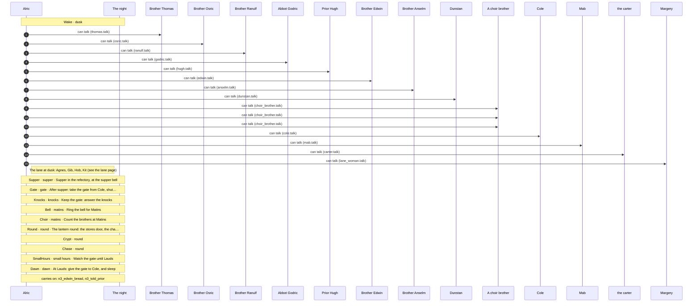

## Conversations

- [Brother Anselm](#anselm) (`anselm.talk`)
- [the carter](#carter) (`carter.talk`)
- [A choir brother](#choir_brother) (`choir_brother.talk`)
- [Cole](#cole) (`cole.talk`)
- [Dunstan](#dunstan) (`dunstan.talk`)
- [Brother Edwin](#edwin) (`edwin.talk`)
- [Abbot Godric](#godric) (`godric.talk`)
- [Prior Hugh](#hugh) (`hugh.talk`)
- [Margery](#lane_woman) (`lane_woman.talk`)
- [Mab](#mab) (`mab.talk`)
- [Brother Osric](#osric) (`osric.talk`)
- [Brother Ranulf](#ranulf) (`ranulf.talk`)
- [Brother Thomas](#thomas) (`thomas.talk`)

## Brother Anselm

[`anselm.talk`](../../game/chapters/night3/dialogue/anselm.talk) · id `n3_anselm` · baseline *weary*, habit *lip* · starts at trust 20

Moods through the talk: weary → afraid → grave → afraid → weary → sad → grave → weary → afraid

> Anselm at dusk, in the infirmary (night 3). The old porter, blind, hunched in his chair, his stick across his knees.
> Guilty and terrified: he let victims in for years. He won't say so, and nothing here says so.

### Every path

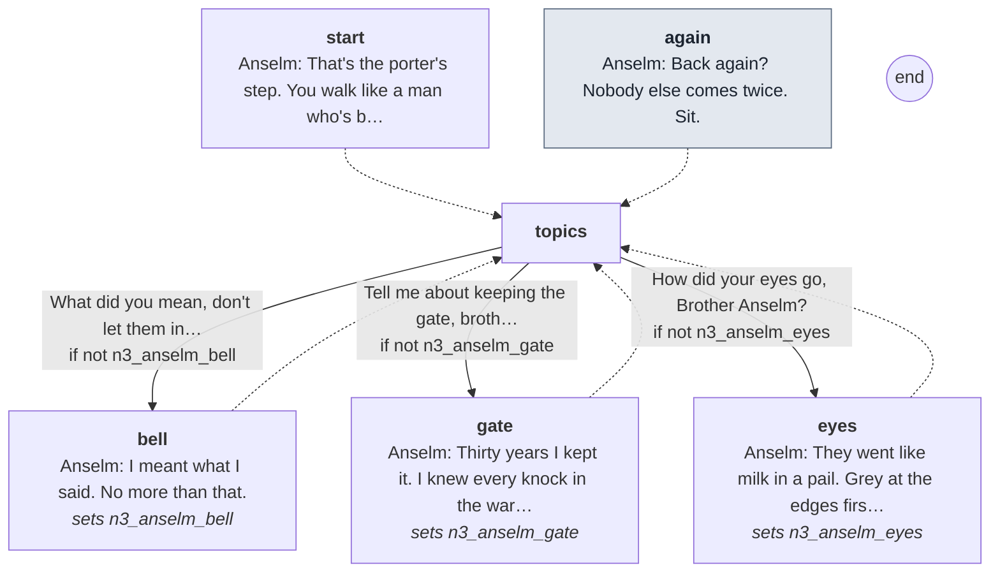

Every line

#### `start`

- *The old man in the chair turns his face to the door before you reach it.*
- **Anselm** *weary*: That's the porter's step. You walk like a man who's been told not to run.
- **Anselm** *weary*: Still with us, then. Good. Sit, if you like.

- → `topics`

#### `again` (the next time)

- *His milky eyes settle on a place just beside your face.*
- **Anselm** *weary*: Back again? Nobody else comes twice. Sit.

- → `topics`

#### `topics`

1. What did you mean, don't let them in after the bell? → `bell` · only if not `n3_anselm_bell`
2. Tell me about keeping the gate, brother. → `gate` · only if not `n3_anselm_gate`
3. How did your eyes go, Brother Anselm? → `eyes` · only if not `n3_anselm_eyes`

#### `bell`
*sets `n3_anselm_bell`*

- *His hand finds your sleeve and grips it. He listens to the room before he speaks.*
- **Anselm** *afraid, swallow*: I meant what I said. No more than that.
- **Anselm** *grave*: Bar it at the bell and keep it barred. Whoever knocks. Whatever they tell you.
- **Anselm** *afraid, lip*: Don't ask me why, boy. I'm old, and I can't see who's listening.

- → `topics`

#### `gate`
*sets `n3_anselm_gate`*

- **Anselm** *weary*: Thirty years I kept it. I knew every knock in the ward by the sound.
- **Anselm** *weary*: The carter's, the bailiff's, Walter's. Pilgrims knock soft, as if the gate might bite.
- **Anselm** *sad, swallow*: I let in whoever came. That was the rule I was given, and I kept it.
- *He's quiet a while.*
- **Anselm** *grave*: Write them all down, boy. Every one. Somebody should.

- → `topics`

#### `eyes`
*sets `n3_anselm_eyes`*

- **Anselm** *weary*: They went like milk in a pail. Grey at the edges first, then the middle. Two winters.
- **Anselm** *weary, lip*: I hear better than I did. That's the bargain God makes with you.
- **Anselm** *afraid*: The night before last, I heard the tower creak before ever you rang. There was no wind. Only the rain.

- → `topics`

## the carter

[`carter.talk`](../../game/chapters/night3/dialogue/carter.talk) · id `n3_carter`

Moods through the talk: wary → amused → wary → grave → wary

> The carter in the lane at dusk (night 3), walking his empty wagon home before dark. A line or two, and he's gone.
> Night 3 keeps its own; the other nights are game/chapters/common/lane/carter.talk.

### Every path

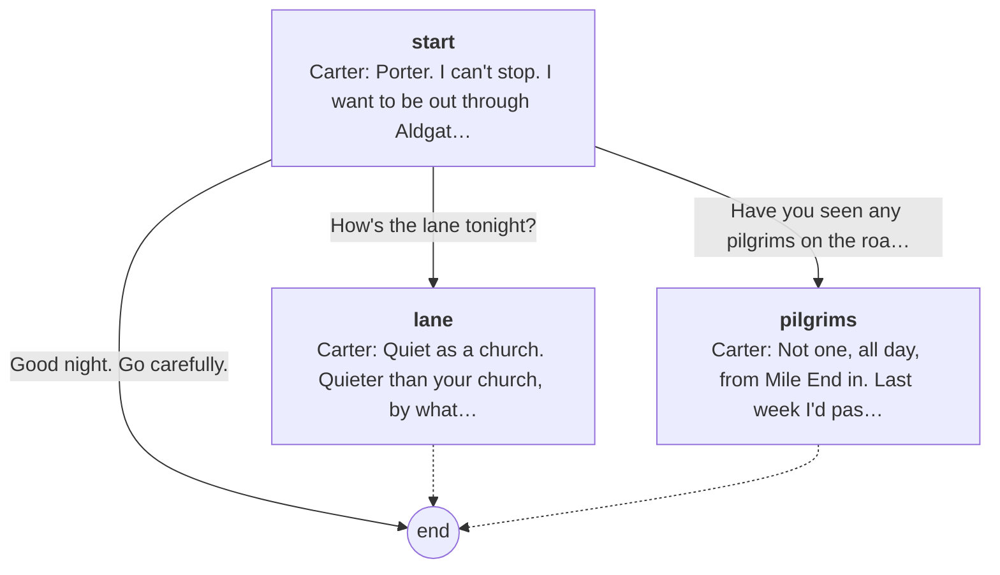

Every line

#### `start`

- *The carter, walking at his horse's head, the wagon rattling empty behind him.*
- **Carter** *wary*: Porter. I can't stop. I want to be out through Aldgate before they shut it.

1. How's the lane tonight? → `lane`
2. Have you seen any pilgrims on the road? → `pilgrims`
3. Good night. Go carefully. → `end`

#### `lane`

- **Carter** *amused*: Quiet as a church. Quieter than your church, by what they say.
- **Carter** *wary*: Hob's doing no trade. Nobody wants to drink with your wall looking at them.

- → `end`

#### `pilgrims`

- **Carter** *grave*: Not one, all day, from Mile End in. Last week I'd pass a dozen, with their staffs and their badges.
- **Carter** *wary, shake*: Word gets about, porter. Folk would sooner walk to Canterbury.

- → `end`

## A choir brother (choir brother)

[`choir_brother.talk`](../../game/chapters/night3/dialogue/choir_brother.talk) · id `n3_choir_brother`

Moods through the talk: calm → sad → grave → sad → afraid → sad

> The choir brothers at dusk (night 3); Wulfric, Aldo and Piers all share this, so nobody is named.
> Faces you know from Matins. Not in the cult. Bede, who warned you about the bread, sang beside them.

**Reads from elsewhere:** [`bread_warned`](links.md#bread_warned)

### Every path

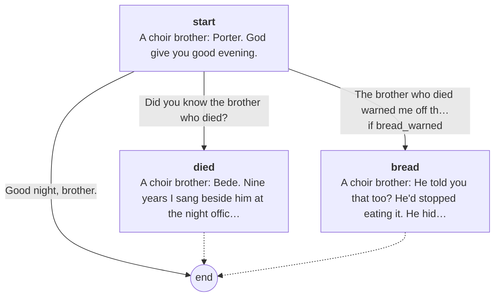

Every line

#### `start`

- *A brother of the choir, his hands in his sleeves. You know his face from Matins.*
- **A choir brother** *calm*: Porter. God give you good evening.

1. Did you know the brother who died? → `died`
2. The brother who died warned me off the bread. Why? → `bread` · only if `bread_warned`
3. Good night, brother. → `end`

#### `died`

- **A choir brother** *sad*: Bede. Nine years I sang beside him at the night office. He sang flat, and knew it, and sang anyway.
- **A choir brother** *grave*: The abbot says the demon took him. Maybe so.
- **A choir brother** *sad*: He was frightened, those last days. But not of demons. Bede laughed at demons.

- → `end`

#### `bread`

- *He looks toward the kitchen before he answers.*
- **A choir brother** *afraid*: He told you that too? He'd stopped eating it. He hid it in his sleeve and threw it over the wall.
- **A choir brother** *sad, swallow*: I asked him why. He said it was better I didn't know. Then he was dead.

- → `end`

## Cole

[`cole.talk`](../../game/chapters/night3/dialogue/cole.talk) · id `n3_cole` · baseline *blank* · **in the cult**

> Cole at dusk, keeping the gate (night 3). Lay brothers don't talk (Look and Feel, "Characters").

### Every path

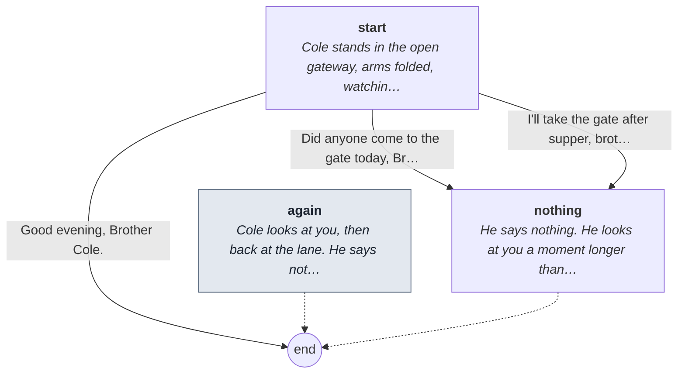

Every line

#### `start`

- *Cole stands in the open gateway, arms folded, watching the lane. He looks round at you and says nothing.*

1. Did anyone come to the gate today, Brother Cole? → `nothing`
2. I'll take the gate after supper, brother. → `nothing`
3. Good evening, Brother Cole. → `end`

#### `again` (the next time)

- *Cole looks at you, then back at the lane. He says nothing.*

- → `end`

#### `nothing`

- *He says nothing. He looks at you a moment longer than he needs to, then back at the lane.*

- → `end`

## Dunstan

[`dunstan.talk`](../../game/chapters/night3/dialogue/dunstan.talk) · id `n3_dunstan` · baseline *blank* · **in the cult**

> Dunstan at dusk, by the woodpile (night 3). Lay brothers don't talk (Look and Feel, "Characters").

### Every path

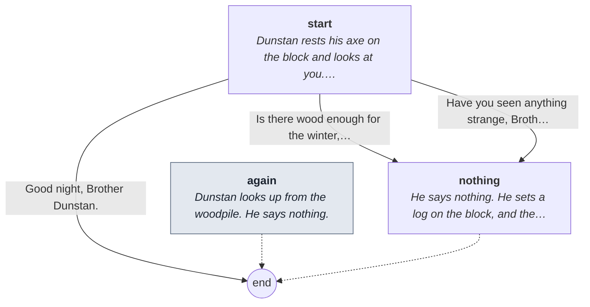

Every line

#### `start`

- *Dunstan rests his axe on the block and looks at you. He says nothing.*

1. Is there wood enough for the winter, brother? → `nothing`
2. Have you seen anything strange, Brother Dunstan? → `nothing`
3. Good night, Brother Dunstan. → `end`

#### `again` (the next time)

- *Dunstan looks up from the woodpile. He says nothing.*

- → `end`

#### `nothing`

- *He says nothing. He sets a log on the block, and the axe comes down.*

- → `end`

## Brother Edwin

[`edwin.talk`](../../game/chapters/night3/dialogue/edwin.talk) · id `n3_edwin` · baseline *warm*, habit *brow* · starts at trust 50

Moods through the talk: glad → warm → weary → warm → sad → afraid → sad → afraid → glad

> Edwin at dusk, on the west walk (night 3). The novice, your friend: gangly, freckled, a book under his arm. He talks too fast.
> He's frightened and trying not to show it. (He dies on night 4. Nothing here says so.)

**Reads from elsewhere:** [`bread_warned`](links.md#bread_warned)
**Read elsewhere:** [`n3_edwin_bread`](links.md#n3_edwin_bread)

### Every path

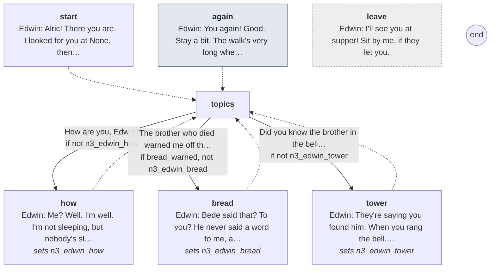

Every line

#### `start`

- *Edwin is pacing the west walk, his book shut under his arm. His face lights up when he sees you.*
- **Edwin** *glad*: Alric! There you are. I looked for you at None, then I remembered you sleep all day. You lucky man.

- → `topics`

#### `again` (the next time)

- **Edwin** *glad*: You again! Good. Stay a bit. The walk's very long when there's nobody on it.

- → `topics`

#### `topics`

1. How are you, Edwin? → `how` · only if not `n3_edwin_how`
2. The brother who died warned me off the bread. → `bread` · only if `bread_warned`, not `n3_edwin_bread`
3. Did you know the brother in the bell tower? → `tower` · only if not `n3_edwin_tower`

#### `how`
*sets `n3_edwin_how`*

- **Edwin** *warm, blink*: Me? Well. I'm well. I'm not sleeping, but nobody's sleeping. Except Brother Wulfric. He'd sleep through Doomsday.
- **Edwin** *weary*: I keep reading the same page. Look. It's the same psalm. I've been on it since Martinmas.
- *He laughs, too quickly.*

- → `topics`

#### `bread`
*sets `n3_edwin_bread`*

- **Edwin** *warm, brow*: Bede said that? To you? He never said a word to me, and I sat by him at table a whole year.
- **Edwin** *warm*: It's only bread. I've eaten it since I was twelve.
- *He thinks about it, and the grin goes.*
- **Edwin** *sad*: I'll leave mine tonight, if you leave yours. We'll be hungry together. That's nearly a feast.

- → `topics`

#### `tower`
*sets `n3_edwin_tower`*

- **Edwin** *afraid*: They're saying you found him. When you rang the bell. Is it true?
- **Edwin** *sad*: Bede taught me my letters. He'd rap my knuckles with a rule, and then give me an apple after.
- **Edwin** *afraid, swallow*: Father Abbot says the demon did it. I'd rather it was the demon, Alric. Isn't that a terrible thing to want?

- → `topics`

#### `leave` (if he walks away)

- **Edwin** *glad*: I'll see you at supper! Sit by me, if they let you.

## Abbot Godric

[`godric.talk`](../../game/chapters/night3/dialogue/godric.talk) · id `n3_godric` · baseline *weary*

Moods through the talk: warm → weary → grave → afraid → grave → warm → weary → warm

> Abbot Godric at dusk, in the chapter house (night 3). Small, frail, very old and kind; he leans on his crosier and coughs.
> Not in the cult. Drugged hardest, he believes the demon has come, and has ordered more incense to drive it out.

### Every path

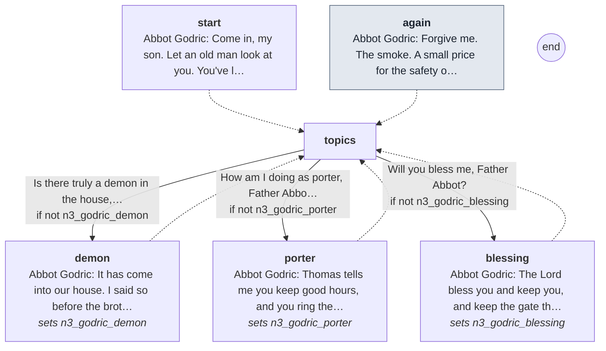

Every line

#### `start`

- *The abbot sits alone on the stone bench, both hands on his crosier. The air in here is blue with incense.*
- **Abbot Godric** *warm*: Come in, my son. Let an old man look at you. You've lost colour since you came to us.

- → `topics`

#### `again` (the next time)

- *The abbot coughs into his sleeve for a long while before he can speak.*
- **Abbot Godric** *weary*: Forgive me. The smoke. A small price for the safety of the house.

- → `topics`

#### `topics`

1. Is there truly a demon in the house, Father Abbot? → `demon` · only if not `n3_godric_demon`
2. How am I doing as porter, Father Abbot? → `porter` · only if not `n3_godric_porter`
3. Will you bless me, Father Abbot? → `blessing` · only if not `n3_godric_blessing`

#### `demon`
*sets `n3_godric_demon`*

- **Abbot Godric** *grave*: It has come into our house. I said so before the brothers this morning, and I'll say it again.
- **Abbot Godric** *afraid*: I have felt it at the night office, my son. The way you feel a draught from a door left open.
- **Abbot Godric** *grave*: So we'll smoke it out. Incense at every office, and prayer. Our saint will not suffer it long.

- → `topics`

#### `porter`
*sets `n3_godric_porter`*

- **Abbot Godric** *warm*: Thomas tells me you keep good hours, and you ring the bell well. That's most of it.
- **Abbot Godric** *weary*: The prior is harder to please. He's no harder on you than he is on himself. Bear with him.
- **Abbot Godric** *warm*: Anselm kept that gate thirty years. Be patient with yourself. It took him a while too.

- → `topics`

#### `blessing`
*sets `n3_godric_blessing`*

- *You kneel. His hand on your head is as light as paper, and it shakes.*
- **Abbot Godric** *warm*: The Lord bless you and keep you, and keep the gate through you. Go in peace, my son.
- *He signs the cross over you, and coughs.*

- → `topics`

## Prior Hugh

[`hugh.talk`](../../game/chapters/night3/dialogue/hugh.talk) · id `n3_hugh` · baseline *cold*, habit *jaw* · starts at trust -20

Moods through the talk: cold → grave → cold → angry → cold

> Prior Hugh at dusk, on the north walk (night 3). Lean, upright, a scarred jaw; he writes everything on his wax tablet.
> Harsh, and he suspects the new porter. He asked at dawn where he was in the night; now he asks again. (He's looking into the deaths. Nothing here says so.)
> Claims: n3_hugh_night (true): he wants to know who walks the house at night. He's investigating the deaths.

**Read elsewhere:** [`n3_told_prior`](links.md#n3_told_prior)

### Every path

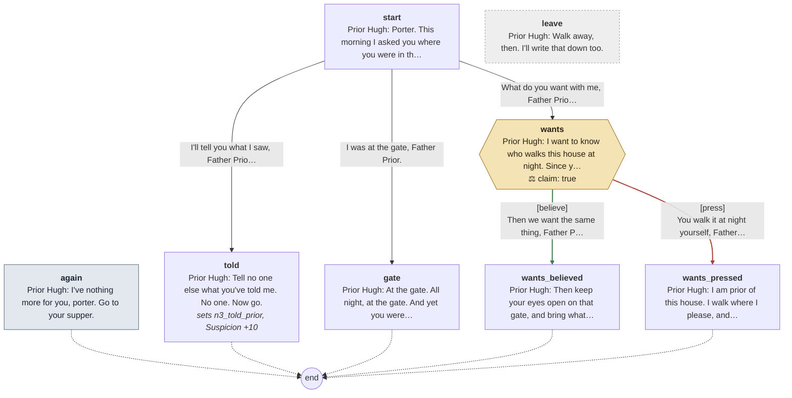

Every line

#### `start`

- *The prior steps out from behind a pillar into your path, his wax tablet open in his hand.*
- **Prior Hugh** *cold*: Porter. This morning I asked you where you were in the night. I'll ask again.
- **Prior Hugh** *cold, jaw*: A man who tells the truth tells it the same way twice. Where were you?

1. I'll tell you what I saw, Father Prior. → `told`
2. I was at the gate, Father Prior. → `gate`
3. What do you want with me, Father Prior? → `wants`

#### `again` (the next time)

- *The prior writes on his wax tablet and doesn't look up.*
- **Prior Hugh** *cold*: I've nothing more for you, porter. Go to your supper.

- → `end`

#### `told`
*sets `n3_told_prior`, **Suspicion +10***

- *You tell him what you saw in the night: the rope, what fell past you, the rest.*
- *He writes it all on the wax. Behind you, in the church, a door closes softly.*
- **Prior Hugh** *grave*: Tell no one else what you've told me. No one. Now go.

- → `end`

#### `gate`

- **Prior Hugh** *cold*: At the gate. All night, at the gate. And yet you were in the tower when Bede came down, and nobody else was.
- **Prior Hugh** *cold*: The porter is first to everything, it seems.
- *He writes one word on the wax, and steps aside to let you pass.*

- → `end`

#### `wants`

- **Prior Hugh** *cold, jaw*: I want to know who walks this house at night. Since you came to that gate, a brother has hanged in our tower.

> **Claim `n3_hugh_night`: true.** The last line is the claim.

1. Then we want the same thing, Father Prior. → `wants_believed` · **believe** · **right**, trust +2
2. You walk it at night yourself, Father Prior. Who watches you? → `wants_pressed` · **press** · wrong, trust -2

#### `wants_believed`

- *He looks at you a long moment. Then he writes something on the wax.*
- **Prior Hugh** *cold*: Then keep your eyes open on that gate, and bring what you see to me. Not to the abbot. To me.
- **Prior Hugh** *cold, jaw*: I'm not a fool, porter, whatever the abbot believes. Go to your supper. I'll be watching you at it.

- → `end`

#### `wants_pressed`

- **Prior Hugh** *angry, jaw*: I am prior of this house. I walk where I please, and I answer to the abbot, not the porter.
- **Prior Hugh** *cold*: I'm not a fool, porter, whatever the abbot believes. Go to your supper. I'll be watching you at it.

- → `end`

#### `leave` (if he walks away)

- **Prior Hugh** *cold*: Walk away, then. I'll write that down too.

## Margery (lane woman)

[`lane_woman.talk`](../../game/chapters/night3/dialogue/lane_woman.talk) · id `n3_lane_woman`

Moods through the talk: wary → afraid → amused → wary → afraid

> Margery in the lane at dusk (night 3), her basket on her arm, hurrying home before dark.
> Night 3 keeps its own; the other nights are game/chapters/common/lane/margery.talk. She names herself, in case he never met her.

### Every path

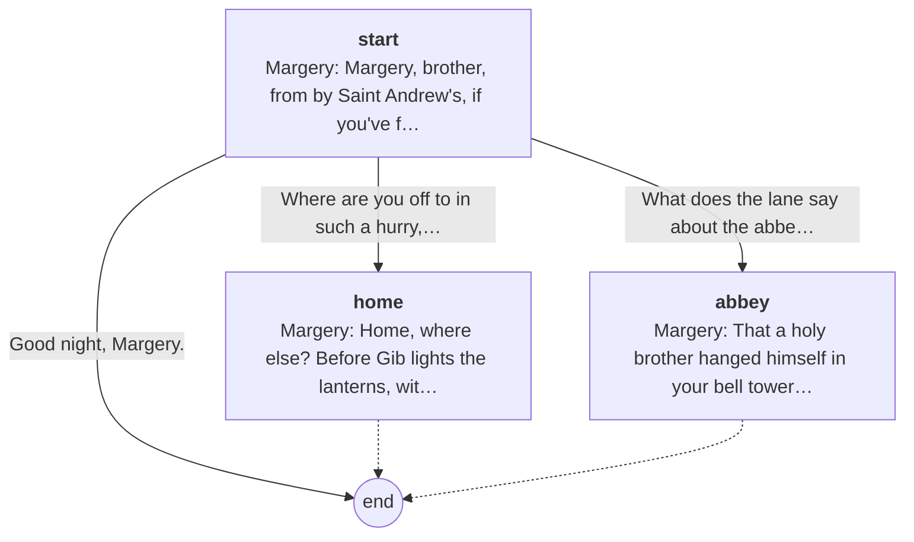

Every line

#### `start`

- *A woman with a covered basket on her arm, walking fast.*
- **Margery** *wary*: Margery, brother, from by Saint Andrew's, if you've forgotten. I'm not stopping. Not this week.

1. Where are you off to in such a hurry, Margery? → `home`
2. What does the lane say about the abbey? → `abbey`
3. Good night, Margery. → `end`

#### `home`

- **Margery** *afraid*: Home, where else? Before Gib lights the lanterns, with the door barred and the shutters too.
- **Margery** *amused*: My husband laughs at me for it. He can laugh from behind a barred door.

- → `end`

#### `abbey`

- **Margery** *wary*: That a holy brother hanged himself in your bell tower. Or the devil hanged him, your abbot says.
- **Margery** *afraid*: Devil or rope, brother, he's dead all the same. And I'm late.

- → `end`

## Mab

[`mab.talk`](../../game/chapters/night3/dialogue/mab.talk) · id `n3_mab` · baseline *wary* · starts at trust 0

Moods through the talk: warm → wary → afraid → cold → wary → grave → warm

> Mab at the gate (night 3), from dusk until the knocks. She sees who comes and goes, nobody asks her, and she never eats the abbey's bread.
> Night 3 keeps its own; the other nights are game/chapters/common/lane/mab.talk. Alms once (n3_mab_alms): a heel of Fenchurch Street bread.

**Reads from elsewhere:** [`bread_warned`](links.md#bread_warned)

### Every path

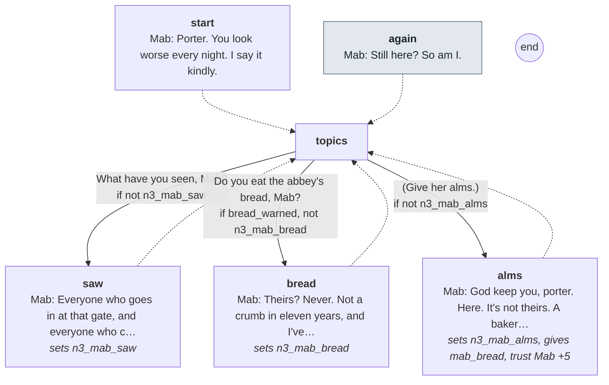

Every line

#### `start`

- *Mab sits against the wall by the gate, her clapper in her lap, her face wrapped to the eyes.*
- **Mab** *warm*: Porter. You look worse every night. I say it kindly.

- → `topics`

#### `again` (the next time)

- *She knocks her clapper once against the stones.*
- **Mab** *wary*: Still here? So am I.

- → `topics`

#### `topics`

1. What have you seen, Mab? → `saw` · only if not `n3_mab_saw`
2. Do you eat the abbey's bread, Mab? → `bread` · only if `bread_warned`, not `n3_mab_bread`
3. (Give her alms.) → `alms` · only if not `n3_mab_alms`

#### `saw`
*sets `n3_mab_saw`*

- **Mab** *wary*: Everyone who goes in at that gate, and everyone who comes out. Nobody asks me.
- **Mab** *afraid*: Last night something walked the lane after the bell. Taller than a man. It came from the corner of your wall.
- **Mab** *afraid*: And the rooks came off your tower before Matins, all at once, screaming. Before your bell, porter. Not after.

- → `topics`

#### `bread`
*sets `n3_mab_bread`*

- **Mab** *cold*: Theirs? Never. Not a crumb in eleven years, and I've been hungry enough to eat straw.
- **Mab** *wary*: Somebody's told you something about it. I can see it on you.
- **Mab** *grave*: Good. Then I don't have to.

- → `topics`

#### `alms`
*sets `n3_mab_alms`, gives `mab_bread`, **trust Mab +5***

- *You drop a coin in the bowl at her feet.*
- **Mab** *warm*: God keep you, porter. Here. It's not theirs. A baker on Fenchurch Street makes it.
- *She sets a heel of bread on the step between you, wrapped in a cloth, and draws back.*

- → `topics`

## Brother Osric

[`osric.talk`](../../game/chapters/night3/dialogue/osric.talk) · id `n3_osric` · baseline *glad*, habit *nod* · starts at trust 20 · **in the cult**

Moods through the talk: glad → amused → glad → amused → glad → amused → glad → wary → glad

> Osric at dusk, in the kitchen (night 3). The cellarer: short and heavy, round red face, always smiling; his ring of keys jingles.
> Jolly; he feeds you extra bread. (He started the killings. Nothing here says so.)
> Claims: n3_osric_page (lie): the cats get at the ledger. The cult tore the page (night 2); Osric handles the bodies.

**Reads from elsewhere:** [`ledger_torn`](links.md#ledger_torn)

### Every path

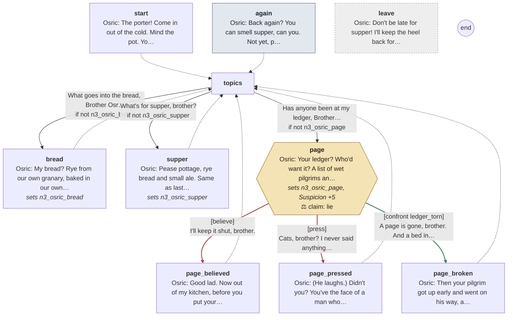

Every line

#### `start`

- *Osric is at the kitchen fire, sleeves rolled, his ring of keys swinging at his belt. His face is red from the heat.*
- **Osric** *glad*: The porter! Come in out of the cold. Mind the pot. You look half starved.

- → `topics`

#### `again` (the next time)

- **Osric** *amused*: Back again? You can smell supper, can you. Not yet, porter. Not yet.

- → `topics`

#### `topics`

1. What goes into the bread, Brother Osric? → `bread` · only if not `n3_osric_bread`
2. What's for supper, brother? → `supper` · only if not `n3_osric_supper`
3. Has anyone been at my ledger, Brother Osric? → `page` · only if not `n3_osric_page`

#### `bread`
*sets `n3_osric_bread`*

- **Osric** *glad*: My bread? Rye from our own granary, baked in our own oven. Best in the ward.
- **Osric** *glad, smile*: There's a bitter crust on it this week. The rye came in damp. It does no harm.
- *He laughs, and claps you on the shoulder with a floury hand.*
- **Osric** *glad*: I'll keep the heel back for you. A growing lad wants the heel.

- → `topics`

#### `supper`
*sets `n3_osric_supper`*

- **Osric** *glad*: Pease pottage, rye bread and small ale. Same as last night, and the night before.
- **Osric** *amused*: Father Abbot looks to me like a man about to order a fast. Eat while you can, porter.

- → `topics`

#### `page`
*sets `n3_osric_page`, **Suspicion +5***

- **Osric** *glad*: Your ledger? Who'd want it? A list of wet pilgrims and their boots.
- *He's still smiling. The knife in his hand has stopped.*
- **Osric** *glad, smile*: Keep your cell door shut, porter. The cats get in. A cat will eat anything.

> **Claim `n3_osric_page`: a lie.** The last line is the claim.

1. I'll keep it shut, brother. → `page_believed` · **believe** · wrong
2. Cats, brother? I never said anything was gone. → `page_pressed` · **press** · wrong
3. A page is gone, brother. And a bed in the guesthouse stands empty that I wrote full. → `page_broken` · **confront** with *ledger_torn* · **right**, **Suspicion +10**: the cult knows he knows

#### `page_believed`

- **Osric** *glad*: Good lad. Now out of my kitchen, before you put your elbow in the pot.

- → `topics`

#### `page_pressed`

- **Osric** *amused*: (He laughs.) Didn't you? You've the face of a man who's lost something. Mind the pot, porter.
- *He turns back to his fire.*

- → `topics`

#### `page_broken`

- *The smile goes out of his face. Then it's back, too wide.*
- **Osric** *glad, smile*: Then your pilgrim got up early and went on his way, and took his page for a keepsake.
- **Osric** *wary*: Count your beds, porter. I count loaves.

- → `topics`

#### `leave` (if he walks away)

- **Osric** *glad*: Don't be late for supper! I'll keep the heel back for you.

## Brother Ranulf

[`ranulf.talk`](../../game/chapters/night3/dialogue/ranulf.talk) · id `n3_ranulf` · baseline *grave* · starts at trust 0 · **in the cult**

Moods through the talk: cold → grave → cold → grave → cold

> Ranulf at dusk, in the church (night 3). The sacrist: rigid, a narrow pale face that doesn't blink; his censer chain clinks.
> He keeps the relic, the candles and the incense. (He wears the horned costume. Nothing here says so.)

### Every path

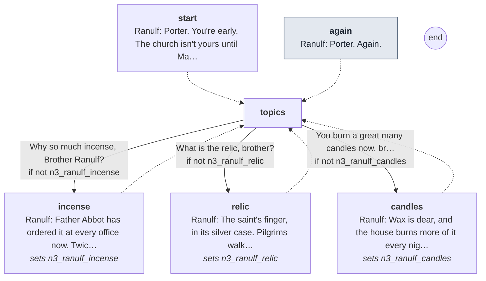

Every line

#### `start`

- *Ranulf is trimming the candles along the choir, one by one. He doesn't turn until you're close.*
- **Ranulf** *cold*: Porter. You're early. The church isn't yours until Matins.

- → `topics`

#### `again` (the next time)

- *He goes on trimming the candles. The censer hangs from his belt on its chain.*
- **Ranulf** *cold*: Porter. Again.

- → `topics`

#### `topics`

1. Why so much incense, Brother Ranulf? → `incense` · only if not `n3_ranulf_incense`
2. What is the relic, brother? → `relic` · only if not `n3_ranulf_relic`
3. You burn a great many candles now, brother. → `candles` · only if not `n3_ranulf_candles`

#### `incense`
*sets `n3_ranulf_incense`*

- **Ranulf** *grave*: Father Abbot has ordered it at every office now. Twice the measure at Matins.
- **Ranulf** *grave, glance*: The smoke drives out what shouldn't be here. Breathe it in, porter. Breathe deep. It's for your protection.

- → `topics`

#### `relic`
*sets `n3_ranulf_relic`*

- **Ranulf** *grave*: The saint's finger, in its silver case. Pilgrims walk from Kent to kiss the glass over it.
- **Ranulf** *cold*: It's in my keeping. Not yours. Not the prior's. Mine.

- → `topics`

#### `candles`
*sets `n3_ranulf_candles`*

- **Ranulf** *grave, glance*: Wax is dear, and the house burns more of it every night. Father Abbot wants no dark corner for the thing to stand in.
- *He doesn't blink.*
- **Ranulf** *cold*: Don't take my candles to light your lantern, porter. I count them.

- → `topics`

## Brother Thomas

[`thomas.talk`](../../game/chapters/night3/dialogue/thomas.talk) · id `n3_thomas` · baseline *warm*, habit *nod* · starts at trust 40 · **in the cult**

Moods through the talk: warm → sad → grave → warm

> Thomas at dusk, in the infirmary (night 3). Tall, thin, stooped, gentle deep-set eyes, fingers stained from his herbs; he hums at his mortar.
> Your first ally. He tells you what he has noticed, always about someone else. (He leads the cult. Nothing here says so.)
> At supper Ranulf offers his remedy and Thomas warns you off it; the headaches answer sets that up.
> Claims: n3_thomas_prior (misleading): the prior was up the tower stair first, which is so; he says it to point at an innocent man. Pressing is the right read.

### Every path

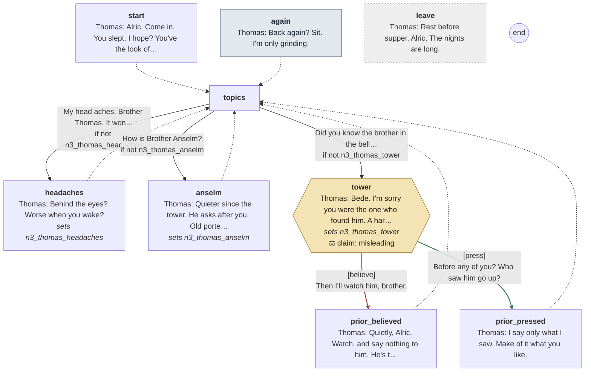

Every line

#### `start`

- *Thomas is at his bench, grinding something in a mortar and humming. He stops when he sees you, and smiles.*
- **Thomas** *warm*: Alric. Come in. You slept, I hope? You've the look of a man who dreamed.

- → `topics`

#### `again` (the next time)

- *Thomas looks up from his mortar. His fingers are stained green to the knuckle.*
- **Thomas** *warm*: Back again? Sit. I'm only grinding.

- → `topics`

#### `topics`

1. My head aches, Brother Thomas. It won't let up. → `headaches` · only if not `n3_thomas_headaches`
2. How is Brother Anselm? → `anselm` · only if not `n3_thomas_anselm`
3. Did you know the brother in the bell tower? → `tower` · only if not `n3_thomas_tower`

#### `headaches`
*sets `n3_thomas_headaches`*

- **Thomas** *warm*: Behind the eyes? Worse when you wake?
- *He tilts your face to the window and looks into one eye, then the other.*
- **Thomas** *warm, nod*: It's the night hours. A body takes a month to learn them. Sleep with your shutter closed, and eat.
- **Thomas** *warm*: And if anyone offers you physic for it, come to me first. Physic is my trade.

- → `topics`

#### `anselm`
*sets `n3_thomas_anselm`*

- **Thomas** *warm*: Quieter since the tower. He asks after you. Old porters never stop keeping the gate.
- **Thomas** *warm, still*: Don't let him frighten you, Alric. His mind wanders at night. He hears things.

- → `topics`

#### `tower`
*sets `n3_thomas_tower`*

- **Thomas** *sad*: Bede. I'm sorry you were the one who found him. A hard thing, on your second night.
- **Thomas** *grave, nod*: Father Abbot says the demon. I've seen what I've seen in this house. I don't argue with him.
- **Thomas** *warm, still*: Only I wonder about the prior. He was up the tower stair before any of us. Quick, for a man woken by a bell.

> **Claim `n3_thomas_prior`: misleading: true words, said to lead him wrong.** The last line is the claim.

1. Then I'll watch him, brother. → `prior_believed` · **believe** · wrong
2. Before any of you? Who saw him go up? → `prior_pressed` · **press** · **right**

#### `prior_believed`

- **Thomas** *warm, nod*: Quietly, Alric. Watch, and say nothing to him. He's the prior, and you're the porter.

- → `topics`

#### `prior_pressed`

- **Thomas** *warm, still*: I say only what I saw. Make of it what you like.
- *He takes up his pestle again.*

- → `topics`

#### `leave` (if he walks away)

- **Thomas** *warm*: Rest before supper, Alric. The nights are long.

## Scripted lines

Said by the night's beats and cues (`night3.tscn`), outside any talk.

- `Director/Supper`: **Thomas** *grave*: (Quietly, not looking at you.) The prior has been asking about you. Where you go. Who you talk to.
- `Director/Supper`: **Thomas** *warm, nod*: I told him you keep your hours. Keep them.
- `Director/Supper`: **Osric** *glad*: Eat up, porter. You're getting thin at that gate.
- `Director/Supper`: **Osric** *amused*: (From the hatch, smiling.) Not hungry, porter? I'll keep an eye on you. Can't have you wasting away.
- `Director/Supper`: **Ranulf** *grave, glance*: You keep pressing your eyes, porter. The new ones all get headaches. A few drops of this in your ale and you'll sleep.
- `Director/Supper`: **Thomas** *grave*: (Quietly, so only you hear.) Not that, Alric. Not from him. Bring your headaches to me.
- `Director/Gate`: **Cole** *blank*: Yours.
- `Director/Knocks`: **Hugh** *cold*: Stand aside, porter. I'll see him to a bed myself.
- `Director/Knocks`: **Hugh** *cold*: (To the visitor.) This way. Keep close, and touch nothing.
- `Director/Chase`: **Thomas** *grave*: Down. Behind the bed. Not a sound.
- `Director/Chase`: **Thomas** *warm, still*: (When the steps have gone.) It's gone. Breathe, Alric. I heard you running. Whatever it was, it's gone.
- `Director/Chase`: **Thomas** *warm*: Lie still. I found you in the yard by the bakehouse. Drink this.
