# The fourth night: Edwin

Generated by `tools/script_docs.py` from the game's files. Don't edit it by hand. How to read it: [README](README.md). Every flag: [links](links.md).

## The night

The chapter's beats in order (`night4.tscn`), the talks each opens, who he can go to from then on, and the flags passed between them (dashed). The note at the end lists what this chapter's talks pass on to later ones.

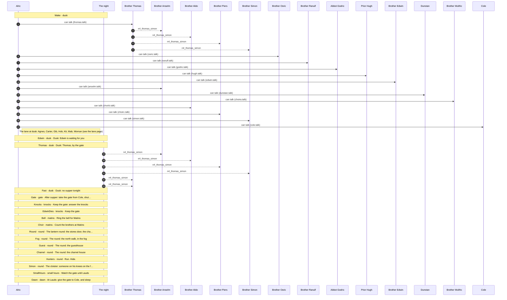

## Conversations

- [Brother Anselm](#anselm) (`anselm.talk`)
- [Brother Wulfric](#choira) (`choira.talk`)
- [Brother Aldo](#choirb) (`choirb.talk`)
- [Brother Piers](#choirc) (`choirc.talk`)
- [Cole](#cole) (`cole.talk`)
- [Dunstan](#dunstan) (`dunstan.talk`)
- [Brother Edwin](#edwin) (`edwin.talk`)
- [Abbot Godric](#godric) (`godric.talk`)
- [Prior Hugh](#hugh) (`hugh.talk`)
- [Brother Osric](#osric) (`osric.talk`)
- [Brother Ranulf](#ranulf) (`ranulf.talk`)
- [Brother Simon](#simon) (`simon.talk`)
- [Brother Thomas](#thomas) (`thomas.talk`)

## Brother Anselm

[`anselm.talk`](../../game/chapters/night4/dialogue/anselm.talk) · id `n4_anselm` · baseline *weary*, habit *lip* · starts at trust 20

Moods through the talk: weary → afraid → sad → weary → grave → warm → afraid → grave

> Anselm at dusk, in his chair in the infirmary (night 4, fog). Blind, guilty and terrified. He hears men on the night stair
> and says his beads. On copied keys (keys_copied) he gives the night-4 rule sideways: bar from inside, a bar has no key.
> If Thomas has named Simon (n4_thomas_simon), Anselm says there's no harm in Simon, and stops himself.

**Reads from elsewhere:** [`keys_copied`](links.md#keys_copied), [`n4_thomas_simon`](links.md#n4_thomas_simon)

### Every path

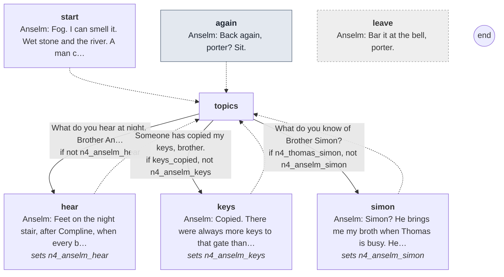

Every line

#### `start`

- *Anselm in his chair. The fog has got into the infirmary and hangs about the brazier.*
- **Anselm** *weary*: Fog. I can smell it. Wet stone and the river. A man could walk right past you in it.

- → `topics`

#### `again` (the next time)

- *His milky eyes settle on a place just beside your face.*
- **Anselm** *weary*: Back again, porter? Sit.

- → `topics`

#### `topics`

1. What do you hear at night, Brother Anselm? → `hear` · only if not `n4_anselm_hear`
2. Someone has copied my keys, brother. → `keys` · only if `keys_copied`, not `n4_anselm_keys`
3. What do you know of Brother Simon? → `simon` · only if `n4_thomas_simon`, not `n4_anselm_simon`

#### `hear`
*sets `n4_anselm_hear`*

- **Anselm** *afraid*: Feet on the night stair, after Compline, when every brother's abed. More than one pair.
- **Anselm** *afraid, swallow*: They walk alike. Like men who've walked together a long while.
- **Anselm** *sad, lip*: I lie still, and I say my beads, and I don't call out. God forgive me, I never call out.

- → `topics`

#### `keys`
*sets `n4_anselm_keys`*

- *He laughs, with nothing in it.*
- **Anselm** *weary*: Copied. There were always more keys to that gate than there were porters, boy.
- **Anselm** *grave*: If you've a guest you want to keep, tell him to bar his door from inside. A bar has no key.

- → `topics`

#### `simon`
*sets `n4_anselm_simon`*

- **Anselm** *warm*: Simon? He brings me my broth when Thomas is busy. He talks to me about his mother in Kent.
- **Anselm** *afraid, swallow*: There's no harm in Simon. Whoever told you different, ask yourself why they...
- *He stops, and turns his face to the wall.*

- → `topics`

#### `leave` (if he walks away)

- **Anselm** *grave*: Bar it at the bell, porter.

## Brother Wulfric

[`choira.talk`](../../game/chapters/night4/dialogue/choira.talk) · id `n4_choira` · starts at trust 10

Moods through the talk: weary → amused → calm → warm → sad → calm → amused

> Brother Wulfric on the south walk at dusk (night 4, fog), rubbing his knees. The oldest of the choir; crabbed.
> His last talk: ordinary, and a little sad. (He is killed in the fog on the round tonight. Nothing here says so.)

### Every path

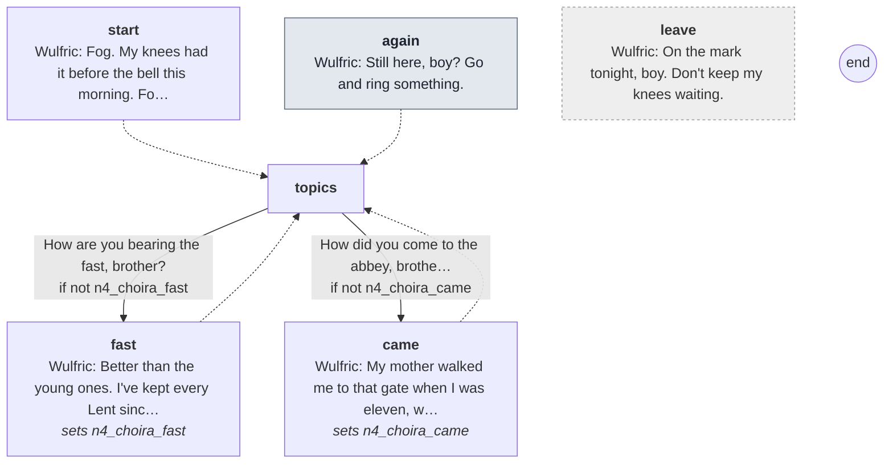

Every line

#### `start`

- *Old Brother Wulfric on the south walk, a shape in the fog until you're close. He's rubbing his knees.*
- **Wulfric** *weary*: Fog. My knees had it before the bell this morning. Forty years, and they've never once been wrong.

- → `topics`

#### `again` (the next time)

- **Wulfric** *amused*: Still here, boy? Go and ring something.

- → `topics`

#### `topics`

1. How are you bearing the fast, brother? → `fast` · only if not `n4_choira_fast`
2. How did you come to the abbey, brother? → `came` · only if not `n4_choira_came`

#### `fast`
*sets `n4_choira_fast`*

- **Wulfric** *calm*: Better than the young ones. I've kept every Lent since before you were born. An empty belly's a quiet one.
- *His stomach growls. He ignores it.*

- → `topics`

#### `came`
*sets `n4_choira_came`*

- **Wulfric** *warm*: My mother walked me to that gate when I was eleven, with a cheese for the cellarer.
- **Wulfric** *sad*: Anselm let us in. He had both his eyes then.
- **Wulfric** *sad*: I've not been past Aldgate since. I meant to see the sea again, once, before the end.
- **Wulfric** *calm*: Well. There's time yet.

- → `topics`

#### `leave` (if he walks away)

- **Wulfric** *amused*: On the mark tonight, boy. Don't keep my knees waiting.

## Brother Aldo

[`choirb.talk`](../../game/chapters/night4/dialogue/choirb.talk) · id `n4_choirb` · starts at trust 10

Moods through the talk: wary → weary → grave → sad → calm → weary → afraid

> Brother Aldo in the nave at dusk (night 4, fog), setting out the psalters. Background; young.
> Bede's stall stays empty by the abbot's order. If Thomas has named Simon (n4_thomas_simon), Aldo bears it out:
> Simon sleeps in the next bed and goes down the night stair after Compline (because Thomas sends him).

**Reads from elsewhere:** [`n4_thomas_simon`](links.md#n4_thomas_simon)

### Every path

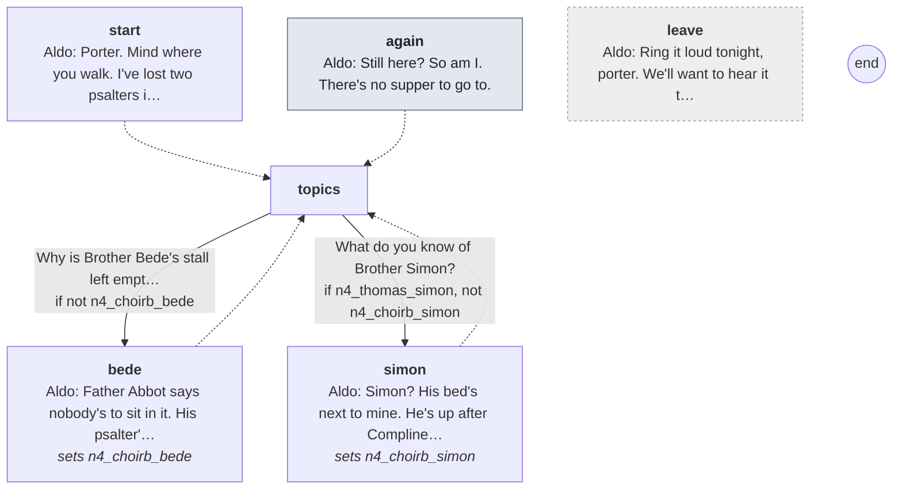

Every line

#### `start`

- *Brother Aldo in the nave, setting out the psalters. The fog has come in at the west door and hides the altar.*
- **Aldo** *wary*: Porter. Mind where you walk. I've lost two psalters in it already.

- → `topics`

#### `again` (the next time)

- **Aldo** *weary*: Still here? So am I. There's no supper to go to.

- → `topics`

#### `topics`

1. Why is Brother Bede's stall left empty? → `bede` · only if not `n4_choirb_bede`
2. What do you know of Brother Simon? → `simon` · only if `n4_thomas_simon`, not `n4_choirb_simon`

#### `bede`
*sets `n4_choirb_bede`*

- **Aldo** *grave*: Father Abbot says nobody's to sit in it. His psalter's still there. Nobody will touch it.
- **Aldo** *sad*: Nobody will sit next to it either. So I do.

- → `topics`

#### `simon`
*sets `n4_choirb_simon`*

- **Aldo** *calm*: Simon? His bed's next to mine. He's up after Compline, these last nights. I hear him go down the night stair.
- **Aldo** *weary*: He says he can't sleep. Who can?

- → `topics`

#### `leave` (if he walks away)

- **Aldo** *afraid*: Ring it loud tonight, porter. We'll want to hear it through this.

## Brother Piers

[`choirc.talk`](../../game/chapters/night4/dialogue/choirc.talk) · id `n4_choirc` · starts at trust 10

Moods through the talk: wary → calm → grave → calm → grave → wary

> Brother Piers on the east walk at dusk (night 4, fog). Background; dry.
> What the brothers say: the abbot's visitor, and the fast to starve it. If Thomas has named Simon (n4_thomas_simon):
> Thomas nursed Simon through a fever at Michaelmas, and Simon would do anything Thomas told him.

**Reads from elsewhere:** [`n4_thomas_simon`](links.md#n4_thomas_simon)

### Every path

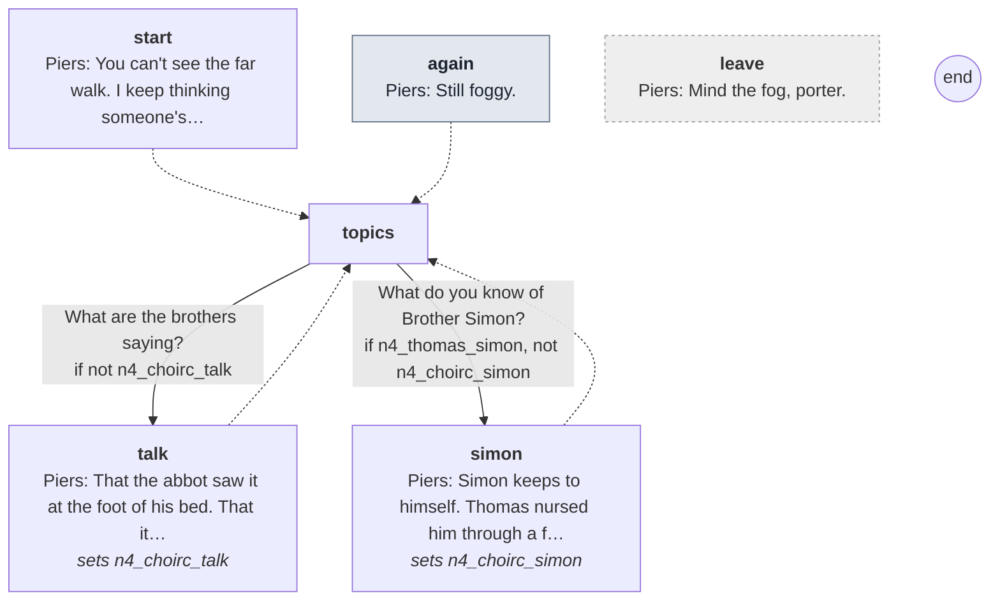

Every line

#### `start`

- *Brother Piers on the east walk, watching the fog fill the garth like milk in a bowl.*
- **Piers** *wary*: You can't see the far walk. I keep thinking someone's standing in it.

- → `topics`

#### `again` (the next time)

- **Piers** *calm*: Still foggy.

- → `topics`

#### `topics`

1. What are the brothers saying? → `talk` · only if not `n4_choirc_talk`
2. What do you know of Brother Simon? → `simon` · only if `n4_thomas_simon`, not `n4_choirc_simon`

#### `talk`
*sets `n4_choirc_talk`*

- **Piers** *grave*: That the abbot saw it at the foot of his bed. That it's hungry, and we fast so it finds nothing in us to eat.
- *He doesn't smile.*
- **Piers** *grave*: I'd sooner eat.

- → `topics`

#### `simon`
*sets `n4_choirc_simon`*

- **Piers** *calm*: Simon keeps to himself. Thomas nursed him through a fever at Michaelmas, and he's been Thomas's shadow since.
- **Piers** *grave*: He'd walk into the river if Thomas told him it was good for his chest.

- → `topics`

#### `leave` (if he walks away)

- **Piers** *wary*: Mind the fog, porter.

## Cole

[`cole.talk`](../../game/chapters/night4/dialogue/cole.talk) · id `n4_cole` · baseline *blank* · **in the cult**

> Cole at dusk, keeping the gate (night 4, fog). Lay brothers don't talk (Look and Feel, "Characters").

### Every path

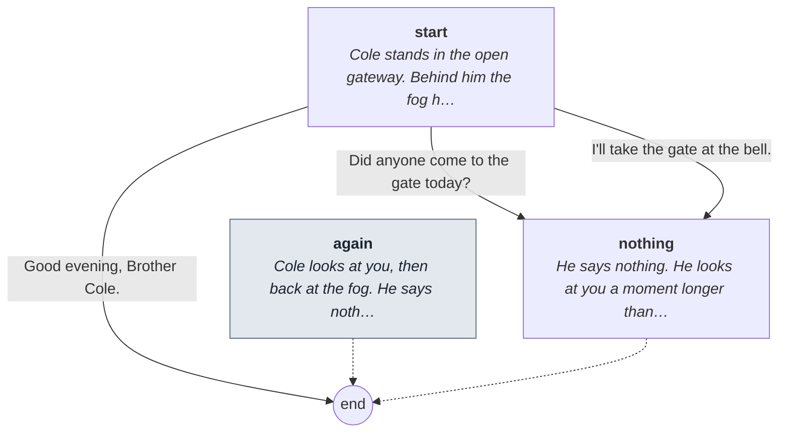

Every line

#### `start`

- *Cole stands in the open gateway. Behind him the fog has swallowed the lane. He looks round at you and says nothing.*

1. Did anyone come to the gate today? → `nothing`
2. I'll take the gate at the bell. → `nothing`
3. Good evening, Brother Cole. → `end`

#### `again` (the next time)

- *Cole looks at you, then back at the fog. He says nothing.*

- → `end`

#### `nothing`

- *He says nothing. He looks at you a moment longer than he needs to, then back into the fog.*

- → `end`

## Dunstan

[`dunstan.talk`](../../game/chapters/night4/dialogue/dunstan.talk) · id `n4_dunstan` · baseline *blank* · **in the cult**

> Dunstan at dusk, by the woodpile (night 4, fog). Lay brothers don't talk (Look and Feel, "Characters").

### Every path

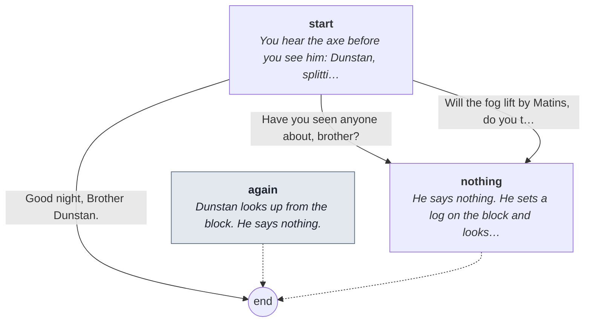

Every line

#### `start`

- *You hear the axe before you see him: Dunstan, splitting logs in the fog. He stops and looks at you. He says nothing.*

1. Have you seen anyone about, brother? → `nothing`
2. Will the fog lift by Matins, do you think? → `nothing`
3. Good night, Brother Dunstan. → `end`

#### `again` (the next time)

- *Dunstan looks up from the block. He says nothing.*

- → `end`

#### `nothing`

- *He says nothing. He sets a log on the block and looks at you over it until you look away.*

- → `end`

## Brother Edwin

[`edwin.talk`](../../game/chapters/night4/dialogue/edwin.talk) · id `n4_edwin` · baseline *warm*, habit *brow* · starts at trust 50

Moods through the talk: afraid → warm → glad → weary → afraid → pleading

> Edwin at dusk, on the west walk (night 4, fog). He has seen the demon's face; the dusk scene has him whisper it, and
> that he'll tell after Matins. Here he's jumpy and won't say more: after Matins, he swears it. (He dies before Matins.
> Nothing here says so.) The lines work whether or not the whisper has come yet.

**Reads from elsewhere:** [`n3_edwin_bread`](links.md#n3_edwin_bread)

### Every path

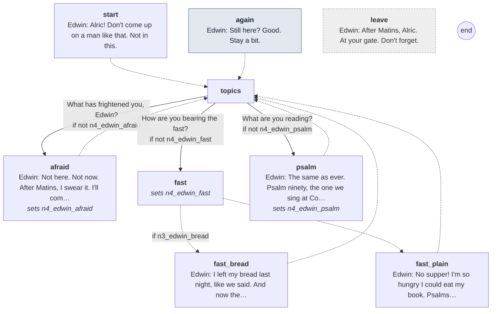

Every line

#### `start`

- *Edwin on the west walk, his book hugged to his chest. He jumps when you come out of the fog, then laughs too loudly.*
- **Edwin** *afraid*: Alric! Don't come up on a man like that. Not in this.

- → `topics`

#### `again` (the next time)

- *Edwin hasn't moved. He's watching the fog at the end of the walk.*
- **Edwin** *afraid*: Still here? Good. Stay a bit.

- → `topics`

#### `topics`

1. What has frightened you, Edwin? → `afraid` · only if not `n4_edwin_afraid`
2. How are you bearing the fast? → `fast` · only if not `n4_edwin_fast`
3. What are you reading? → `psalm` · only if not `n4_edwin_psalm`

#### `afraid`
*sets `n4_edwin_afraid`*

- *He looks over your shoulder into the fog before he answers.*
- **Edwin** *afraid, glance*: Not here. Not now. After Matins, I swear it. I'll come to your gate and tell you everything.
- **Edwin** *afraid*: Somebody's always listening in this house, Alric. Even in the fog. Especially in the fog.

- → `topics`

#### `fast`
*sets `n4_edwin_fast`*

- → `fast_bread` if `n3_edwin_bread`
- → `fast_plain`

#### `fast_bread`

- **Edwin** *warm*: I left my bread last night, like we said. And now there's none to leave. I'm so hungry I could eat my book.

- → `topics`

#### `fast_plain`

- **Edwin** *glad*: No supper! I'm so hungry I could eat my book. Psalms and all.

- → `topics`

#### `psalm`
*sets `n4_edwin_psalm`*

- **Edwin** *weary*: The same as ever. Psalm ninety, the one we sing at Compline. You shall not fear the terror of the night.
- **Edwin** *afraid*: I've said it a hundred times since None. It isn't working.

- → `topics`

#### `leave` (if he walks away)

- **Edwin** *pleading*: After Matins, Alric. At your gate. Don't forget.

## Abbot Godric

[`godric.talk`](../../game/chapters/night4/dialogue/godric.talk) · id `n4_godric` · baseline *weary*

Moods through the talk: sad → afraid → grave → afraid → pleading → afraid → grave

> Abbot Godric at dusk, in the chapter house (night 4, fog). He has ordered the house to fast and doubled the incense again.
> Frail, pious and frightened; drugged hardest, he believes. Telling him about the crypt: he'll send Ranulf down to
> bless it, so the cult hears of it (Suspicion +5).

**Reads from elsewhere:** [`died_crypt_pilgrim`](links.md#died_crypt_pilgrim)

### Every path

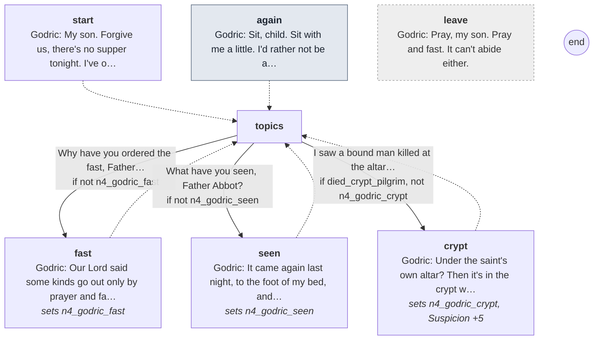

Every line

#### `start`

- *The chapter house is thick with smoke. The abbot sits in his blanket, a psalter open on his knees, not reading it.*
- **Godric** *sad*: My son. Forgive us, there's no supper tonight. I've ordered the house to fast until it leaves us.

- → `topics`

#### `again` (the next time)

- *The abbot coughs into his sleeve for a long while.*
- **Godric** *afraid*: Sit, child. Sit with me a little. I'd rather not be alone in here.

- → `topics`

#### `topics`

1. Why have you ordered the fast, Father Abbot? → `fast` · only if not `n4_godric_fast`
2. What have you seen, Father Abbot? → `seen` · only if not `n4_godric_seen`
3. I saw a bound man killed at the altar in the crypt. → `crypt` · only if `died_crypt_pilgrim`, not `n4_godric_crypt`

#### `fast`
*sets `n4_godric_fast`*

- **Godric** *grave*: Our Lord said some kinds go out only by prayer and fasting. So we'll pray, and we'll fast.
- **Godric** *grave*: And Ranulf will burn twice what he burned. It shall find nothing in this house to feed on.

- → `topics`

#### `seen`
*sets `n4_godric_seen`*

- *He looks at the door before he answers.*
- **Godric** *afraid*: It came again last night, to the foot of my bed, and counted.
- **Godric** *afraid, swallow*: It had a brother's face, I think. I couldn't tell you whose.
- **Godric** *pleading*: Pray for me, child. I'm too old to be this afraid.

- → `topics`

#### `crypt`
*sets `n4_godric_crypt`, **Suspicion +5***

- *His hand finds his crosier and holds it.*
- **Godric** *afraid*: Under the saint's own altar? Then it's in the crypt with our saint. God help us.
- **Godric** *grave*: I'll have Ranulf go down tonight and bless every stone of it. Ranulf will know what to do.

- → `topics`

#### `leave` (if he walks away)

- **Godric** *grave*: Pray, my son. Pray and fast. It can't abide either.

## Prior Hugh

[`hugh.talk`](../../game/chapters/night4/dialogue/hugh.talk) · id `n4_hugh` · baseline *cold*, habit *jaw* · starts at trust -20

Moods through the talk: cold → grave → cold → angry → cold → grave → cold → angry → cold

> Prior Hugh at dusk, on the north walk (night 4, fog). Cold; he's investigating. He heard two men run the cloister
> after Matins last night and wants to know what the porter saw. If the porter has told him the truth before
> (n3_told_prior, or everything at night 2's dawn), he says so. Telling him about the crypt: Suspicion +10 (Ranulf overhears).
> If the keys were copied (keys_copied), he looks at them and finds the wax: where were they? (n4_hugh_keys)

**Reads from elsewhere:** [`died_crypt_pilgrim`](links.md#died_crypt_pilgrim), [`keys_copied`](links.md#keys_copied), [`n2_told_hugh`](links.md#n2_told_hugh), [`n3_thomas_hid_you`](links.md#n3_thomas_hid_you), [`n3_told_prior`](links.md#n3_told_prior)

### Every path

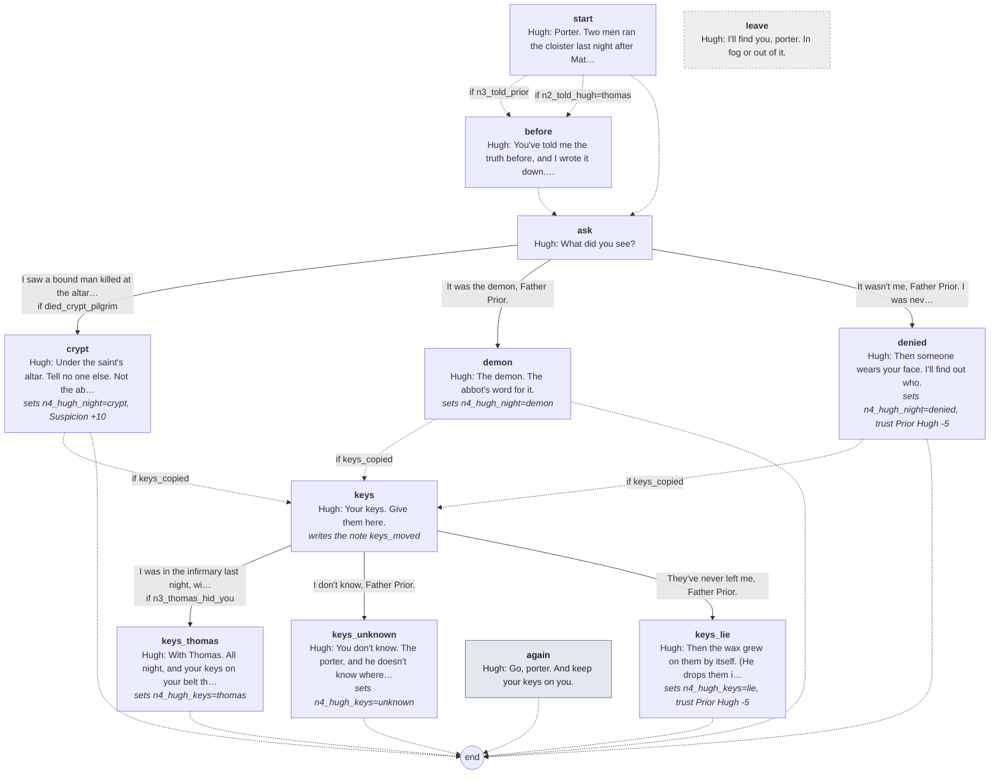

Every line

#### `start`

- *The prior comes out of the fog so close you nearly walk into him. His wax tablet is already open.*
- **Hugh** *cold*: Porter. Two men ran the cloister last night after Matins, one behind the other. I heard them from this walk.
- **Hugh** *cold, jaw*: The first of them was you.

- → `before` if `n3_told_prior`
- → `before` if `n2_told_hugh=thomas`
- → `ask`

#### `before`

- **Hugh** *cold*: You've told me the truth before, and I wrote it down. Do it again.

- → `ask`

#### `ask`

- **Hugh** *cold*: What did you see?

1. I saw a bound man killed at the altar in the crypt. → `crypt` · only if `died_crypt_pilgrim`
2. It was the demon, Father Prior. → `demon`
3. It wasn't me, Father Prior. I was never there. → `denied`

#### `crypt`
*sets `n4_hugh_night=crypt`, **Suspicion +10***

- *You tell him: the light, the bound man, the figure at the altar. He writes it all on the wax.*
- *Somewhere in the fog behind you, a door closes softly.*
- **Hugh** *grave, jaw*: Under the saint's altar. Tell no one else. Not the abbot. Not anyone.

- → `keys` if `keys_copied`
- → `end`

#### `demon`
*sets `n4_hugh_night=demon`*

- **Hugh** *cold*: The demon. The abbot's word for it.
- **Hugh** *cold*: Whatever ran behind you was out of breath, porter. I heard it. Demons don't pant.

- → `keys` if `keys_copied`
- → `end`

#### `denied`
*sets `n4_hugh_night=denied`, **trust Prior Hugh -5***

- **Hugh** *angry, jaw*: Then someone wears your face. I'll find out who.

- → `keys` if `keys_copied`
- → `end`

#### `keys`
*writes the note *keys_moved**

- **Hugh** *cold*: Your keys. Give them here.
- *He turns them in the grey light and scrapes a tooth with his thumbnail. Wax comes away.*
- **Hugh** *grave*: Someone has taken a mould of these. When were they out of your hands?

1. I was in the infirmary last night, with Brother Thomas. → `keys_thomas` · only if `n3_thomas_hid_you`
2. I don't know, Father Prior. → `keys_unknown`
3. They've never left me, Father Prior. → `keys_lie`

#### `keys_thomas`
*sets `n4_hugh_keys=thomas`*

- **Hugh** *cold*: With Thomas. All night, and your keys on your belt the whole while.
- *He writes one word on the wax, and gives the keys back.*
- **Hugh** *cold*: A lock two men have a key to is no lock, porter. Remember that tonight.

- → `end`

#### `keys_unknown`
*sets `n4_hugh_keys=unknown`*

- **Hugh** *cold*: You don't know. The porter, and he doesn't know where his keys go at night.
- **Hugh** *cold*: A lock two men have a key to is no lock. Remember that tonight.

- → `end`

#### `keys_lie`
*sets `n4_hugh_keys=lie`, **trust Prior Hugh -5***

- **Hugh** *angry*: Then the wax grew on them by itself. (He drops them in your hand.)
- **Hugh** *cold, jaw*: A lock two men have a key to is no lock, porter. Remember that tonight.

- → `end`

#### `again` (the next time)

- *The prior is a dark shape in the fog, writing.*
- **Hugh** *cold*: Go, porter. And keep your keys on you.

- → `end`

#### `leave` (if he walks away)

- **Hugh** *cold*: I'll find you, porter. In fog or out of it.

## Brother Osric

[`osric.talk`](../../game/chapters/night4/dialogue/osric.talk) · id `n4_osric` · baseline *glad*, habit *nod* · starts at trust 20 · **in the cult**

Moods through the talk: glad → amused → glad → amused → glad

> Osric at dusk, locking the kitchen door (night 4, fog). The abbot's fast: no supper, the refectory locked.
> Jolly as ever. (Tonight his mask comes off in the chase. Nothing here says so.)
> Who could copy a key, and the bakehouse oven: the wrong questions to the wrong brother (Suspicion +5 each).

**Reads from elsewhere:** [`keys_copied`](links.md#keys_copied)

### Every path

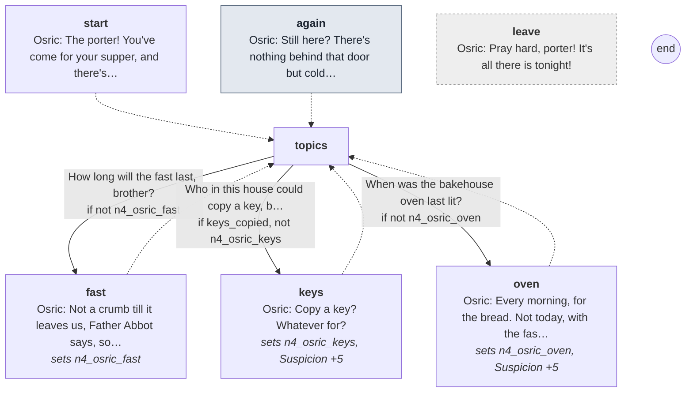

Every line

#### `start`

- *Osric is locking the kitchen door, his ring of keys in his fist. He turns round beaming.*
- **Osric** *glad*: The porter! You've come for your supper, and there's none. Father Abbot's fast. I've locked my own kitchen.

- → `topics`

#### `again` (the next time)

- **Osric** *glad, smile*: Still here? There's nothing behind that door but cold pots, porter. I promise you.

- → `topics`

#### `topics`

1. How long will the fast last, brother? → `fast` · only if not `n4_osric_fast`
2. Who in this house could copy a key, brother? → `keys` · only if `keys_copied`, not `n4_osric_keys`
3. When was the bakehouse oven last lit? → `oven` · only if not `n4_osric_oven`

#### `fast`
*sets `n4_osric_fast`*

- **Osric** *glad*: Not a crumb till it leaves us, Father Abbot says, so it finds nothing in us to feed on.
- *He pats his belly and laughs.*
- **Osric** *amused*: I've stores enough to last me. It's you I worry for. Skin and bone, and up all night.

- → `topics`

#### `keys`
*sets `n4_osric_keys`, **Suspicion +5***

- *The keys in his fist go quiet.*
- **Osric** *glad, smile*: Copy a key? Whatever for?
- **Osric** *glad*: I've forty keys on this ring, porter, and I've never once needed a copy of one.

- → `topics`

#### `oven`
*sets `n4_osric_oven`, **Suspicion +5***

- **Osric** *glad*: Every morning, for the bread. Not today, with the fast. It's as cold as a grave in there.
- *He's still smiling.*
- **Osric** *amused*: Why? Were you thinking of climbing in?

- → `topics`

#### `leave` (if he walks away)

- **Osric** *glad*: Pray hard, porter! It's all there is tonight!

## Brother Ranulf

[`ranulf.talk`](../../game/chapters/night4/dialogue/ranulf.talk) · id `n4_ranulf` · baseline *grave* · starts at trust 0 · **in the cult**

Moods through the talk: grave → cold → grave → cold → grave → cold → grave → cold

> Ranulf at dusk, filling the censers in the choir (night 4, fog). Smooth. (He wears the horned costume. Nothing here says so.)
> The abbot has doubled the incense again; Ranulf wants the porter in the choir at Matins, not by the door (from night 4
> the door is where a man can keep out of the smoke). His remedy: taken (n3_took_remedy) or refused (n3_refused_remedy).
> Asking what is kept in the crypt is the wrong question to the wrong brother (Suspicion +10): he knows who ran last night.
> Claims: n4_ranulf_crypt (lie): the light below is candles for the dead. The cult lights one for each soul fed to the rite.

**Reads from elsewhere:** [`crypt_book`](links.md#crypt_book), [`died_crypt_pilgrim`](links.md#died_crypt_pilgrim), [`n3_refused_remedy`](links.md#n3_refused_remedy), [`n3_took_remedy`](links.md#n3_took_remedy)

### Every path

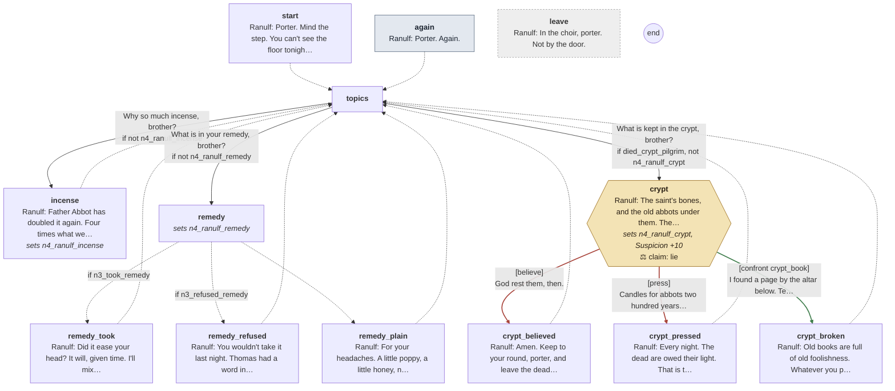

Every line

#### `start`

- *Ranulf is filling the censers in the choir from a leather bag. The fog has come in at the west door.*
- **Ranulf** *grave*: Porter. Mind the step. You can't see the floor tonight.

- → `topics`

#### `again` (the next time)

- *He goes on filling the censers. The chain clinks.*
- **Ranulf** *cold*: Porter. Again.

- → `topics`

#### `topics`

1. Why so much incense, brother? → `incense` · only if not `n4_ranulf_incense`
2. What is in your remedy, brother? → `remedy` · only if not `n4_ranulf_remedy`
3. What is kept in the crypt, brother? → `crypt` · only if `died_crypt_pilgrim`, not `n4_ranulf_crypt`

#### `incense`
*sets `n4_ranulf_incense`*

- **Ranulf** *grave*: Father Abbot has doubled it again. Four times what we burned at Martinmas.
- **Ranulf** *cold*: And your place at Matins is in the choir with us, porter. Not back by the door, where the smoke doesn't reach.

- → `topics`

#### `remedy`
*sets `n4_ranulf_remedy`*

- → `remedy_took` if `n3_took_remedy`
- → `remedy_refused` if `n3_refused_remedy`
- → `remedy_plain`

#### `remedy_took`

- **Ranulf** *grave, glance*: Did it ease your head? It will, given time. I'll mix you another whenever you like.
- **Ranulf** *cold*: You've only to ask me. Not Thomas. Me.

- → `topics`

#### `remedy_refused`

- **Ranulf** *cold*: You wouldn't take it last night. Thomas had a word in your ear. I saw. Thomas has a word for everyone.
- **Ranulf** *grave*: Your head will get worse, porter. Come to me when it does.

- → `topics`

#### `remedy_plain`

- **Ranulf** *grave, glance*: For your headaches. A little poppy, a little honey, nothing more. Come to me after Matins, if your head is bad.

- → `topics`

#### `crypt`
*sets `n4_ranulf_crypt`, **Suspicion +10***

- *The censer stops halfway to its hook.*
- **Ranulf** *grave*: The saint's bones, and the old abbots under them. The stair is kept locked. It's no part of your round.
- **Ranulf** *grave, glance*: If you see a light below, porter, it's mine. I keep candles burning for the dead.

> **Claim `n4_ranulf_crypt`: a lie.** The last line is the claim.

1. God rest them, then. → `crypt_believed` · **believe** · wrong
2. Candles for abbots two hundred years dead, brother? Every night? → `crypt_pressed` · **press** · wrong
3. I found a page by the altar below. Ten candles in a ring, and a soul for each. → `crypt_broken` · **confront** with *crypt_book* · **right**, **Suspicion +10**: the cult knows he knows

#### `crypt_believed`

- **Ranulf** *grave*: Amen. Keep to your round, porter, and leave the dead to me.

- → `topics`

#### `crypt_pressed`

- **Ranulf** *cold*: Every night. The dead are owed their light. That is the sacrist's business, not the porter's.
- *He hangs the censer, and turns his back on you.*

- → `topics`

#### `crypt_broken`

- *The chain goes still in his hand. His eyes go to the altar steps, and come back.*
- **Ranulf** *cold, glance*: Old books are full of old foolishness. Whatever you picked up down there, it belongs to the church.
- **Ranulf** *cold*: Bring it to me, porter. Don't show it about.

- → `topics`

#### `leave` (if he walks away)

- **Ranulf** *cold*: In the choir, porter. Not by the door.

## Brother Simon

[`simon.talk`](../../game/chapters/night4/dialogue/simon.talk) · id `n4_simon` · baseline *ashamed*, habit *look down* · starts at trust 10

Moods through the talk: ashamed → afraid → ashamed → pleading → ashamed → sad → afraid → ashamed → pleading → ashamed

> Brother Simon at dusk, in the cloister garth on the low wall of the herb beds (night 4, fog). A quiet choir brother; nervous.
> Not in the cult. Thomas has sent him to do a dirty job tonight (scrubbing blood) and he can't say so.
> If Thomas has named him (n4_thomas_simon), the porter can ask where he goes at night (trust -5: he takes it badly).
> Telling him to keep to the dormitory is a warning ([warn]); he takes it badly, and he trusts Thomas more than the porter.
> Claims: n4_simon_night (hiding): he can't sleep, he walks. True, but Thomas sends him out at night; pressed, he says he's bid, not by whom.

**Reads from elsewhere:** [`n4_thomas_simon`](links.md#n4_thomas_simon)

### Every path

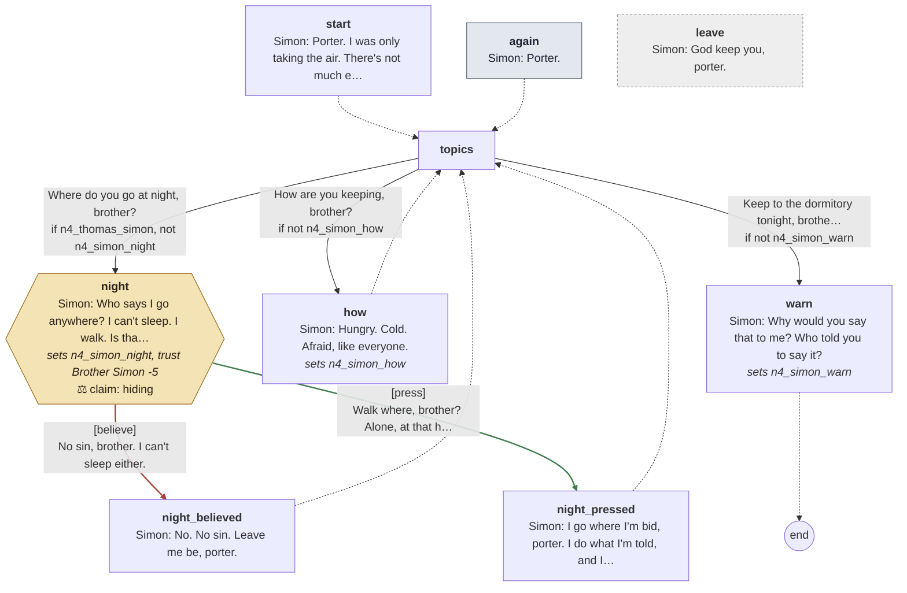

Every line

#### `start`

- *A thin brother on the wall of the herb beds, picking at a thread on his sleeve. He stands too fast when he sees you.*
- **Simon** *ashamed, look down*: Porter. I was only taking the air. There's not much else to take tonight.

- → `topics`

#### `again` (the next time)

- *Simon is back on the wall, picking at the same thread.*
- **Simon** *ashamed*: Porter.

- → `topics`

#### `topics`

1. Where do you go at night, brother? → `night` · only if `n4_thomas_simon`, not `n4_simon_night`
2. How are you keeping, brother? → `how` · only if not `n4_simon_how`
3. Keep to the dormitory tonight, brother. Bar the door. → `warn` · only if not `n4_simon_warn` · **warns them**

#### `night`
*sets `n4_simon_night`, **trust Brother Simon -5***

- *The thread snaps in his fingers.*
- **Simon** *afraid*: Who says I go anywhere? I can't sleep. I walk. Is that a sin now, with all the rest?

> **Claim `n4_simon_night`: true, but holding back.** The last line is the claim.

1. No sin, brother. I can't sleep either. → `night_believed` · **believe** · wrong
2. Walk where, brother? Alone, at that hour? → `night_pressed` · **press** · **right**, trust +1

#### `night_believed`

- *He looks toward the infirmary, then at the ground.*
- **Simon** *ashamed, look down*: No. No sin. Leave me be, porter.

- → `topics`

#### `night_pressed`

- *He looks toward the infirmary, then at the ground.*
- **Simon** *ashamed, swallow*: I go where I'm bid, porter. I do what I'm told, and I don't ask. I'm not to talk of it.
- **Simon** *pleading, look down*: Don't ask me again. Please.

- → `topics`

#### `how`
*sets `n4_simon_how`*

- **Simon** *ashamed*: Hungry. Cold. Afraid, like everyone.
- **Simon** *sad, look down*: I came here to sing, porter. It's all I'm good for. I wish they'd let me only sing.

- → `topics`

#### `warn`
*sets `n4_simon_warn`*

- *He goes white.*
- **Simon** *afraid, look down*: Why would you say that to me? Who told you to say it?
- **Simon** *ashamed*: I'll go where I'm bid. I'm a brother of this house, not a guest you can lock in.
- **Simon** *pleading, look down*: Don't tell anyone you said that to me. Please.

- → `end`

#### `leave` (if he walks away)

- **Simon** *ashamed*: God keep you, porter.

## Brother Thomas

[`thomas.talk`](../../game/chapters/night4/dialogue/thomas.talk) · id `n4_thomas` · baseline *warm*, habit *nod* · starts at trust 40 · **in the cult**

Moods through the talk: warm → grave → warm → grave → warm → sad → grave → warm

> Thomas at dusk, at his mortar in the infirmary (night 4, fog; the house fasts, no supper).
> If he hid the porter from the hunter last night (n3_thomas_hid_you), he gives him a story for it: he was here, for his head.
> Brother Simon out at night: he says it first (n4_thomas_simon) unless the porter has already heard it from him tonight
> (the dusk scene should set the same flag), then comes back to it. True, and it costs him nothing: he sends Simon out.
> Telling him about the crypt is reporting it the safe way (trust +5). Edwin poured out his sleeping draught; Thomas watched.
> Claims: n4_thomas_keeps (misleading): Simon does keep things, which is so; Thomas sent him out himself and says it to point at an innocent man. Pressing is the right read.

**Reads from elsewhere:** [`died_crypt_pilgrim`](links.md#died_crypt_pilgrim), [`n3_thomas_hid_you`](links.md#n3_thomas_hid_you)
**Read elsewhere:** [`n4_thomas_simon`](links.md#n4_thomas_simon)

### Every path

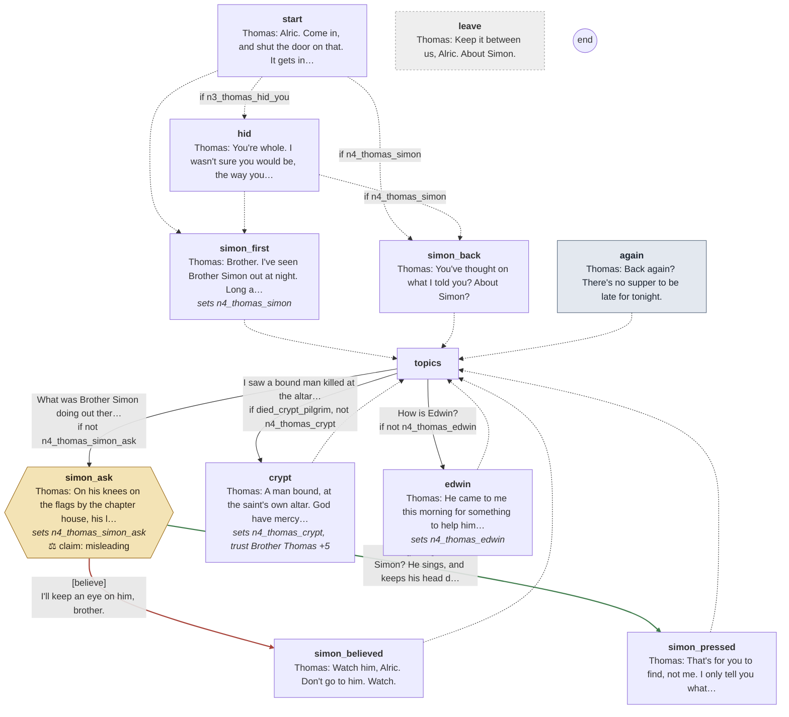

Every line

#### `start`

- *Fog presses at the infirmary window. Thomas is at his mortar, humming, as if it weren't there.*
- **Thomas** *warm*: Alric. Come in, and shut the door on that. It gets into the chest.

- → `hid` if `n3_thomas_hid_you`
- → `simon_back` if `n4_thomas_simon`
- → `simon_first`

#### `hid`

- **Thomas** *warm*: You're whole. I wasn't sure you would be, the way you came through that door last night.
- **Thomas** *warm, still*: If anyone asks, you were here with me, for your head. All night. It's true enough.

- → `simon_back` if `n4_thomas_simon`
- → `simon_first`

#### `simon_first`
*sets `n4_thomas_simon`*

- *He looks past you at the door, and lowers his voice.*
- **Thomas** *grave*: Brother. I've seen Brother Simon out at night. Long after Compline, when he should be abed.
- **Thomas** *warm, nod*: I don't say what it means. Only, keep an eye on him.

- → `topics`

#### `simon_back`

- **Thomas** *warm*: You've thought on what I told you? About Simon?

- → `topics`

#### `again` (the next time)

- *Thomas looks up from the mortar. His fingers are stained green to the knuckle.*
- **Thomas** *warm*: Back again? There's no supper to be late for tonight.

- → `topics`

#### `topics`

1. What was Brother Simon doing out there? → `simon_ask` · only if not `n4_thomas_simon_ask`
2. I saw a bound man killed at the altar in the crypt. → `crypt` · only if `died_crypt_pilgrim`, not `n4_thomas_crypt`
3. How is Edwin? → `edwin` · only if not `n4_thomas_edwin`

#### `simon_ask`
*sets `n4_thomas_simon_ask`*

- **Thomas** *grave*: On his knees on the flags by the chapter house, his lantern hooded. At an hour nobody prays.
- **Thomas** *warm, still*: He's a quiet one, Simon. Quiet men keep things.

> **Claim `n4_thomas_keeps`: misleading: true words, said to lead him wrong.** The last line is the claim.

1. I'll keep an eye on him, brother. → `simon_believed` · **believe** · wrong
2. Simon? He sings, and keeps his head down. What would he keep? → `simon_pressed` · **press** · **right**

#### `simon_believed`

- **Thomas** *warm, nod*: Watch him, Alric. Don't go to him. Watch.

- → `topics`

#### `simon_pressed`

- **Thomas** *warm, still*: That's for you to find, not me. I only tell you what I see.
- **Thomas** *warm*: Watch him, Alric. Don't go to him. Watch.

- → `topics`

#### `crypt`
*sets `n4_thomas_crypt`, **trust Brother Thomas +5***

- *He sets the pestle down very carefully, and hears you out.*
- **Thomas** *sad*: A man bound, at the saint's own altar. God have mercy on him.
- **Thomas** *grave, still*: Have you told the prior? Don't. Hugh would hang the porter for it and call it justice.
- **Thomas** *warm*: Leave it with me. You did right to bring it here.

- → `topics`

#### `edwin`
*sets `n4_thomas_edwin`*

- **Thomas** *warm*: He came to me this morning for something to help him sleep, and poured it out of the window. I watched him do it.
- **Thomas** *warm, nod*: He listens to you. Tell him to come to me after Matins, if he can't sleep.

- → `topics`

#### `leave` (if he walks away)

- **Thomas** *warm*: Keep it between us, Alric. About Simon.

## Scripted lines

Said by the night's beats and cues (`night4.tscn`), outside any talk.

- `Director/Edwin`: **Edwin** *afraid*: I've seen its face, Alric. The demon's. As close as I am to you.
- `Director/Edwin`: **Edwin** *afraid, glance*: Not here. After Matins, at your gate. I'll tell you all of it then, I swear.
- `Director/Thomas`: **Thomas** *grave*: (Low, falling into step beside you in the fog.) I've seen Brother Simon out at night, Alric. Long after Compline, when he should be abed.
- `Director/Thomas`: **Thomas** *warm, still*: Down on his knees in the cloister, at an hour nobody prays. Watch him. And say nothing.
- `Director/Gate`: **Cole** *blank*: Yours.
- `Director/Knocks`: **Hugh** *cold*: Stand aside, porter. I'll see him to a bed myself.
- `Director/Knocks`: **Hugh** *cold*: (To the visitor.) This way. Keep close, and touch nothing.
- `Director/Fog`: **Hugh** *cold, jaw*: Stand back from him, porter. And keep your hands where I can see them.
- `Director/Guest`: **Pilgrim** *afraid*: (Through the door, high and shaking.) Somebody tried this door an hour since, and called me by my name. I've a knife in my hand, and I'll not lift the bar for anyone till it's light.
- `Director/Charnel`: **Edwin** *blank*: (Sitting up among the bones, his folded hands falling open.) You're late, Alric. I waited for you after Matins.
- `Director/Charnel`: **Edwin** *blank*: I saw its face. You've eaten bread from its hand. So have I.
- `Director/Simon`: **Simon** *pleading*: It's wine. Only wine, somebody spilled it. Please, porter. You didn't see me here.
