# The fifth night: The Granary

Generated by `tools/script_docs.py` from the game's files. Don't edit it by hand. How to read it: [README](README.md). Every flag: [links](links.md).

## The night

The chapter's beats in order (`night5.tscn`), the talks each opens, who he can go to from then on, and the flags passed between them (dashed). The note at the end lists what this chapter's talks pass on to later ones.

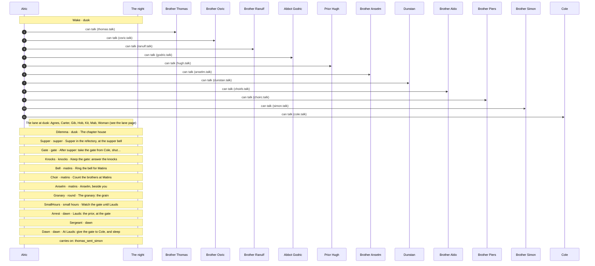

## Conversations

- [Brother Anselm](#anselm) (`anselm.talk`)
- [Brother Aldo](#choirb) (`choirb.talk`)
- [Brother Piers](#choirc) (`choirc.talk`)
- [Cole](#cole) (`cole.talk`)
- [Dunstan](#dunstan) (`dunstan.talk`)
- [Abbot Godric](#godric) (`godric.talk`)
- [Prior Hugh](#hugh) (`hugh.talk`)
- [Brother Osric](#osric) (`osric.talk`)
- [Brother Ranulf](#ranulf) (`ranulf.talk`)
- [Brother Simon](#simon) (`simon.talk`)
- [Brother Thomas](#thomas) (`thomas.talk`)

## Brother Anselm

[`anselm.talk`](../../game/chapters/night5/dialogue/anselm.talk) · id `n5_anselm` · baseline *weary*, habit *lip* · starts at trust 20

Moods through the talk: afraid → grave → weary → grave → sad → afraid

> Anselm at dusk, in his chair in the infirmary (night 5, clear and cold). Frightened. He has something to tell the porter,
> and won't say it here: he can't see who's in the room. At Matins, where the singing covers a voice.
> (At Matins he tells him the key to the crypt passage is in the granary. Nothing here says so.)

**Reads from elsewhere:** [`died_edwin`](links.md#died_edwin)

### Every path

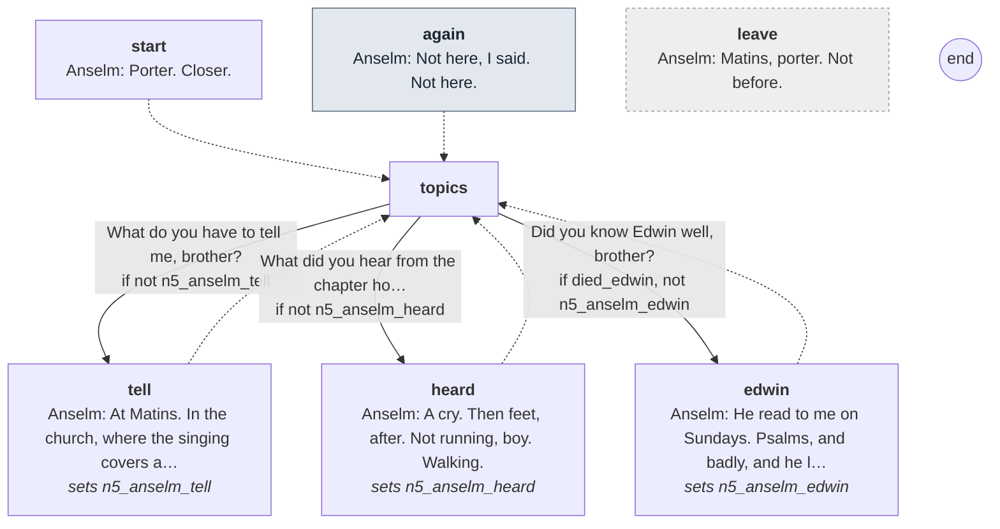

Every line

#### `start`

- *Anselm has turned toward the door before you reach it. His hand comes out and finds your sleeve.*
- **Anselm** *afraid*: Porter. Closer.
- **Anselm** *afraid, swallow*: There's a thing I should have told you the night you came. Not here. I can't see who's in the room.

- → `topics`

#### `again` (the next time)

- *His hand finds your sleeve again, and holds it.*
- **Anselm** *afraid, lip*: Not here, I said. Not here.

- → `topics`

#### `topics`

1. What do you have to tell me, brother? → `tell` · only if not `n5_anselm_tell`
2. What did you hear from the chapter house? → `heard` · only if not `n5_anselm_heard`
3. Did you know Edwin well, brother? → `edwin` · only if `died_edwin`, not `n5_anselm_edwin`

#### `tell`
*sets `n5_anselm_tell`*

- **Anselm** *afraid*: At Matins. In the church, where the singing covers a man's voice. I'll find you.
- *His grip tightens.*
- **Anselm** *grave*: Don't come asking again before then. Don't look at me in the choir.

- → `topics`

#### `heard`
*sets `n5_anselm_heard`*

- **Anselm** *weary*: A cry. Then feet, after. Not running, boy. Walking.
- **Anselm** *grave, lip*: Men who know where they're going walk.

- → `topics`

#### `edwin`
*sets `n5_anselm_edwin`*

- **Anselm** *sad*: He read to me on Sundays. Psalms, and badly, and he laughed at his own mistakes.
- **Anselm** *sad, swallow*: They carried him past this door at Lauds. I knew who it was. Nobody else in this house would have been so light.

- → `topics`

#### `leave` (if he walks away)

- **Anselm** *afraid*: Matins, porter. Not before.

## Brother Aldo

[`choirb.talk`](../../game/chapters/night5/dialogue/choirb.talk) · id `n5_choirb` · starts at trust 10

Moods through the talk: weary → sad → grave

> Brother Aldo in the nave at dusk (night 5, clear and cold), setting out the psalters. More stalls empty than full.
> Wulfric, killed in the fog (died_fog_brother): Aldo came in a beat behind him at Matins. Simon slept in the next bed:
> dead on the chapter house floor (died_simon), or alive and hiding at the back of the church.

**Reads from elsewhere:** [`died_fog_brother`](links.md#died_fog_brother), [`died_simon`](links.md#died_simon)

### Every path

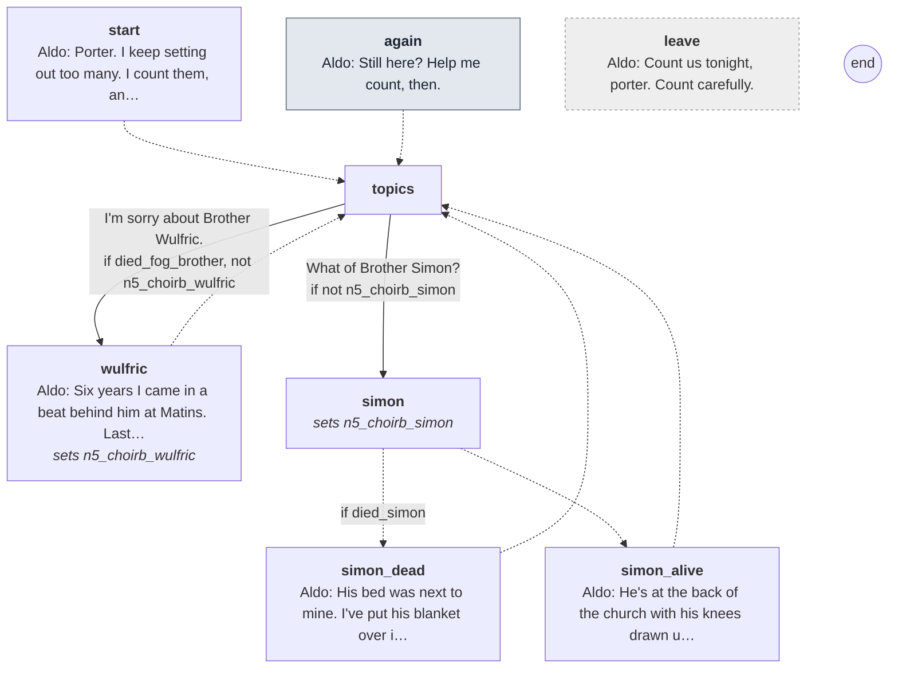

Every line

#### `start`

- *Brother Aldo in the nave, setting out the psalters. There are more empty stalls than full ones now.*
- **Aldo** *weary*: Porter. I keep setting out too many. I count them, and then I count them again.

- → `topics`

#### `again` (the next time)

- **Aldo** *weary*: Still here? Help me count, then.

- → `topics`

#### `topics`

1. I'm sorry about Brother Wulfric. → `wulfric` · only if `died_fog_brother`, not `n5_choirb_wulfric`
2. What of Brother Simon? → `simon` · only if not `n5_choirb_simon`

#### `wulfric`
*sets `n5_choirb_wulfric`*

- **Aldo** *sad*: Six years I came in a beat behind him at Matins. Last night there was nothing to come in behind.
- **Aldo** *sad, swallow*: I sang it alone, and flat. He'd have hated it.

- → `topics`

#### `simon`
*sets `n5_choirb_simon`*

- → `simon_dead` if `died_simon`
- → `simon_alive`

#### `simon_dead`

- **Aldo** *sad*: His bed was next to mine. I've put his blanket over it, so I don't have to see it empty.

- → `topics`

#### `simon_alive`

- **Aldo** *grave*: He's at the back of the church with his knees drawn up, like a child. He won't come into the choir, or say why.

- → `topics`

#### `leave` (if he walks away)

- **Aldo** *grave*: Count us tonight, porter. Count carefully.

## Brother Piers

[`choirc.talk`](../../game/chapters/night5/dialogue/choirc.talk) · id `n5_choirc` · starts at trust 10

Moods through the talk: grave → calm → grave → wary → sad → weary → calm

> Brother Piers on the east walk at dusk (night 5, clear and cold), looking at the chapter house door. Background; dry.
> What the brothers say now (and what some say quietly), and whether he'll leave: he has nowhere to go.

### Every path

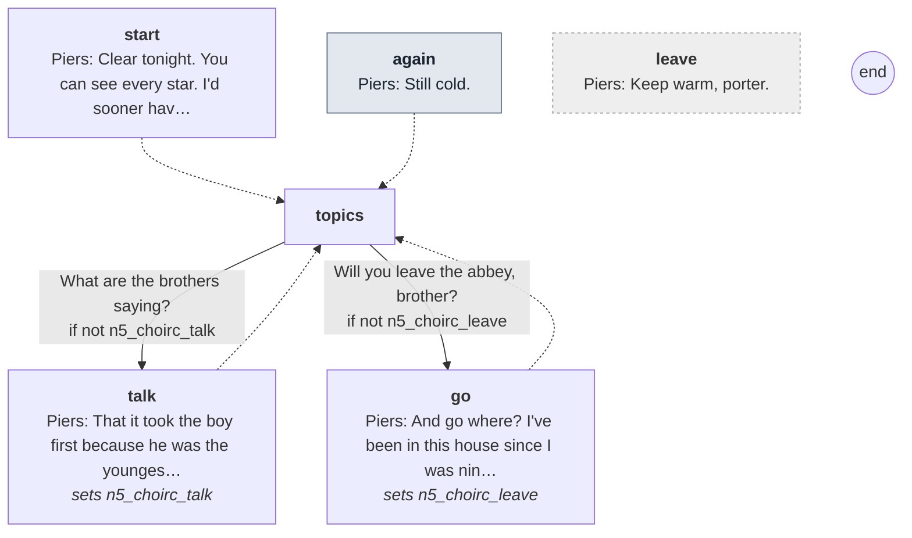

Every line

#### `start`

- *Brother Piers on the east walk, his breath smoking in the cold. He's looking at the chapter house door.*
- **Piers** *grave*: Clear tonight. You can see every star. I'd sooner have the fog back.

- → `topics`

#### `again` (the next time)

- **Piers** *calm*: Still cold.

- → `topics`

#### `topics`

1. What are the brothers saying? → `talk` · only if not `n5_choirc_talk`
2. Will you leave the abbey, brother? → `go` · only if not `n5_choirc_leave`

#### `talk`
*sets `n5_choirc_talk`*

- **Piers** *grave*: That it took the boy first because he was the youngest. That it walks in the fog. That it's no demon at all.
- *He looks at you.*
- **Piers** *wary*: Nobody says that last one loudly.

- → `topics`

#### `go`
*sets `n5_choirc_leave`*

- **Piers** *sad*: And go where? I've been in this house since I was nine. Outside that gate I'm a shaved head and no trade.
- **Piers** *weary*: I'll stay. I'll keep a candle lit.

- → `topics`

#### `leave` (if he walks away)

- **Piers** *calm*: Keep warm, porter.

## Cole

[`cole.talk`](../../game/chapters/night5/dialogue/cole.talk) · id `n5_cole` · baseline *blank* · **in the cult**

> Cole at dusk, keeping the gate (night 5, clear and cold). Lay brothers don't talk (Look and Feel, "Characters").

### Every path

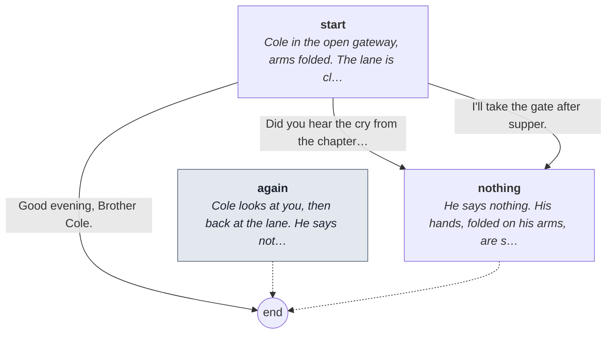

Every line

#### `start`

- *Cole in the open gateway, arms folded. The lane is clear and cold behind him, every lantern sharp. He says nothing.*

1. Did you hear the cry from the chapter house? → `nothing`
2. I'll take the gate after supper. → `nothing`
3. Good evening, Brother Cole. → `end`

#### `again` (the next time)

- *Cole looks at you, then back at the lane. He says nothing.*

- → `end`

#### `nothing`

- *He says nothing. His hands, folded on his arms, are scrubbed red to the wrist.*

- → `end`

## Dunstan

[`dunstan.talk`](../../game/chapters/night5/dialogue/dunstan.talk) · id `n5_dunstan` · baseline *blank* · **in the cult**

> Dunstan at dusk, by the woodpile (night 5, clear and cold). Lay brothers don't talk (Look and Feel, "Characters").

### Every path

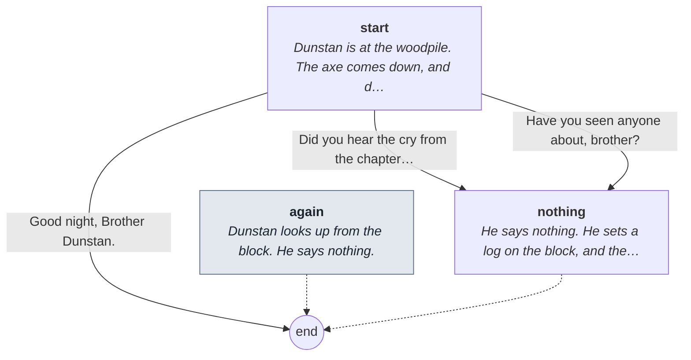

Every line

#### `start`

- *Dunstan is at the woodpile. The axe comes down, and down. He doesn't stop for you, and he says nothing.*

1. Did you hear the cry from the chapter house? → `nothing`
2. Have you seen anyone about, brother? → `nothing`
3. Good night, Brother Dunstan. → `end`

#### `again` (the next time)

- *Dunstan looks up from the block. He says nothing.*

- → `end`

#### `nothing`

- *He says nothing. He sets a log on the block, and the axe comes down.*

- → `end`

## Abbot Godric

[`godric.talk`](../../game/chapters/night5/dialogue/godric.talk) · id `n5_godric` · baseline *weary*

Moods through the talk: sad → weary → sad → afraid → weary → grave → weary

> Abbot Godric at dusk, on his knees in the chapter house where it happened (night 5, clear and cold). Frail, sick from
> the incense, praying. He names the dead: Edwin, Wulfric, and Simon if he died. He won't burn less incense, and won't
> send for the bishop. (He collapses from the smoke at Matins tonight. Nothing here says so.)

**Reads from elsewhere:** [`died_simon`](links.md#died_simon)

### Every path

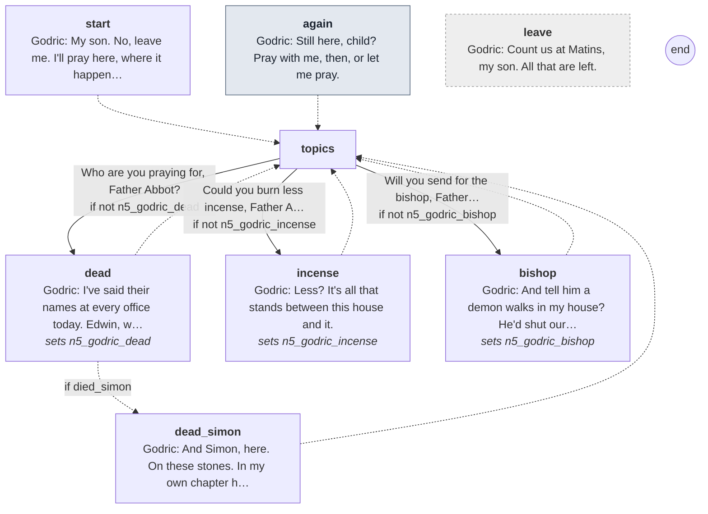

Every line

#### `start`

- *The abbot kneels by the dark stain on the chapter house floor, lips moving. He coughs till he has to hold the bench.*
- **Godric** *sad*: My son. No, leave me. I'll pray here, where it happened.

- → `topics`

#### `again` (the next time)

- *The abbot hasn't moved. His breath rattles.*
- **Godric** *weary*: Still here, child? Pray with me, then, or let me pray.

- → `topics`

#### `topics`

1. Who are you praying for, Father Abbot? → `dead` · only if not `n5_godric_dead`
2. Could you burn less incense, Father Abbot? It's making you ill. → `incense` · only if not `n5_godric_incense`
3. Will you send for the bishop, Father Abbot? → `bishop` · only if not `n5_godric_bishop`

#### `dead`
*sets `n5_godric_dead`*

- **Godric** *sad*: I've said their names at every office today. Edwin, who read so badly at table. Wulfric, here before me.

- → `dead_simon` if `died_simon`
- → `topics`

#### `dead_simon`

- **Godric** *sad, swallow*: And Simon, here. On these stones. In my own chapter house.

- → `topics`

#### `incense`
*sets `n5_godric_incense`*

- **Godric** *afraid*: Less? It's all that stands between this house and it.
- *He coughs into his sleeve, and looks at what he's coughed.*
- **Godric** *weary*: Ranulf says more. I'll give it more.

- → `topics`

#### `bishop`
*sets `n5_godric_bishop`*

- **Godric** *grave*: And tell him a demon walks in my house? He'd shut our doors and send our saint to Canterbury.
- **Godric** *grave*: No. We'll bear it ourselves, as Our Lord bore it. God hasn't forgotten us.

- → `topics`

#### `leave` (if he walks away)

- **Godric** *weary*: Count us at Matins, my son. All that are left.

## Prior Hugh

[`hugh.talk`](../../game/chapters/night5/dialogue/hugh.talk) · id `n5_hugh` · baseline *cold*, habit *jaw* · starts at trust -20

Moods through the talk: cold → grave → cold → grave → cold → grave → cold → grave → cold

> Prior Hugh at dusk, on the north walk (night 5, clear and cold). Grim; he means to see it ended tonight.
> (He arrests the porter at dawn. Nothing here says so.) He knows what happened in the chapter house. The blood on his
> sleeve (prior_sleeve): Wulfric's, and the porter was there first. Telling him what you've seen: Suspicion +10 (Ranulf overhears).
> Claims: n5_hugh_porter (mistaken): whatever is killing his brothers came in with the porter.

**Reads from elsewhere:** [`died_simon`](links.md#died_simon), [`n5_saved`](links.md#n5_saved), [`osric_mask`](links.md#osric_mask), [`prior_sleeve`](links.md#prior_sleeve)

### Every path

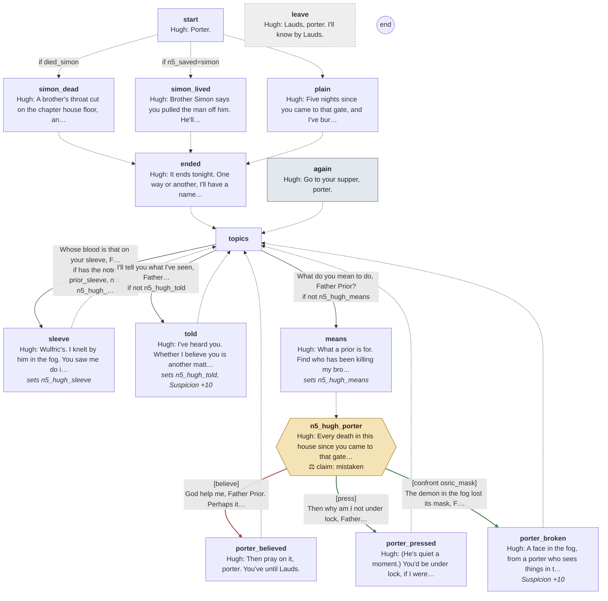

Every line

#### `start`

- *The prior is on the north walk, his tablet shut in his hand for once. He looks as if he hasn't slept.*
- **Hugh** *cold*: Porter.

- → `simon_dead` if `died_simon`
- → `simon_lived` if `n5_saved=simon`
- → `plain`

#### `simon_dead`

- **Hugh** *cold*: A brother's throat cut on the chapter house floor, and the porter in the door. Thomas says you saved his life.
- **Hugh** *cold, jaw*: Thomas is generous.

- → `ended`

#### `simon_lived`

- **Hugh** *grave*: Brother Simon says you pulled the man off him. He'll say nothing else. He shakes when I ask him.

- → `ended`

#### `plain`

- **Hugh** *cold, jaw*: Five nights since you came to that gate, and I've buried more brothers than in five years.

- → `ended`

#### `ended`

- **Hugh** *cold*: It ends tonight. One way or another, I'll have a name by Lauds.

- → `topics`

#### `again` (the next time)

- *He's writing on his tablet again, and doesn't look up.*
- **Hugh** *cold*: Go to your supper, porter.

- → `topics`

#### `topics`

1. Whose blood is that on your sleeve, Father Prior? → `sleeve` · only if has the note *prior_sleeve*, not `n5_hugh_sleeve`
2. I'll tell you what I've seen, Father Prior. → `told` · only if not `n5_hugh_told`
3. What do you mean to do, Father Prior? → `means` · only if not `n5_hugh_means`

#### `sleeve`
*sets `n5_hugh_sleeve`*

- *He looks down at the sleeve. It's been scrubbed. The stain is still there.*
- **Hugh** *cold, jaw*: Wulfric's. I knelt by him in the fog. You saw me do it.
- **Hugh** *cold*: You were there before me, porter. You're always there before me.

- → `topics`

#### `told`
*sets `n5_hugh_told`, **Suspicion +10***

- *You tell him. He opens the tablet and writes until the wax is full.*
- *Across the garth, someone moves out of the light and is gone.*
- **Hugh** *cold*: I've heard you. Whether I believe you is another matter. Go and keep your gate.

- → `topics`

#### `means`
*sets `n5_hugh_means`*

- **Hugh** *grave*: What a prior is for. Find who has been killing my brothers, and see him taken.
- **Hugh** *cold*: Keep to your gate tonight, porter. Keep to it, and I'll know where to find you.

- → `n5_hugh_porter`

#### `n5_hugh_porter`

- **Hugh** *cold, jaw*: Every death in this house since you came to that gate, and the porter there before me. Whatever is killing my brothers, it came in with you.

> **Claim `n5_hugh_porter`: mistaken: they believe it, and it isn't so.** The last line is the claim.

1. God help me, Father Prior. Perhaps it did. → `porter_believed` · **believe** · wrong
2. Then why am I not under lock, Father Prior? → `porter_pressed` · **press** · **right**, trust +1
3. The demon in the fog lost its mask, Father Prior. Under it was Brother Osric. → `porter_broken` · **confront** with *osric_mask* · **right**, trust +2

#### `porter_believed`

- **Hugh** *cold*: Then pray on it, porter. You've until Lauds.

- → `topics`

#### `porter_pressed`

- **Hugh** *grave, look down*: (He's quiet a moment.) You'd be under lock, if I were sure of it. I'm not.
- **Hugh** *cold, jaw*: One man didn't do all this, and I want every one of them. Go to your gate.

- → `topics`

#### `porter_broken`
***Suspicion +10***

- *He looks at you a long moment. Then he opens the tablet and writes one word. Across the garth, a door shuts softly.*
- **Hugh** *grave*: A face in the fog, from a porter who sees things in the smoke. It isn't enough.
- **Hugh** *cold, jaw*: But I'll look at Osric. Bring me something I can hold in my hand, porter, and I'll look at more.

- → `topics`

#### `leave` (if he walks away)

- **Hugh** *cold*: Lauds, porter. I'll know by Lauds.

## Brother Osric

[`osric.talk`](../../game/chapters/night5/dialogue/osric.talk) · id `n5_osric` · baseline *glad*, habit *nod* · starts at trust 20 · **in the cult**

Moods through the talk: glad → amused → glad

> Osric at dusk, at the kitchen fire (night 5, clear and cold). The fast is over: bread tonight, and the heel kept back.
> Smiling. If the porter saw his face under the mask last night (osric_mask), he knows this face; Osric acts as if nothing happened.
> Where he was last night: the wrong question (Suspicion +5). Saying he saw his face: Suspicion +15, and Osric ends the talk.

**Reads from elsewhere:** [`osric_mask`](links.md#osric_mask)

### Every path

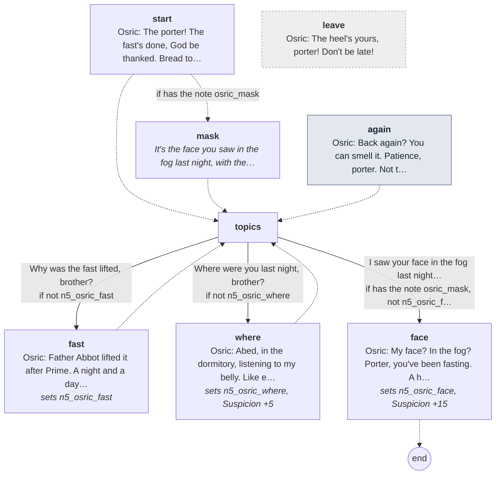

Every line

#### `start`

- *Osric is at the kitchen fire, flour to the elbow, the smell of new bread all round him. He beams at you.*
- **Osric** *glad*: The porter! The fast's done, God be thanked. Bread tonight, and I've kept the heel back for you.

- → `mask` if has the note *osric_mask*
- → `topics`

#### `mask`

- *It's the face you saw in the fog last night, with the horns pushed back off it. It's smiling at you.*

- → `topics`

#### `again` (the next time)

- **Osric** *glad*: Back again? You can smell it. Patience, porter. Not till the bell.

- → `topics`

#### `topics`

1. Why was the fast lifted, brother? → `fast` · only if not `n5_osric_fast`
2. Where were you last night, brother? → `where` · only if not `n5_osric_where`
3. I saw your face in the fog last night, brother. → `face` · only if has the note *osric_mask*, not `n5_osric_face`

#### `fast`
*sets `n5_osric_fast`*

- **Osric** *glad*: Father Abbot lifted it after Prime. A night and a day of nothing, and half the house couldn't stand at Lauds.
- **Osric** *glad, smile*: Eat tonight, porter. All of it. You'll want your strength.

- → `topics`

#### `where`
*sets `n5_osric_where`, **Suspicion +5***

- **Osric** *glad, smile*: Abed, in the dormitory, listening to my belly. Like every Christian in the house. Where else would I be?
- *He goes on kneading.*
- **Osric** *amused*: Ask the brother in the next bed. He'll tell you how I snore.

- → `topics`

#### `face`
*sets `n5_osric_face`, **Suspicion +15***

- *He laughs, a big warm laugh. The dough under his hands doesn't stop.*
- **Osric** *amused, smile*: My face? In the fog? Porter, you've been fasting. A hungry man sees faces in his porridge.
- **Osric** *glad*: Eat your bread tonight. All of it. You'll see clearer for it.

- → `end`

#### `leave` (if he walks away)

- **Osric** *glad*: The heel's yours, porter! Don't be late!

## Brother Ranulf

[`ranulf.talk`](../../game/chapters/night5/dialogue/ranulf.talk) · id `n5_ranulf` · baseline *grave* · starts at trust 0 · **in the cult**

Moods through the talk: grave → cold → grave

> Ranulf at dusk, filling the censers in the choir (night 5, clear and cold). Smooth. (He wears the horned costume.)
> The abbot sick from the smoke; where Ranulf was when Thomas was "attacked" (Suspicion +5); and, if the porter has
> heard from Kit tonight that he bought no candles (lane_kit_5), the wrong question (Suspicion +10): we have all we need.

**Reads from elsewhere:** [`lane_kit_5`](links.md#lane_kit_5)

### Every path

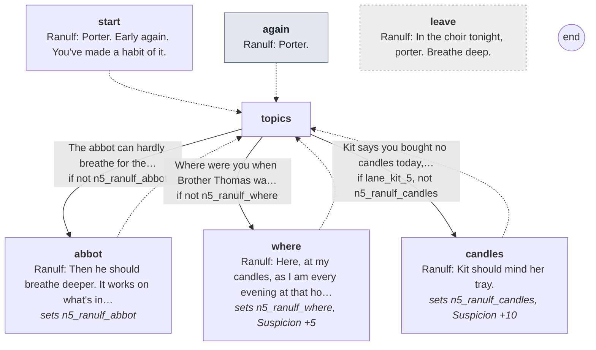

Every line

#### `start`

- *Ranulf is filling the censers from his leather bag. The church already smells of it, though Matins is hours off.*
- **Ranulf** *grave*: Porter. Early again. You've made a habit of it.

- → `topics`

#### `again` (the next time)

- *He hangs a censer on its hook and reaches for the next.*
- **Ranulf** *grave*: Porter.

- → `topics`

#### `topics`

1. The abbot can hardly breathe for the smoke. → `abbot` · only if not `n5_ranulf_abbot`
2. Where were you when Brother Thomas was attacked? → `where` · only if not `n5_ranulf_where`
3. Kit says you bought no candles today, brother. → `candles` · only if `lane_kit_5`, not `n5_ranulf_candles`

#### `abbot`
*sets `n5_ranulf_abbot`*

- **Ranulf** *grave, glance*: Then he should breathe deeper. It works on what's in the chest as well as what's in the house.
- **Ranulf** *grave*: Father Abbot ordered it. I only burn it.

- → `topics`

#### `where`
*sets `n5_ranulf_where`, **Suspicion +5***

- **Ranulf** *grave, glance*: Here, at my candles, as I am every evening at that hour. I heard the cry, like everyone.
- *He doesn't blink.*
- **Ranulf** *cold*: And you, porter? Thomas says you were first through the door. You generally are.

- → `topics`

#### `candles`
*sets `n5_ranulf_candles`, **Suspicion +10***

- *He stops with a censer in his hand.*
- **Ranulf** *cold*: Kit should mind her tray.
- **Ranulf** *cold*: We have all we need now, porter. That's all.

- → `topics`

#### `leave` (if he walks away)

- **Ranulf** *grave*: In the choir tonight, porter. Breathe deep.

## Brother Simon

[`simon.talk`](../../game/chapters/night5/dialogue/simon.talk) · id `n5_simon` · baseline *ashamed*, habit *look down* · starts at trust 10

Moods through the talk: afraid → pleading → sad → afraid → ashamed → sad → ashamed → afraid → ashamed → pleading

> Brother Simon at dusk, at the back of the nave (night 5, clear and cold). Only if the porter saved him (n5_saved=simon).
> Shaking and grateful. He says little more than he told the porter in the chapter house: Thomas sent him to scrub the blood
> (the thomas_sent_simon note). He asks the porter not to tell anyone. Where he scrubbed: a flag that rocked (the hidden body).
> Claims: n5_simon_sent (true): Brother Thomas sent him to scrub the blood.

**Reads from elsewhere:** [`simon_blood`](links.md#simon_blood)
**Read elsewhere:** [`thomas_sent_simon`](links.md#thomas_sent_simon)

### Every path

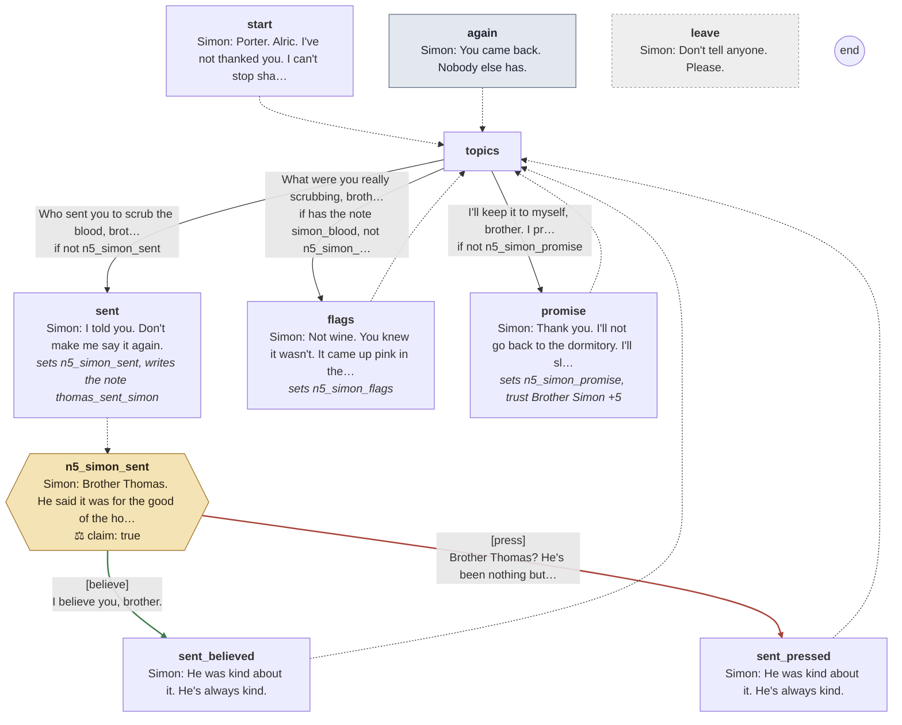

Every line

#### `start`

- *Brother Simon sits at the back of the nave, knees drawn up, a strip of linen at his neck where the knife touched him.*
- *He flinches at your step, then sees who it is.*
- **Simon** *afraid, look down*: Porter. Alric. I've not thanked you. I can't stop shaking long enough to thank you.
- **Simon** *pleading*: What I told you in the chapter house. Keep it. Please. Don't tell anyone I said it.

- → `topics`

#### `again` (the next time)

- *Simon hasn't moved. He's watching the door.*
- **Simon** *sad*: You came back. Nobody else has.

- → `topics`

#### `topics`

1. Who sent you to scrub the blood, brother? → `sent` · only if not `n5_simon_sent`
2. What were you really scrubbing, brother? → `flags` · only if has the note *simon_blood*, not `n5_simon_flags`
3. I'll keep it to myself, brother. I promise. → `promise` · only if not `n5_simon_promise`

#### `sent`
*sets `n5_simon_sent`, writes the note *thomas_sent_simon**

- **Simon** *afraid*: I told you. Don't make me say it again.
- *He looks past you at the door, and whispers it.*

- → `n5_simon_sent`

#### `n5_simon_sent`

- **Simon** *afraid, look down*: Brother Thomas. He said it was for the good of the house. He said the abbot mustn't see it.

> **Claim `n5_simon_sent`: true.** The last line is the claim.

1. I believe you, brother. → `sent_believed` · **believe** · **right**, trust +2
2. Brother Thomas? He's been nothing but kind to me. → `sent_pressed` · **press** · wrong, trust -2

#### `sent_believed`

- **Simon** *ashamed*: He was kind about it. He's always kind.
- **Simon** *sad*: You believe me. I'd not have said it to another soul in this house.

- → `topics`

#### `sent_pressed`

- **Simon** *ashamed*: He was kind about it. He's always kind.
- **Simon** *ashamed, look down*: You see? Nobody will believe it of him. Forget I said it.

- → `topics`

#### `flags`
*sets `n5_simon_flags`*

- **Simon** *ashamed, look down*: Not wine. You knew it wasn't. It came up pink in the bucket, and then it wouldn't come up at all.
- **Simon** *afraid, swallow*: There was a flag that rocked when I knelt on it. I didn't lift it. I didn't want to know.

- → `topics`

#### `promise`
*sets `n5_simon_promise`, **trust Brother Simon +5***

- *He lets out a breath, and some of the shaking goes out with it.*
- **Simon** *ashamed*: Thank you. I'll not go back to the dormitory. I'll sleep here, where the candles are.

- → `topics`

#### `leave` (if he walks away)

- **Simon** *pleading*: Don't tell anyone. Please.

## Brother Thomas

[`thomas.talk`](../../game/chapters/night5/dialogue/thomas.talk) · id `n5_thomas` · baseline *warm*, habit *nod* · starts at trust 40 · **in the cult**

Moods through the talk: warm → sad → weary → warm → weary → grave → warm → weary → warm → grave → warm → grave → sad → warm → grave → sad → grave → warm

> Thomas at dusk, on a bed in the infirmary, his head bandaged (night 5, clear and cold), after the dilemma.
> Brave about his "wound". Saved (n5_saved=thomas), he thanks the porter; passed over for Simon (n5_saved=simon), he's hurt
> and forgiving. His account of the attack points at the prior again. (The attack was staged. Nothing here says so.)
> Osric's face (osric_mask): keep quiet and eat Osric's bread tonight (Suspicion +5). What Simon told him: a frightened man
> names whoever you'll believe (Suspicion +10: the cult learns Simon talked). Simon scrubbing blood: he uses it.
> Claims: n5_thomas_attack (lie): the man in the mask was as tall as the prior.

**Reads from elsewhere:** [`died_simon`](links.md#died_simon), [`n5_saved`](links.md#n5_saved), [`osric_mask`](links.md#osric_mask), [`simon_blood`](links.md#simon_blood)

### Every path

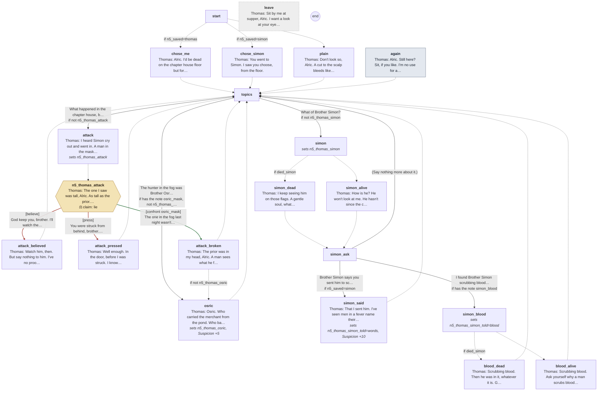

Every line

#### `start`

- → `chose_me` if `n5_saved=thomas`
- → `chose_simon` if `n5_saved=simon`
- → `plain`

#### `chose_me`

- *Thomas sits on the edge of a bed, his head bound in linen, a brown stain at the temple. He smiles when he sees you.*
- **Thomas** *warm*: Alric. I'd be dead on the chapter house floor but for you. I'll not forget it.
- **Thomas** *sad, still*: Poor Simon. I told you I'd seen him out at night. Whatever he'd got himself into, it came for him.

- → `topics`

#### `chose_simon`

- *Thomas sits on the edge of a bed, his head bound in linen, a brown stain at the temple. He looks at you, then smiles.*
- **Thomas** *weary*: You went to Simon. I saw you choose, from the floor.
- **Thomas** *warm, nod*: No, don't. You reached for the nearer man. I'm alive, as you see. I've a thick skull.

- → `topics`

#### `plain`

- *Thomas sits on the edge of a bed, his head bound in linen, a brown stain coming through at the temple.*
- **Thomas** *warm*: Don't look so, Alric. A cut to the scalp bleeds like a pig and means nothing.

- → `topics`

#### `again` (the next time)

- *Thomas has lain back against the wall with his eyes shut. He opens them when you come in.*
- **Thomas** *weary*: Alric. Still here? Sit, if you like. I'm no use for anything else tonight.

- → `topics`

#### `topics`

1. What happened in the chapter house, brother? → `attack` · only if not `n5_thomas_attack`
2. The hunter in the fog was Brother Osric. I saw his face. → `osric` · only if has the note *osric_mask*, not `n5_thomas_osric`
3. What of Brother Simon? → `simon` · only if not `n5_thomas_simon`

#### `attack`
*sets `n5_thomas_attack`*

- **Thomas** *grave*: I heard Simon cry out and went in. A man in the mask was over him. Something struck me from behind. Then the floor.

- → `n5_thomas_attack`

#### `n5_thomas_attack`

- **Thomas** *warm, still*: The one I saw was tall, Alric. As tall as the prior. I'll say no more than that, God forgive me if I'm wrong.

> **Claim `n5_thomas_attack`: a lie.** The last line is the claim.

1. God keep you, brother. I'll watch the prior. → `attack_believed` · **believe** · wrong
2. You were struck from behind, brother. How well did you see him? → `attack_pressed` · **press** · wrong
3. The one in the fog last night wasn't the prior. It was Brother Osric. I saw his face. → `attack_broken` · **confront** with *osric_mask* · **right**, **Suspicion +10**: the cult knows he knows

#### `attack_believed`

- **Thomas** *warm, nod*: Watch him, then. But say nothing to him. I've no proof, and he's the prior.

- → `topics`

#### `attack_pressed`

- **Thomas** *warm, still*: Well enough. In the door, before I was struck. I know what I saw, Alric.
- **Thomas** *weary*: Let me rest now. My head.

- → `topics`

#### `attack_broken`

- *For a moment his face is nothing at all.*
- **Thomas** *warm*: The prior was in my head, Alric. A man sees what he fears, in the dark.

- → `osric` if not `n5_thomas_osric`
- → `topics`

#### `osric`
*sets `n5_thomas_osric`, **Suspicion +5***

- *He's very still.*
- **Thomas** *grave*: Osric. Who carried the merchant from the pond. Who bakes our bread.
- **Thomas** *warm, still*: Say nothing to him. Eat what he gives you tonight, and let him think you saw nothing.
- **Thomas** *grave*: I'll think what's to be done.

- → `topics`

#### `simon`
*sets `n5_thomas_simon`*

- → `simon_dead` if `died_simon`
- → `simon_alive`

#### `simon_dead`

- **Thomas** *sad, still*: I keep seeing him on those flags. A gentle soul, whatever he'd got into. I wish to God I'd been wrong about him.

- → `simon_ask`

#### `simon_alive`

- **Thomas** *warm*: How is he? He won't look at me. He hasn't since the chapter house.

- → `simon_ask`

#### `simon_ask`

1. Brother Simon says you sent him to scrub the blood. → `simon_said` · only if `n5_saved=simon`
2. I found Brother Simon scrubbing blood off the stones. → `simon_blood` · only if has the note *simon_blood*
3. (Say nothing more about it.) → `topics`

#### `simon_said`
*sets `n5_thomas_simon_told=words`, **Suspicion +10***

- *A long silence. He turns the bandage at his temple with one finger.*
- **Thomas** *warm, still*: That I sent him. I've seen men in a fever name their own mothers, Alric.
- **Thomas** *warm*: A frightened man says the name he thinks you'll believe, and he knows you trust me.
- **Thomas** *grave*: Ask him where he was every night this week.

- → `topics`

#### `simon_blood`
*sets `n5_thomas_simon_told=blood`*

- → `blood_dead` if `died_simon`
- → `blood_alive`

#### `blood_dead`

- *He shuts his eyes.*
- **Thomas** *sad*: Scrubbing blood. Then he was in it, whatever it is. God rest him anyway.

- → `topics`

#### `blood_alive`

- **Thomas** *grave, still*: Scrubbing blood. Ask yourself why a man scrubs blood in the dark, and whose name he gives when he's caught.

- → `topics`

#### `leave` (if he walks away)

- **Thomas** *warm, nod*: Sit by me at supper, Alric. I want a look at your eyes.

## Scripted lines

Said by the night's beats and cues (`night5.tscn`), outside any talk.

- `Director/Dilemma`: **Thomas** *pained, still*: (Holding his side, his breath short.) It came at us out of nowhere, Alric. I tried to pull it off him. God forgive me, I couldn't.
- `Director/Dilemma`: **Thomas** *warm*: Help me up. And don't go after it. Promise me.
- `Director/Dilemma`: **Simon** *afraid*: (Low, his eyes on Thomas.) The blood on the flags last night. Brother Thomas sent me to scrub it. He said it was for the good of the house, and to tell no one.
- `Director/Dilemma`: **Simon** *ashamed, look down*: Whose blood was it, porter? He wouldn't say.
- `Director/Supper`: **Osric** *glad*: The heel for the porter. A day's fast, and look at you. Eat up.
- `Director/Supper`: **Osric** *glad, smile*: (From the hatch, smiling.) Not hungry, porter? I'll keep an eye on you. Can't have you wasting away.
- `Director/Supper`: **Thomas** *warm*: Eat, Alric. All of it. You'll need your strength tonight.
- `Director/Gate`: **Cole** *blank*: Yours.
- `Director/Knocks`: **Hugh** *cold*: Stand aside, porter. I'll see him to a bed myself.
- `Director/Knocks`: **Hugh** *cold*: (To the visitor.) This way. Keep close, and touch nothing.
- `Director/Anselm`: **Anselm** *afraid, swallow*: The key to the crypt passage. It's in the granary, under the rye. Go now, while they're all looking at him.
- `Director/Arrest`: **Hugh** *cold, jaw*: Brother Alric, I'm holding you for the killings in this house. Every one of them since you came to that gate.
- `Director/Arrest`: **Hugh** *cold*: If you have anything to show me, show it now, porter. I won't ask twice.
- `Director/Arrest`: **Hugh** *grave*: (He looks a long time at what you've shown him, then at his wax.) Let go of him. Go to your beds, both of you.
- `Director/Arrest`: **Hugh** *grave, jaw*: I've been watching the wrong man, porter. Tonight I'll stand with you, whatever comes.
- `Director/Arrest`: **Hugh** *cold*: That's all? It isn't enough. You'll be held until I'm sure of you.
- `Director/Arrest`: **Thomas** *warm*: (Crossing the court, his arm bound.) Prior, look at his eyes. He's sick. He's been seeing things for days. Give him to me. I'll keep him in the infirmary and answer for him myself.
- `Director/Arrest`: **Hugh** *cold, jaw*: Into your care, then, brother. Yours. If he walks out of it, it's on your head.
