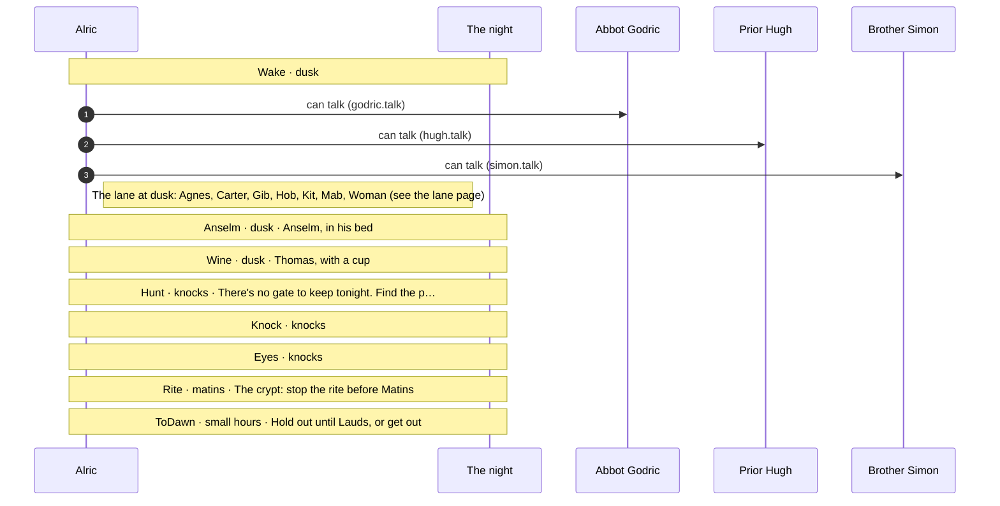
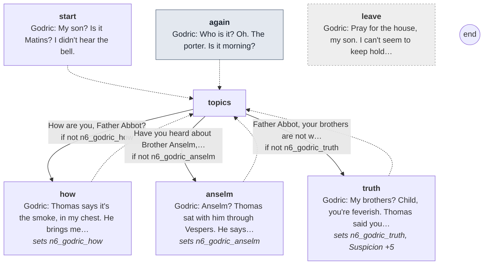
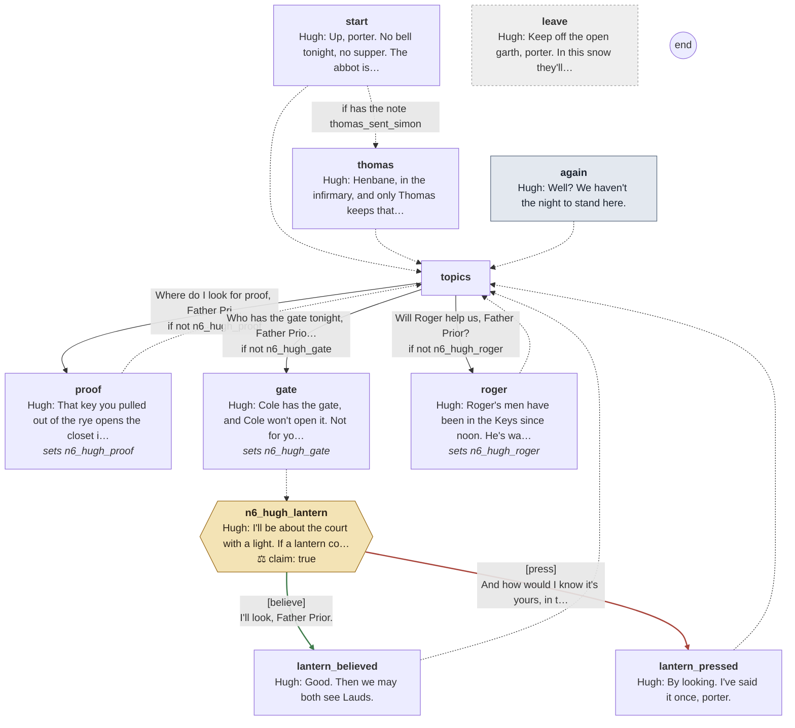
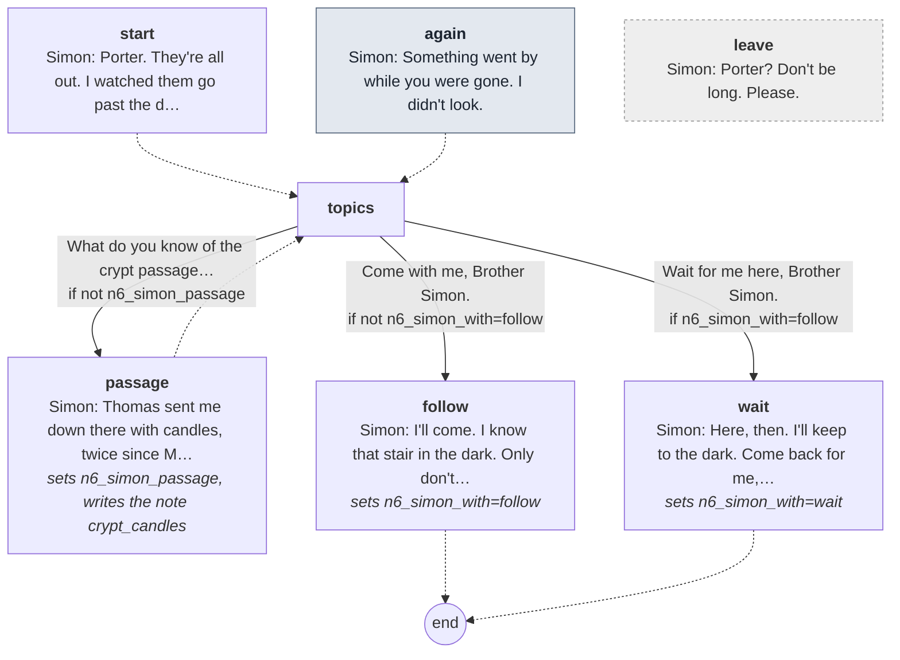

# The sixth night: The Hunt

Generated by `tools/script_docs.py` from the game's files. Don't edit it by hand. How to read it: [README](README.md). Every flag: [links](links.md).

## The night

The chapter's beats in order (`night6.tscn`), the talks each opens, who he can go to from then on, and the flags passed between them (dashed). The note at the end lists what this chapter's talks pass on to later ones.

## Conversations

- [Abbot Godric](#godric) (`godric.talk`)
- [Prior Hugh](#hugh) (`hugh.talk`)
- [Brother Simon](#simon) (`simon.talk`)

## Abbot Godric

[`godric.talk`](../../game/chapters/night6/dialogue/godric.talk) · id `n6_godric` · baseline *weary*

Moods through the talk: weary → sad → warm → weary → warm → sad

> Abbot Godric at dusk, sick in his bed since he fell in the smoke at Matins (night 6, snow). Thomas brings him something
> hot at every bell, and he sleeps and wakes and doesn't know what's happening: why there's no bell, whether it's morning.
> He doesn't know Anselm is dead: Thomas told him Anselm sleeps sound at last. Telling him what his brothers are: he
> thinks the porter is feverish, sends him to Thomas, and will tell Thomas he's coming (Suspicion +5).

### Every path

Every line

#### `start`

- *The abbot lies in his bed under a heap of blankets, his beads in his fingers, his lips moving. His breath rattles.*
- **Godric** *weary*: My son? Is it Matins? I didn't hear the bell.
- **Godric** *weary*: Thomas says I'm not to trouble about Matins. He says the house can sing without me for one night.

- → `topics`

#### `again` (the next time)

- *The abbot has slipped down in the bed. He opens his eyes, and takes a while to find you.*
- **Godric** *weary, blink*: Who is it? Oh. The porter. Is it morning?

- → `topics`

#### `topics`

1. How are you, Father Abbot? → `how` · only if not `n6_godric_how`
2. Have you heard about Brother Anselm, Father Abbot? → `anselm` · only if not `n6_godric_anselm`
3. Father Abbot, your brothers are not what they seem. → `truth` · only if not `n6_godric_truth`

#### `how`
*sets `n6_godric_how`*

- **Godric** *weary*: Thomas says it's the smoke, in my chest. He brings me something hot at every bell, and I sleep.
- **Godric** *sad*: I sleep so much, child. I dream I'm awake, and then I wake, and it's the same room.

- → `topics`

#### `anselm`
*sets `n6_godric_anselm`*

- **Godric** *warm*: Anselm? Thomas sat with him through Vespers. He says Anselm sleeps sound at last, poor soul, like a child.
- **Godric** *warm*: Thirty years at our gate, and never a whole night's sleep. Let him have it.

- → `topics`

#### `truth`
*sets `n6_godric_truth`, **Suspicion +5***

- *He hears you out. Then he laughs, weakly, and it turns into coughing.*
- **Godric** *weary*: My brothers? Child, you're feverish. Thomas said you might be.
- **Godric** *warm*: Go to him. He'll give you something to help you sleep. I'll tell him you're coming.

- → `topics`

#### `leave` (if he walks away)

- **Godric** *sad*: Pray for the house, my son. I can't seem to keep hold of the words.

## Prior Hugh

[`hugh.talk`](../../game/chapters/night6/dialogue/hugh.talk) · id `n6_hugh` · baseline *cold*, habit *jaw* · starts at trust -20

Moods through the talk: cold → grave → cold → grave → cold → grave → cold → grave → cold → grave → cold

> Prior Hugh at dusk, at the porter's cell door with a lantern (night 6, snow). Only if he believed the porter at dawn
> (prior_believes): he stands with him tonight. Grim and practical: where the proof is (down the hidden stair with the
> key from the rye; two kinds), the gate (Cole holds it and won't open), Roger (a bad bargain, maybe the only one).
> With the thomas_sent_simon note he joins Anselm's death to Thomas. He warns that a lantern looking for the porter
> may be his. (At Dose 75+ he is the demon who corners the porter with a light. Nothing here says so.)
> Claims: n6_hugh_lantern (true): a lantern looking for the porter tonight may be his.

**Reads from elsewhere:** [`thomas_sent_simon`](links.md#thomas_sent_simon)

### Every path

Every line

#### `start`

- *The prior is at your door with a lantern, snow on his hood. He looks as if he hasn't slept since he let you go.*
- **Hugh** *cold*: Up, porter. No bell tonight, no supper. The abbot is sick in his bed and doesn't know what day it is.
- **Hugh** *grave, jaw*: Anselm is dead. Henbane packed into his mouth like straw. Somebody heard him talk.

- → `thomas` if has the note *thomas_sent_simon*
- → `topics`

#### `thomas`

- **Hugh** *cold, jaw*: Henbane, in the infirmary, and only Thomas keeps that key. And Simon says Thomas sent him to scrub the blood.
- **Hugh** *grave*: I'm not blind, porter. Only slow.

- → `topics`

#### `again` (the next time)

- *The prior is trimming his lantern's wick with a thumbnail. He doesn't look up.*
- **Hugh** *cold*: Well? We haven't the night to stand here.

- → `topics`

#### `topics`

1. Where do I look for proof, Father Prior? → `proof` · only if not `n6_hugh_proof`
2. Who has the gate tonight, Father Prior? → `gate` · only if not `n6_hugh_gate`
3. Will Roger help us, Father Prior? → `roger` · only if not `n6_hugh_roger`

#### `proof`
*sets `n6_hugh_proof`*

- **Hugh** *cold*: That key you pulled out of the rye opens the closet in the granary. The stair behind it goes down under the nave.
- **Hugh** *grave*: Whatever they keep, they keep down there. Bring up two kinds of thing, not two of a kind. One proves nothing.

- → `topics`

#### `gate`
*sets `n6_hugh_gate`*

- **Hugh** *cold*: Cole has the gate, and Cole won't open it. Not for you, not for me. Not for the abbot, if he could stand.

- → `n6_hugh_lantern`

#### `n6_hugh_lantern`

- **Hugh** *cold, jaw*: I'll be about the court with a light. If a lantern comes looking for you tonight, it may be mine. Look before you run.

> **Claim `n6_hugh_lantern`: true.** The last line is the claim.

1. I'll look, Father Prior. → `lantern_believed` · **believe** · **right**, trust +2
2. And how would I know it's yours, in the dark? → `lantern_pressed` · **press** · wrong, trust -2

#### `lantern_believed`

- **Hugh** *grave*: Good. Then we may both see Lauds.

- → `topics`

#### `lantern_pressed`

- **Hugh** *cold, jaw*: By looking. I've said it once, porter.

- → `topics`

#### `roger`
*sets `n6_hugh_roger`*

- **Hugh** *cold*: Roger's men have been in the Keys since noon. He's wanted this ground since before I was prior.
- **Hugh** *grave*: Give him proof and he'll hang them, and take the house for his trouble. A bad bargain. It may be the only one left.

- → `topics`

#### `leave` (if he walks away)

- **Hugh** *cold*: Keep off the open garth, porter. In this snow they'll follow your feet.

## Brother Simon

[`simon.talk`](../../game/chapters/night6/dialogue/simon.talk) · id `n6_simon` · baseline *ashamed*, habit *look down* · starts at trust 10

Moods through the talk: afraid → pleading → afraid → ashamed → afraid → sad → pleading

> Brother Simon at dusk, hiding at the back of the nave where he slept last night (night 6, snow). Only if the porter
> saved him on night 5 (n5_saved=simon). Frightened; he knows they'll come for him again, and he'd sooner help than wait.
> He knows the crypt passage: Thomas sent him down with candles for the ring (the crypt_candles note), and said, the
> last time, only one more. He can follow the porter or wait for him ([follow], [wait]; n6_simon_with).
> (He is the rite's last soul at Matins if the cult takes him. Nothing here says so.)

**Read elsewhere:** [`crypt_candles`](links.md#crypt_candles)

### Every path

Every line

#### `start`

- *Brother Simon is crouched in the dark at the back of the nave, his hood up. He's on his feet before you can speak.*
- **Simon** *afraid*: Porter. They're all out. I watched them go past the door in their horns, and not one of them was hurrying.
- **Simon** *pleading*: They'll come for me again tonight. I know it. Let me help you. I can't sit here and wait for it.

- → `topics`

#### `again` (the next time)

- *Simon is back in the dark, hugging himself, watching the door.*
- **Simon** *afraid, look down*: Something went by while you were gone. I didn't look.

- → `topics`

#### `topics`

1. What do you know of the crypt passage, brother? → `passage` · only if not `n6_simon_passage`
2. Come with me, Brother Simon. → `follow` · only if not `n6_simon_with=follow` · they follow him
3. Wait for me here, Brother Simon. → `wait` · only if `n6_simon_with=follow` · they wait

#### `passage`
*sets `n6_simon_passage`, writes the note *crypt_candles**

- **Simon** *afraid, look down*: Thomas sent me down there with candles, twice since Michaelmas. A door in the granary closet that looks like the planks.
- **Simon** *afraid*: Then a stair, and a long passage under the nave. Pegs on the wall with things hung on them, and a chest. I didn't look.
- **Simon** *ashamed*: I set the candles in the ring by the altar, as I was told. More of them were lit each time.
- **Simon** *afraid, swallow*: The last time, he said only one more now. I didn't ask him one more what.

- → `topics`

#### `follow`
*sets `n6_simon_with=follow`*

- *He swallows, and pushes back his hood.*
- **Simon** *afraid*: I'll come. I know that stair in the dark. Only don't leave me anywhere alone.

- → `end`

#### `wait`
*sets `n6_simon_with=wait`*

- *He tries to smile, and can't.*
- **Simon** *sad*: Here, then. I'll keep to the dark. Come back for me, porter.

- → `end`

#### `leave` (if he walks away)

- **Simon** *pleading*: Porter? Don't be long. Please.

## Scripted lines

Said by the night's beats and cues (`night6.tscn`), outside any talk.

- `Ending`: **Roger** *amused*: (Looking past you at the church, the granary, the long roofs white with snow.) That'll do, porter. That'll do very well.
- `Director/Wine`: **Thomas** *warm*: (Holding out a steaming cup.) Hot wine, Alric, with spice in it. For the cold. You've had nothing all day.
- `Director/Wine`: **Thomas** *warm, still*: Go on, all of it, while it's hot. (He sits down where he can watch you drink.)
- `Director/Wine`: **Thomas** *warm*: (Then he smiles, the same as always.) As you like, Alric. I'll leave it here, in case you change your mind.
- `Director/Eyes`: **Hugh** *grave*: (He holds his lantern up to your face.) Your eyes are black to the rims. You're full of it, brother, whatever they've fed you.
- `Director/Rite`: **Thomas** *angry*: (A shout, in a voice you've never heard from him.) Alric! Put it back! You don't know what you're holding!
